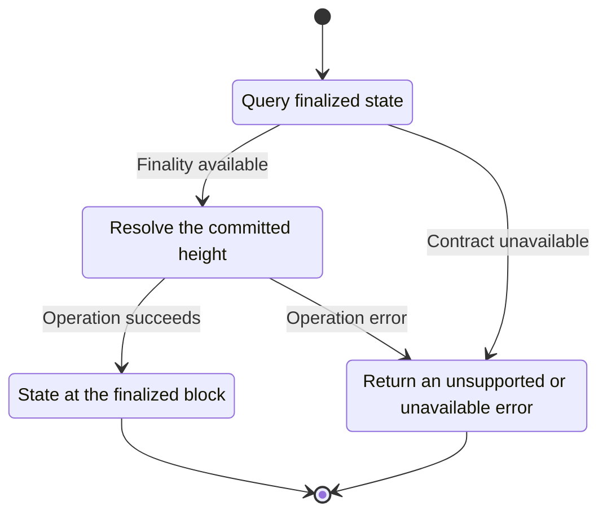
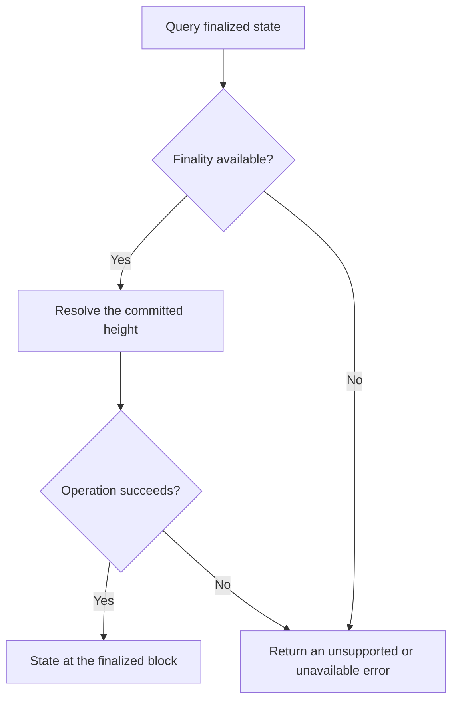

<!-- xone-gap-audit:2026-11-14:pass4:finality-tags -->
> GAP-0060 · P1 · source review at `330b742bfa1ef1401c1b9b9be0cf0bd344255cca`. Static evidence; no deployed-node reproduction or benchmark is claimed.

## What

`parse_tag` maps latest, pending, safe and finalized to the same head. The production ChainApi already exposes the QC-committed height through finalized(), but selector parsing does not use it. A request for finalized can therefore select a later, uncommitted block.

Current implementation:

- [`crates/xone-rpc/src/types.rs`](https://github.com/XDCIndia/xOneRS/blob/330b742bfa1ef1401c1b9b9be0cf0bd344255cca/crates/xone-rpc/src/types.rs)
- [`crates/xone-rpc/src/eth.rs`](https://github.com/XDCIndia/xOneRS/blob/330b742bfa1ef1401c1b9b9be0cf0bd344255cca/crates/xone-rpc/src/eth.rs)
- [`crates/xone-rpc/src/api.rs`](https://github.com/XDCIndia/xOneRS/blob/330b742bfa1ef1401c1b9b9be0cf0bd344255cca/crates/xone-rpc/src/api.rs)
- [`crates/xone-node/src/services/rpc.rs`](https://github.com/XDCIndia/xOneRS/blob/330b742bfa1ef1401c1b9b9be0cf0bd344255cca/crates/xone-node/src/services/rpc.rs)

## Why

Consumers use finality tags to decide whether a result can still change. Returning the current head overstates finality.

Verified competitor implementation references:

- [XinFinOrg/XDPoSChain: `eth/api_backend.go`](https://github.com/XinFinOrg/XDPoSChain/blob/cb1ef79073c05f50b9df75b1e740387b9d72af99/eth/api_backend.go)
- [ethereum/go-ethereum: `eth/api_backend.go`](https://github.com/ethereum/go-ethereum/blob/8059ff8beb3170eb8b977169ac51bb0423c97ee1/eth/api_backend.go)
- [paradigmxyz/reth: `crates/storage/storage-api/src/block_id.rs`](https://github.com/paradigmxyz/reth/blob/36600d5ff9628465475dd4c7608e2e9f2fe24273/crates/storage/storage-api/src/block_id.rs)

#42 owns general RPC parity; #33 owns fork choice. Neither records this selector defect.

## 80% of the way to

1. Preserve block tags until the chain-aware resolver can distinguish latest from committed finality. Use one coherent chain view for resolution and reads.
2. Resolve finalized using the committed XDPoS V2 block. Define the V1 and no-commit errors from pinned geth-XDC vectors. Never substitute head when finality is unavailable.
3. Pin safe behavior to the XDC oracle. XDPoSChain does not expose Ethereum safe-head semantics; reject unsupported tags rather than inventing consensus rules.
4. Use the resolver for block, state, log-range and fee-history queries. Preserve existing XDC pending behavior; pending is intentionally mapped to latest in the public reference.

Acceptance criteria:

- [ ] With head 105 and committed block 102, finalized resolves to 102 across affected methods.
- [ ] V1, absent commit, restart and a reorg above the committed floor have explicit vectors.
- [ ] The fix changes RPC selection only; it does not change fork choice or the committed floor.

## ASD-STE100

1. Resolve the committed height.
2. Keep the existing XDC consensus rules unchanged.
3. Check all required input before you start the operation.
4. Keep memory use within the configured limits.
5. Return an unsupported or unavailable error.
6. Test each acceptance case through the actual entry point.

Technical names follow the repository vocabulary. These short instructions follow the requested sentence limits; certified ASD-STE100 vocabulary compliance has not been assessed.

## Diagrams

```mermaid
sequenceDiagram
    participant Actor as RPC caller
    participant Service as Block resolver
    participant Data as Committed chain view
    Actor->>Service: Query finalized state
    Service->>Data: Check required state and limits
    Data-->>Service: State and validation result
    alt Finality available
        Service->>Data: Resolve the committed height
        Data-->>Service: Result or operation error
        Service-->>Actor: State at the finalized block
    else Contract cannot be met
        Service-->>Actor: Return an unsupported or unavailable error
    end
```

## Images

N/A. This change affects node behavior. The source links and test fixtures provide the evidence.

## Prompt

```text
Implement GAP-0060 in XDCIndia/xOneRS: Resolve finalized block queries from the committed XDPoS head.
Observed at 330b742bfa1ef1401c1b9b9be0cf0bd344255cca: `parse_tag` maps latest, pending, safe and finalized to the same head. The production ChainApi already exposes the QC-committed height through finalized(), but selector parsing does not use it. A request for finalized can therefore select a later, uncommitted block.
Read these target files: crates/xone-rpc/src/types.rs, crates/xone-rpc/src/eth.rs, crates/xone-rpc/src/api.rs, crates/xone-node/src/services/rpc.rs.
Implementation: Preserve block tags until the chain-aware resolver can distinguish latest from committed finality. Use one coherent chain view for resolution and reads. Resolve finalized using the committed XDPoS V2 block. Define the V1 and no-commit errors from pinned geth-XDC vectors. Never substitute head when finality is unavailable. Pin safe behavior to the XDC oracle. XDPoSChain does not expose Ethereum safe-head semantics; reject unsupported tags rather than inventing consensus rules. Use the resolver for block, state, log-range and fee-history queries. Preserve existing XDC pending behavior; pending is intentionally mapped to latest in the public reference.
Acceptance: With head 105 and committed block 102, finalized resolves to 102 across affected methods. V1, absent commit, restart and a reorg above the committed floor have explicit vectors. The fix changes RPC selection only; it does not change fork choice or the committed floor.
Related ownership: #42 owns general RPC parity; #33 owns fork choice. Neither records this selector defect.
Re-pin current main and the authoritative geth-XDC oracle before editing. Preserve XDC consensus, signatures, encodings, storage publication and configured resource bounds. Use the linked competitor code as design evidence, respecting its license. Write focused failing fixtures, implement the smallest coherent change, and run the applicable repository checks. Report exact commands and results. Open a reviewable PR; do not claim completion from a registered method or a mock-only test.
```

## Workflow

1. **RPC caller:** Query finalized state.
2. **Block resolver:** Check whether finality available.
3. **Block resolver:** Resolve the committed height through committed chain view.
4. **Block resolver:** On success, provide state at the finalized block.
5. **Block resolver:** On refusal or failure, return an unsupported or unavailable error.

The acceptance cases above define the exact errors, ordering and resource boundaries. Verify the real entry point before closing the issue.

## Loop

None. Run the operation only when requested.

## Graph

Lifecycle of this block resolver operation; this diagram does not change the blockchain consensus state machine.



## Layout

This capability uses a node, command-line, or build interface. It does not require a new graphical screen.

| Interface detail | Placement |
| --- | --- |
| Actor and trigger | RPC caller: query finalized state |
| Input validation | Block resolver: finality available |
| Output | State at the finalized block |
| Error or refusal | Return an unsupported or unavailable error |
| Implementation files | `crates/xone-rpc/src/types.rs`, `crates/xone-rpc/src/eth.rs`, `crates/xone-rpc/src/api.rs`, `crates/xone-node/src/services/rpc.rs` |

Keep field names and response shapes compatible with the specification and acceptance cases above.

## Flow



## Summary

Gap: Resolve finalized block queries from the committed XDPoS head.
Fix: Preserve block tags until the chain-aware resolver can distinguish latest from committed finality. Use one coherent chain view for resolution and reads.
Acceptance: With head 105 and committed block 102, finalized resolves to 102 across affected methods.
