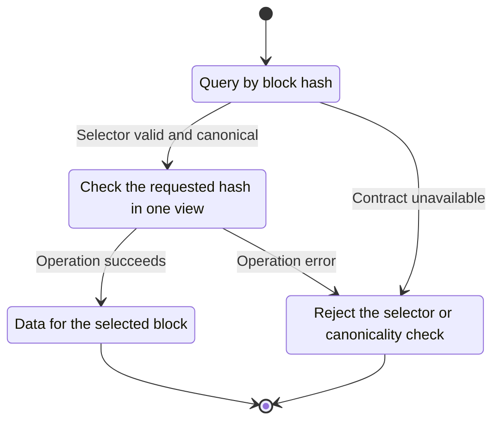
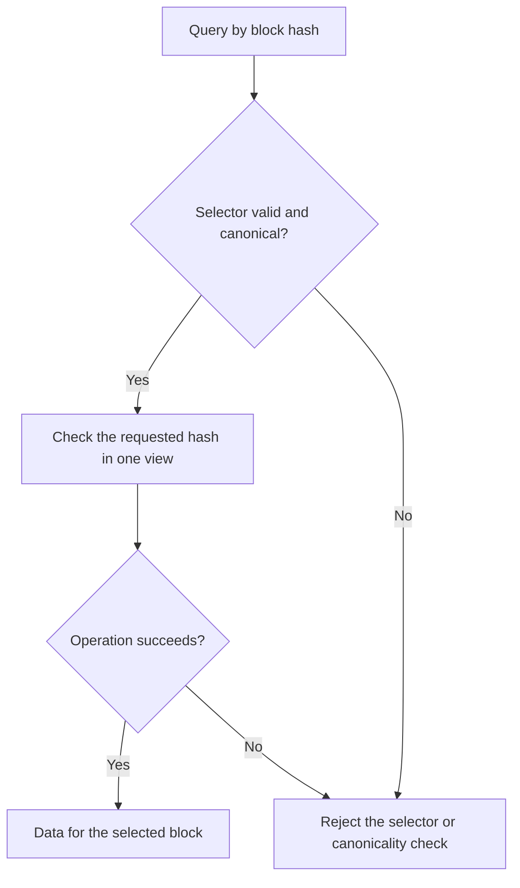

<!-- xone-gap-audit:2026-11-14:pass4:canonical-selectors -->
> GAP-0061 · P1 · source review at `330b742bfa1ef1401c1b9b9be0cf0bd344255cca`. Static evidence; no deployed-node reproduction or benchmark is claimed.

## What

`BlockRef::Hash` contains no requireCanonical flag. The object parser accepts blockHash with blockNumber and selects the hash. `state_at` resolves the stored hash without checking whether it is canonical.

Current implementation:

- [`crates/xone-rpc/src/types.rs`](https://github.com/XDCIndia/xOneRS/blob/330b742bfa1ef1401c1b9b9be0cf0bd344255cca/crates/xone-rpc/src/types.rs)
- [`crates/xone-rpc/src/eth.rs`](https://github.com/XDCIndia/xOneRS/blob/330b742bfa1ef1401c1b9b9be0cf0bd344255cca/crates/xone-rpc/src/eth.rs)

## Why

Wallets and indexers use requireCanonical to avoid combining canonical metadata with state from an orphaned block.

Verified competitor implementation references:

- [XinFinOrg/XDPoSChain: `rpc/types.go`](https://github.com/XinFinOrg/XDPoSChain/blob/cb1ef79073c05f50b9df75b1e740387b9d72af99/rpc/types.go)
- [XinFinOrg/XDPoSChain: `eth/api_backend.go`](https://github.com/XinFinOrg/XDPoSChain/blob/cb1ef79073c05f50b9df75b1e740387b9d72af99/eth/api_backend.go)
- [ethereum/go-ethereum: `eth/api_backend.go`](https://github.com/ethereum/go-ethereum/blob/8059ff8beb3170eb8b977169ac51bb0423c97ee1/eth/api_backend.go)
- [paradigmxyz/reth: `crates/storage/provider/src/providers/consistent.rs`](https://github.com/paradigmxyz/reth/blob/36600d5ff9628465475dd4c7608e2e9f2fe24273/crates/storage/provider/src/providers/consistent.rs)

#100 pins state during reads; this adds selector validation and canonicality, not another state-pinning implementation.

## 80% of the way to

1. Represent the optional canonicality requirement in the typed selector and reject mutually exclusive or mistyped fields.
2. Check the requested hash against the canonical hash at its height when requireCanonical is true. Hold the same read view through the query.
3. Keep allowed side-branch queries and typed unsupported-history errors when canonicality is not required. Match the pinned oracle error contract.

Acceptance criteria:

- [ ] A retained side-branch hash with requireCanonical=true is rejected.
- [ ] Both selector fields, invalid boolean values and invalid hash/quantity encodings are rejected.
- [ ] A concurrent reorg cannot change the canonicality decision between validation and the state read.

## ASD-STE100

1. Check the requested hash in one view.
2. Keep the existing XDC consensus rules unchanged.
3. Check all required input before you start the operation.
4. Keep memory use within the configured limits.
5. Reject the selector or canonicality check.
6. Test each acceptance case through the actual entry point.

Technical names follow the repository vocabulary. These short instructions follow the requested sentence limits; certified ASD-STE100 vocabulary compliance has not been assessed.

## Diagrams

```mermaid
sequenceDiagram
    participant Actor as RPC caller
    participant Service as Block resolver
    participant Data as Canonical index
    Actor->>Service: Query by block hash
    Service->>Data: Check required state and limits
    Data-->>Service: State and validation result
    alt Selector valid and canonical
        Service->>Data: Check the requested hash in one view
        Data-->>Service: Result or operation error
        Service-->>Actor: Data for the selected block
    else Contract cannot be met
        Service-->>Actor: Reject the selector or canonicality check
    end
```

## Images

N/A. This change affects node behavior. The source links and test fixtures provide the evidence.

## Prompt

```text
Implement GAP-0061 in XDCIndia/xOneRS: Honor requireCanonical and validate EIP-1898 block selectors.
Observed at 330b742bfa1ef1401c1b9b9be0cf0bd344255cca: `BlockRef::Hash` contains no requireCanonical flag. The object parser accepts blockHash with blockNumber and selects the hash. `state_at` resolves the stored hash without checking whether it is canonical.
Read these target files: crates/xone-rpc/src/types.rs, crates/xone-rpc/src/eth.rs.
Implementation: Represent the optional canonicality requirement in the typed selector and reject mutually exclusive or mistyped fields. Check the requested hash against the canonical hash at its height when requireCanonical is true. Hold the same read view through the query. Keep allowed side-branch queries and typed unsupported-history errors when canonicality is not required. Match the pinned oracle error contract.
Acceptance: A retained side-branch hash with requireCanonical=true is rejected. Both selector fields, invalid boolean values and invalid hash/quantity encodings are rejected. A concurrent reorg cannot change the canonicality decision between validation and the state read.
Related ownership: #100 pins state during reads; this adds selector validation and canonicality, not another state-pinning implementation.
Re-pin current main and the authoritative geth-XDC oracle before editing. Preserve XDC consensus, signatures, encodings, storage publication and configured resource bounds. Use the linked competitor code as design evidence, respecting its license. Write focused failing fixtures, implement the smallest coherent change, and run the applicable repository checks. Report exact commands and results. Open a reviewable PR; do not claim completion from a registered method or a mock-only test.
```

## Workflow

1. **RPC caller:** Query by block hash.
2. **Block resolver:** Check whether selector valid and canonical.
3. **Block resolver:** Check the requested hash in one view through canonical index.
4. **Block resolver:** On success, provide data for the selected block.
5. **Block resolver:** On refusal or failure, reject the selector or canonicality check.

The acceptance cases above define the exact errors, ordering and resource boundaries. Verify the real entry point before closing the issue.

## Loop

None. Run the operation only when requested.

## Graph

Lifecycle of this block resolver operation; this diagram does not change the blockchain consensus state machine.



## Layout

This capability uses a node, command-line, or build interface. It does not require a new graphical screen.

| Interface detail | Placement |
| --- | --- |
| Actor and trigger | RPC caller: query by block hash |
| Input validation | Block resolver: selector valid and canonical |
| Output | Data for the selected block |
| Error or refusal | Reject the selector or canonicality check |
| Implementation files | `crates/xone-rpc/src/types.rs`, `crates/xone-rpc/src/eth.rs` |

Keep field names and response shapes compatible with the specification and acceptance cases above.

## Flow



## Summary

Gap: Honor requireCanonical and validate EIP-1898 block selectors.
Fix: Represent the optional canonicality requirement in the typed selector and reject mutually exclusive or mistyped fields.
Acceptance: A retained side-branch hash with requireCanonical=true is rejected.
