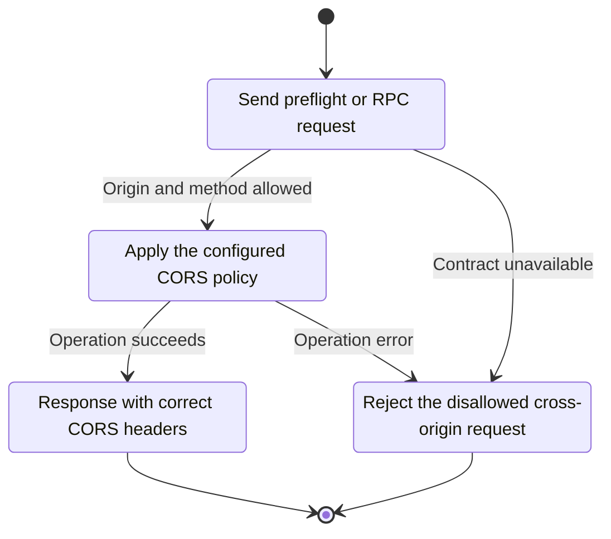
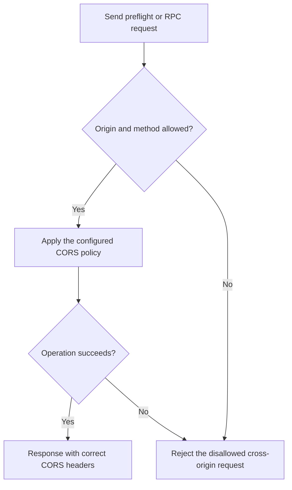

<!-- xone-gap-audit:2026-11-14:pass4:http-cors -->
> GAP-0062 · P2 · source review at `330b742bfa1ef1401c1b9b9be0cf0bd344255cca`. Static evidence; no deployed-node reproduction or benchmark is claimed.

## What

`http.corsdomain` populates Config.http.cors, but the HTTP service constructs an empty origins policy and never consumes that list. `http_handle` rejects every non-POST request, including OPTIONS, and emits no CORS headers.

Current implementation:

- [`bin/xone/src/flags.rs`](https://github.com/XDCIndia/xOneRS/blob/330b742bfa1ef1401c1b9b9be0cf0bd344255cca/bin/xone/src/flags.rs)
- [`crates/xone-node/src/config.rs`](https://github.com/XDCIndia/xOneRS/blob/330b742bfa1ef1401c1b9b9be0cf0bd344255cca/crates/xone-node/src/config.rs)
- [`crates/xone-node/src/services/rpc.rs`](https://github.com/XDCIndia/xOneRS/blob/330b742bfa1ef1401c1b9b9be0cf0bd344255cca/crates/xone-node/src/services/rpc.rs)
- [`crates/xone-rpc/src/transport.rs`](https://github.com/XDCIndia/xOneRS/blob/330b742bfa1ef1401c1b9b9be0cf0bd344255cca/crates/xone-rpc/src/transport.rs)

## Why

A browser application cannot use the configured RPC endpoint even when its origin is explicitly allowed.

Verified competitor implementation references:

- [ethereum/go-ethereum: `node/rpcstack.go`](https://github.com/ethereum/go-ethereum/blob/8059ff8beb3170eb8b977169ac51bb0423c97ee1/node/rpcstack.go)
- [paradigmxyz/reth: `crates/rpc/rpc-builder/src/cors.rs`](https://github.com/paradigmxyz/reth/blob/36600d5ff9628465475dd4c7608e2e9f2fe24273/crates/rpc/rpc-builder/src/cors.rs)
- [besu-eth/besu: `ethereum/api/src/main/java/org/hyperledger/besu/ethereum/api/jsonrpc/JsonRpcHttpService.java`](https://github.com/besu-eth/besu/blob/2b839d96863d01210f45a6f62127e6229e5b0889/ethereum/api/src/main/java/org/hyperledger/besu/ethereum/api/jsonrpc/JsonRpcHttpService.java)

#60 owns transport authorization and #171 owns RPC limits. This issue fixes the existing CORS flag that is not wired to HTTP.

## 80% of the way to

1. Carry the HTTP CORS policy separately from WebSocket Origin validation.
2. Handle bounded OPTIONS preflight and emit matching Access-Control-Allow-* and Vary headers on permitted responses.
3. Keep the empty default disabled. Specify wildcard, null-origin and credential behavior explicitly. Apply Host checks, namespace policy and authentication independently.

Acceptance criteria:

- [ ] A browser-origin POST and its preflight succeed only for configured origins.
- [ ] Denied origins receive no permission headers. Vary: Origin prevents cross-origin cache reuse.
- [ ] Preflight does not execute an RPC method or expose a disabled namespace.

## ASD-STE100

1. Apply the configured CORS policy.
2. Keep the existing XDC consensus rules unchanged.
3. Check all required input before you start the operation.
4. Keep memory use within the configured limits.
5. Reject the disallowed cross-origin request.
6. Test each acceptance case through the actual entry point.

Technical names follow the repository vocabulary. These short instructions follow the requested sentence limits; certified ASD-STE100 vocabulary compliance has not been assessed.

## Diagrams

```mermaid
sequenceDiagram
    participant Actor as Browser
    participant Service as HTTP listener
    participant Data as Origin policy
    Actor->>Service: Send preflight or RPC request
    Service->>Data: Check required state and limits
    Data-->>Service: State and validation result
    alt Origin and method allowed
        Service->>Data: Apply the configured CORS policy
        Data-->>Service: Result or operation error
        Service-->>Actor: Response with correct CORS headers
    else Contract cannot be met
        Service-->>Actor: Reject the disallowed cross-origin request
    end
```

## Images

N/A. This change affects node behavior. The source links and test fixtures provide the evidence.

## Prompt

```text
Implement GAP-0062 in XDCIndia/xOneRS: Wire http.corsdomain through HTTP preflight and response headers.
Observed at 330b742bfa1ef1401c1b9b9be0cf0bd344255cca: `http.corsdomain` populates Config.http.cors, but the HTTP service constructs an empty origins policy and never consumes that list. `http_handle` rejects every non-POST request, including OPTIONS, and emits no CORS headers.
Read these target files: bin/xone/src/flags.rs, crates/xone-node/src/config.rs, crates/xone-node/src/services/rpc.rs, crates/xone-rpc/src/transport.rs.
Implementation: Carry the HTTP CORS policy separately from WebSocket Origin validation. Handle bounded OPTIONS preflight and emit matching Access-Control-Allow-* and Vary headers on permitted responses. Keep the empty default disabled. Specify wildcard, null-origin and credential behavior explicitly. Apply Host checks, namespace policy and authentication independently.
Acceptance: A browser-origin POST and its preflight succeed only for configured origins. Denied origins receive no permission headers. Vary: Origin prevents cross-origin cache reuse. Preflight does not execute an RPC method or expose a disabled namespace.
Related ownership: #60 owns transport authorization and #171 owns RPC limits. This issue fixes the existing CORS flag that is not wired to HTTP.
Re-pin current main and the authoritative geth-XDC oracle before editing. Preserve XDC consensus, signatures, encodings, storage publication and configured resource bounds. Use the linked competitor code as design evidence, respecting its license. Write focused failing fixtures, implement the smallest coherent change, and run the applicable repository checks. Report exact commands and results. Open a reviewable PR; do not claim completion from a registered method or a mock-only test.
```

## Workflow

1. **Browser:** Send preflight or RPC request.
2. **HTTP listener:** Check whether origin and method allowed.
3. **HTTP listener:** Apply the configured CORS policy through origin policy.
4. **HTTP listener:** On success, provide response with correct cors headers.
5. **HTTP listener:** On refusal or failure, reject the disallowed cross-origin request.

The acceptance cases above define the exact errors, ordering and resource boundaries. Verify the real entry point before closing the issue.

## Loop

None. Run the operation only when requested.

## Graph

Lifecycle of this http listener operation; this diagram does not change the blockchain consensus state machine.



## Layout

This capability uses a node, command-line, or build interface. It does not require a new graphical screen.

| Interface detail | Placement |
| --- | --- |
| Actor and trigger | Browser: send preflight or rpc request |
| Input validation | HTTP listener: origin and method allowed |
| Output | Response with correct CORS headers |
| Error or refusal | Reject the disallowed cross-origin request |
| Implementation files | `bin/xone/src/flags.rs`, `crates/xone-node/src/config.rs`, `crates/xone-node/src/services/rpc.rs`, `crates/xone-rpc/src/transport.rs` |

Keep field names and response shapes compatible with the specification and acceptance cases above.

## Flow



## Summary

Gap: Wire http.corsdomain through HTTP preflight and response headers.
Fix: Carry the HTTP CORS policy separately from WebSocket Origin validation.
Acceptance: A browser-origin POST and its preflight succeed only for configured origins.
