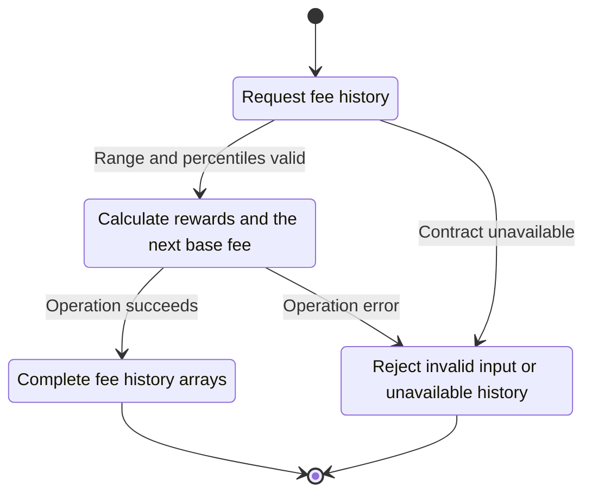
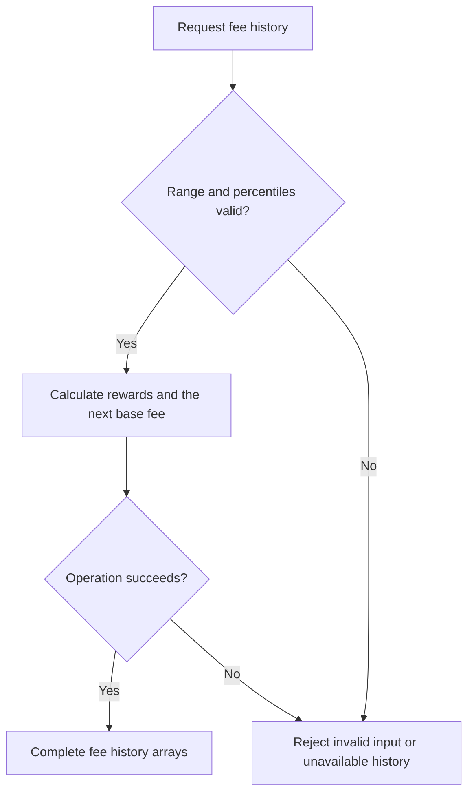

<!-- xone-gap-audit:2026-11-14:pass4:fee-history -->
> GAP-0063 · P1 · source review at `330b742bfa1ef1401c1b9b9be0cf0bd344255cca`. Static evidence; no deployed-node reproduction or benchmark is claimed.

## What

`fee_history` silently drops fractional percentiles, does not validate their order or range, converts zero count to one, narrows gas values through u32, and repeats the last base fee instead of evaluating the next block fee rule. Missing receipts become an empty vector.

Current implementation:

- [`crates/xone-rpc/src/eth.rs`](https://github.com/XDCIndia/xOneRS/blob/330b742bfa1ef1401c1b9b9be0cf0bd344255cca/crates/xone-rpc/src/eth.rs)
- [`spec/rpc/scope-adr-008.md`](https://github.com/XDCIndia/xOneRS/blob/330b742bfa1ef1401c1b9b9be0cf0bd344255cca/spec/rpc/scope-adr-008.md)
- [`crates/xone-evm/src/fees.rs`](https://github.com/XDCIndia/xOneRS/blob/330b742bfa1ef1401c1b9b9be0cf0bd344255cca/crates/xone-evm/src/fees.rs)

## Why

Fee estimators need valid percentile rewards and the next block fee. Silent input changes can produce plausible but incorrect pricing.

Verified competitor implementation references:

- [XinFinOrg/XDPoSChain: `eth/gasprice/feehistory.go`](https://github.com/XinFinOrg/XDPoSChain/blob/cb1ef79073c05f50b9df75b1e740387b9d72af99/eth/gasprice/feehistory.go)
- [ethereum/go-ethereum: `eth/gasprice/feehistory.go`](https://github.com/ethereum/go-ethereum/blob/8059ff8beb3170eb8b977169ac51bb0423c97ee1/eth/gasprice/feehistory.go)
- [paradigmxyz/reth: `crates/rpc/rpc-eth-api/src/helpers/fee.rs`](https://github.com/paradigmxyz/reth/blob/36600d5ff9628465475dd4c7608e2e9f2fe24273/crates/rpc/rpc-eth-api/src/helpers/fee.rs)

#42 is the parent RPC scope; this issue replaces explicit shortcuts in the current feeHistory implementation.

## 80% of the way to

1. Parse and validate numeric percentiles without silently discarding values. Pin ordering, count and error behavior to geth-XDC.
2. Evaluate the child-height XDC fee rule for the final baseFeePerGas entry. Do not import Ethereum market fees into an XDC chain.
3. Compute ratios from the full gas values and return a typed history/storage error when required receipts are unavailable.
4. Replace the documented integer-only and repeated-fee shortcuts with the implemented contract.

Acceptance criteria:

- [ ] Vectors cover fractional, descending, repeated, negative and above-100 percentiles, plus zero count.
- [ ] A range ending immediately before an XDC fee-rule change returns the correct next fee.
- [ ] Large gas fields retain correct ratios; missing receipts cannot produce invented reward percentiles.

## ASD-STE100

1. Calculate rewards and the next base fee.
2. Keep the existing XDC consensus rules unchanged.
3. Check all required input before you start the operation.
4. Keep memory use within the configured limits.
5. Reject invalid input or unavailable history.
6. Test each acceptance case through the actual entry point.

Technical names follow the repository vocabulary. These short instructions follow the requested sentence limits; certified ASD-STE100 vocabulary compliance has not been assessed.

## Diagrams

```mermaid
sequenceDiagram
    participant Actor as RPC caller
    participant Service as Fee history handler
    participant Data as Headers and receipts
    Actor->>Service: Request fee history
    Service->>Data: Check required state and limits
    Data-->>Service: State and validation result
    alt Range and percentiles valid
        Service->>Data: Calculate rewards and the next base fee
        Data-->>Service: Result or operation error
        Service-->>Actor: Complete fee history arrays
    else Contract cannot be met
        Service-->>Actor: Reject invalid input or unavailable history
    end
```

## Images

N/A. This change affects node behavior. The source links and test fixtures provide the evidence.

## Prompt

```text
Implement GAP-0063 in XDCIndia/xOneRS: Complete eth_feeHistory percentile and next-block fee semantics.
Observed at 330b742bfa1ef1401c1b9b9be0cf0bd344255cca: `fee_history` silently drops fractional percentiles, does not validate their order or range, converts zero count to one, narrows gas values through u32, and repeats the last base fee instead of evaluating the next block fee rule. Missing receipts become an empty vector.
Read these target files: crates/xone-rpc/src/eth.rs, spec/rpc/scope-adr-008.md, crates/xone-evm/src/fees.rs.
Implementation: Parse and validate numeric percentiles without silently discarding values. Pin ordering, count and error behavior to geth-XDC. Evaluate the child-height XDC fee rule for the final baseFeePerGas entry. Do not import Ethereum market fees into an XDC chain. Compute ratios from the full gas values and return a typed history/storage error when required receipts are unavailable. Replace the documented integer-only and repeated-fee shortcuts with the implemented contract.
Acceptance: Vectors cover fractional, descending, repeated, negative and above-100 percentiles, plus zero count. A range ending immediately before an XDC fee-rule change returns the correct next fee. Large gas fields retain correct ratios; missing receipts cannot produce invented reward percentiles.
Related ownership: #42 is the parent RPC scope; this issue replaces explicit shortcuts in the current feeHistory implementation.
Re-pin current main and the authoritative geth-XDC oracle before editing. Preserve XDC consensus, signatures, encodings, storage publication and configured resource bounds. Use the linked competitor code as design evidence, respecting its license. Write focused failing fixtures, implement the smallest coherent change, and run the applicable repository checks. Report exact commands and results. Open a reviewable PR; do not claim completion from a registered method or a mock-only test.
```

## Workflow

1. **RPC caller:** Request fee history.
2. **Fee history handler:** Check whether range and percentiles valid.
3. **Fee history handler:** Calculate rewards and the next base fee through headers and receipts.
4. **Fee history handler:** On success, provide complete fee history arrays.
5. **Fee history handler:** On refusal or failure, reject invalid input or unavailable history.

The acceptance cases above define the exact errors, ordering and resource boundaries. Verify the real entry point before closing the issue.

## Loop

None. Run the operation only when requested.

## Graph

Lifecycle of this fee history handler operation; this diagram does not change the blockchain consensus state machine.



## Layout

This capability uses a node, command-line, or build interface. It does not require a new graphical screen.

| Interface detail | Placement |
| --- | --- |
| Actor and trigger | RPC caller: request fee history |
| Input validation | Fee history handler: range and percentiles valid |
| Output | Complete fee history arrays |
| Error or refusal | Reject invalid input or unavailable history |
| Implementation files | `crates/xone-rpc/src/eth.rs`, `spec/rpc/scope-adr-008.md`, `crates/xone-evm/src/fees.rs` |

Keep field names and response shapes compatible with the specification and acceptance cases above.

## Flow



## Summary

Gap: Complete eth_feeHistory percentile and next-block fee semantics.
Fix: Parse and validate numeric percentiles without silently discarding values. Pin ordering, count and error behavior to geth-XDC.
Acceptance: Vectors cover fractional, descending, repeated, negative and above-100 percentiles, plus zero count.
