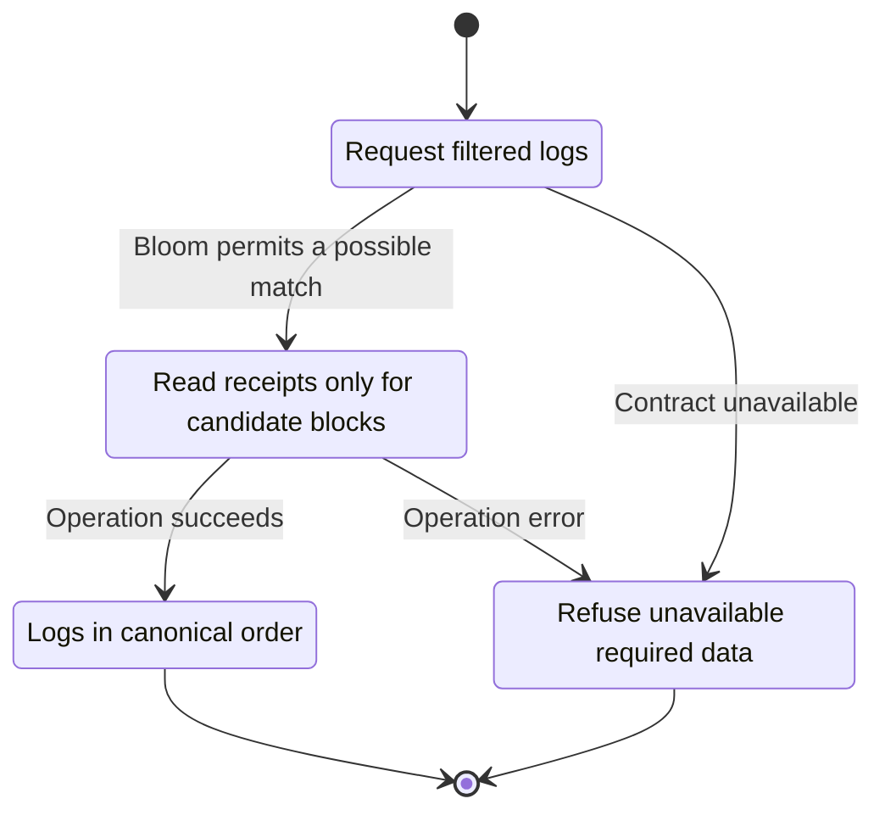
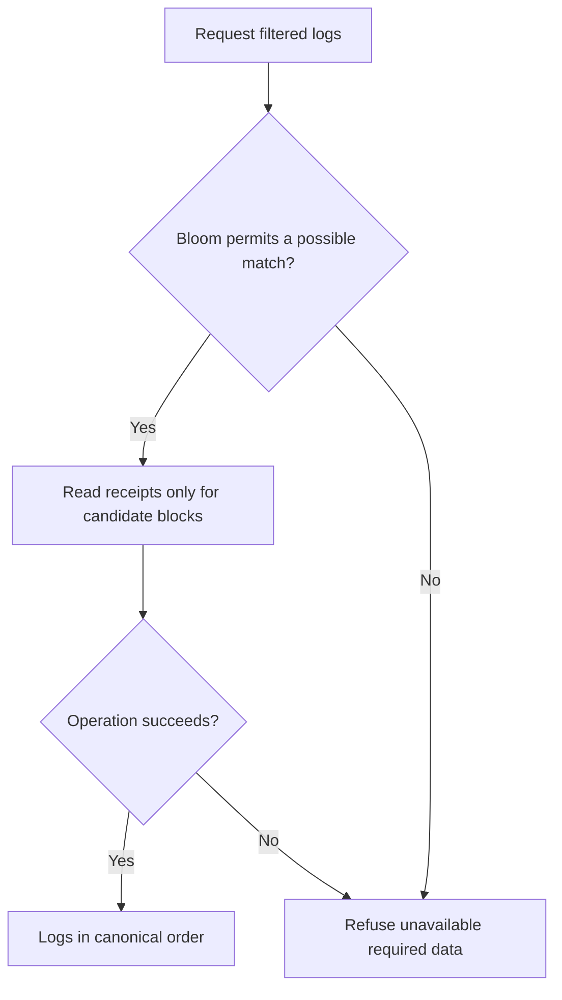

<!-- xone-gap-audit:2026-11-14:pass4:log-bloom -->
> GAP-0064 · P2 · source review at `330b742bfa1ef1401c1b9b9be0cf0bd344255cca`. Static evidence; no deployed-node reproduction or benchmark is claimed.

## What

`get_logs` loads each selected block and its receipts before matching addresses and topics. The block header bloom is available but is not used to reject impossible matches.

Current implementation:

- [`crates/xone-rpc/src/eth.rs`](https://github.com/XDCIndia/xOneRS/blob/330b742bfa1ef1401c1b9b9be0cf0bd344255cca/crates/xone-rpc/src/eth.rs)
- [`crates/xone-rpc/src/subscriptions.rs`](https://github.com/XDCIndia/xOneRS/blob/330b742bfa1ef1401c1b9b9be0cf0bd344255cca/crates/xone-rpc/src/subscriptions.rs)
- [`crates/xone-rpc/src/api.rs`](https://github.com/XDCIndia/xOneRS/blob/330b742bfa1ef1401c1b9b9be0cf0bd344255cca/crates/xone-rpc/src/api.rs)

## Why

Sparse explorer queries currently pay receipt IO and decoding cost for every block in the requested range.

Verified competitor implementation references:

- [XinFinOrg/XDPoSChain: `eth/filters/filter.go`](https://github.com/XinFinOrg/XDPoSChain/blob/cb1ef79073c05f50b9df75b1e740387b9d72af99/eth/filters/filter.go)
- [ethereum/go-ethereum: `eth/filters/filter.go`](https://github.com/ethereum/go-ethereum/blob/8059ff8beb3170eb8b977169ac51bb0423c97ee1/eth/filters/filter.go)
- [paradigmxyz/reth: `crates/rpc/rpc/src/eth/filter.rs`](https://github.com/paradigmxyz/reth/blob/36600d5ff9628465475dd4c7608e2e9f2fe24273/crates/rpc/rpc/src/eth/filter.rs)

#99 fixed range overflow; #153 adds polling filters. Neither adds bloom pruning to this existing method.

## 80% of the way to

1. Add a header-bloom negative test for the same address/topic expression used by the exact filter.
2. Fetch and decode receipts only for possible matches. Keep exact matching because bloom positives are not proof.
3. Preserve retention checks, cancellation, canonical order, result limits and blockHash semantics. No new persistent index is required for this unit.

Acceptance criteria:

- [ ] Differential fixtures return identical ordered logs with pruning enabled and disabled.
- [ ] A sparse filter demonstrably performs fewer receipt reads using an instrumented backend.
- [ ] Wildcard, OR-topic, empty-filter and bloom false-positive cases remain correct.

## ASD-STE100

1. Read receipts only for candidate blocks.
2. Keep the existing XDC consensus rules unchanged.
3. Check all required input before you start the operation.
4. Keep memory use within the configured limits.
5. Refuse unavailable required data.
6. Test each acceptance case through the actual entry point.

Technical names follow the repository vocabulary. These short instructions follow the requested sentence limits; certified ASD-STE100 vocabulary compliance has not been assessed.

## Diagrams

```mermaid
sequenceDiagram
    participant Actor as RPC caller
    participant Service as Log scanner
    participant Data as Headers and receipts
    Actor->>Service: Request filtered logs
    Service->>Data: Check required state and limits
    Data-->>Service: State and validation result
    alt Bloom permits a possible match
        Service->>Data: Read receipts only for candidate blocks
        Data-->>Service: Result or operation error
        Service-->>Actor: Logs in canonical order
    else Contract cannot be met
        Service-->>Actor: Refuse unavailable required data
    end
```

## Images

N/A. This change affects node behavior. The source links and test fixtures provide the evidence.

## Prompt

```text
Implement GAP-0064 in XDCIndia/xOneRS: Skip receipt reads when header blooms exclude an eth_getLogs match.
Observed at 330b742bfa1ef1401c1b9b9be0cf0bd344255cca: `get_logs` loads each selected block and its receipts before matching addresses and topics. The block header bloom is available but is not used to reject impossible matches.
Read these target files: crates/xone-rpc/src/eth.rs, crates/xone-rpc/src/subscriptions.rs, crates/xone-rpc/src/api.rs.
Implementation: Add a header-bloom negative test for the same address/topic expression used by the exact filter. Fetch and decode receipts only for possible matches. Keep exact matching because bloom positives are not proof. Preserve retention checks, cancellation, canonical order, result limits and blockHash semantics. No new persistent index is required for this unit.
Acceptance: Differential fixtures return identical ordered logs with pruning enabled and disabled. A sparse filter demonstrably performs fewer receipt reads using an instrumented backend. Wildcard, OR-topic, empty-filter and bloom false-positive cases remain correct.
Related ownership: #99 fixed range overflow; #153 adds polling filters. Neither adds bloom pruning to this existing method.
Re-pin current main and the authoritative geth-XDC oracle before editing. Preserve XDC consensus, signatures, encodings, storage publication and configured resource bounds. Use the linked competitor code as design evidence, respecting its license. Write focused failing fixtures, implement the smallest coherent change, and run the applicable repository checks. Report exact commands and results. Open a reviewable PR; do not claim completion from a registered method or a mock-only test.
```

## Workflow

1. **RPC caller:** Request filtered logs.
2. **Log scanner:** Check whether bloom permits a possible match.
3. **Log scanner:** Read receipts only for candidate blocks through headers and receipts.
4. **Log scanner:** On success, provide logs in canonical order.
5. **Log scanner:** On refusal or failure, refuse unavailable required data.

The acceptance cases above define the exact errors, ordering and resource boundaries. Verify the real entry point before closing the issue.

## Loop

None. Run the operation only when requested.

## Graph

Lifecycle of this log scanner operation; this diagram does not change the blockchain consensus state machine.



## Layout

This capability uses a node, command-line, or build interface. It does not require a new graphical screen.

| Interface detail | Placement |
| --- | --- |
| Actor and trigger | RPC caller: request filtered logs |
| Input validation | Log scanner: bloom permits a possible match |
| Output | Logs in canonical order |
| Error or refusal | Refuse unavailable required data |
| Implementation files | `crates/xone-rpc/src/eth.rs`, `crates/xone-rpc/src/subscriptions.rs`, `crates/xone-rpc/src/api.rs` |

Keep field names and response shapes compatible with the specification and acceptance cases above.

## Flow



## Summary

Gap: Skip receipt reads when header blooms exclude an eth_getLogs match.
Fix: Add a header-bloom negative test for the same address/topic expression used by the exact filter.
Acceptance: Differential fixtures return identical ordered logs with pruning enabled and disabled.
