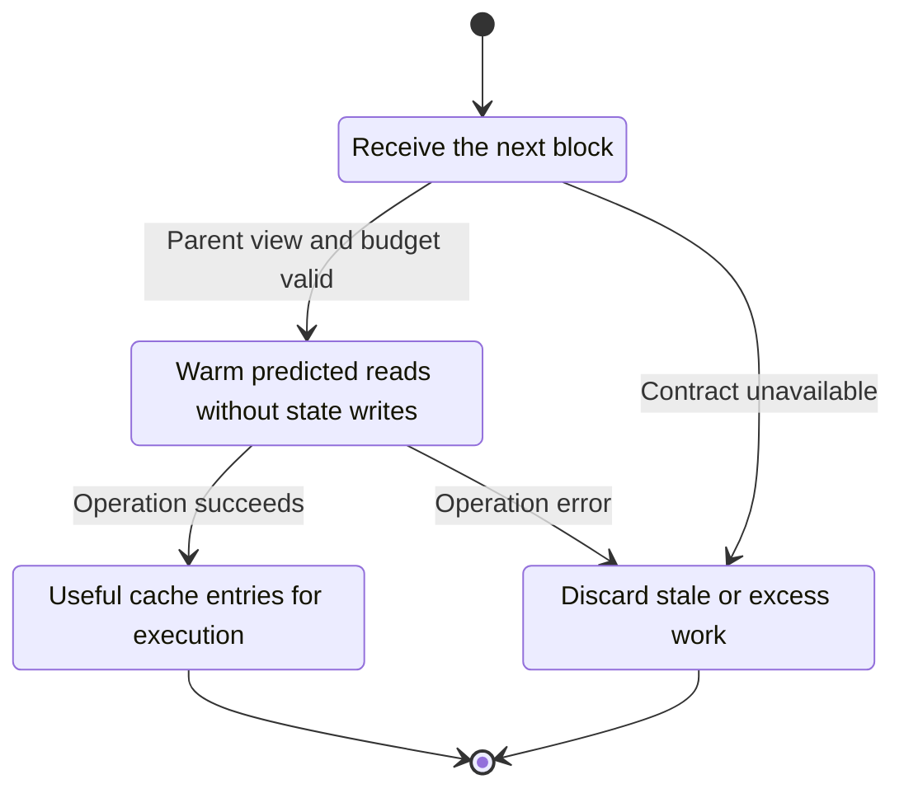
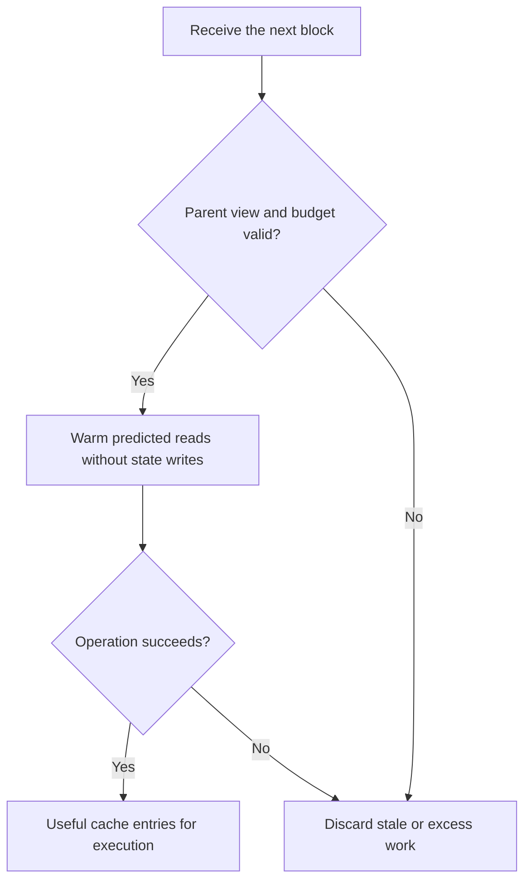

<!-- xone-gap-audit:2026-11-14:pass4:state-prefetch -->
> GAP-0065 · P2 · source review at `330b742bfa1ef1401c1b9b9be0cf0bd344255cca`. Static evidence; no deployed-node reproduction or benchmark is claimed.

## What

StateRead mentions read-only prewarming as an intended use, but the repository has no prefetch worker. Disk-backed account and storage reads are demand driven, while run_block executes transactions in order.

Current implementation:

- [`crates/xone-state/src/provider.rs`](https://github.com/XDCIndia/xOneRS/blob/330b742bfa1ef1401c1b9b9be0cf0bd344255cca/crates/xone-state/src/provider.rs)
- [`crates/xone-sync/src/mdbx/diskflat.rs`](https://github.com/XDCIndia/xOneRS/blob/330b742bfa1ef1401c1b9b9be0cf0bd344255cca/crates/xone-sync/src/mdbx/diskflat.rs)
- [`crates/xone-executor/src/lib.rs`](https://github.com/XDCIndia/xOneRS/blob/330b742bfa1ef1401c1b9b9be0cf0bd344255cca/crates/xone-executor/src/lib.rs)
- [`crates/xone-node/src/services/core.rs`](https://github.com/XDCIndia/xOneRS/blob/330b742bfa1ef1401c1b9b9be0cf0bd344255cca/crates/xone-node/src/services/core.rs)

## Why

Disk latency can stall otherwise sequential execution. Competitor prefetchers move optional reads ahead of the critical path without changing consensus.

Verified competitor implementation references:

- [ethereum/go-ethereum: `core/state_prefetcher.go`](https://github.com/ethereum/go-ethereum/blob/8059ff8beb3170eb8b977169ac51bb0423c97ee1/core/state_prefetcher.go)
- [XinFinOrg/XDPoSChain: `core/state_prefetcher.go`](https://github.com/XinFinOrg/XDPoSChain/blob/cb1ef79073c05f50b9df75b1e740387b9d72af99/core/state_prefetcher.go)
- [lambdaclass/ethrex: `crates/blockchain/prewarm.rs`](https://github.com/lambdaclass/ethrex/blob/7e272ac5075aec832304909b376bada4eca52e77/crates/blockchain/prewarm.rs)

#248 caches analyzed bytecode; #246 hashes tries in parallel; #247 overlaps commit. This issue warms state reads and does not duplicate those changes.

## 80% of the way to

1. Measure cold and warm disk-backed execution before adding workers.
2. Use a parent-state-pinned read-only view to warm bounded account, storage and code caches from candidate transactions.
3. Bound workers, queued transactions, reads and cache bytes. Cancel stale work on reorg, parent change, shutdown or execution completion.
4. Keep canonical writes and publication on the existing execution/import path. Make prefetch optional and treat a miss as a normal read.

Acceptance criteria:

- [ ] Enabled and disabled execution produce identical state, receipts, logs and gas across fork and special-transaction fixtures.
- [ ] Cancellation releases every state pin and worker; memory remains within its configured budget.
- [ ] Report disk-backed latency, IO and RSS before/after, including a workload with no benefit.

## ASD-STE100

1. Warm predicted reads without state writes.
2. Keep the existing XDC consensus rules unchanged.
3. Check all required input before you start the operation.
4. Keep memory use within the configured limits.
5. Discard stale or excess work.
6. Test each acceptance case through the actual entry point.

Technical names follow the repository vocabulary. These short instructions follow the requested sentence limits; certified ASD-STE100 vocabulary compliance has not been assessed.

## Diagrams

```mermaid
sequenceDiagram
    participant Actor as Block importer
    participant Service as Prefetch scheduler
    participant Data as Parent state cache
    Actor->>Service: Receive the next block
    Service->>Data: Check required state and limits
    Data-->>Service: State and validation result
    alt Parent view and budget valid
        Service->>Data: Warm predicted reads without state writes
        Data-->>Service: Result or operation error
        Service-->>Actor: Useful cache entries for execution
    else Contract cannot be met
        Service-->>Actor: Discard stale or excess work
    end
```

## Images

N/A. This change affects node behavior. The source links and test fixtures provide the evidence.

## Prompt

```text
Implement GAP-0065 in XDCIndia/xOneRS: Add bounded read-only state prefetch before block execution.
Observed at 330b742bfa1ef1401c1b9b9be0cf0bd344255cca: StateRead mentions read-only prewarming as an intended use, but the repository has no prefetch worker. Disk-backed account and storage reads are demand driven, while run_block executes transactions in order.
Read these target files: crates/xone-state/src/provider.rs, crates/xone-sync/src/mdbx/diskflat.rs, crates/xone-executor/src/lib.rs, crates/xone-node/src/services/core.rs.
Implementation: Measure cold and warm disk-backed execution before adding workers. Use a parent-state-pinned read-only view to warm bounded account, storage and code caches from candidate transactions. Bound workers, queued transactions, reads and cache bytes. Cancel stale work on reorg, parent change, shutdown or execution completion. Keep canonical writes and publication on the existing execution/import path. Make prefetch optional and treat a miss as a normal read.
Acceptance: Enabled and disabled execution produce identical state, receipts, logs and gas across fork and special-transaction fixtures. Cancellation releases every state pin and worker; memory remains within its configured budget. Report disk-backed latency, IO and RSS before/after, including a workload with no benefit.
Related ownership: #248 caches analyzed bytecode; #246 hashes tries in parallel; #247 overlaps commit. This issue warms state reads and does not duplicate those changes.
Re-pin current main and the authoritative geth-XDC oracle before editing. Preserve XDC consensus, signatures, encodings, storage publication and configured resource bounds. Use the linked competitor code as design evidence, respecting its license. Write focused failing fixtures, implement the smallest coherent change, and run the applicable repository checks. Report exact commands and results. Open a reviewable PR; do not claim completion from a registered method or a mock-only test.
```

## Workflow

1. **Block importer:** Receive the next block.
2. **Prefetch scheduler:** Check whether parent view and budget valid.
3. **Prefetch scheduler:** Warm predicted reads without state writes through parent state cache.
4. **Prefetch scheduler:** On success, provide useful cache entries for execution.
5. **Prefetch scheduler:** On refusal or failure, discard stale or excess work.

The acceptance cases above define the exact errors, ordering and resource boundaries. Verify the real entry point before closing the issue.

## Loop

Warm only while the parent view remains valid. Discard stale work; never retry without a fresh parent and a budget.

## Graph

Lifecycle of this prefetch scheduler operation; this diagram does not change the blockchain consensus state machine.



## Layout

This capability uses a node, command-line, or build interface. It does not require a new graphical screen.

| Interface detail | Placement |
| --- | --- |
| Actor and trigger | Block importer: receive the next block |
| Input validation | Prefetch scheduler: parent view and budget valid |
| Output | Useful cache entries for execution |
| Error or refusal | Discard stale or excess work |
| Implementation files | `crates/xone-state/src/provider.rs`, `crates/xone-sync/src/mdbx/diskflat.rs`, `crates/xone-executor/src/lib.rs`, `crates/xone-node/src/services/core.rs` |

Keep field names and response shapes compatible with the specification and acceptance cases above.

## Flow



## Summary

Gap: Add bounded read-only state prefetch before block execution.
Fix: Measure cold and warm disk-backed execution before adding workers.
Acceptance: Enabled and disabled execution produce identical state, receipts, logs and gas across fork and special-transaction fixtures.
