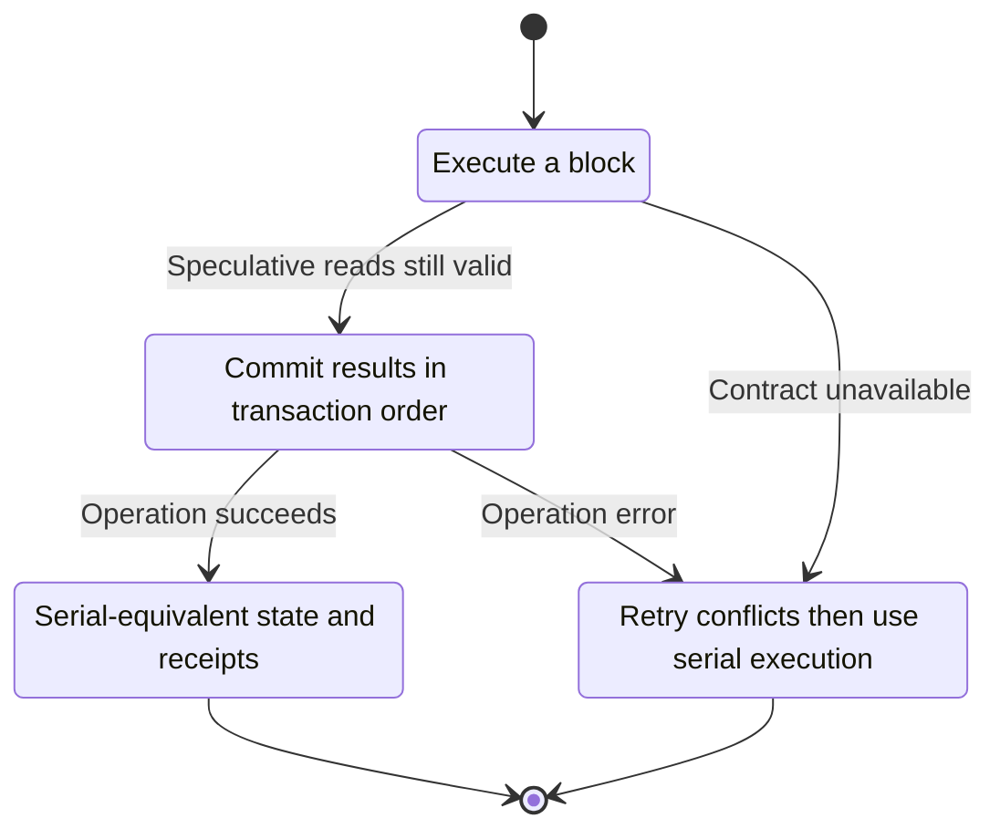
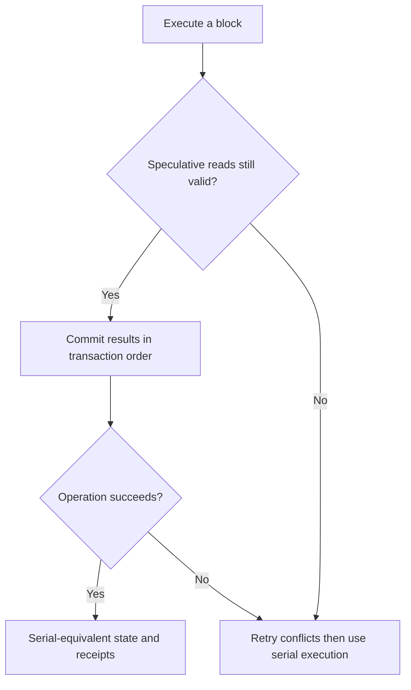

<!-- xone-gap-audit:2026-11-14:pass4:parallel-evm -->
> GAP-0066 · P3 · source review at `330b742bfa1ef1401c1b9b9be0cf0bd344255cca`. Static evidence; no deployed-node reproduction or benchmark is claimed.

## What

`run_block` executes its transaction loop sequentially. The accepted scale review calls for a later parallel-EVM prototype behind serial-equivalence and bounded-memory gates. No such executor is currently present.

Current implementation:

- [`crates/xone-executor/src/lib.rs`](https://github.com/XDCIndia/xOneRS/blob/330b742bfa1ef1401c1b9b9be0cf0bd344255cca/crates/xone-executor/src/lib.rs)
- [`crates/xone-executor/src/overlay.rs`](https://github.com/XDCIndia/xOneRS/blob/330b742bfa1ef1401c1b9b9be0cf0bd344255cca/crates/xone-executor/src/overlay.rs)
- [`crates/xone-state/src/provider.rs`](https://github.com/XDCIndia/xOneRS/blob/330b742bfa1ef1401c1b9b9be0cf0bd344255cca/crates/xone-state/src/provider.rs)
- [`docs/reviews/2026-11-10-architecture-scale-pq-review.md`](https://github.com/XDCIndia/xOneRS/blob/330b742bfa1ef1401c1b9b9be0cf0bd344255cca/docs/reviews/2026-11-10-architecture-scale-pq-review.md)

## Why

Parallel execution is a competitive performance option for independent transactions. It is a research-to-implementation task, not a claim that XDC semantics can be changed.

Verified competitor implementation references:

- [Galxe/gravity-reth: `crates/ethereum/evm/src/parallel_execute.rs`](https://github.com/Galxe/gravity-reth/blob/c407bd938013a4250544c303ac294a36482dcd98/crates/ethereum/evm/src/parallel_execute.rs)
- [category-labs/monad: `category/execution/ethereum/execute_block.cpp`](https://github.com/category-labs/monad/blob/83f8bc65ca725a77f7b6ead50756eed90fa28691/category/execution/ethereum/execute_block.cpp)
- [sei-protocol/sei-chain: `giga/evmonly/occ.go`](https://github.com/sei-protocol/sei-chain/blob/efa1e663467ee973e95f844f7505a6d218cadab0/giga/evmonly/occ.go)

#7, #10 and #58 provide execution correctness gates. #246 concerns trie hashing, not EVM transaction scheduling.

## 80% of the way to

1. Keep serial execution as the default and correctness oracle. Introduce an opt-in executor interface with per-transaction speculative overlays.
2. Track read/write conflicts and validate in block order. Re-execute invalidated work and fall back to serial after a bounded retry budget.
3. Preserve XDC special transactions, TRC21 routing, wide balances, native hooks, fork transitions and Amsterdam commitments. Serialize operations that cannot be proven independent.
4. Workers must not publish roots or canonical heads. Measure representative independent and highly contended blocks before proposing a default change.

Acceptance criteria:

- [ ] Serial and parallel paths produce identical receipts, logs, gas, state roots and BAL commitments.
- [ ] Conflict, revert, deployment, nonce-chain, special-transaction and fork-boundary fixtures pass.
- [ ] Cancellation, repeated conflicts and worker failure yield bounded cleanup or safe serial fallback.
- [ ] A replay report includes resource usage and regressions; no throughput claim is accepted without measurements.

## ASD-STE100

1. Commit results in transaction order.
2. Keep the existing XDC consensus rules unchanged.
3. Check all required input before you start the operation.
4. Keep memory use within the configured limits.
5. Retry conflicts then use serial execution.
6. Test each acceptance case through the actual entry point.

Technical names follow the repository vocabulary. These short instructions follow the requested sentence limits; certified ASD-STE100 vocabulary compliance has not been assessed.

## Diagrams

```mermaid
sequenceDiagram
    participant Actor as Block importer
    participant Service as Execution scheduler
    participant Data as Versioned state
    Actor->>Service: Execute a block
    Service->>Data: Check required state and limits
    Data-->>Service: State and validation result
    alt Speculative reads still valid
        Service->>Data: Commit results in transaction order
        Data-->>Service: Result or operation error
        Service-->>Actor: Serial-equivalent state and receipts
    else Contract cannot be met
        Service-->>Actor: Retry conflicts then use serial execution
    end
```

## Images

N/A. This change affects node behavior. The source links and test fixtures provide the evidence.

## Prompt

```text
Implement GAP-0066 in XDCIndia/xOneRS: Prototype deterministic parallel transaction execution with serial fallback.
Observed at 330b742bfa1ef1401c1b9b9be0cf0bd344255cca: `run_block` executes its transaction loop sequentially. The accepted scale review calls for a later parallel-EVM prototype behind serial-equivalence and bounded-memory gates. No such executor is currently present.
Read these target files: crates/xone-executor/src/lib.rs, crates/xone-executor/src/overlay.rs, crates/xone-state/src/provider.rs, docs/reviews/2026-11-10-architecture-scale-pq-review.md.
Implementation: Keep serial execution as the default and correctness oracle. Introduce an opt-in executor interface with per-transaction speculative overlays. Track read/write conflicts and validate in block order. Re-execute invalidated work and fall back to serial after a bounded retry budget. Preserve XDC special transactions, TRC21 routing, wide balances, native hooks, fork transitions and Amsterdam commitments. Serialize operations that cannot be proven independent. Workers must not publish roots or canonical heads. Measure representative independent and highly contended blocks before proposing a default change.
Acceptance: Serial and parallel paths produce identical receipts, logs, gas, state roots and BAL commitments. Conflict, revert, deployment, nonce-chain, special-transaction and fork-boundary fixtures pass. Cancellation, repeated conflicts and worker failure yield bounded cleanup or safe serial fallback. A replay report includes resource usage and regressions; no throughput claim is accepted without measurements.
Related ownership: #7, #10 and #58 provide execution correctness gates. #246 concerns trie hashing, not EVM transaction scheduling.
Re-pin current main and the authoritative geth-XDC oracle before editing. Preserve XDC consensus, signatures, encodings, storage publication and configured resource bounds. Use the linked competitor code as design evidence, respecting its license. Write focused failing fixtures, implement the smallest coherent change, and run the applicable repository checks. Report exact commands and results. Open a reviewable PR; do not claim completion from a registered method or a mock-only test.
```

## Workflow

1. **Block importer:** Execute a block.
2. **Execution scheduler:** Check whether speculative reads still valid.
3. **Execution scheduler:** Commit results in transaction order through versioned state.
4. **Execution scheduler:** On success, provide serial-equivalent state and receipts.
5. **Execution scheduler:** On refusal or failure, retry conflicts then use serial execution.

The acceptance cases above define the exact errors, ordering and resource boundaries. Verify the real entry point before closing the issue.

## Loop

Speculate, validate in block order and retry conflicts within a fixed budget. Use serial fallback when the budget is exhausted.

## Graph

Lifecycle of this execution scheduler operation; this diagram does not change the blockchain consensus state machine.



## Layout

This capability uses a node, command-line, or build interface. It does not require a new graphical screen.

| Interface detail | Placement |
| --- | --- |
| Actor and trigger | Block importer: execute a block |
| Input validation | Execution scheduler: speculative reads still valid |
| Output | Serial-equivalent state and receipts |
| Error or refusal | Retry conflicts then use serial execution |
| Implementation files | `crates/xone-executor/src/lib.rs`, `crates/xone-executor/src/overlay.rs`, `crates/xone-state/src/provider.rs`, `docs/reviews/2026-11-10-architecture-scale-pq-review.md` |

Keep field names and response shapes compatible with the specification and acceptance cases above.

## Flow



## Summary

Gap: Prototype deterministic parallel transaction execution with serial fallback.
Fix: Keep serial execution as the default and correctness oracle. Introduce an opt-in executor interface with per-transaction speculative overlays.
Acceptance: Serial and parallel paths produce identical receipts, logs, gas, state roots and BAL commitments.
