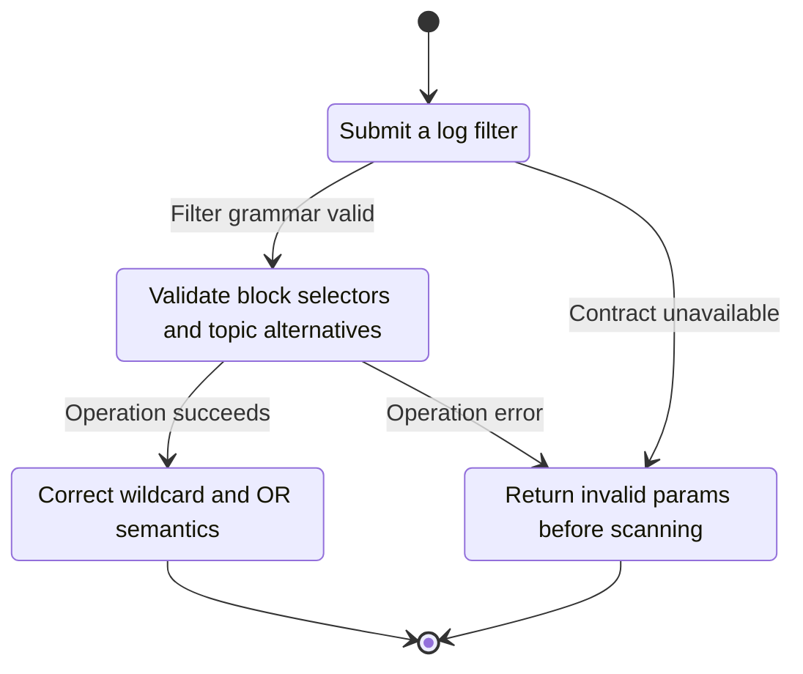
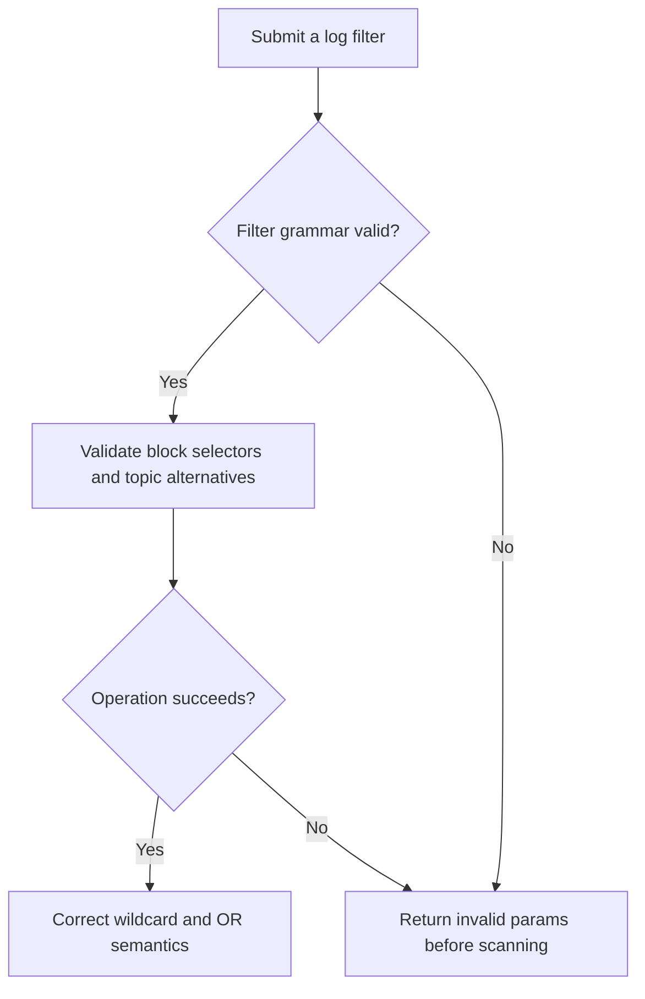

<!-- xone-gap-audit:2026-11-14:pass4:log-filter-grammar -->
> GAP-0067 · P2 · source review at `330b742bfa1ef1401c1b9b9be0cf0bd344255cca`. Static evidence; no deployed-node reproduction or benchmark is claimed.

## What

`LogFilter::parse` silently ignores a non-array topics field, rejects null inside a topic-alternative array, and does not limit topic positions. `get_logs` accepts blockHash together with fromBlock/toBlock and ignores the range.

Current implementation:

- [`crates/xone-rpc/src/subscriptions.rs`](https://github.com/XDCIndia/xOneRS/blob/330b742bfa1ef1401c1b9b9be0cf0bd344255cca/crates/xone-rpc/src/subscriptions.rs)
- [`crates/xone-rpc/src/eth.rs`](https://github.com/XDCIndia/xOneRS/blob/330b742bfa1ef1401c1b9b9be0cf0bd344255cca/crates/xone-rpc/src/eth.rs)

## Why

A malformed filter can silently broaden a query, while valid wildcard alternatives are refused.

Verified competitor implementation references:

- [ethereum/go-ethereum: `eth/filters/api.go`](https://github.com/ethereum/go-ethereum/blob/8059ff8beb3170eb8b977169ac51bb0423c97ee1/eth/filters/api.go)
- [XinFinOrg/XDPoSChain: `eth/filters/api.go`](https://github.com/XinFinOrg/XDPoSChain/blob/cb1ef79073c05f50b9df75b1e740387b9d72af99/eth/filters/api.go)

#153 adds polling filters and #258 adds bloom pruning. This fixes the existing filter input contract used by both.

## 80% of the way to

1. Use one typed filter parser for HTTP log queries and subscriptions.
2. Reject incompatible block selectors and malformed topic shapes. Implement null wildcard alternatives according to the pinned XDC oracle.
3. Bound topic positions, alternative counts and address counts before scanning history.

Acceptance criteria:

- [ ] Vectors cover blockHash plus range, non-array topics, too many positions and null inside OR alternatives.
- [ ] Every accepted filter yields the same logs as the pinned oracle; malformed filters fail before storage reads.

## ASD-STE100

1. Validate block selectors and topic alternatives.
2. Keep the existing XDC consensus rules unchanged.
3. Check all required input before you start the operation.
4. Keep memory use within the configured limits.
5. Return invalid params before scanning.
6. Test each acceptance case through the actual entry point.

Technical names follow the repository vocabulary. These short instructions follow the requested sentence limits; certified ASD-STE100 vocabulary compliance has not been assessed.

## Diagrams

```mermaid
sequenceDiagram
    participant Actor as RPC caller
    participant Service as Filter parser
    participant Data as Typed filter model
    Actor->>Service: Submit a log filter
    Service->>Data: Check required state and limits
    Data-->>Service: State and validation result
    alt Filter grammar valid
        Service->>Data: Validate block selectors and topic alternatives
        Data-->>Service: Result or operation error
        Service-->>Actor: Correct wildcard and OR semantics
    else Contract cannot be met
        Service-->>Actor: Return invalid params before scanning
    end
```

## Images

N/A. This change affects node behavior. The source links and test fixtures provide the evidence.

## Prompt

```text
Implement GAP-0067 in XDCIndia/xOneRS: Validate log-filter ranges, topic shapes and wildcard alternatives.
Observed at 330b742bfa1ef1401c1b9b9be0cf0bd344255cca: `LogFilter::parse` silently ignores a non-array topics field, rejects null inside a topic-alternative array, and does not limit topic positions. `get_logs` accepts blockHash together with fromBlock/toBlock and ignores the range.
Read these target files: crates/xone-rpc/src/subscriptions.rs, crates/xone-rpc/src/eth.rs.
Implementation: Use one typed filter parser for HTTP log queries and subscriptions. Reject incompatible block selectors and malformed topic shapes. Implement null wildcard alternatives according to the pinned XDC oracle. Bound topic positions, alternative counts and address counts before scanning history.
Acceptance: Vectors cover blockHash plus range, non-array topics, too many positions and null inside OR alternatives. Every accepted filter yields the same logs as the pinned oracle; malformed filters fail before storage reads.
Related ownership: #153 adds polling filters and #258 adds bloom pruning. This fixes the existing filter input contract used by both.
Re-pin current main and the authoritative geth-XDC oracle before editing. Preserve XDC consensus, signatures, encodings, storage publication and configured resource bounds. Use the linked competitor code as design evidence, respecting its license. Write focused failing fixtures, implement the smallest coherent change, and run the applicable repository checks. Report exact commands and results. Open a reviewable PR; do not claim completion from a registered method or a mock-only test.
```

## Workflow

1. **RPC caller:** Submit a log filter.
2. **Filter parser:** Check whether filter grammar valid.
3. **Filter parser:** Validate block selectors and topic alternatives through typed filter model.
4. **Filter parser:** On success, provide correct wildcard and or semantics.
5. **Filter parser:** On refusal or failure, return invalid params before scanning.

The acceptance cases above define the exact errors, ordering and resource boundaries. Verify the real entry point before closing the issue.

## Loop

None. Run the operation only when requested.

## Graph

Lifecycle of this filter parser operation; this diagram does not change the blockchain consensus state machine.



## Layout

This capability uses a node, command-line, or build interface. It does not require a new graphical screen.

| Interface detail | Placement |
| --- | --- |
| Actor and trigger | RPC caller: submit a log filter |
| Input validation | Filter parser: filter grammar valid |
| Output | Correct wildcard and OR semantics |
| Error or refusal | Return invalid params before scanning |
| Implementation files | `crates/xone-rpc/src/subscriptions.rs`, `crates/xone-rpc/src/eth.rs` |

Keep field names and response shapes compatible with the specification and acceptance cases above.

## Flow



## Summary

Gap: Validate log-filter ranges, topic shapes and wildcard alternatives.
Fix: Use one typed filter parser for HTTP log queries and subscriptions.
Acceptance: Vectors cover blockHash plus range, non-array topics, too many positions and null inside OR alternatives.
