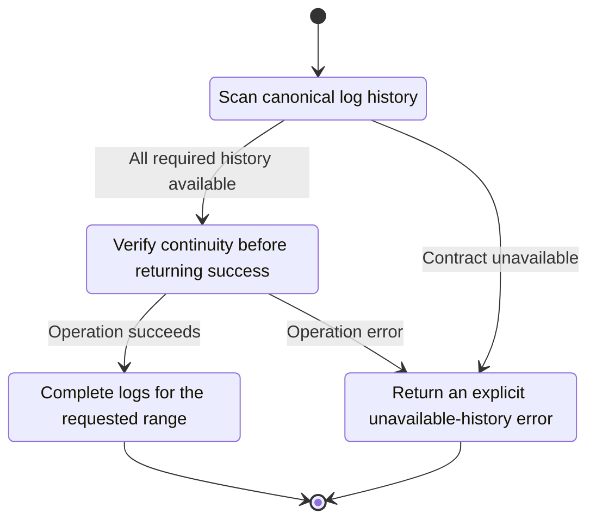
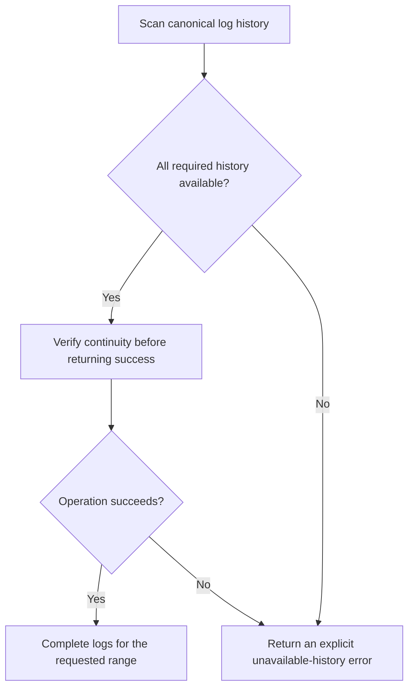

<!-- xone-gap-audit:2026-11-14:pass4:log-history-holes -->
> GAP-0068 · P1 · source review at `330b742bfa1ef1401c1b9b9be0cf0bd344255cca`. Static evidence; no deployed-node reproduction or benchmark is claimed.

## What

Range resolution uses filter_map on canonical hashes. The scan continues when a selected block or its receipts are absent. The blockHash path also skips the receipt retention check. These paths can return an apparently complete empty or partial list.

Current implementation:

- [`crates/xone-rpc/src/eth.rs`](https://github.com/XDCIndia/xOneRS/blob/330b742bfa1ef1401c1b9b9be0cf0bd344255cca/crates/xone-rpc/src/eth.rs)
- [`crates/xone-rpc/src/api.rs`](https://github.com/XDCIndia/xOneRS/blob/330b742bfa1ef1401c1b9b9be0cf0bd344255cca/crates/xone-rpc/src/api.rs)
- [`crates/xone-node/src/services/rpc.rs`](https://github.com/XDCIndia/xOneRS/blob/330b742bfa1ef1401c1b9b9be0cf0bd344255cca/crates/xone-node/src/services/rpc.rs)

## Why

Indexers can permanently miss events when an incomplete scan is indistinguishable from a complete result.

Verified competitor implementation references:

- [ethereum/go-ethereum: `eth/filters/filter.go`](https://github.com/ethereum/go-ethereum/blob/8059ff8beb3170eb8b977169ac51bb0423c97ee1/eth/filters/filter.go)
- [XinFinOrg/XDPoSChain: `eth/filters/filter.go`](https://github.com/XinFinOrg/XDPoSChain/blob/cb1ef79073c05f50b9df75b1e740387b9d72af99/eth/filters/filter.go)

#99 addressed range overflow; #121 corrected pivot reporting. Neither handles silent data omission in the current scan.

## 80% of the way to

1. Distinguish unknown blocks, pruned history, missing canonical rows and legitimate empty logs.
2. Check retention for hash-selected queries and return a typed error when required canonical data disappears or cannot be loaded.
3. Keep a coherent canonical view for the scan, or detect its invalidation and return the documented retryable refusal.

Acceptance criteria:

- [ ] A known canonical block with missing receipts never produces a successful partial result.
- [ ] Hash queries below the receipt floor return the same typed refusal as range queries.
- [ ] A block with valid empty receipts still returns an empty array.

## ASD-STE100

1. Verify continuity before returning success.
2. Keep the existing XDC consensus rules unchanged.
3. Check all required input before you start the operation.
4. Keep memory use within the configured limits.
5. Return an explicit unavailable-history error.
6. Test each acceptance case through the actual entry point.

Technical names follow the repository vocabulary. These short instructions follow the requested sentence limits; certified ASD-STE100 vocabulary compliance has not been assessed.

## Diagrams

```mermaid
sequenceDiagram
    participant Actor as RPC caller
    participant Service as Log scanner
    participant Data as Canonical headers and receipts
    Actor->>Service: Scan canonical log history
    Service->>Data: Check required state and limits
    Data-->>Service: State and validation result
    alt All required history available
        Service->>Data: Verify continuity before returning success
        Data-->>Service: Result or operation error
        Service-->>Actor: Complete logs for the requested range
    else Contract cannot be met
        Service-->>Actor: Return an explicit unavailable-history error
    end
```

## Images

N/A. This change affects node behavior. The source links and test fixtures provide the evidence.

## Prompt

```text
Implement GAP-0068 in XDCIndia/xOneRS: Refuse incomplete eth_getLogs results when canonical data is unavailable.
Observed at 330b742bfa1ef1401c1b9b9be0cf0bd344255cca: Range resolution uses filter_map on canonical hashes. The scan continues when a selected block or its receipts are absent. The blockHash path also skips the receipt retention check. These paths can return an apparently complete empty or partial list.
Read these target files: crates/xone-rpc/src/eth.rs, crates/xone-rpc/src/api.rs, crates/xone-node/src/services/rpc.rs.
Implementation: Distinguish unknown blocks, pruned history, missing canonical rows and legitimate empty logs. Check retention for hash-selected queries and return a typed error when required canonical data disappears or cannot be loaded. Keep a coherent canonical view for the scan, or detect its invalidation and return the documented retryable refusal.
Acceptance: A known canonical block with missing receipts never produces a successful partial result. Hash queries below the receipt floor return the same typed refusal as range queries. A block with valid empty receipts still returns an empty array.
Related ownership: #99 addressed range overflow; #121 corrected pivot reporting. Neither handles silent data omission in the current scan.
Re-pin current main and the authoritative geth-XDC oracle before editing. Preserve XDC consensus, signatures, encodings, storage publication and configured resource bounds. Use the linked competitor code as design evidence, respecting its license. Write focused failing fixtures, implement the smallest coherent change, and run the applicable repository checks. Report exact commands and results. Open a reviewable PR; do not claim completion from a registered method or a mock-only test.
```

## Workflow

1. **RPC caller:** Scan canonical log history.
2. **Log scanner:** Check whether all required history available.
3. **Log scanner:** Verify continuity before returning success through canonical headers and receipts.
4. **Log scanner:** On success, provide complete logs for the requested range.
5. **Log scanner:** On refusal or failure, return an explicit unavailable-history error.

The acceptance cases above define the exact errors, ordering and resource boundaries. Verify the real entry point before closing the issue.

## Loop

None. Run the operation only when requested.

## Graph

Lifecycle of this log scanner operation; this diagram does not change the blockchain consensus state machine.



## Layout

This capability uses a node, command-line, or build interface. It does not require a new graphical screen.

| Interface detail | Placement |
| --- | --- |
| Actor and trigger | RPC caller: scan canonical log history |
| Input validation | Log scanner: all required history available |
| Output | Complete logs for the requested range |
| Error or refusal | Return an explicit unavailable-history error |
| Implementation files | `crates/xone-rpc/src/eth.rs`, `crates/xone-rpc/src/api.rs`, `crates/xone-node/src/services/rpc.rs` |

Keep field names and response shapes compatible with the specification and acceptance cases above.

## Flow



## Summary

Gap: Refuse incomplete eth_getLogs results when canonical data is unavailable.
Fix: Distinguish unknown blocks, pruned history, missing canonical rows and legitimate empty logs.
Acceptance: A known canonical block with missing receipts never produces a successful partial result.
