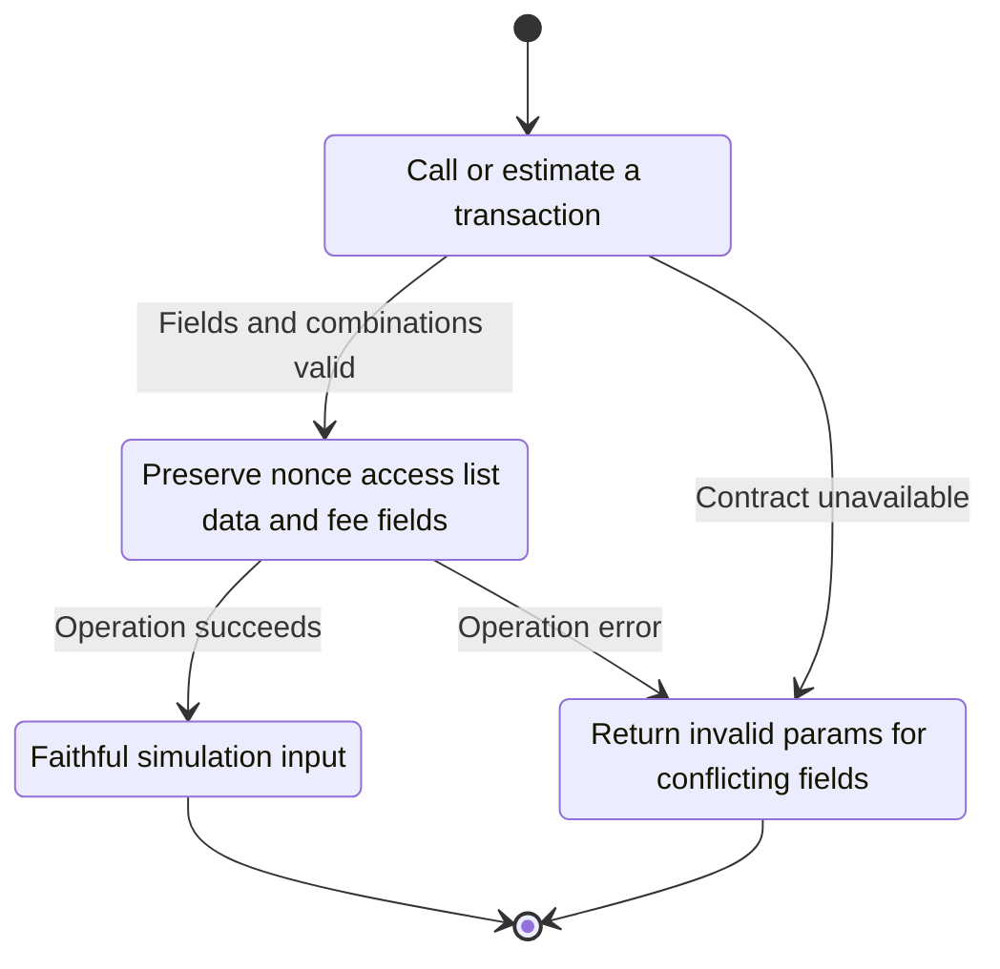
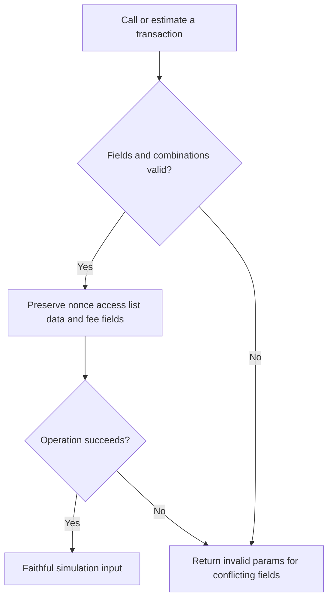

<!-- xone-gap-audit:2026-11-14:pass4:call-transaction-args -->
> GAP-0069 · P1 · source review at `330b742bfa1ef1401c1b9b9be0cf0bd344255cca`. Static evidence; no deployed-node reproduction or benchmark is claimed.

## What

`CallRequest` has no nonce or access list. `call_request` ignores mistyped optional fields, accepts conflicting data/input values by taking one, and does not reject mixed legacy and dynamic fee fields. Supported transaction semantics cannot be faithfully passed to the eventual execution backend.

Current implementation:

- [`crates/xone-rpc/src/api.rs`](https://github.com/XDCIndia/xOneRS/blob/330b742bfa1ef1401c1b9b9be0cf0bd344255cca/crates/xone-rpc/src/api.rs)
- [`crates/xone-rpc/src/eth.rs`](https://github.com/XDCIndia/xOneRS/blob/330b742bfa1ef1401c1b9b9be0cf0bd344255cca/crates/xone-rpc/src/eth.rs)

## Why

Simulation and estimation must execute the transaction the caller supplied, including its gas-affecting access list.

Verified competitor implementation references:

- [ethereum/go-ethereum: `internal/ethapi/transaction_args.go`](https://github.com/ethereum/go-ethereum/blob/8059ff8beb3170eb8b977169ac51bb0423c97ee1/internal/ethapi/transaction_args.go)
- [XinFinOrg/XDPoSChain: `internal/ethapi/transaction_args.go`](https://github.com/XinFinOrg/XDPoSChain/blob/cb1ef79073c05f50b9df75b1e740387b9d72af99/internal/ethapi/transaction_args.go)

#42 owns the runtime call backend; #158 concerns state/block overrides and #155 generates access lists. This unit is the transaction-argument contract.

## 80% of the way to

1. Define typed call arguments for the transaction types enabled by the selected XDC fork, including access lists and nonce where supported.
2. Validate field types, quantity encodings, data/input equality and mutually exclusive fee fields before dispatch.
3. Pass the complete validated envelope to call and estimate backends. Reject unsupported future transaction fields explicitly instead of silently ignoring them.

Acceptance criteria:

- [ ] A cold-access fixture with and without an access list matches oracle gas behavior.
- [ ] Conflicting input/data and legacy/dynamic fee combinations fail with oracle-compatible errors.
- [ ] Malformed gas, address, nonce and value fields cannot become defaults.

## ASD-STE100

1. Preserve nonce access list data and fee fields.
2. Keep the existing XDC consensus rules unchanged.
3. Check all required input before you start the operation.
4. Keep memory use within the configured limits.
5. Return invalid params for conflicting fields.
6. Test each acceptance case through the actual entry point.

Technical names follow the repository vocabulary. These short instructions follow the requested sentence limits; certified ASD-STE100 vocabulary compliance has not been assessed.

## Diagrams

```mermaid
sequenceDiagram
    participant Actor as RPC caller
    participant Service as Call argument parser
    participant Data as Execution request model
    Actor->>Service: Call or estimate a transaction
    Service->>Data: Check required state and limits
    Data-->>Service: State and validation result
    alt Fields and combinations valid
        Service->>Data: Preserve nonce access list data and fee fields
        Data-->>Service: Result or operation error
        Service-->>Actor: Faithful simulation input
    else Contract cannot be met
        Service-->>Actor: Return invalid params for conflicting fields
    end
```

## Images

N/A. This change affects node behavior. The source links and test fixtures provide the evidence.

## Prompt

```text
Implement GAP-0069 in XDCIndia/xOneRS: Preserve and validate transaction arguments for call and gas estimation.
Observed at 330b742bfa1ef1401c1b9b9be0cf0bd344255cca: `CallRequest` has no nonce or access list. `call_request` ignores mistyped optional fields, accepts conflicting data/input values by taking one, and does not reject mixed legacy and dynamic fee fields. Supported transaction semantics cannot be faithfully passed to the eventual execution backend.
Read these target files: crates/xone-rpc/src/api.rs, crates/xone-rpc/src/eth.rs.
Implementation: Define typed call arguments for the transaction types enabled by the selected XDC fork, including access lists and nonce where supported. Validate field types, quantity encodings, data/input equality and mutually exclusive fee fields before dispatch. Pass the complete validated envelope to call and estimate backends. Reject unsupported future transaction fields explicitly instead of silently ignoring them.
Acceptance: A cold-access fixture with and without an access list matches oracle gas behavior. Conflicting input/data and legacy/dynamic fee combinations fail with oracle-compatible errors. Malformed gas, address, nonce and value fields cannot become defaults.
Related ownership: #42 owns the runtime call backend; #158 concerns state/block overrides and #155 generates access lists. This unit is the transaction-argument contract.
Re-pin current main and the authoritative geth-XDC oracle before editing. Preserve XDC consensus, signatures, encodings, storage publication and configured resource bounds. Use the linked competitor code as design evidence, respecting its license. Write focused failing fixtures, implement the smallest coherent change, and run the applicable repository checks. Report exact commands and results. Open a reviewable PR; do not claim completion from a registered method or a mock-only test.
```

## Workflow

1. **RPC caller:** Call or estimate a transaction.
2. **Call argument parser:** Check whether fields and combinations valid.
3. **Call argument parser:** Preserve nonce access list data and fee fields through execution request model.
4. **Call argument parser:** On success, provide faithful simulation input.
5. **Call argument parser:** On refusal or failure, return invalid params for conflicting fields.

The acceptance cases above define the exact errors, ordering and resource boundaries. Verify the real entry point before closing the issue.

## Loop

None. Run the operation only when requested.

## Graph

Lifecycle of this call argument parser operation; this diagram does not change the blockchain consensus state machine.



## Layout

This capability uses a node, command-line, or build interface. It does not require a new graphical screen.

| Interface detail | Placement |
| --- | --- |
| Actor and trigger | RPC caller: call or estimate a transaction |
| Input validation | Call argument parser: fields and combinations valid |
| Output | Faithful simulation input |
| Error or refusal | Return invalid params for conflicting fields |
| Implementation files | `crates/xone-rpc/src/api.rs`, `crates/xone-rpc/src/eth.rs` |

Keep field names and response shapes compatible with the specification and acceptance cases above.

## Flow



## Summary

Gap: Preserve and validate transaction arguments for call and gas estimation.
Fix: Define typed call arguments for the transaction types enabled by the selected XDC fork, including access lists and nonce where supported.
Acceptance: A cold-access fixture with and without an access list matches oracle gas behavior.
