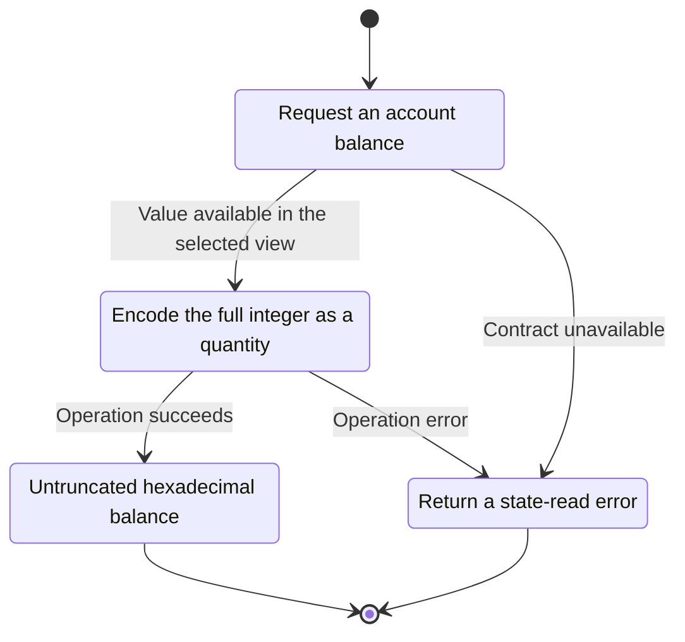
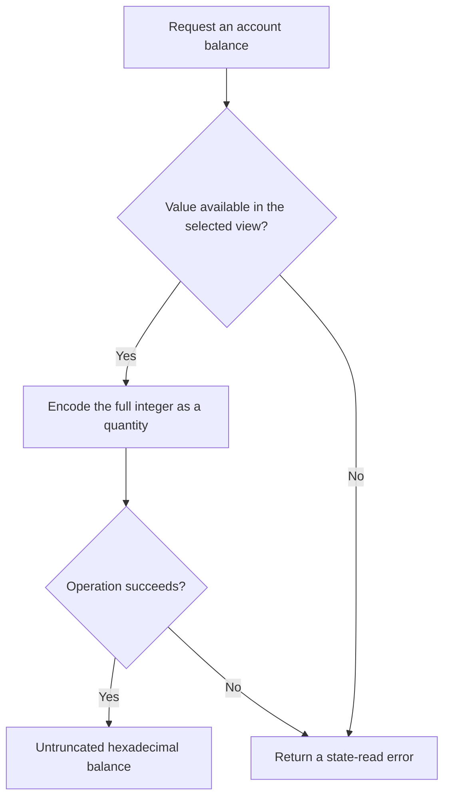

<!-- xone-gap-audit:2026-11-14:pass4:wide-balance-rpc -->
> GAP-0070 · P2 · source review at `330b742bfa1ef1401c1b9b9be0cf0bd344255cca`. Static evidence; no deployed-node reproduction or benchmark is claimed.

## What

`eth_getBalance` converts the stored WideBalance to U256 and returns an error above 256 bits. WideBalance already exposes minimal big-endian bytes, while the XDC reference returns a hexutil.Big quantity.

Current implementation:

- [`crates/xone-rpc/src/eth.rs`](https://github.com/XDCIndia/xOneRS/blob/330b742bfa1ef1401c1b9b9be0cf0bd344255cca/crates/xone-rpc/src/eth.rs)
- [`crates/xone-rpc/src/json.rs`](https://github.com/XDCIndia/xOneRS/blob/330b742bfa1ef1401c1b9b9be0cf0bd344255cca/crates/xone-rpc/src/json.rs)
- [`crates/xone-primitives/src/wide_balance.rs`](https://github.com/XDCIndia/xOneRS/blob/330b742bfa1ef1401c1b9b9be0cf0bd344255cca/crates/xone-primitives/src/wide_balance.rs)

## Why

An account value that is valid in XDC state should remain observable without loss or an artificial serialization limit.

Verified competitor implementation references:

- [XinFinOrg/XDPoSChain: `internal/ethapi/api.go`](https://github.com/XinFinOrg/XDPoSChain/blob/cb1ef79073c05f50b9df75b1e740387b9d72af99/internal/ethapi/api.go)
- [XinFinOrg/XDPoSChain: `common/hexutil/json.go`](https://github.com/XinFinOrg/XDPoSChain/blob/cb1ef79073c05f50b9df75b1e740387b9d72af99/common/hexutil/json.go)

#7 owns execution-domain proof. This is a separately testable read-only serialization gap.

## 80% of the way to

1. Serialize the full nonnegative balance as a minimal hexadecimal RPC quantity without narrowing it.
2. Keep execution conversion rules unchanged. This change affects reporting only and must not mask values inside the EVM.
3. Audit other read-only balance output fields for the same narrowing and document any intentionally unsupported domains.

Acceptance criteria:

- [ ] Fixtures for zero, 2^256-1, 2^256 and a larger stored balance match the XDC oracle exactly.
- [ ] No leading zero or truncated balance is emitted.
- [ ] EVM wide-balance and revert behavior remains unchanged.

## ASD-STE100

1. Encode the full integer as a quantity.
2. Keep the existing XDC consensus rules unchanged.
3. Check all required input before you start the operation.
4. Keep memory use within the configured limits.
5. Return a state-read error.
6. Test each acceptance case through the actual entry point.

Technical names follow the repository vocabulary. These short instructions follow the requested sentence limits; certified ASD-STE100 vocabulary compliance has not been assessed.

## Diagrams

```mermaid
sequenceDiagram
    participant Actor as RPC caller
    participant Service as Balance encoder
    participant Data as Wide balance value
    Actor->>Service: Request an account balance
    Service->>Data: Check required state and limits
    Data-->>Service: State and validation result
    alt Value available in the selected view
        Service->>Data: Encode the full integer as a quantity
        Data-->>Service: Result or operation error
        Service-->>Actor: Untruncated hexadecimal balance
    else Contract cannot be met
        Service-->>Actor: Return a state-read error
    end
```

## Images

N/A. This change affects node behavior. The source links and test fixtures provide the evidence.

## Prompt

```text
Implement GAP-0070 in XDCIndia/xOneRS: Return complete wide balances through read-only RPC quantities.
Observed at 330b742bfa1ef1401c1b9b9be0cf0bd344255cca: `eth_getBalance` converts the stored WideBalance to U256 and returns an error above 256 bits. WideBalance already exposes minimal big-endian bytes, while the XDC reference returns a hexutil.Big quantity.
Read these target files: crates/xone-rpc/src/eth.rs, crates/xone-rpc/src/json.rs, crates/xone-primitives/src/wide_balance.rs.
Implementation: Serialize the full nonnegative balance as a minimal hexadecimal RPC quantity without narrowing it. Keep execution conversion rules unchanged. This change affects reporting only and must not mask values inside the EVM. Audit other read-only balance output fields for the same narrowing and document any intentionally unsupported domains.
Acceptance: Fixtures for zero, 2^256-1, 2^256 and a larger stored balance match the XDC oracle exactly. No leading zero or truncated balance is emitted. EVM wide-balance and revert behavior remains unchanged.
Related ownership: #7 owns execution-domain proof. This is a separately testable read-only serialization gap.
Re-pin current main and the authoritative geth-XDC oracle before editing. Preserve XDC consensus, signatures, encodings, storage publication and configured resource bounds. Use the linked competitor code as design evidence, respecting its license. Write focused failing fixtures, implement the smallest coherent change, and run the applicable repository checks. Report exact commands and results. Open a reviewable PR; do not claim completion from a registered method or a mock-only test.
```

## Workflow

1. **RPC caller:** Request an account balance.
2. **Balance encoder:** Check whether value available in the selected view.
3. **Balance encoder:** Encode the full integer as a quantity through wide balance value.
4. **Balance encoder:** On success, provide untruncated hexadecimal balance.
5. **Balance encoder:** On refusal or failure, return a state-read error.

The acceptance cases above define the exact errors, ordering and resource boundaries. Verify the real entry point before closing the issue.

## Loop

None. Run the operation only when requested.

## Graph

Lifecycle of this balance encoder operation; this diagram does not change the blockchain consensus state machine.



## Layout

This capability uses a node, command-line, or build interface. It does not require a new graphical screen.

| Interface detail | Placement |
| --- | --- |
| Actor and trigger | RPC caller: request an account balance |
| Input validation | Balance encoder: value available in the selected view |
| Output | Untruncated hexadecimal balance |
| Error or refusal | Return a state-read error |
| Implementation files | `crates/xone-rpc/src/eth.rs`, `crates/xone-rpc/src/json.rs`, `crates/xone-primitives/src/wide_balance.rs` |

Keep field names and response shapes compatible with the specification and acceptance cases above.

## Flow



## Summary

Gap: Return complete wide balances through read-only RPC quantities.
Fix: Serialize the full nonnegative balance as a minimal hexadecimal RPC quantity without narrowing it.
Acceptance: Fixtures for zero, 2^256-1, 2^256 and a larger stored balance match the XDC oracle exactly.
