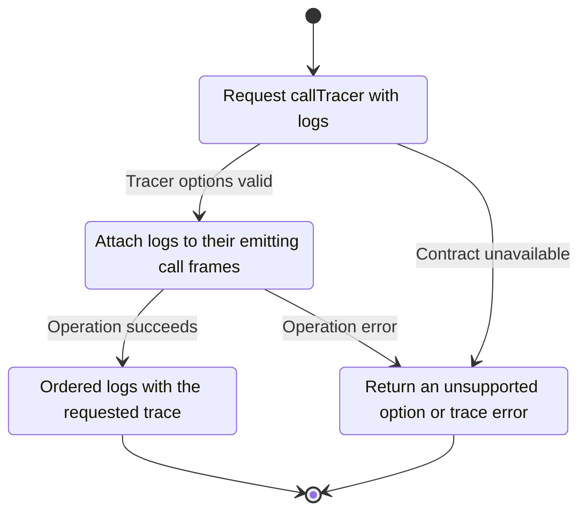
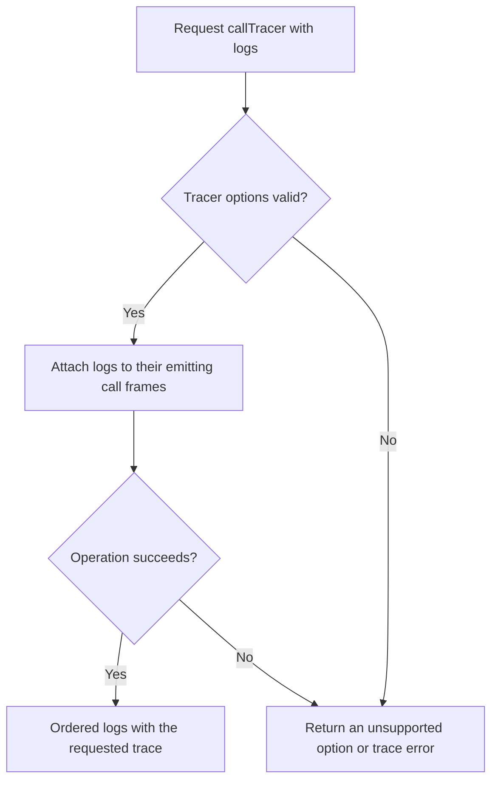

<!-- xone-gap-audit:2026-11-14:pass4:call-tracer-log-contract -->
> GAP-0071 · P2 · source review at `330b742bfa1ef1401c1b9b9be0cf0bd344255cca`. Static evidence; no deployed-node reproduction or benchmark is claimed.

## What

The parser accepts callTracer withLog=true, but CallFrame has no logs field and frame() cannot serialize logs. No execution backend can satisfy the accepted option through the current result type.

Current implementation:

- [`crates/xone-rpc/src/api.rs`](https://github.com/XDCIndia/xOneRS/blob/330b742bfa1ef1401c1b9b9be0cf0bd344255cca/crates/xone-rpc/src/api.rs)
- [`crates/xone-rpc/src/debug.rs`](https://github.com/XDCIndia/xOneRS/blob/330b742bfa1ef1401c1b9b9be0cf0bd344255cca/crates/xone-rpc/src/debug.rs)

## Why

Trace consumers request event logs to connect calls to emitted events. Accepting the option while dropping its data is misleading.

Verified competitor implementation references:

- [ethereum/go-ethereum: `eth/tracers/native/call.go`](https://github.com/ethereum/go-ethereum/blob/8059ff8beb3170eb8b977169ac51bb0423c97ee1/eth/tracers/native/call.go)
- [ethereum/go-ethereum: `eth/tracers/native/gen_callframe_json.go`](https://github.com/ethereum/go-ethereum/blob/8059ff8beb3170eb8b977169ac51bb0423c97ee1/eth/tracers/native/gen_callframe_json.go)

#42 owns trace execution and #169 adds other native tracers. This fixes an accepted option that the current public model cannot represent.

## 80% of the way to

1. Extend the call-frame model and encoder with the oracle log schema and emission order.
2. Carry withLog through the real tracing adapter. Remove logs from reverted calls and their reverted descendants according to oracle behavior.
3. Validate tracer option types instead of converting malformed booleans to false.

Acceptance criteria:

- [ ] Nested successful and reverted calls produce oracle-matching log placement and order.
- [ ] withLog=false omits logs; withLog=true includes them when execution emitted them.
- [ ] onlyTopCall interaction and malformed configuration have explicit fixtures.

## ASD-STE100

1. Attach logs to their emitting call frames.
2. Keep the existing XDC consensus rules unchanged.
3. Check all required input before you start the operation.
4. Keep memory use within the configured limits.
5. Return an unsupported option or trace error.
6. Test each acceptance case through the actual entry point.

Technical names follow the repository vocabulary. These short instructions follow the requested sentence limits; certified ASD-STE100 vocabulary compliance has not been assessed.

## Diagrams

```mermaid
sequenceDiagram
    participant Actor as Trace caller
    participant Service as Trace adapter
    participant Data as Call frames and event logs
    Actor->>Service: Request callTracer with logs
    Service->>Data: Check required state and limits
    Data-->>Service: State and validation result
    alt Tracer options valid
        Service->>Data: Attach logs to their emitting call frames
        Data-->>Service: Result or operation error
        Service-->>Actor: Ordered logs with the requested trace
    else Contract cannot be met
        Service-->>Actor: Return an unsupported option or trace error
    end
```

## Images

N/A. This change affects node behavior. The source links and test fixtures provide the evidence.

## Prompt

```text
Implement GAP-0071 in XDCIndia/xOneRS: Carry callTracer event logs through the trace result model.
Observed at 330b742bfa1ef1401c1b9b9be0cf0bd344255cca: The parser accepts callTracer withLog=true, but CallFrame has no logs field and frame() cannot serialize logs. No execution backend can satisfy the accepted option through the current result type.
Read these target files: crates/xone-rpc/src/api.rs, crates/xone-rpc/src/debug.rs.
Implementation: Extend the call-frame model and encoder with the oracle log schema and emission order. Carry withLog through the real tracing adapter. Remove logs from reverted calls and their reverted descendants according to oracle behavior. Validate tracer option types instead of converting malformed booleans to false.
Acceptance: Nested successful and reverted calls produce oracle-matching log placement and order. withLog=false omits logs; withLog=true includes them when execution emitted them. onlyTopCall interaction and malformed configuration have explicit fixtures.
Related ownership: #42 owns trace execution and #169 adds other native tracers. This fixes an accepted option that the current public model cannot represent.
Re-pin current main and the authoritative geth-XDC oracle before editing. Preserve XDC consensus, signatures, encodings, storage publication and configured resource bounds. Use the linked competitor code as design evidence, respecting its license. Write focused failing fixtures, implement the smallest coherent change, and run the applicable repository checks. Report exact commands and results. Open a reviewable PR; do not claim completion from a registered method or a mock-only test.
```

## Workflow

1. **Trace caller:** Request callTracer with logs.
2. **Trace adapter:** Check whether tracer options valid.
3. **Trace adapter:** Attach logs to their emitting call frames through call frames and event logs.
4. **Trace adapter:** On success, provide ordered logs with the requested trace.
5. **Trace adapter:** On refusal or failure, return an unsupported option or trace error.

The acceptance cases above define the exact errors, ordering and resource boundaries. Verify the real entry point before closing the issue.

## Loop

None. Run the operation only when requested.

## Graph

Lifecycle of this trace adapter operation; this diagram does not change the blockchain consensus state machine.



## Layout

This capability uses a node, command-line, or build interface. It does not require a new graphical screen.

| Interface detail | Placement |
| --- | --- |
| Actor and trigger | Trace caller: request calltracer with logs |
| Input validation | Trace adapter: tracer options valid |
| Output | Ordered logs with the requested trace |
| Error or refusal | Return an unsupported option or trace error |
| Implementation files | `crates/xone-rpc/src/api.rs`, `crates/xone-rpc/src/debug.rs` |

Keep field names and response shapes compatible with the specification and acceptance cases above.

## Flow



## Summary

Gap: Carry callTracer event logs through the trace result model.
Fix: Extend the call-frame model and encoder with the oracle log schema and emission order.
Acceptance: Nested successful and reverted calls produce oracle-matching log placement and order.
