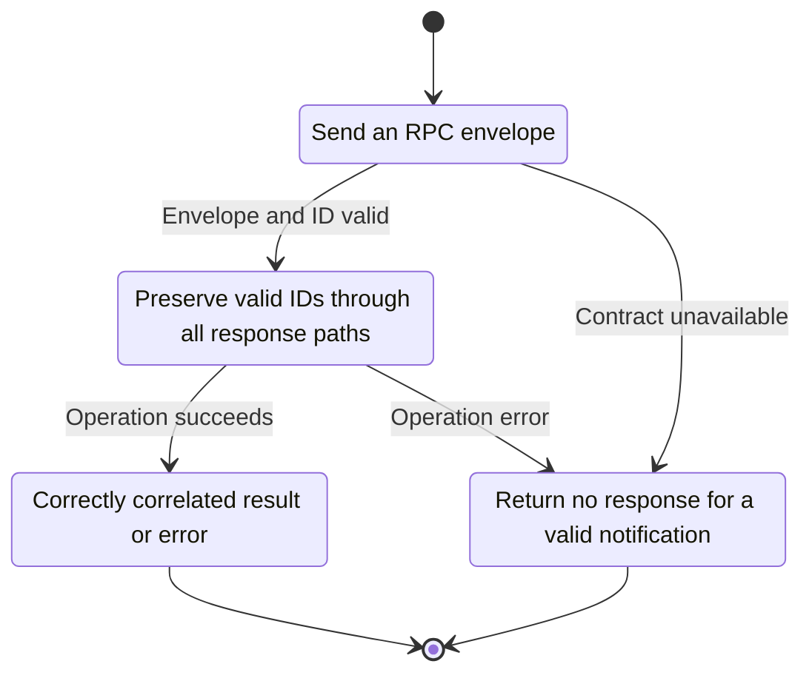
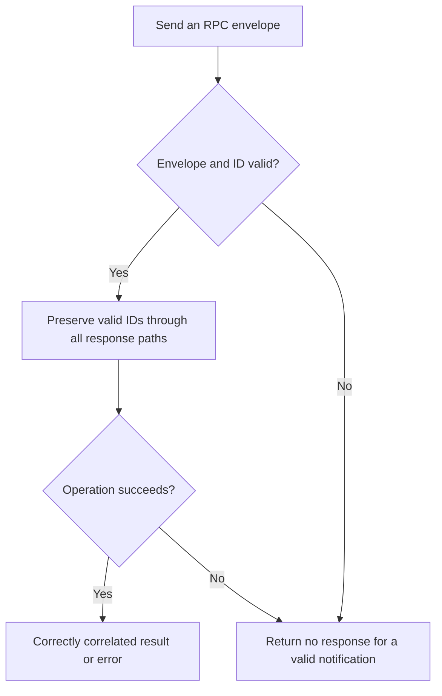

<!-- xone-gap-audit:2026-11-14:pass4:jsonrpc-envelope -->
> GAP-0072 · P1 · source review at `330b742bfa1ef1401c1b9b9be0cf0bd344255cca`. Static evidence; no deployed-node reproduction or benchmark is claimed.

## What

`Rpc::one` clones any id value, including objects and arrays. Quota, timeout, panic and oversized-response paths construct id:null even when a valid request ID was parsed. Batch-wide errors lose correlation and notification-only failure paths can produce replies.

Current implementation:

- [`crates/xone-rpc/src/server.rs`](https://github.com/XDCIndia/xOneRS/blob/330b742bfa1ef1401c1b9b9be0cf0bd344255cca/crates/xone-rpc/src/server.rs)
- [`crates/xone-rpc/src/transport.rs`](https://github.com/XDCIndia/xOneRS/blob/330b742bfa1ef1401c1b9b9be0cf0bd344255cca/crates/xone-rpc/src/transport.rs)

## Why

Clients can leave promises unresolved or misclassify failures when the server changes their request IDs.

Verified competitor implementation references:

- [ethereum/go-ethereum: `rpc/json.go`](https://github.com/ethereum/go-ethereum/blob/8059ff8beb3170eb8b977169ac51bb0423c97ee1/rpc/json.go)
- [ethereum/go-ethereum: `rpc/handler.go`](https://github.com/ethereum/go-ethereum/blob/8059ff8beb3170eb8b977169ac51bb0423c97ee1/rpc/handler.go)

#42 supplies protocol parity. This issue captures specific failure-path correlation defects in the current server.

## 80% of the way to

1. Create a validated request-envelope type before cost admission and dispatch.
2. Retain valid IDs in errors, including timed-out batch members. Define aggregate batch failures using the pinned oracle contract.
3. Suppress replies for valid notifications, including failures after admission. Reject invalid request IDs before executing handlers.

Acceptance criteria:

- [ ] String and numeric IDs survive timeout, quota refusal and handler failure.
- [ ] Object/array IDs fail validation without invoking the method.
- [ ] Mixed batches correlate every response, and notification-only requests produce no JSON-RPC reply.

## ASD-STE100

1. Preserve valid IDs through all response paths.
2. Keep the existing XDC consensus rules unchanged.
3. Check all required input before you start the operation.
4. Keep memory use within the configured limits.
5. Return no response for a valid notification.
6. Test each acceptance case through the actual entry point.

Technical names follow the repository vocabulary. These short instructions follow the requested sentence limits; certified ASD-STE100 vocabulary compliance has not been assessed.

## Diagrams

```mermaid
sequenceDiagram
    participant Actor as RPC caller
    participant Service as RPC dispatcher
    participant Data as Admission and execution
    Actor->>Service: Send an RPC envelope
    Service->>Data: Check required state and limits
    Data-->>Service: State and validation result
    alt Envelope and ID valid
        Service->>Data: Preserve valid IDs through all response paths
        Data-->>Service: Result or operation error
        Service-->>Actor: Correctly correlated result or error
    else Contract cannot be met
        Service-->>Actor: Return no response for a valid notification
    end
```

## Images

N/A. This change affects node behavior. The source links and test fixtures provide the evidence.

## Prompt

```text
Implement GAP-0072 in XDCIndia/xOneRS: Validate request IDs and preserve response correlation on RPC failures.
Observed at 330b742bfa1ef1401c1b9b9be0cf0bd344255cca: `Rpc::one` clones any id value, including objects and arrays. Quota, timeout, panic and oversized-response paths construct id:null even when a valid request ID was parsed. Batch-wide errors lose correlation and notification-only failure paths can produce replies.
Read these target files: crates/xone-rpc/src/server.rs, crates/xone-rpc/src/transport.rs.
Implementation: Create a validated request-envelope type before cost admission and dispatch. Retain valid IDs in errors, including timed-out batch members. Define aggregate batch failures using the pinned oracle contract. Suppress replies for valid notifications, including failures after admission. Reject invalid request IDs before executing handlers.
Acceptance: String and numeric IDs survive timeout, quota refusal and handler failure. Object/array IDs fail validation without invoking the method. Mixed batches correlate every response, and notification-only requests produce no JSON-RPC reply.
Related ownership: #42 supplies protocol parity. This issue captures specific failure-path correlation defects in the current server.
Re-pin current main and the authoritative geth-XDC oracle before editing. Preserve XDC consensus, signatures, encodings, storage publication and configured resource bounds. Use the linked competitor code as design evidence, respecting its license. Write focused failing fixtures, implement the smallest coherent change, and run the applicable repository checks. Report exact commands and results. Open a reviewable PR; do not claim completion from a registered method or a mock-only test.
```

## Workflow

1. **RPC caller:** Send an RPC envelope.
2. **RPC dispatcher:** Check whether envelope and id valid.
3. **RPC dispatcher:** Preserve valid IDs through all response paths through admission and execution.
4. **RPC dispatcher:** On success, provide correctly correlated result or error.
5. **RPC dispatcher:** On refusal or failure, return no response for a valid notification.

The acceptance cases above define the exact errors, ordering and resource boundaries. Verify the real entry point before closing the issue.

## Loop

None. Run the operation only when requested.

## Graph

Lifecycle of this rpc dispatcher operation; this diagram does not change the blockchain consensus state machine.



## Layout

This capability uses a node, command-line, or build interface. It does not require a new graphical screen.

| Interface detail | Placement |
| --- | --- |
| Actor and trigger | RPC caller: send an rpc envelope |
| Input validation | RPC dispatcher: envelope and id valid |
| Output | Correctly correlated result or error |
| Error or refusal | Return no response for a valid notification |
| Implementation files | `crates/xone-rpc/src/server.rs`, `crates/xone-rpc/src/transport.rs` |

Keep field names and response shapes compatible with the specification and acceptance cases above.

## Flow



## Summary

Gap: Validate request IDs and preserve response correlation on RPC failures.
Fix: Create a validated request-envelope type before cost admission and dispatch.
Acceptance: String and numeric IDs survive timeout, quota refusal and handler failure.
