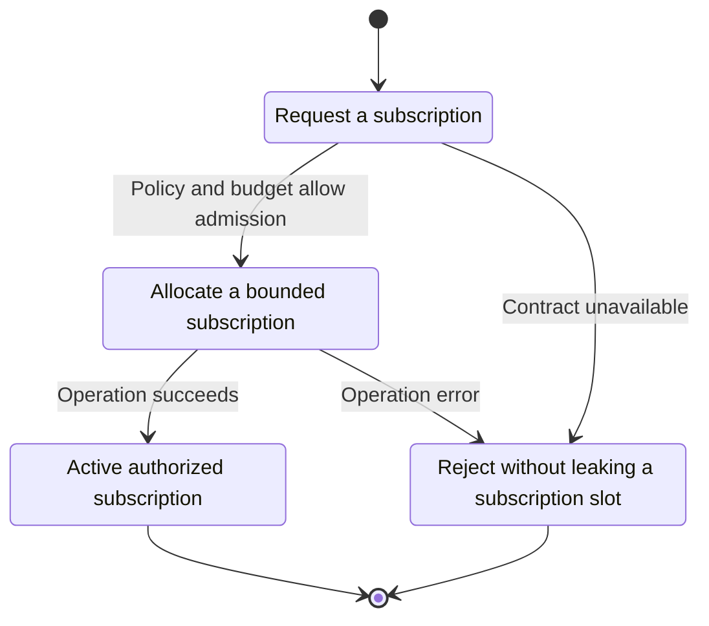
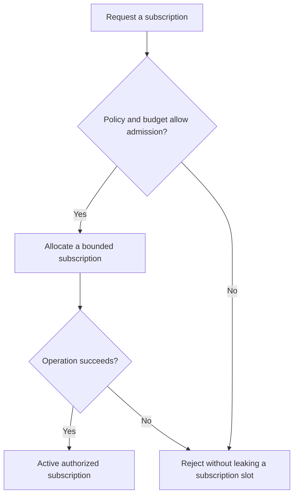

<!-- xone-gap-audit:2026-11-14:pass4:subscription-admission -->
> GAP-0073 · P1 · source review at `330b742bfa1ef1401c1b9b9be0cf0bd344255cca`. Static evidence; no deployed-node reproduction or benchmark is claimed.

## What

`Session::subscription` handles eth_subscribe and eth_unsubscribe before Rpc::serve. It does not check the filtered method registry, JSON-RPC version, token bucket or subscription count. Single subscription requests use this shortcut, while batches go through a path that rejects subscriptions.

Current implementation:

- [`crates/xone-rpc/src/transport.rs`](https://github.com/XDCIndia/xOneRS/blob/330b742bfa1ef1401c1b9b9be0cf0bd344255cca/crates/xone-rpc/src/transport.rs)
- [`crates/xone-rpc/src/subscriptions.rs`](https://github.com/XDCIndia/xOneRS/blob/330b742bfa1ef1401c1b9b9be0cf0bd344255cca/crates/xone-rpc/src/subscriptions.rs)
- [`crates/xone-node/src/services/rpc.rs`](https://github.com/XDCIndia/xOneRS/blob/330b742bfa1ef1401c1b9b9be0cf0bd344255cca/crates/xone-node/src/services/rpc.rs)

## Why

Subscription creation must honor the operator-selected API surface and cannot grow an unbounded registry.

Verified competitor implementation references:

- [ethereum/go-ethereum: `rpc/handler.go`](https://github.com/ethereum/go-ethereum/blob/8059ff8beb3170eb8b977169ac51bb0423c97ee1/rpc/handler.go)
- [ethereum/go-ethereum: `rpc/subscription.go`](https://github.com/ethereum/go-ethereum/blob/8059ff8beb3170eb8b977169ac51bb0423c97ee1/rpc/subscription.go)

#60 is the exposure parent and #122 fixed event publication. This defect is the current bypass around admission, not another event publisher.

## 80% of the way to

1. Route subscription admission through the same validated envelope and transport namespace policy as other methods.
2. Add explicit bounded subscription counts per connection and globally, with documented refusal and cleanup behavior.
3. Support the oracle batch contract and suppress notification replies. Activate notifications only after the subscription response is queued.

Acceptance criteria:

- [ ] Disabling eth on a transport also disables eth subscriptions on that transport.
- [ ] Repeated subscriptions hit a bounded refusal and release capacity on unsubscribe or disconnect.
- [ ] Single and batched subscription requests have consistent validation and no event precedes its subscription response.

## ASD-STE100

1. Allocate a bounded subscription.
2. Keep the existing XDC consensus rules unchanged.
3. Check all required input before you start the operation.
4. Keep memory use within the configured limits.
5. Reject without leaking a subscription slot.
6. Test each acceptance case through the actual entry point.

Technical names follow the repository vocabulary. These short instructions follow the requested sentence limits; certified ASD-STE100 vocabulary compliance has not been assessed.

## Diagrams

```mermaid
sequenceDiagram
    participant Actor as WebSocket caller
    participant Service as Subscription dispatcher
    participant Data as Namespace policy and quotas
    Actor->>Service: Request a subscription
    Service->>Data: Check required state and limits
    Data-->>Service: State and validation result
    alt Policy and budget allow admission
        Service->>Data: Allocate a bounded subscription
        Data-->>Service: Result or operation error
        Service-->>Actor: Active authorized subscription
    else Contract cannot be met
        Service-->>Actor: Reject without leaking a subscription slot
    end
```

## Images

N/A. This change affects node behavior. The source links and test fixtures provide the evidence.

## Prompt

```text
Implement GAP-0073 in XDCIndia/xOneRS: Apply namespace policy and resource admission to subscription requests.
Observed at 330b742bfa1ef1401c1b9b9be0cf0bd344255cca: `Session::subscription` handles eth_subscribe and eth_unsubscribe before Rpc::serve. It does not check the filtered method registry, JSON-RPC version, token bucket or subscription count. Single subscription requests use this shortcut, while batches go through a path that rejects subscriptions.
Read these target files: crates/xone-rpc/src/transport.rs, crates/xone-rpc/src/subscriptions.rs, crates/xone-node/src/services/rpc.rs.
Implementation: Route subscription admission through the same validated envelope and transport namespace policy as other methods. Add explicit bounded subscription counts per connection and globally, with documented refusal and cleanup behavior. Support the oracle batch contract and suppress notification replies. Activate notifications only after the subscription response is queued.
Acceptance: Disabling eth on a transport also disables eth subscriptions on that transport. Repeated subscriptions hit a bounded refusal and release capacity on unsubscribe or disconnect. Single and batched subscription requests have consistent validation and no event precedes its subscription response.
Related ownership: #60 is the exposure parent and #122 fixed event publication. This defect is the current bypass around admission, not another event publisher.
Re-pin current main and the authoritative geth-XDC oracle before editing. Preserve XDC consensus, signatures, encodings, storage publication and configured resource bounds. Use the linked competitor code as design evidence, respecting its license. Write focused failing fixtures, implement the smallest coherent change, and run the applicable repository checks. Report exact commands and results. Open a reviewable PR; do not claim completion from a registered method or a mock-only test.
```

## Workflow

1. **WebSocket caller:** Request a subscription.
2. **Subscription dispatcher:** Check whether policy and budget allow admission.
3. **Subscription dispatcher:** Allocate a bounded subscription through namespace policy and quotas.
4. **Subscription dispatcher:** On success, provide active authorized subscription.
5. **Subscription dispatcher:** On refusal or failure, reject without leaking a subscription slot.

The acceptance cases above define the exact errors, ordering and resource boundaries. Verify the real entry point before closing the issue.

## Loop

None. Run the operation only when requested.

## Graph

Lifecycle of this subscription dispatcher operation; this diagram does not change the blockchain consensus state machine.



## Layout

This capability uses a node, command-line, or build interface. It does not require a new graphical screen.

| Interface detail | Placement |
| --- | --- |
| Actor and trigger | WebSocket caller: request a subscription |
| Input validation | Subscription dispatcher: policy and budget allow admission |
| Output | Active authorized subscription |
| Error or refusal | Reject without leaking a subscription slot |
| Implementation files | `crates/xone-rpc/src/transport.rs`, `crates/xone-rpc/src/subscriptions.rs`, `crates/xone-node/src/services/rpc.rs` |

Keep field names and response shapes compatible with the specification and acceptance cases above.

## Flow



## Summary

Gap: Apply namespace policy and resource admission to subscription requests.
Fix: Route subscription admission through the same validated envelope and transport namespace policy as other methods.
Acceptance: Disabling eth on a transport also disables eth subscriptions on that transport.
