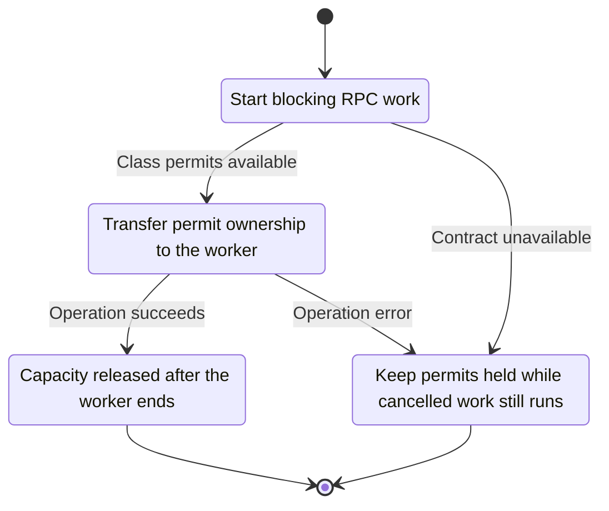
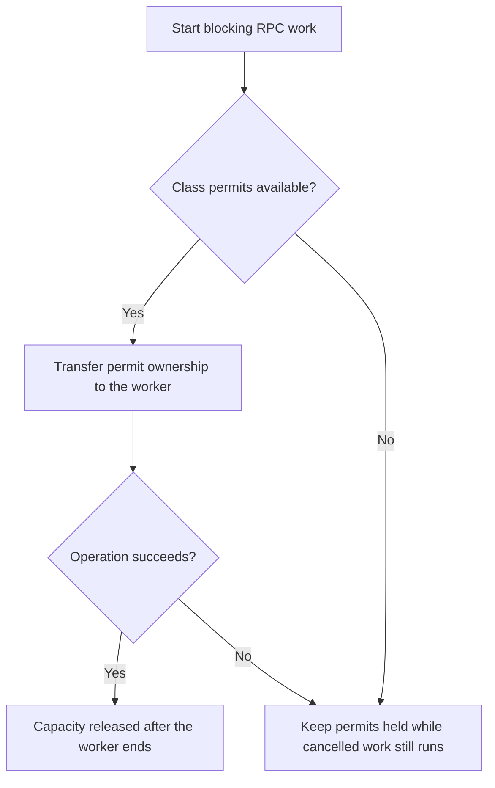

<!-- xone-gap-audit:2026-11-14:pass4:blocking-worker-permits -->
> GAP-0074 · P1 · source review at `330b742bfa1ef1401c1b9b9be0cf0bd344255cca`. Static evidence; no deployed-node reproduction or benchmark is claimed.

## What

The class semaphore permit is owned by the async serve future, while work runs in spawn_blocking. A timeout or dropped request releases the permit even if the worker is still running. A mixed batch acquires only its highest class semaphore, bypassing lower-class concurrency accounting.

Current implementation:

- [`crates/xone-rpc/src/server.rs`](https://github.com/XDCIndia/xOneRS/blob/330b742bfa1ef1401c1b9b9be0cf0bd344255cca/crates/xone-rpc/src/server.rs)
- [`crates/xone-rpc/src/transport.rs`](https://github.com/XDCIndia/xOneRS/blob/330b742bfa1ef1401c1b9b9be0cf0bd344255cca/crates/xone-rpc/src/transport.rs)

## Why

A deadline limits waiting time; it does not stop a blocking thread. Releasing capacity early permits more work than the configured limit.

Verified competitor implementation references:

- [paradigmxyz/reth: `crates/rpc/rpc-eth-api/src/helpers/blocking_task.rs`](https://github.com/paradigmxyz/reth/blob/36600d5ff9628465475dd4c7608e2e9f2fe24273/crates/rpc/rpc-eth-api/src/helpers/blocking_task.rs)
- [paradigmxyz/reth: `crates/tasks/src/pool.rs`](https://github.com/paradigmxyz/reth/blob/36600d5ff9628465475dd4c7608e2e9f2fe24273/crates/tasks/src/pool.rs)

#16 defines budgets. This unit repairs two concrete admission-accounting paths that do not enforce those budgets.

## 80% of the way to

1. Transfer worker resource permits into the blocking closure so cancellation of the waiting future does not release active capacity.
2. Account for each executing method class in a batch, or reserve a documented equivalent set of permits without deadlock.
3. Check cancellation between batch members and inside long operations; instrument actual worker counts separately from waiting requests.

Acceptance criteria:

- [ ] A deliberately slow cancelled handler keeps its permit until it exits.
- [ ] Repeated timeouts cannot increase running workers beyond configured class bounds.
- [ ] Mixed-cost batches and ordinary requests respect each class limit.

## ASD-STE100

1. Transfer permit ownership to the worker.
2. Keep the existing XDC consensus rules unchanged.
3. Check all required input before you start the operation.
4. Keep memory use within the configured limits.
5. Keep permits held while cancelled work still runs.
6. Test each acceptance case through the actual entry point.

Technical names follow the repository vocabulary. These short instructions follow the requested sentence limits; certified ASD-STE100 vocabulary compliance has not been assessed.

## Diagrams

```mermaid
sequenceDiagram
    participant Actor as RPC caller
    participant Service as RPC scheduler
    participant Data as Blocking worker
    Actor->>Service: Start blocking RPC work
    Service->>Data: Check required state and limits
    Data-->>Service: State and validation result
    alt Class permits available
        Service->>Data: Transfer permit ownership to the worker
        Data-->>Service: Result or operation error
        Service-->>Actor: Capacity released after the worker ends
    else Contract cannot be met
        Service-->>Actor: Keep permits held while cancelled work still runs
    end
```

## Images

N/A. This change affects node behavior. The source links and test fixtures provide the evidence.

## Prompt

```text
Implement GAP-0074 in XDCIndia/xOneRS: Hold RPC permits until blocking workers stop and account for each cost class.
Observed at 330b742bfa1ef1401c1b9b9be0cf0bd344255cca: The class semaphore permit is owned by the async serve future, while work runs in spawn_blocking. A timeout or dropped request releases the permit even if the worker is still running. A mixed batch acquires only its highest class semaphore, bypassing lower-class concurrency accounting.
Read these target files: crates/xone-rpc/src/server.rs, crates/xone-rpc/src/transport.rs.
Implementation: Transfer worker resource permits into the blocking closure so cancellation of the waiting future does not release active capacity. Account for each executing method class in a batch, or reserve a documented equivalent set of permits without deadlock. Check cancellation between batch members and inside long operations; instrument actual worker counts separately from waiting requests.
Acceptance: A deliberately slow cancelled handler keeps its permit until it exits. Repeated timeouts cannot increase running workers beyond configured class bounds. Mixed-cost batches and ordinary requests respect each class limit.
Related ownership: #16 defines budgets. This unit repairs two concrete admission-accounting paths that do not enforce those budgets.
Re-pin current main and the authoritative geth-XDC oracle before editing. Preserve XDC consensus, signatures, encodings, storage publication and configured resource bounds. Use the linked competitor code as design evidence, respecting its license. Write focused failing fixtures, implement the smallest coherent change, and run the applicable repository checks. Report exact commands and results. Open a reviewable PR; do not claim completion from a registered method or a mock-only test.
```

## Workflow

1. **RPC caller:** Start blocking RPC work.
2. **RPC scheduler:** Check whether class permits available.
3. **RPC scheduler:** Transfer permit ownership to the worker through blocking worker.
4. **RPC scheduler:** On success, provide capacity released after the worker ends.
5. **RPC scheduler:** On refusal or failure, keep permits held while cancelled work still runs.

The acceptance cases above define the exact errors, ordering and resource boundaries. Verify the real entry point before closing the issue.

## Loop

None. Run the operation only when requested.

## Graph

Lifecycle of this rpc scheduler operation; this diagram does not change the blockchain consensus state machine.



## Layout

This capability uses a node, command-line, or build interface. It does not require a new graphical screen.

| Interface detail | Placement |
| --- | --- |
| Actor and trigger | RPC caller: start blocking rpc work |
| Input validation | RPC scheduler: class permits available |
| Output | Capacity released after the worker ends |
| Error or refusal | Keep permits held while cancelled work still runs |
| Implementation files | `crates/xone-rpc/src/server.rs`, `crates/xone-rpc/src/transport.rs` |

Keep field names and response shapes compatible with the specification and acceptance cases above.

## Flow



## Summary

Gap: Hold RPC permits until blocking workers stop and account for each cost class.
Fix: Transfer worker resource permits into the blocking closure so cancellation of the waiting future does not release active capacity.
Acceptance: A deliberately slow cancelled handler keeps its permit until it exits.
