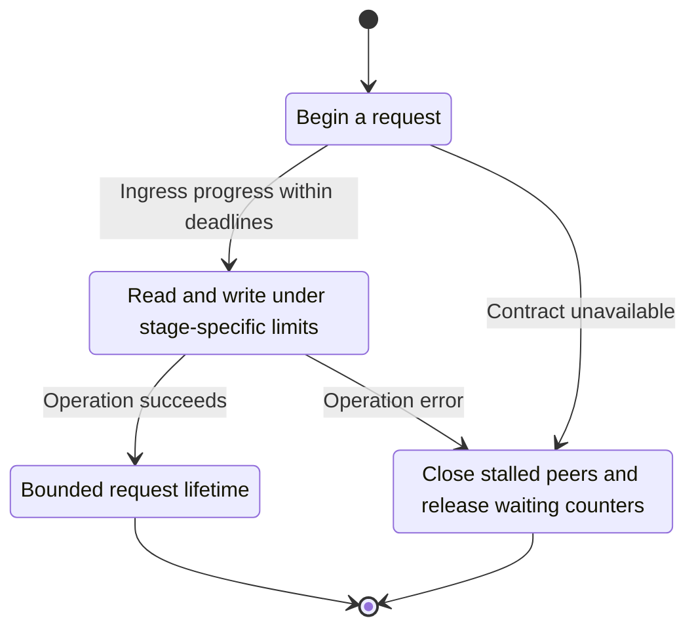
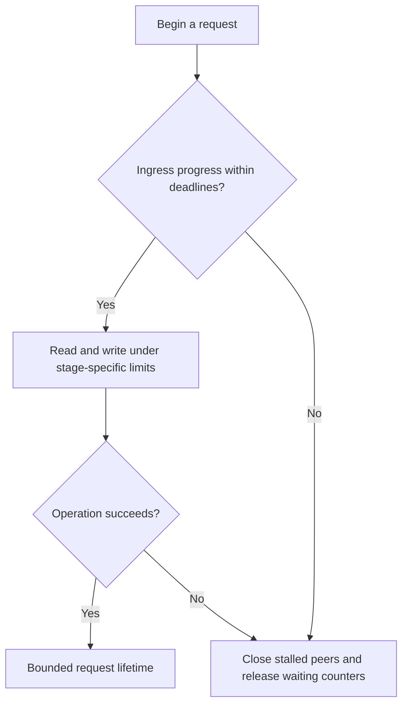

<!-- xone-gap-audit:2026-11-14:pass4:http-ingress-deadlines -->
> GAP-0075 · P1 · source review at `330b742bfa1ef1401c1b9b9be0cf0bd344255cca`. Static evidence; no deployed-node reproduction or benchmark is claimed.

## What

`serve_http` configures no header or idle timeout. `http_handle` acquires a global request permit before collecting the body without a time bound. Method deadlines start only after the complete body reaches Rpc::serve.

Current implementation:

- [`crates/xone-rpc/src/transport.rs`](https://github.com/XDCIndia/xOneRS/blob/330b742bfa1ef1401c1b9b9be0cf0bd344255cca/crates/xone-rpc/src/transport.rs)
- [`crates/xone-rpc/src/server.rs`](https://github.com/XDCIndia/xOneRS/blob/330b742bfa1ef1401c1b9b9be0cf0bd344255cca/crates/xone-rpc/src/server.rs)

## Why

A client that sends headers or a body slowly can hold limited connections and request slots without ever starting an RPC method.

Verified competitor implementation references:

- [ethereum/go-ethereum: `node/rpcstack.go`](https://github.com/ethereum/go-ethereum/blob/8059ff8beb3170eb8b977169ac51bb0423c97ee1/node/rpcstack.go)
- [ethereum/go-ethereum: `rpc/http.go`](https://github.com/ethereum/go-ethereum/blob/8059ff8beb3170eb8b977169ac51bb0423c97ee1/rpc/http.go)

#16 defines RPC budgets and #60 defines exposure. This issue handles pre-dispatch network IO, which method deadlines cannot cover.

## 80% of the way to

1. Add explicit finite header, body-read, idle and response-write deadlines at the HTTP transport layer.
2. Keep byte limits and method deadlines separate. Release waiting counters and permits with drop guards when a connection ends during admission.
3. Ensure transport shutdown cancels idle and partially read connections without waiting for a full body.

Acceptance criteria:

- [ ] Slow-header and stalled-body local fixtures close within the configured deadline.
- [ ] Cancelled waiters do not permanently increase the waiting count.
- [ ] A normal keep-alive client succeeds and a slow client cannot occupy all work slots indefinitely.

## ASD-STE100

1. Read and write under stage-specific limits.
2. Keep the existing XDC consensus rules unchanged.
3. Check all required input before you start the operation.
4. Keep memory use within the configured limits.
5. Close stalled peers and release waiting counters.
6. Test each acceptance case through the actual entry point.

Technical names follow the repository vocabulary. These short instructions follow the requested sentence limits; certified ASD-STE100 vocabulary compliance has not been assessed.

## Diagrams

```mermaid
sequenceDiagram
    participant Actor as HTTP peer
    participant Service as HTTP connection handler
    participant Data as Deadline and admission guards
    Actor->>Service: Begin a request
    Service->>Data: Check required state and limits
    Data-->>Service: State and validation result
    alt Ingress progress within deadlines
        Service->>Data: Read and write under stage-specific limits
        Data-->>Service: Result or operation error
        Service-->>Actor: Bounded request lifetime
    else Contract cannot be met
        Service-->>Actor: Close stalled peers and release waiting counters
    end
```

## Images

N/A. This change affects node behavior. The source links and test fixtures provide the evidence.

## Prompt

```text
Implement GAP-0075 in XDCIndia/xOneRS: Bound HTTP header, body, idle and response-write time before RPC dispatch.
Observed at 330b742bfa1ef1401c1b9b9be0cf0bd344255cca: `serve_http` configures no header or idle timeout. `http_handle` acquires a global request permit before collecting the body without a time bound. Method deadlines start only after the complete body reaches Rpc::serve.
Read these target files: crates/xone-rpc/src/transport.rs, crates/xone-rpc/src/server.rs.
Implementation: Add explicit finite header, body-read, idle and response-write deadlines at the HTTP transport layer. Keep byte limits and method deadlines separate. Release waiting counters and permits with drop guards when a connection ends during admission. Ensure transport shutdown cancels idle and partially read connections without waiting for a full body.
Acceptance: Slow-header and stalled-body local fixtures close within the configured deadline. Cancelled waiters do not permanently increase the waiting count. A normal keep-alive client succeeds and a slow client cannot occupy all work slots indefinitely.
Related ownership: #16 defines RPC budgets and #60 defines exposure. This issue handles pre-dispatch network IO, which method deadlines cannot cover.
Re-pin current main and the authoritative geth-XDC oracle before editing. Preserve XDC consensus, signatures, encodings, storage publication and configured resource bounds. Use the linked competitor code as design evidence, respecting its license. Write focused failing fixtures, implement the smallest coherent change, and run the applicable repository checks. Report exact commands and results. Open a reviewable PR; do not claim completion from a registered method or a mock-only test.
```

## Workflow

1. **HTTP peer:** Begin a request.
2. **HTTP connection handler:** Check whether ingress progress within deadlines.
3. **HTTP connection handler:** Read and write under stage-specific limits through deadline and admission guards.
4. **HTTP connection handler:** On success, provide bounded request lifetime.
5. **HTTP connection handler:** On refusal or failure, close stalled peers and release waiting counters.

The acceptance cases above define the exact errors, ordering and resource boundaries. Verify the real entry point before closing the issue.

## Loop

None. Run the operation only when requested.

## Graph

Lifecycle of this http connection handler operation; this diagram does not change the blockchain consensus state machine.



## Layout

This capability uses a node, command-line, or build interface. It does not require a new graphical screen.

| Interface detail | Placement |
| --- | --- |
| Actor and trigger | HTTP peer: begin a request |
| Input validation | HTTP connection handler: ingress progress within deadlines |
| Output | Bounded request lifetime |
| Error or refusal | Close stalled peers and release waiting counters |
| Implementation files | `crates/xone-rpc/src/transport.rs`, `crates/xone-rpc/src/server.rs` |

Keep field names and response shapes compatible with the specification and acceptance cases above.

## Flow



## Summary

Gap: Bound HTTP header, body, idle and response-write time before RPC dispatch.
Fix: Add explicit finite header, body-read, idle and response-write deadlines at the HTTP transport layer.
Acceptance: Slow-header and stalled-body local fixtures close within the configured deadline.
