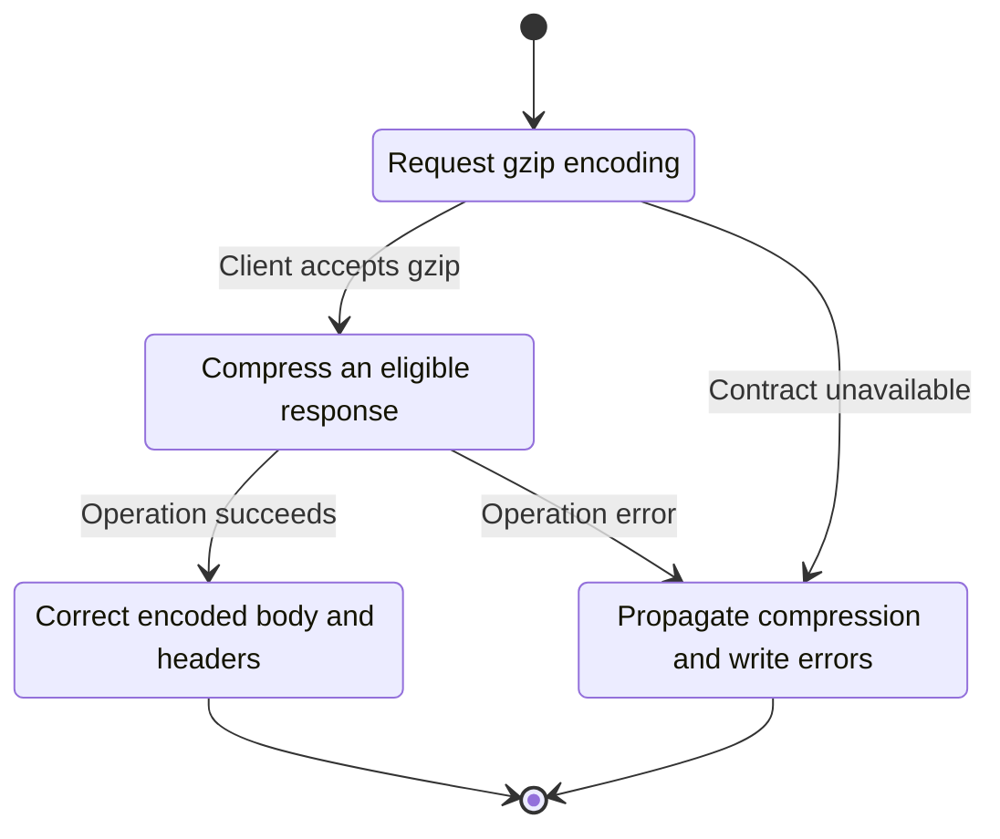
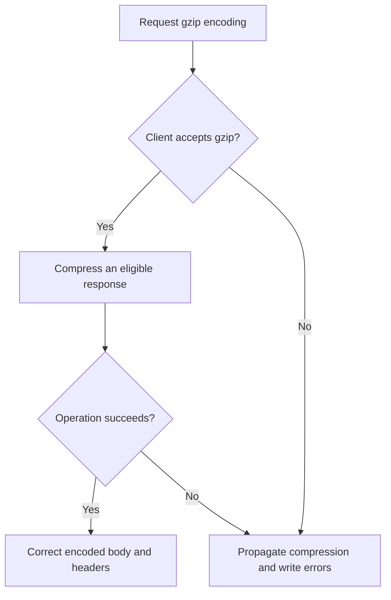

<!-- xone-gap-audit:2026-11-14:pass4:http-compression -->
> GAP-0076 · P3 · source review at `330b742bfa1ef1401c1b9b9be0cf0bd344255cca`. Static evidence; no deployed-node reproduction or benchmark is claimed.

## What

`http_reply` always returns the uncompressed JSON bytes. The transport does not inspect Accept-Encoding or emit Content-Encoding.

Current implementation:

- [`crates/xone-rpc/src/transport.rs`](https://github.com/XDCIndia/xOneRS/blob/330b742bfa1ef1401c1b9b9be0cf0bd344255cca/crates/xone-rpc/src/transport.rs)

## Why

RPC providers and remote indexers transfer large JSON responses that competitor clients can compress.

Verified competitor implementation references:

- [ethereum/go-ethereum: `node/rpcstack.go`](https://github.com/ethereum/go-ethereum/blob/8059ff8beb3170eb8b977169ac51bb0423c97ee1/node/rpcstack.go)
- [XinFinOrg/XDPoSChain: `node/rpcstack.go`](https://github.com/XinFinOrg/XDPoSChain/blob/cb1ef79073c05f50b9df75b1e740387b9d72af99/node/rpcstack.go)

#257 wires CORS. Compression is a separate opt-in transport efficiency feature.

## 80% of the way to

1. Add standards-compliant gzip response negotiation with correct Vary headers and a small-response threshold.
2. Apply response-size limits to uncompressed data before compression and bound compression work.
3. Leave WebSocket framing and response content unchanged; share the transport middleware contract with the CORS change.

Acceptance criteria:

- [ ] Decompressed responses equal ordinary responses byte for byte.
- [ ] Clients without gzip support receive plain JSON; gzip;q=0 is not compressed.
- [ ] Large receipt/log responses show measured byte savings without escaping CPU or size limits.

## ASD-STE100

1. Compress an eligible response.
2. Keep the existing XDC consensus rules unchanged.
3. Check all required input before you start the operation.
4. Keep memory use within the configured limits.
5. Propagate compression and write errors.
6. Test each acceptance case through the actual entry point.

Technical names follow the repository vocabulary. These short instructions follow the requested sentence limits; certified ASD-STE100 vocabulary compliance has not been assessed.

## Diagrams

```mermaid
sequenceDiagram
    participant Actor as HTTP client
    participant Service as HTTP response writer
    participant Data as Streaming compressor
    Actor->>Service: Request gzip encoding
    Service->>Data: Check required state and limits
    Data-->>Service: State and validation result
    alt Client accepts gzip
        Service->>Data: Compress an eligible response
        Data-->>Service: Result or operation error
        Service-->>Actor: Correct encoded body and headers
    else Contract cannot be met
        Service-->>Actor: Propagate compression and write errors
    end
```

## Images

N/A. This change affects node behavior. The source links and test fixtures provide the evidence.

## Prompt

```text
Implement GAP-0076 in XDCIndia/xOneRS: Negotiate gzip compression for large HTTP RPC responses.
Observed at 330b742bfa1ef1401c1b9b9be0cf0bd344255cca: `http_reply` always returns the uncompressed JSON bytes. The transport does not inspect Accept-Encoding or emit Content-Encoding.
Read these target files: crates/xone-rpc/src/transport.rs.
Implementation: Add standards-compliant gzip response negotiation with correct Vary headers and a small-response threshold. Apply response-size limits to uncompressed data before compression and bound compression work. Leave WebSocket framing and response content unchanged; share the transport middleware contract with the CORS change.
Acceptance: Decompressed responses equal ordinary responses byte for byte. Clients without gzip support receive plain JSON; gzip;q=0 is not compressed. Large receipt/log responses show measured byte savings without escaping CPU or size limits.
Related ownership: #257 wires CORS. Compression is a separate opt-in transport efficiency feature.
Re-pin current main and the authoritative geth-XDC oracle before editing. Preserve XDC consensus, signatures, encodings, storage publication and configured resource bounds. Use the linked competitor code as design evidence, respecting its license. Write focused failing fixtures, implement the smallest coherent change, and run the applicable repository checks. Report exact commands and results. Open a reviewable PR; do not claim completion from a registered method or a mock-only test.
```

## Workflow

1. **HTTP client:** Request gzip encoding.
2. **HTTP response writer:** Check whether client accepts gzip.
3. **HTTP response writer:** Compress an eligible response through streaming compressor.
4. **HTTP response writer:** On success, provide correct encoded body and headers.
5. **HTTP response writer:** On refusal or failure, propagate compression and write errors.

The acceptance cases above define the exact errors, ordering and resource boundaries. Verify the real entry point before closing the issue.

## Loop

None. Run the operation only when requested.

## Graph

Lifecycle of this http response writer operation; this diagram does not change the blockchain consensus state machine.



## Layout

This capability uses a node, command-line, or build interface. It does not require a new graphical screen.

| Interface detail | Placement |
| --- | --- |
| Actor and trigger | HTTP client: request gzip encoding |
| Input validation | HTTP response writer: client accepts gzip |
| Output | Correct encoded body and headers |
| Error or refusal | Propagate compression and write errors |
| Implementation files | `crates/xone-rpc/src/transport.rs` |

Keep field names and response shapes compatible with the specification and acceptance cases above.

## Flow



## Summary

Gap: Negotiate gzip compression for large HTTP RPC responses.
Fix: Add standards-compliant gzip response negotiation with correct Vary headers and a small-response threshold.
Acceptance: Decompressed responses equal ordinary responses byte for byte.
