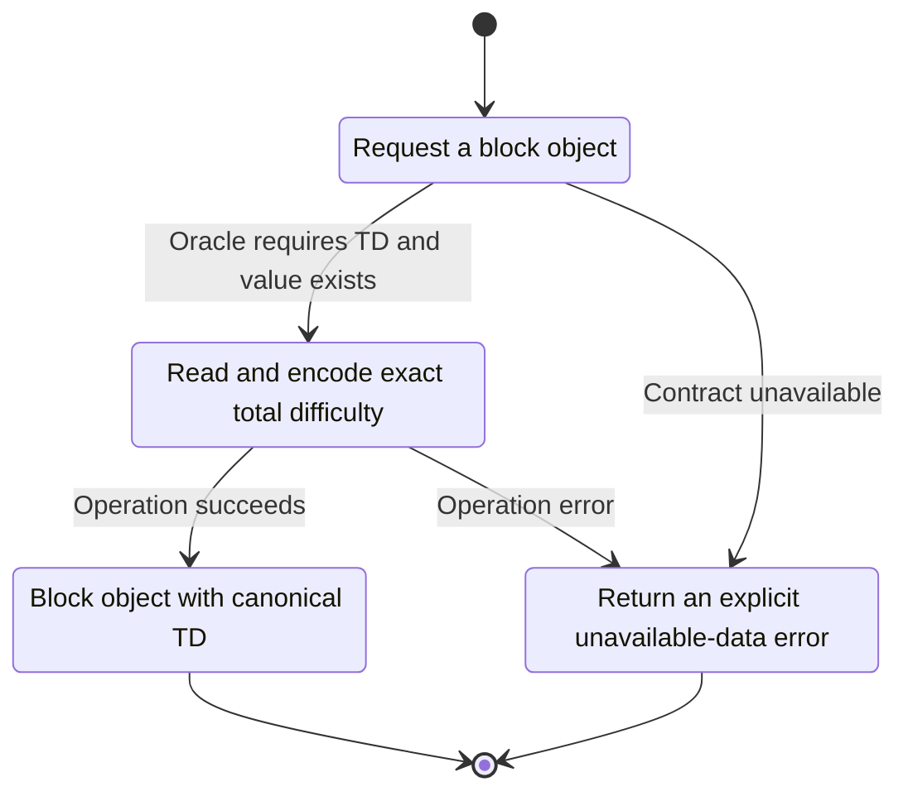
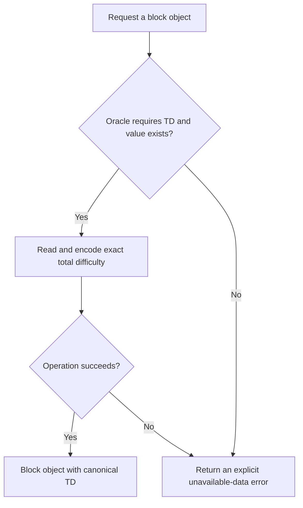

<!-- xone-gap-audit:2026-11-14:pass4:block-total-difficulty -->
> GAP-0077 · P2 · source review at `330b742bfa1ef1401c1b9b9be0cf0bd344255cca`. Static evidence; no deployed-node reproduction or benchmark is claimed.

## What

`block_json` emits header difficulty but no totalDifficulty, and ChainApi exposes no total-difficulty lookup. The public XDC reference includes the accumulated value in block responses.

Current implementation:

- [`crates/xone-rpc/src/json.rs`](https://github.com/XDCIndia/xOneRS/blob/330b742bfa1ef1401c1b9b9be0cf0bd344255cca/crates/xone-rpc/src/json.rs)
- [`crates/xone-rpc/src/api.rs`](https://github.com/XDCIndia/xOneRS/blob/330b742bfa1ef1401c1b9b9be0cf0bd344255cca/crates/xone-rpc/src/api.rs)
- [`crates/xone-node/src/services/rpc.rs`](https://github.com/XDCIndia/xOneRS/blob/330b742bfa1ef1401c1b9b9be0cf0bd344255cca/crates/xone-node/src/services/rpc.rs)
- [`crates/xone-node/src/services/hist.rs`](https://github.com/XDCIndia/xOneRS/blob/330b742bfa1ef1401c1b9b9be0cf0bd344255cca/crates/xone-node/src/services/hist.rs)

## Why

Explorers and client-comparison tools need the same accumulated-difficulty field as existing XDC nodes.

Verified competitor implementation references:

- [XinFinOrg/XDPoSChain: `internal/ethapi/api.go`](https://github.com/XinFinOrg/XDPoSChain/blob/cb1ef79073c05f50b9df75b1e740387b9d72af99/internal/ethapi/api.go)
- [XinFinOrg/XDPoSChain: `eth/api_backend.go`](https://github.com/XinFinOrg/XDPoSChain/blob/cb1ef79073c05f50b9df75b1e740387b9d72af99/eth/api_backend.go)

#119 concerns P2P Status ranking after snap. This issue adds the missing RPC field and reuses its corrected TD source.

## 80% of the way to

1. Expose an exact stored accumulated-difficulty read by block hash and serialize it where the pinned XDC oracle does.
2. Use authenticated bootstrap metadata for a snap pivot; do not count only blocks since the pivot or substitute header difficulty.
3. Specify missing-data behavior and retain correct values through restart and reorg.

Acceptance criteria:

- [ ] Full and snap followers return identical totalDifficulty for the same block.
- [ ] By-number and by-hash responses match the pinned XDC oracle.
- [ ] A missing accumulated value is never invented from the local sync start.

## ASD-STE100

1. Read and encode exact total difficulty.
2. Keep the existing XDC consensus rules unchanged.
3. Check all required input before you start the operation.
4. Keep memory use within the configured limits.
5. Return an explicit unavailable-data error.
6. Test each acceptance case through the actual entry point.

Technical names follow the repository vocabulary. These short instructions follow the requested sentence limits; certified ASD-STE100 vocabulary compliance has not been assessed.

## Diagrams

```mermaid
sequenceDiagram
    participant Actor as RPC caller
    participant Service as Block RPC encoder
    participant Data as Total difficulty index
    Actor->>Service: Request a block object
    Service->>Data: Check required state and limits
    Data-->>Service: State and validation result
    alt Oracle requires TD and value exists
        Service->>Data: Read and encode exact total difficulty
        Data-->>Service: Result or operation error
        Service-->>Actor: Block object with canonical TD
    else Contract cannot be met
        Service-->>Actor: Return an explicit unavailable-data error
    end
```

## Images

N/A. This change affects node behavior. The source links and test fixtures provide the evidence.

## Prompt

```text
Implement GAP-0077 in XDCIndia/xOneRS: Include exact totalDifficulty in XDC block RPC responses.
Observed at 330b742bfa1ef1401c1b9b9be0cf0bd344255cca: `block_json` emits header difficulty but no totalDifficulty, and ChainApi exposes no total-difficulty lookup. The public XDC reference includes the accumulated value in block responses.
Read these target files: crates/xone-rpc/src/json.rs, crates/xone-rpc/src/api.rs, crates/xone-node/src/services/rpc.rs, crates/xone-node/src/services/hist.rs.
Implementation: Expose an exact stored accumulated-difficulty read by block hash and serialize it where the pinned XDC oracle does. Use authenticated bootstrap metadata for a snap pivot; do not count only blocks since the pivot or substitute header difficulty. Specify missing-data behavior and retain correct values through restart and reorg.
Acceptance: Full and snap followers return identical totalDifficulty for the same block. By-number and by-hash responses match the pinned XDC oracle. A missing accumulated value is never invented from the local sync start.
Related ownership: #119 concerns P2P Status ranking after snap. This issue adds the missing RPC field and reuses its corrected TD source.
Re-pin current main and the authoritative geth-XDC oracle before editing. Preserve XDC consensus, signatures, encodings, storage publication and configured resource bounds. Use the linked competitor code as design evidence, respecting its license. Write focused failing fixtures, implement the smallest coherent change, and run the applicable repository checks. Report exact commands and results. Open a reviewable PR; do not claim completion from a registered method or a mock-only test.
```

## Workflow

1. **RPC caller:** Request a block object.
2. **Block RPC encoder:** Check whether oracle requires td and value exists.
3. **Block RPC encoder:** Read and encode exact total difficulty through total difficulty index.
4. **Block RPC encoder:** On success, provide block object with canonical td.
5. **Block RPC encoder:** On refusal or failure, return an explicit unavailable-data error.

The acceptance cases above define the exact errors, ordering and resource boundaries. Verify the real entry point before closing the issue.

## Loop

None. Run the operation only when requested.

## Graph

Lifecycle of this block rpc encoder operation; this diagram does not change the blockchain consensus state machine.



## Layout

This capability uses a node, command-line, or build interface. It does not require a new graphical screen.

| Interface detail | Placement |
| --- | --- |
| Actor and trigger | RPC caller: request a block object |
| Input validation | Block RPC encoder: oracle requires td and value exists |
| Output | Block object with canonical TD |
| Error or refusal | Return an explicit unavailable-data error |
| Implementation files | `crates/xone-rpc/src/json.rs`, `crates/xone-rpc/src/api.rs`, `crates/xone-node/src/services/rpc.rs`, `crates/xone-node/src/services/hist.rs` |

Keep field names and response shapes compatible with the specification and acceptance cases above.

## Flow



## Summary

Gap: Include exact totalDifficulty in XDC block RPC responses.
Fix: Expose an exact stored accumulated-difficulty read by block hash and serialize it where the pinned XDC oracle does.
Acceptance: Full and snap followers return identical totalDifficulty for the same block.
