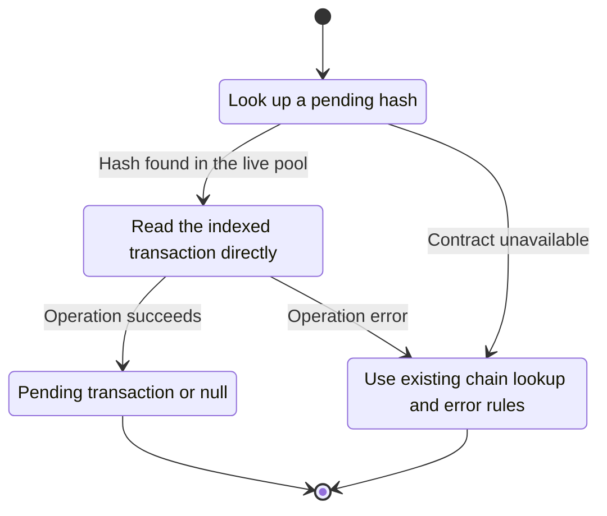
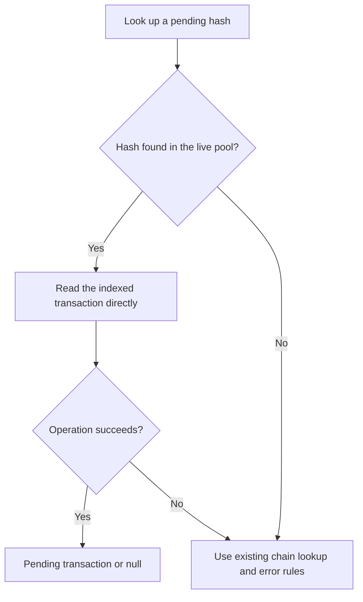

<!-- xone-gap-audit:2026-11-14:pass4:pool-hash-lookup -->
> GAP-0078 · P2 · source review at `330b742bfa1ef1401c1b9b9be0cf0bd344255cca`. Static evidence; no deployed-node reproduction or benchmark is claimed.

## What

After the chain lookup misses, tx_by_hash calls PoolApi::content, clones both pool maps and hashes every transaction. The underlying Pool already has get(hash) backed by its lookup index.

Current implementation:

- [`crates/xone-rpc/src/eth.rs`](https://github.com/XDCIndia/xOneRS/blob/330b742bfa1ef1401c1b9b9be0cf0bd344255cca/crates/xone-rpc/src/eth.rs)
- [`crates/xone-rpc/src/api.rs`](https://github.com/XDCIndia/xOneRS/blob/330b742bfa1ef1401c1b9b9be0cf0bd344255cca/crates/xone-rpc/src/api.rs)
- [`crates/xone-node/src/services/pool.rs`](https://github.com/XDCIndia/xOneRS/blob/330b742bfa1ef1401c1b9b9be0cf0bd344255cca/crates/xone-node/src/services/pool.rs)
- [`crates/xone-builder/src/txpool/mod.rs`](https://github.com/XDCIndia/xOneRS/blob/330b742bfa1ef1401c1b9b9be0cf0bd344255cca/crates/xone-builder/src/txpool/mod.rs)

## Why

A cheap-looking hash query currently performs work proportional to the entire pool and holds avoidable allocations.

Verified competitor implementation references:

- [ethereum/go-ethereum: `eth/api_backend.go`](https://github.com/ethereum/go-ethereum/blob/8059ff8beb3170eb8b977169ac51bb0423c97ee1/eth/api_backend.go)
- [ethereum/go-ethereum: `core/txpool/txpool.go`](https://github.com/ethereum/go-ethereum/blob/8059ff8beb3170eb8b977169ac51bb0423c97ee1/core/txpool/txpool.go)

#165 adds pool operator controls. This is a bounded lookup optimization in an existing read method.

## 80% of the way to

1. Expose a read-only transaction-by-hash method in PoolApi and implement it through Pool::get.
2. Return one owned/immutable transaction without holding the pool lock during JSON encoding.
3. Keep queued transactions visible and preserve null for an unknown hash.

Acceptance criteria:

- [ ] Pending, queued, replaced and unknown hash fixtures preserve results.
- [ ] A measured lookup does not clone or hash unrelated transactions.
- [ ] Concurrent pool mutation cannot produce an inconsistent transaction representation.

## ASD-STE100

1. Read the indexed transaction directly.
2. Keep the existing XDC consensus rules unchanged.
3. Check all required input before you start the operation.
4. Keep memory use within the configured limits.
5. Use existing chain lookup and error rules.
6. Test each acceptance case through the actual entry point.

Technical names follow the repository vocabulary. These short instructions follow the requested sentence limits; certified ASD-STE100 vocabulary compliance has not been assessed.

## Diagrams

```mermaid
sequenceDiagram
    participant Actor as RPC caller
    participant Service as Transaction RPC handler
    participant Data as Pool hash index
    Actor->>Service: Look up a pending hash
    Service->>Data: Check required state and limits
    Data-->>Service: State and validation result
    alt Hash found in the live pool
        Service->>Data: Read the indexed transaction directly
        Data-->>Service: Result or operation error
        Service-->>Actor: Pending transaction or null
    else Contract cannot be met
        Service-->>Actor: Use existing chain lookup and error rules
    end
```

## Images

N/A. This change affects node behavior. The source links and test fixtures provide the evidence.

## Prompt

```text
Implement GAP-0078 in XDCIndia/xOneRS: Use the txpool hash index for eth_getTransactionByHash.
Observed at 330b742bfa1ef1401c1b9b9be0cf0bd344255cca: After the chain lookup misses, tx_by_hash calls PoolApi::content, clones both pool maps and hashes every transaction. The underlying Pool already has get(hash) backed by its lookup index.
Read these target files: crates/xone-rpc/src/eth.rs, crates/xone-rpc/src/api.rs, crates/xone-node/src/services/pool.rs, crates/xone-builder/src/txpool/mod.rs.
Implementation: Expose a read-only transaction-by-hash method in PoolApi and implement it through Pool::get. Return one owned/immutable transaction without holding the pool lock during JSON encoding. Keep queued transactions visible and preserve null for an unknown hash.
Acceptance: Pending, queued, replaced and unknown hash fixtures preserve results. A measured lookup does not clone or hash unrelated transactions. Concurrent pool mutation cannot produce an inconsistent transaction representation.
Related ownership: #165 adds pool operator controls. This is a bounded lookup optimization in an existing read method.
Re-pin current main and the authoritative geth-XDC oracle before editing. Preserve XDC consensus, signatures, encodings, storage publication and configured resource bounds. Use the linked competitor code as design evidence, respecting its license. Write focused failing fixtures, implement the smallest coherent change, and run the applicable repository checks. Report exact commands and results. Open a reviewable PR; do not claim completion from a registered method or a mock-only test.
```

## Workflow

1. **RPC caller:** Look up a pending hash.
2. **Transaction RPC handler:** Check whether hash found in the live pool.
3. **Transaction RPC handler:** Read the indexed transaction directly through pool hash index.
4. **Transaction RPC handler:** On success, provide pending transaction or null.
5. **Transaction RPC handler:** On refusal or failure, use existing chain lookup and error rules.

The acceptance cases above define the exact errors, ordering and resource boundaries. Verify the real entry point before closing the issue.

## Loop

None. Run the operation only when requested.

## Graph

Lifecycle of this transaction rpc handler operation; this diagram does not change the blockchain consensus state machine.



## Layout

This capability uses a node, command-line, or build interface. It does not require a new graphical screen.

| Interface detail | Placement |
| --- | --- |
| Actor and trigger | RPC caller: look up a pending hash |
| Input validation | Transaction RPC handler: hash found in the live pool |
| Output | Pending transaction or null |
| Error or refusal | Use existing chain lookup and error rules |
| Implementation files | `crates/xone-rpc/src/eth.rs`, `crates/xone-rpc/src/api.rs`, `crates/xone-node/src/services/pool.rs`, `crates/xone-builder/src/txpool/mod.rs` |

Keep field names and response shapes compatible with the specification and acceptance cases above.

## Flow



## Summary

Gap: Use the txpool hash index for eth_getTransactionByHash.
Fix: Expose a read-only transaction-by-hash method in PoolApi and implement it through Pool::get.
Acceptance: Pending, queued, replaced and unknown hash fixtures preserve results.
