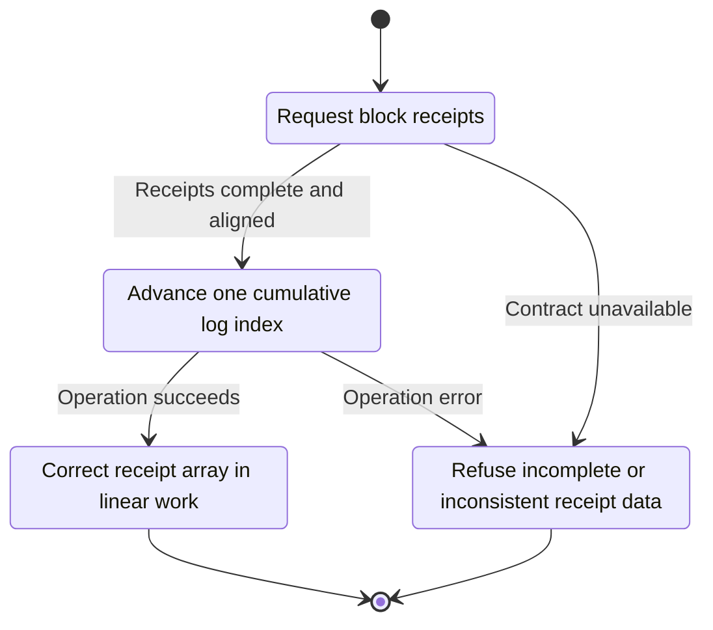
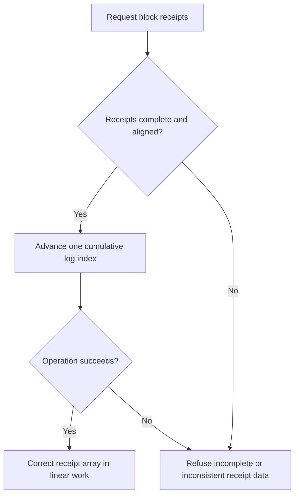

<!-- xone-gap-audit:2026-11-14:pass4:receipt-linear-encoding -->
> GAP-0079 · P2 · source review at `330b742bfa1ef1401c1b9b9be0cf0bd344255cca`. Static evidence; no deployed-node reproduction or benchmark is claimed.

## What

`block_receipts` invokes receipt_json for each transaction. Each call sums logs in receipts[..i] to find its first index, creating quadratic prefix work across a large block.

Current implementation:

- [`crates/xone-rpc/src/json.rs`](https://github.com/XDCIndia/xOneRS/blob/330b742bfa1ef1401c1b9b9be0cf0bd344255cca/crates/xone-rpc/src/json.rs)
- [`crates/xone-rpc/src/eth.rs`](https://github.com/XDCIndia/xOneRS/blob/330b742bfa1ef1401c1b9b9be0cf0bd344255cca/crates/xone-rpc/src/eth.rs)

## Why

Large receipt responses should scale with their output size rather than repeatedly traversing earlier receipts.

Verified competitor implementation references:

- [ethereum/go-ethereum: `core/types/receipt.go`](https://github.com/ethereum/go-ethereum/blob/8059ff8beb3170eb8b977169ac51bb0423c97ee1/core/types/receipt.go)
- [ethereum/go-ethereum: `internal/ethapi/api.go`](https://github.com/ethereum/go-ethereum/blob/8059ff8beb3170eb8b977169ac51bb0423c97ee1/internal/ethapi/api.go)

#244 and #245 optimize execution roots. This issue removes repeated work in RPC response construction.

## 80% of the way to

1. Compute cumulative gas and starting log indexes in one pass for block-wide serialization.
2. Pass the derived receipt context to the encoder while preserving the standalone transaction-receipt path.
3. Keep ordering, receipt types and XDC-specific transaction decoding unchanged.

Acceptance criteria:

- [ ] Every receipt and log index is byte-equivalent before and after the change.
- [ ] A large synthetic receipt list demonstrates linear prefix operations with an instrumented counter.
- [ ] Empty receipts, empty logs and mixed receipt types are covered.

## ASD-STE100

1. Advance one cumulative log index.
2. Keep the existing XDC consensus rules unchanged.
3. Check all required input before you start the operation.
4. Keep memory use within the configured limits.
5. Refuse incomplete or inconsistent receipt data.
6. Test each acceptance case through the actual entry point.

Technical names follow the repository vocabulary. These short instructions follow the requested sentence limits; certified ASD-STE100 vocabulary compliance has not been assessed.

## Diagrams

```mermaid
sequenceDiagram
    participant Actor as RPC caller
    participant Service as Receipt encoder
    participant Data as Ordered receipts
    Actor->>Service: Request block receipts
    Service->>Data: Check required state and limits
    Data-->>Service: State and validation result
    alt Receipts complete and aligned
        Service->>Data: Advance one cumulative log index
        Data-->>Service: Result or operation error
        Service-->>Actor: Correct receipt array in linear work
    else Contract cannot be met
        Service-->>Actor: Refuse incomplete or inconsistent receipt data
    end
```

## Images

N/A. This change affects node behavior. The source links and test fixtures provide the evidence.

## Prompt

```text
Implement GAP-0079 in XDCIndia/xOneRS: Serialize block receipts with one cumulative log-index pass.
Observed at 330b742bfa1ef1401c1b9b9be0cf0bd344255cca: `block_receipts` invokes receipt_json for each transaction. Each call sums logs in receipts[..i] to find its first index, creating quadratic prefix work across a large block.
Read these target files: crates/xone-rpc/src/json.rs, crates/xone-rpc/src/eth.rs.
Implementation: Compute cumulative gas and starting log indexes in one pass for block-wide serialization. Pass the derived receipt context to the encoder while preserving the standalone transaction-receipt path. Keep ordering, receipt types and XDC-specific transaction decoding unchanged.
Acceptance: Every receipt and log index is byte-equivalent before and after the change. A large synthetic receipt list demonstrates linear prefix operations with an instrumented counter. Empty receipts, empty logs and mixed receipt types are covered.
Related ownership: #244 and #245 optimize execution roots. This issue removes repeated work in RPC response construction.
Re-pin current main and the authoritative geth-XDC oracle before editing. Preserve XDC consensus, signatures, encodings, storage publication and configured resource bounds. Use the linked competitor code as design evidence, respecting its license. Write focused failing fixtures, implement the smallest coherent change, and run the applicable repository checks. Report exact commands and results. Open a reviewable PR; do not claim completion from a registered method or a mock-only test.
```

## Workflow

1. **RPC caller:** Request block receipts.
2. **Receipt encoder:** Check whether receipts complete and aligned.
3. **Receipt encoder:** Advance one cumulative log index through ordered receipts.
4. **Receipt encoder:** On success, provide correct receipt array in linear work.
5. **Receipt encoder:** On refusal or failure, refuse incomplete or inconsistent receipt data.

The acceptance cases above define the exact errors, ordering and resource boundaries. Verify the real entry point before closing the issue.

## Loop

None. Run the operation only when requested.

## Graph

Lifecycle of this receipt encoder operation; this diagram does not change the blockchain consensus state machine.



## Layout

This capability uses a node, command-line, or build interface. It does not require a new graphical screen.

| Interface detail | Placement |
| --- | --- |
| Actor and trigger | RPC caller: request block receipts |
| Input validation | Receipt encoder: receipts complete and aligned |
| Output | Correct receipt array in linear work |
| Error or refusal | Refuse incomplete or inconsistent receipt data |
| Implementation files | `crates/xone-rpc/src/json.rs`, `crates/xone-rpc/src/eth.rs` |

Keep field names and response shapes compatible with the specification and acceptance cases above.

## Flow



## Summary

Gap: Serialize block receipts with one cumulative log-index pass.
Fix: Compute cumulative gas and starting log indexes in one pass for block-wide serialization.
Acceptance: Every receipt and log index is byte-equivalent before and after the change.
