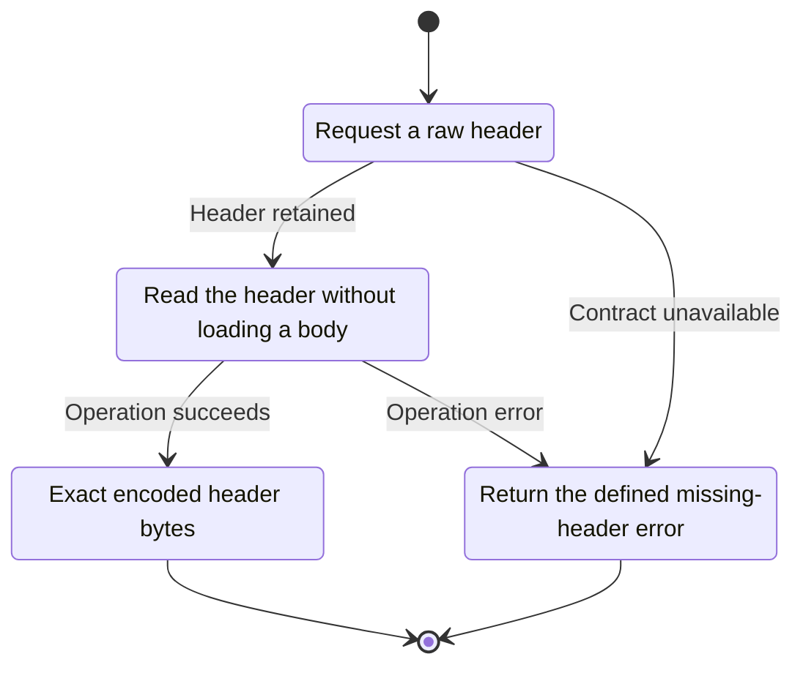
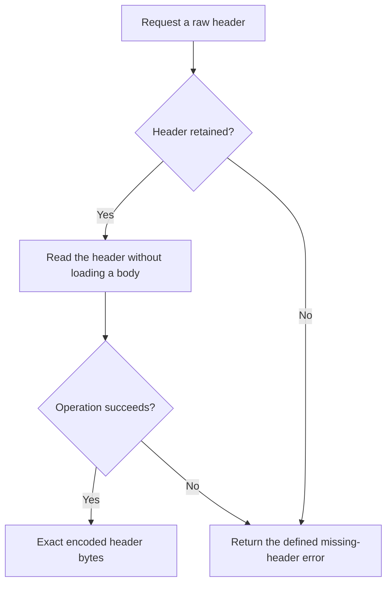

<!-- xone-gap-audit:2026-11-14:pass4:raw-header-retention -->
> GAP-0080 · P2 · source review at `330b742bfa1ef1401c1b9b9be0cf0bd344255cca`. Static evidence; no deployed-node reproduction or benchmark is claimed.

## What

`debug_getRawHeader` calls block_of, which checks body retention and loads a BlockView. A header-only request therefore depends on block body availability despite ChainApi::header already existing.

Current implementation:

- [`crates/xone-rpc/src/debug.rs`](https://github.com/XDCIndia/xOneRS/blob/330b742bfa1ef1401c1b9b9be0cf0bd344255cca/crates/xone-rpc/src/debug.rs)
- [`crates/xone-rpc/src/eth.rs`](https://github.com/XDCIndia/xOneRS/blob/330b742bfa1ef1401c1b9b9be0cf0bd344255cca/crates/xone-rpc/src/eth.rs)
- [`crates/xone-rpc/src/api.rs`](https://github.com/XDCIndia/xOneRS/blob/330b742bfa1ef1401c1b9b9be0cf0bd344255cca/crates/xone-rpc/src/api.rs)

## Why

Operators need header diagnostics on minimal and pruned nodes even when full bodies have been removed.

Verified competitor implementation references:

- [ethereum/go-ethereum: `internal/ethapi/dbapi.go`](https://github.com/ethereum/go-ethereum/blob/8059ff8beb3170eb8b977169ac51bb0423c97ee1/internal/ethapi/dbapi.go)

#160 adds other diagnostics and #156 adds header methods. This corrects an already registered raw-header method.

## 80% of the way to

1. Resolve the selector to a retained header using the header history class and header lookup.
2. Keep debug_getRawBlock on its body-aware path.
3. Preserve canonical selector semantics and distinguish unknown headers from pruned header history.

Acceptance criteria:

- [ ] A retained header with a pruned body can be returned as exact RLP.
- [ ] No block-body read occurs for this method.
- [ ] An actually unavailable header returns the documented null/error contract.

## ASD-STE100

1. Read the header without loading a body.
2. Keep the existing XDC consensus rules unchanged.
3. Check all required input before you start the operation.
4. Keep memory use within the configured limits.
5. Return the defined missing-header error.
6. Test each acceptance case through the actual entry point.

Technical names follow the repository vocabulary. These short instructions follow the requested sentence limits; certified ASD-STE100 vocabulary compliance has not been assessed.

## Diagrams

```mermaid
sequenceDiagram
    participant Actor as Debug caller
    participant Service as Debug RPC handler
    participant Data as Retained header store
    Actor->>Service: Request a raw header
    Service->>Data: Check required state and limits
    Data-->>Service: State and validation result
    alt Header retained
        Service->>Data: Read the header without loading a body
        Data-->>Service: Result or operation error
        Service-->>Actor: Exact encoded header bytes
    else Contract cannot be met
        Service-->>Actor: Return the defined missing-header error
    end
```

## Images

N/A. This change affects node behavior. The source links and test fixtures provide the evidence.

## Prompt

```text
Implement GAP-0080 in XDCIndia/xOneRS: Read debug_getRawHeader from retained headers without requiring block bodies.
Observed at 330b742bfa1ef1401c1b9b9be0cf0bd344255cca: `debug_getRawHeader` calls block_of, which checks body retention and loads a BlockView. A header-only request therefore depends on block body availability despite ChainApi::header already existing.
Read these target files: crates/xone-rpc/src/debug.rs, crates/xone-rpc/src/eth.rs, crates/xone-rpc/src/api.rs.
Implementation: Resolve the selector to a retained header using the header history class and header lookup. Keep debug_getRawBlock on its body-aware path. Preserve canonical selector semantics and distinguish unknown headers from pruned header history.
Acceptance: A retained header with a pruned body can be returned as exact RLP. No block-body read occurs for this method. An actually unavailable header returns the documented null/error contract.
Related ownership: #160 adds other diagnostics and #156 adds header methods. This corrects an already registered raw-header method.
Re-pin current main and the authoritative geth-XDC oracle before editing. Preserve XDC consensus, signatures, encodings, storage publication and configured resource bounds. Use the linked competitor code as design evidence, respecting its license. Write focused failing fixtures, implement the smallest coherent change, and run the applicable repository checks. Report exact commands and results. Open a reviewable PR; do not claim completion from a registered method or a mock-only test.
```

## Workflow

1. **Debug caller:** Request a raw header.
2. **Debug RPC handler:** Check whether header retained.
3. **Debug RPC handler:** Read the header without loading a body through retained header store.
4. **Debug RPC handler:** On success, provide exact encoded header bytes.
5. **Debug RPC handler:** On refusal or failure, return the defined missing-header error.

The acceptance cases above define the exact errors, ordering and resource boundaries. Verify the real entry point before closing the issue.

## Loop

None. Run the operation only when requested.

## Graph

Lifecycle of this debug rpc handler operation; this diagram does not change the blockchain consensus state machine.



## Layout

This capability uses a node, command-line, or build interface. It does not require a new graphical screen.

| Interface detail | Placement |
| --- | --- |
| Actor and trigger | Debug caller: request a raw header |
| Input validation | Debug RPC handler: header retained |
| Output | Exact encoded header bytes |
| Error or refusal | Return the defined missing-header error |
| Implementation files | `crates/xone-rpc/src/debug.rs`, `crates/xone-rpc/src/eth.rs`, `crates/xone-rpc/src/api.rs` |

Keep field names and response shapes compatible with the specification and acceptance cases above.

## Flow



## Summary

Gap: Read debug_getRawHeader from retained headers without requiring block bodies.
Fix: Resolve the selector to a retained header using the header history class and header lookup.
Acceptance: A retained header with a pruned body can be returned as exact RLP.
