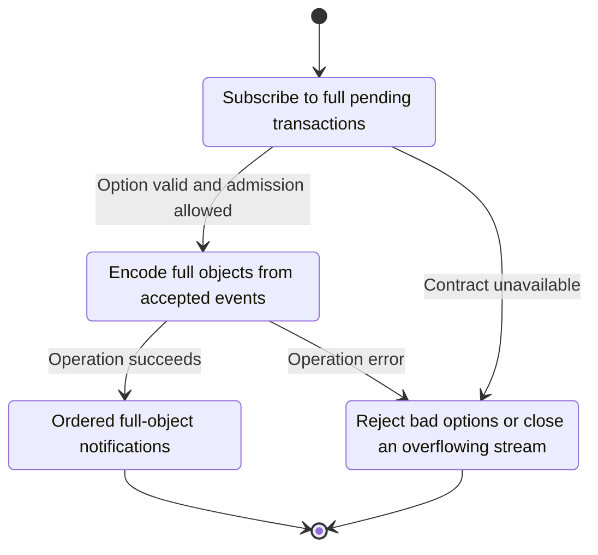
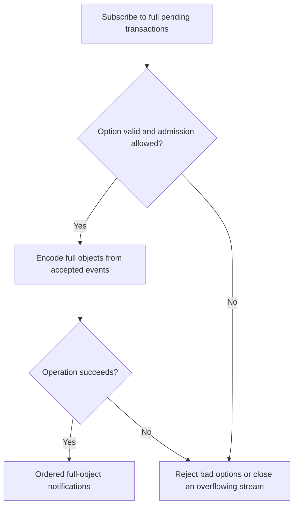

<!-- xone-gap-audit:2026-11-14:pass4:pending-full-subscription -->
> GAP-0081 · P3 · source review at `330b742bfa1ef1401c1b9b9be0cf0bd344255cca`. Static evidence; no deployed-node reproduction or benchmark is claimed.

## What

parse_kind ignores the second argument of newPendingTransactions. Kind::PendingTransactions and publish_pending carry hashes only, so a request for full transactions still receives hashes.

Current implementation:

- [`crates/xone-rpc/src/subscriptions.rs`](https://github.com/XDCIndia/xOneRS/blob/330b742bfa1ef1401c1b9b9be0cf0bd344255cca/crates/xone-rpc/src/subscriptions.rs)
- [`crates/xone-node/src/services/pool.rs`](https://github.com/XDCIndia/xOneRS/blob/330b742bfa1ef1401c1b9b9be0cf0bd344255cca/crates/xone-node/src/services/pool.rs)
- [`crates/xone-rpc/src/json.rs`](https://github.com/XDCIndia/xOneRS/blob/330b742bfa1ef1401c1b9b9be0cf0bd344255cca/crates/xone-rpc/src/json.rs)

## Why

Mempool consumers otherwise need one extra RPC query for each event and can lose data when a transaction leaves the pool first.

Verified competitor implementation references:

- [ethereum/go-ethereum: `eth/filters/api.go`](https://github.com/ethereum/go-ethereum/blob/8059ff8beb3170eb8b977169ac51bb0423c97ee1/eth/filters/api.go)
- [paradigmxyz/reth: `crates/rpc/rpc/src/eth/pubsub.rs`](https://github.com/paradigmxyz/reth/blob/36600d5ff9628465475dd4c7608e2e9f2fe24273/crates/rpc/rpc/src/eth/pubsub.rs)

#156 covers additional methods and other subscriptions. #42 already owns hash notifications; this adds the unsupported full-object option.

## 80% of the way to

1. Parse the optional full-transaction boolean and store it in the subscription kind.
2. Publish the admitted immutable transaction once and encode an object only for subscribers that request it.
3. Apply the subscription admission and output-byte limits; avoid cloning the whole pool or issuing an internal RPC per event.

Acceptance criteria:

- [ ] Default and false return hashes; true returns oracle-shaped pending transaction objects.
- [ ] Malformed option types fail instead of being ignored.
- [ ] Replacement, special-transaction and slow-consumer cases retain bounded behavior.

## ASD-STE100

1. Encode full objects from accepted events.
2. Keep the existing XDC consensus rules unchanged.
3. Check all required input before you start the operation.
4. Keep memory use within the configured limits.
5. Reject bad options or close an overflowing stream.
6. Test each acceptance case through the actual entry point.

Technical names follow the repository vocabulary. These short instructions follow the requested sentence limits; certified ASD-STE100 vocabulary compliance has not been assessed.

## Diagrams

```mermaid
sequenceDiagram
    participant Actor as WebSocket caller
    participant Service as Pending event adapter
    participant Data as Accepted pool events
    Actor->>Service: Subscribe to full pending transactions
    Service->>Data: Check required state and limits
    Data-->>Service: State and validation result
    alt Option valid and admission allowed
        Service->>Data: Encode full objects from accepted events
        Data-->>Service: Result or operation error
        Service-->>Actor: Ordered full-object notifications
    else Contract cannot be met
        Service-->>Actor: Reject bad options or close an overflowing stream
    end
```

## Images

N/A. This change affects node behavior. The source links and test fixtures provide the evidence.

## Prompt

```text
Implement GAP-0081 in XDCIndia/xOneRS: Support full transaction objects in newPendingTransactions subscriptions.
Observed at 330b742bfa1ef1401c1b9b9be0cf0bd344255cca: parse_kind ignores the second argument of newPendingTransactions. Kind::PendingTransactions and publish_pending carry hashes only, so a request for full transactions still receives hashes.
Read these target files: crates/xone-rpc/src/subscriptions.rs, crates/xone-node/src/services/pool.rs, crates/xone-rpc/src/json.rs.
Implementation: Parse the optional full-transaction boolean and store it in the subscription kind. Publish the admitted immutable transaction once and encode an object only for subscribers that request it. Apply the subscription admission and output-byte limits; avoid cloning the whole pool or issuing an internal RPC per event.
Acceptance: Default and false return hashes; true returns oracle-shaped pending transaction objects. Malformed option types fail instead of being ignored. Replacement, special-transaction and slow-consumer cases retain bounded behavior.
Related ownership: #156 covers additional methods and other subscriptions. #42 already owns hash notifications; this adds the unsupported full-object option.
Re-pin current main and the authoritative geth-XDC oracle before editing. Preserve XDC consensus, signatures, encodings, storage publication and configured resource bounds. Use the linked competitor code as design evidence, respecting its license. Write focused failing fixtures, implement the smallest coherent change, and run the applicable repository checks. Report exact commands and results. Open a reviewable PR; do not claim completion from a registered method or a mock-only test.
```

## Workflow

1. **WebSocket caller:** Subscribe to full pending transactions.
2. **Pending event adapter:** Check whether option valid and admission allowed.
3. **Pending event adapter:** Encode full objects from accepted events through accepted pool events.
4. **Pending event adapter:** On success, provide ordered full-object notifications.
5. **Pending event adapter:** On refusal or failure, reject bad options or close an overflowing stream.

The acceptance cases above define the exact errors, ordering and resource boundaries. Verify the real entry point before closing the issue.

## Loop

None. Run the operation only when requested.

## Graph

Lifecycle of this pending event adapter operation; this diagram does not change the blockchain consensus state machine.



## Layout

This capability uses a node, command-line, or build interface. It does not require a new graphical screen.

| Interface detail | Placement |
| --- | --- |
| Actor and trigger | WebSocket caller: subscribe to full pending transactions |
| Input validation | Pending event adapter: option valid and admission allowed |
| Output | Ordered full-object notifications |
| Error or refusal | Reject bad options or close an overflowing stream |
| Implementation files | `crates/xone-rpc/src/subscriptions.rs`, `crates/xone-node/src/services/pool.rs`, `crates/xone-rpc/src/json.rs` |

Keep field names and response shapes compatible with the specification and acceptance cases above.

## Flow



## Summary

Gap: Support full transaction objects in newPendingTransactions subscriptions.
Fix: Parse the optional full-transaction boolean and store it in the subscription kind.
Acceptance: Default and false return hashes; true returns oracle-shaped pending transaction objects.
