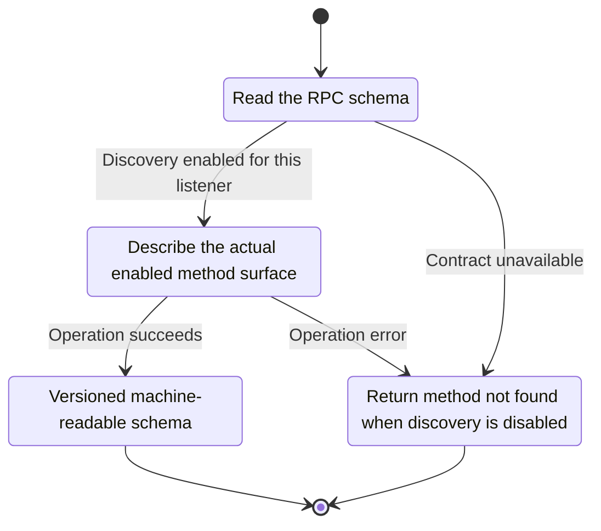
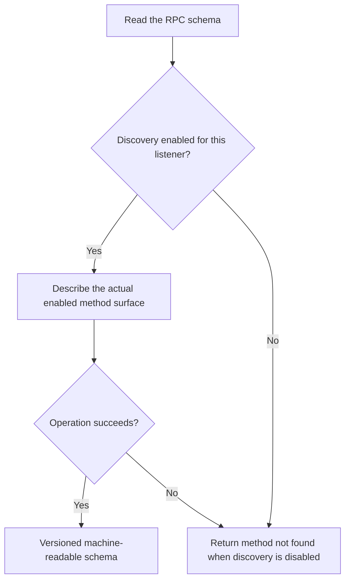

<!-- xone-gap-audit:2026-11-14:pass4:openrpc-discovery -->
> GAP-0082 · P3 · source review at `330b742bfa1ef1401c1b9b9be0cf0bd344255cca`. Static evidence; no deployed-node reproduction or benchmark is claimed.

## What

The registry exposes method names and closures, but no machine-readable parameter/result schemas or rpc.discover handler. Existing documentation work proposes human reference pages and a method-list currency test.

Current implementation:

- [`crates/xone-rpc/src/server.rs`](https://github.com/XDCIndia/xOneRS/blob/330b742bfa1ef1401c1b9b9be0cf0bd344255cca/crates/xone-rpc/src/server.rs)
- [`crates/xone-rpc/src/policy.rs`](https://github.com/XDCIndia/xOneRS/blob/330b742bfa1ef1401c1b9b9be0cf0bd344255cca/crates/xone-rpc/src/policy.rs)
- [`spec/rpc/scope-adr-008.md`](https://github.com/XDCIndia/xOneRS/blob/330b742bfa1ef1401c1b9b9be0cf0bd344255cca/spec/rpc/scope-adr-008.md)

## Why

SDK generators and coding agents can validate requests and inspect capabilities without reverse-engineering Rust closures.

Verified competitor implementation references:

- [etclabscore/core-geth: `node/openrpc.go`](https://github.com/etclabscore/core-geth/blob/4720ac33055e8e5482ce2fb6c5ff800aad8a5889/node/openrpc.go)
- [etclabscore/core-geth: `node/node.go`](https://github.com/etclabscore/core-geth/blob/4720ac33055e8e5482ce2fb6c5ff800aad8a5889/node/node.go)

#188 owns human RPC documentation. This unit adds machine-readable contracts and discovery, reusing that documentation work.

## 80% of the way to

1. Define one versioned OpenRPC schema for the supported method contract and generate a distributable document.
2. Add optional rpc.discover only through an explicitly enabled namespace and an ADR-008 scope update; default XDC parity exposure remains unchanged.
3. Filter runtime discovery to methods enabled on the requesting transport and mark unsupported backends accurately.
4. Drive the human documentation currency test from the same schema instead of maintaining two method inventories.

Acceptance criteria:

- [ ] Schema validation succeeds and every documented method maps to a real registry entry.
- [ ] Disabled or unimplemented methods are not advertised as available.
- [ ] A schema consumer can construct and validate representative XDC-prefixed requests and typed history errors.

## ASD-STE100

1. Describe the actual enabled method surface.
2. Keep the existing XDC consensus rules unchanged.
3. Check all required input before you start the operation.
4. Keep memory use within the configured limits.
5. Return method not found when discovery is disabled.
6. Test each acceptance case through the actual entry point.

Technical names follow the repository vocabulary. These short instructions follow the requested sentence limits; certified ASD-STE100 vocabulary compliance has not been assessed.

## Diagrams

```mermaid
sequenceDiagram
    participant Actor as Integrator
    participant Service as Schema generator and endpoint
    participant Data as Method registry
    Actor->>Service: Read the RPC schema
    Service->>Data: Check required state and limits
    Data-->>Service: State and validation result
    alt Discovery enabled for this listener
        Service->>Data: Describe the actual enabled method surface
        Data-->>Service: Result or operation error
        Service-->>Actor: Versioned machine-readable schema
    else Contract cannot be met
        Service-->>Actor: Return method not found when discovery is disabled
    end
```

## Images

N/A. This change affects node behavior. The source links and test fixtures provide the evidence.

## Prompt

```text
Implement GAP-0082 in XDCIndia/xOneRS: Generate a machine-readable RPC schema and optional rpc.discover endpoint.
Observed at 330b742bfa1ef1401c1b9b9be0cf0bd344255cca: The registry exposes method names and closures, but no machine-readable parameter/result schemas or rpc.discover handler. Existing documentation work proposes human reference pages and a method-list currency test.
Read these target files: crates/xone-rpc/src/server.rs, crates/xone-rpc/src/policy.rs, spec/rpc/scope-adr-008.md.
Implementation: Define one versioned OpenRPC schema for the supported method contract and generate a distributable document. Add optional rpc.discover only through an explicitly enabled namespace and an ADR-008 scope update; default XDC parity exposure remains unchanged. Filter runtime discovery to methods enabled on the requesting transport and mark unsupported backends accurately. Drive the human documentation currency test from the same schema instead of maintaining two method inventories.
Acceptance: Schema validation succeeds and every documented method maps to a real registry entry. Disabled or unimplemented methods are not advertised as available. A schema consumer can construct and validate representative XDC-prefixed requests and typed history errors.
Related ownership: #188 owns human RPC documentation. This unit adds machine-readable contracts and discovery, reusing that documentation work.
Re-pin current main and the authoritative geth-XDC oracle before editing. Preserve XDC consensus, signatures, encodings, storage publication and configured resource bounds. Use the linked competitor code as design evidence, respecting its license. Write focused failing fixtures, implement the smallest coherent change, and run the applicable repository checks. Report exact commands and results. Open a reviewable PR; do not claim completion from a registered method or a mock-only test.
```

## Workflow

1. **Integrator:** Read the RPC schema.
2. **Schema generator and endpoint:** Check whether discovery enabled for this listener.
3. **Schema generator and endpoint:** Describe the actual enabled method surface through method registry.
4. **Schema generator and endpoint:** On success, provide versioned machine-readable schema.
5. **Schema generator and endpoint:** On refusal or failure, return method not found when discovery is disabled.

The acceptance cases above define the exact errors, ordering and resource boundaries. Verify the real entry point before closing the issue.

## Loop

None. Run the operation only when requested.

## Graph

Lifecycle of this schema generator and endpoint operation; this diagram does not change the blockchain consensus state machine.



## Layout

This capability uses a node, command-line, or build interface. It does not require a new graphical screen.

| Interface detail | Placement |
| --- | --- |
| Actor and trigger | Integrator: read the rpc schema |
| Input validation | Schema generator and endpoint: discovery enabled for this listener |
| Output | Versioned machine-readable schema |
| Error or refusal | Return method not found when discovery is disabled |
| Implementation files | `crates/xone-rpc/src/server.rs`, `crates/xone-rpc/src/policy.rs`, `spec/rpc/scope-adr-008.md` |

Keep field names and response shapes compatible with the specification and acceptance cases above.

## Flow



## Summary

Gap: Generate a machine-readable RPC schema and optional rpc.discover endpoint.
Fix: Define one versioned OpenRPC schema for the supported method contract and generate a distributable document.
Acceptance: Schema validation succeeds and every documented method maps to a real registry entry.
