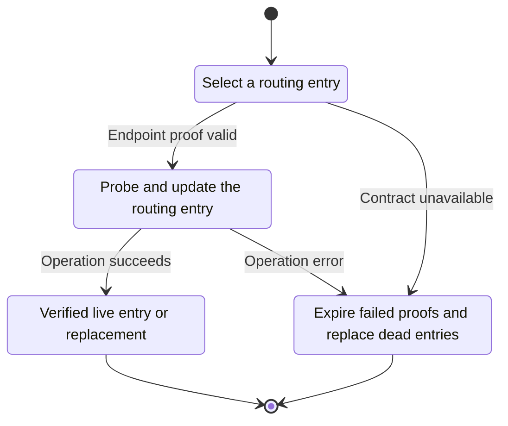
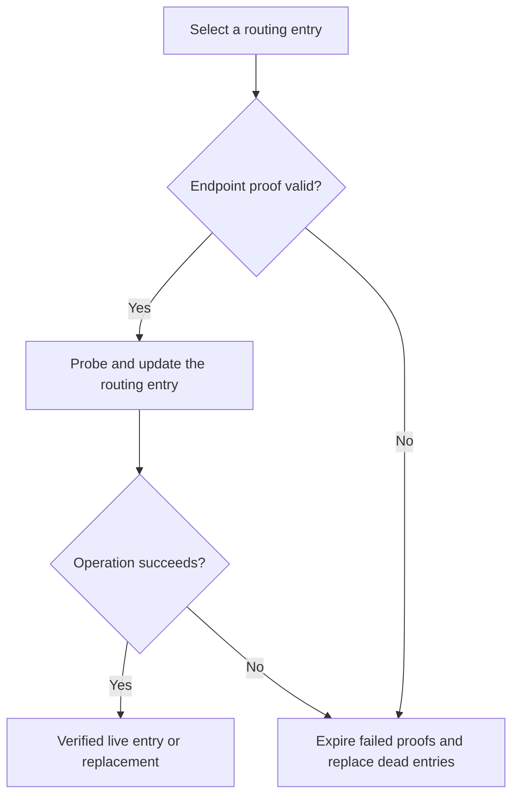

<!-- xone-gap-audit:2026-11-14:pass4:discovery-revalidation -->
> GAP-0083 · P2 · source review at `330b742bfa1ef1401c1b9b9be0cf0bd344255cca`. Static evidence; no deployed-node reproduction or benchmark is claimed.

## What

Table has no last-bond timestamp or eviction/revalidation state. A full bucket permanently refuses new entries. FindNode accepts a previously stored identity/IP without checking whether its endpoint proof is still recent.

Current implementation:

- [`crates/xone-net/src/discv4.rs`](https://github.com/XDCIndia/xOneRS/blob/330b742bfa1ef1401c1b9b9be0cf0bd344255cca/crates/xone-net/src/discv4.rs)
- [`crates/xone-node/src/services/net.rs`](https://github.com/XDCIndia/xOneRS/blob/330b742bfa1ef1401c1b9b9be0cf0bd344255cca/crates/xone-node/src/services/net.rs)

## Why

A long-running node can exhaust its routing table with dead endpoints and continue trusting stale endpoint proofs.

Verified competitor implementation references:

- [ethereum/go-ethereum: `p2p/discover/table_reval.go`](https://github.com/ethereum/go-ethereum/blob/8059ff8beb3170eb8b977169ac51bb0423c97ee1/p2p/discover/table_reval.go)
- [ethereum/go-ethereum: `p2p/discover/v4_udp.go`](https://github.com/ethereum/go-ethereum/blob/8059ff8beb3170eb8b977169ac51bb0423c97ee1/p2p/discover/v4_udp.go)

#221 persists peers across restarts. This unit manages freshness and replacement while a node is running.

## 80% of the way to

1. Track bounded endpoint-proof freshness and periodically revalidate routing entries.
2. Use a bounded replacement cache when a bucket is full; replace dead entries after verified failure.
3. Require a recent endpoint proof before amplified discovery replies and refresh changed endpoints safely. Preserve the XDC ping encoding.

Acceptance criteria:

- [ ] A full bucket with dead nodes eventually admits verified replacements.
- [ ] A stale bond cannot authorize a FindNode response until renewed.
- [ ] A simulated clock and packet-loss test prove bounded retries, memory and refresh traffic.

## ASD-STE100

1. Probe and update the routing entry.
2. Keep the existing XDC consensus rules unchanged.
3. Check all required input before you start the operation.
4. Keep memory use within the configured limits.
5. Expire failed proofs and replace dead entries.
6. Test each acceptance case through the actual entry point.

Technical names follow the repository vocabulary. These short instructions follow the requested sentence limits; certified ASD-STE100 vocabulary compliance has not been assessed.

## Diagrams

```mermaid
sequenceDiagram
    participant Actor as Discovery timer
    participant Service as Discovery table
    participant Data as Peer endpoint
    Actor->>Service: Select a routing entry
    Service->>Data: Check required state and limits
    Data-->>Service: State and validation result
    alt Endpoint proof valid
        Service->>Data: Probe and update the routing entry
        Data-->>Service: Result or operation error
        Service-->>Actor: Verified live entry or replacement
    else Contract cannot be met
        Service-->>Actor: Expire failed proofs and replace dead entries
    end
```

## Images

N/A. This change affects node behavior. The source links and test fixtures provide the evidence.

## Prompt

```text
Implement GAP-0083 in XDCIndia/xOneRS: Revalidate discovery endpoints and replace dead routing-table entries.
Observed at 330b742bfa1ef1401c1b9b9be0cf0bd344255cca: Table has no last-bond timestamp or eviction/revalidation state. A full bucket permanently refuses new entries. FindNode accepts a previously stored identity/IP without checking whether its endpoint proof is still recent.
Read these target files: crates/xone-net/src/discv4.rs, crates/xone-node/src/services/net.rs.
Implementation: Track bounded endpoint-proof freshness and periodically revalidate routing entries. Use a bounded replacement cache when a bucket is full; replace dead entries after verified failure. Require a recent endpoint proof before amplified discovery replies and refresh changed endpoints safely. Preserve the XDC ping encoding.
Acceptance: A full bucket with dead nodes eventually admits verified replacements. A stale bond cannot authorize a FindNode response until renewed. A simulated clock and packet-loss test prove bounded retries, memory and refresh traffic.
Related ownership: #221 persists peers across restarts. This unit manages freshness and replacement while a node is running.
Re-pin current main and the authoritative geth-XDC oracle before editing. Preserve XDC consensus, signatures, encodings, storage publication and configured resource bounds. Use the linked competitor code as design evidence, respecting its license. Write focused failing fixtures, implement the smallest coherent change, and run the applicable repository checks. Report exact commands and results. Open a reviewable PR; do not claim completion from a registered method or a mock-only test.
```

## Workflow

1. **Discovery timer:** Select a routing entry.
2. **Discovery table:** Check whether endpoint proof valid.
3. **Discovery table:** Probe and update the routing entry through peer endpoint.
4. **Discovery table:** On success, provide verified live entry or replacement.
5. **Discovery table:** On refusal or failure, expire failed proofs and replace dead entries.

The acceptance cases above define the exact errors, ordering and resource boundaries. Verify the real entry point before closing the issue.

## Loop

Periodically probe a bounded subset. Back off failures, expire proofs and promote verified replacements.

## Graph

Lifecycle of this discovery table operation; this diagram does not change the blockchain consensus state machine.



## Layout

This capability uses a node, command-line, or build interface. It does not require a new graphical screen.

| Interface detail | Placement |
| --- | --- |
| Actor and trigger | Discovery timer: select a routing entry |
| Input validation | Discovery table: endpoint proof valid |
| Output | Verified live entry or replacement |
| Error or refusal | Expire failed proofs and replace dead entries |
| Implementation files | `crates/xone-net/src/discv4.rs`, `crates/xone-node/src/services/net.rs` |

Keep field names and response shapes compatible with the specification and acceptance cases above.

## Flow



## Summary

Gap: Revalidate discovery endpoints and replace dead routing-table entries.
Fix: Track bounded endpoint-proof freshness and periodically revalidate routing entries.
Acceptance: A full bucket with dead nodes eventually admits verified replacements.
