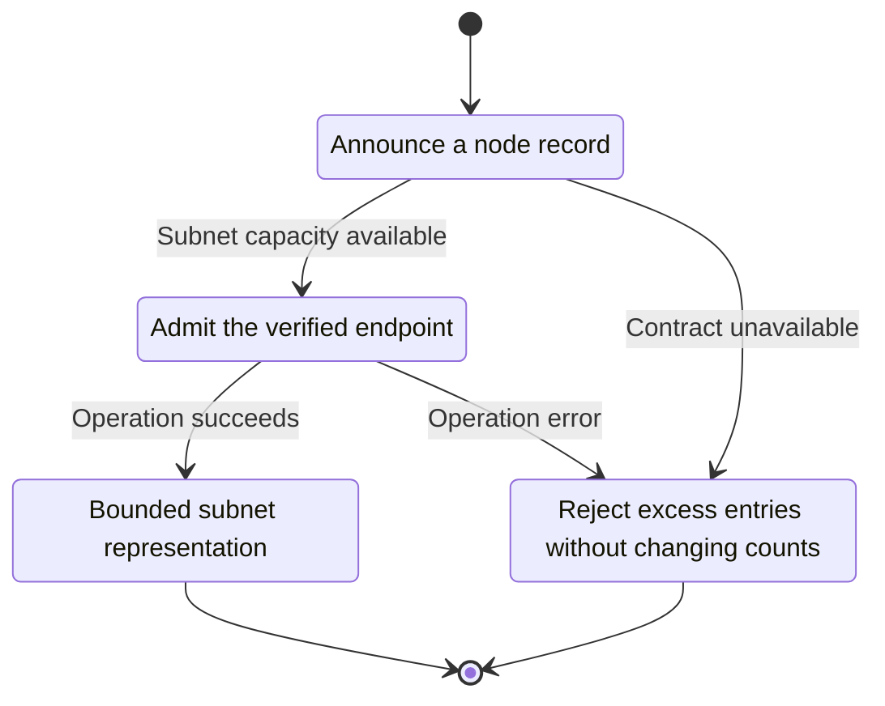
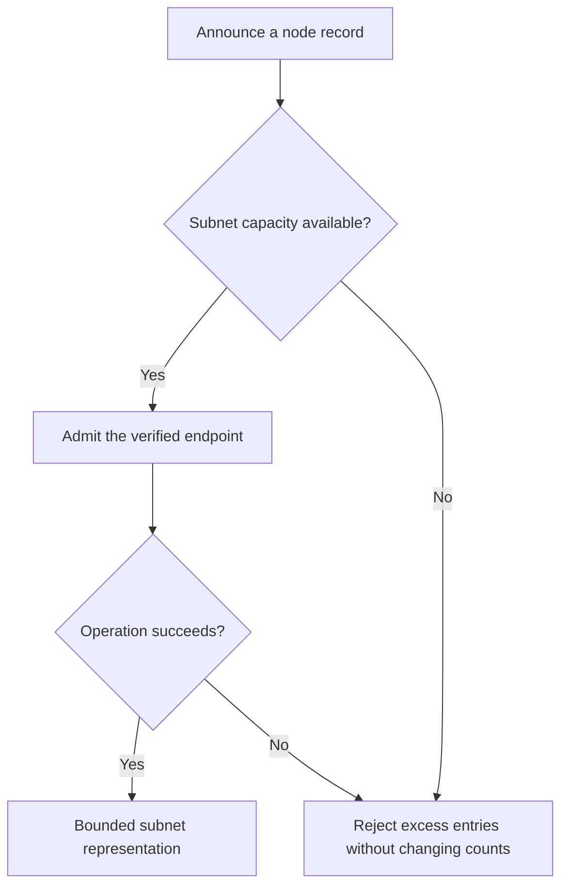

<!-- xone-gap-audit:2026-11-14:pass4:discovery-diversity -->
> GAP-0084 · P2 · source review at `330b742bfa1ef1401c1b9b9be0cf0bd344255cca`. Static evidence; no deployed-node reproduction or benchmark is claimed.

## What

Routing-table insertion checks node identity, bucket distance and count, but has no per-subnet diversity accounting. Many identities on one subnet can occupy the bounded table.

Current implementation:

- [`crates/xone-net/src/discv4.rs`](https://github.com/XDCIndia/xOneRS/blob/330b742bfa1ef1401c1b9b9be0cf0bd344255cca/crates/xone-net/src/discv4.rs)

## Why

Identity-count limits alone do not give routing diversity when many public keys share the same network origin.

Verified competitor implementation references:

- [ethereum/go-ethereum: `p2p/discover/table.go`](https://github.com/ethereum/go-ethereum/blob/8059ff8beb3170eb8b977169ac51bb0423c97ee1/p2p/discover/table.go)
- [ethereum/go-ethereum: `p2p/discover/table_test.go`](https://github.com/ethereum/go-ethereum/blob/8059ff8beb3170eb8b977169ac51bb0423c97ee1/p2p/discover/table_test.go)

#175 restricts allowed CIDRs and #199 restricts peer identities. Diversity limits address concentration among otherwise allowed discovery entries.

## 80% of the way to

1. Add bounded per-bucket and whole-table subnet accounting for public discovery entries.
2. Define IPv4 and IPv6 grouping and explicit private-network exceptions without silently granting trust.
3. Update counters atomically on insertion, replacement and removal, including endpoint changes.

Acceptance criteria:

- [ ] Many distinct identities from one subnet cannot exceed its configured allocation.
- [ ] Diverse legitimate endpoints remain discoverable.
- [ ] Replace/remove/change-address tests preserve counts and never bypass total table bounds.

## ASD-STE100

1. Admit the verified endpoint.
2. Keep the existing XDC consensus rules unchanged.
3. Check all required input before you start the operation.
4. Keep memory use within the configured limits.
5. Reject excess entries without changing counts.
6. Test each acceptance case through the actual entry point.

Technical names follow the repository vocabulary. These short instructions follow the requested sentence limits; certified ASD-STE100 vocabulary compliance has not been assessed.

## Diagrams

```mermaid
sequenceDiagram
    participant Actor as Discovery peer
    participant Service as Discovery table
    participant Data as Subnet counters
    Actor->>Service: Announce a node record
    Service->>Data: Check required state and limits
    Data-->>Service: State and validation result
    alt Subnet capacity available
        Service->>Data: Admit the verified endpoint
        Data-->>Service: Result or operation error
        Service-->>Actor: Bounded subnet representation
    else Contract cannot be met
        Service-->>Actor: Reject excess entries without changing counts
    end
```

## Images

N/A. This change affects node behavior. The source links and test fixtures provide the evidence.

## Prompt

```text
Implement GAP-0084 in XDCIndia/xOneRS: Limit subnet concentration in the discovery routing table.
Observed at 330b742bfa1ef1401c1b9b9be0cf0bd344255cca: Routing-table insertion checks node identity, bucket distance and count, but has no per-subnet diversity accounting. Many identities on one subnet can occupy the bounded table.
Read these target files: crates/xone-net/src/discv4.rs.
Implementation: Add bounded per-bucket and whole-table subnet accounting for public discovery entries. Define IPv4 and IPv6 grouping and explicit private-network exceptions without silently granting trust. Update counters atomically on insertion, replacement and removal, including endpoint changes.
Acceptance: Many distinct identities from one subnet cannot exceed its configured allocation. Diverse legitimate endpoints remain discoverable. Replace/remove/change-address tests preserve counts and never bypass total table bounds.
Related ownership: #175 restricts allowed CIDRs and #199 restricts peer identities. Diversity limits address concentration among otherwise allowed discovery entries.
Re-pin current main and the authoritative geth-XDC oracle before editing. Preserve XDC consensus, signatures, encodings, storage publication and configured resource bounds. Use the linked competitor code as design evidence, respecting its license. Write focused failing fixtures, implement the smallest coherent change, and run the applicable repository checks. Report exact commands and results. Open a reviewable PR; do not claim completion from a registered method or a mock-only test.
```

## Workflow

1. **Discovery peer:** Announce a node record.
2. **Discovery table:** Check whether subnet capacity available.
3. **Discovery table:** Admit the verified endpoint through subnet counters.
4. **Discovery table:** On success, provide bounded subnet representation.
5. **Discovery table:** On refusal or failure, reject excess entries without changing counts.

The acceptance cases above define the exact errors, ordering and resource boundaries. Verify the real entry point before closing the issue.

## Loop

None. Run the operation only when requested.

## Graph

Lifecycle of this discovery table operation; this diagram does not change the blockchain consensus state machine.



## Layout

This capability uses a node, command-line, or build interface. It does not require a new graphical screen.

| Interface detail | Placement |
| --- | --- |
| Actor and trigger | Discovery peer: announce a node record |
| Input validation | Discovery table: subnet capacity available |
| Output | Bounded subnet representation |
| Error or refusal | Reject excess entries without changing counts |
| Implementation files | `crates/xone-net/src/discv4.rs` |

Keep field names and response shapes compatible with the specification and acceptance cases above.

## Flow



## Summary

Gap: Limit subnet concentration in the discovery routing table.
Fix: Add bounded per-bucket and whole-table subnet accounting for public discovery entries.
Acceptance: Many distinct identities from one subnet cannot exceed its configured allocation.
