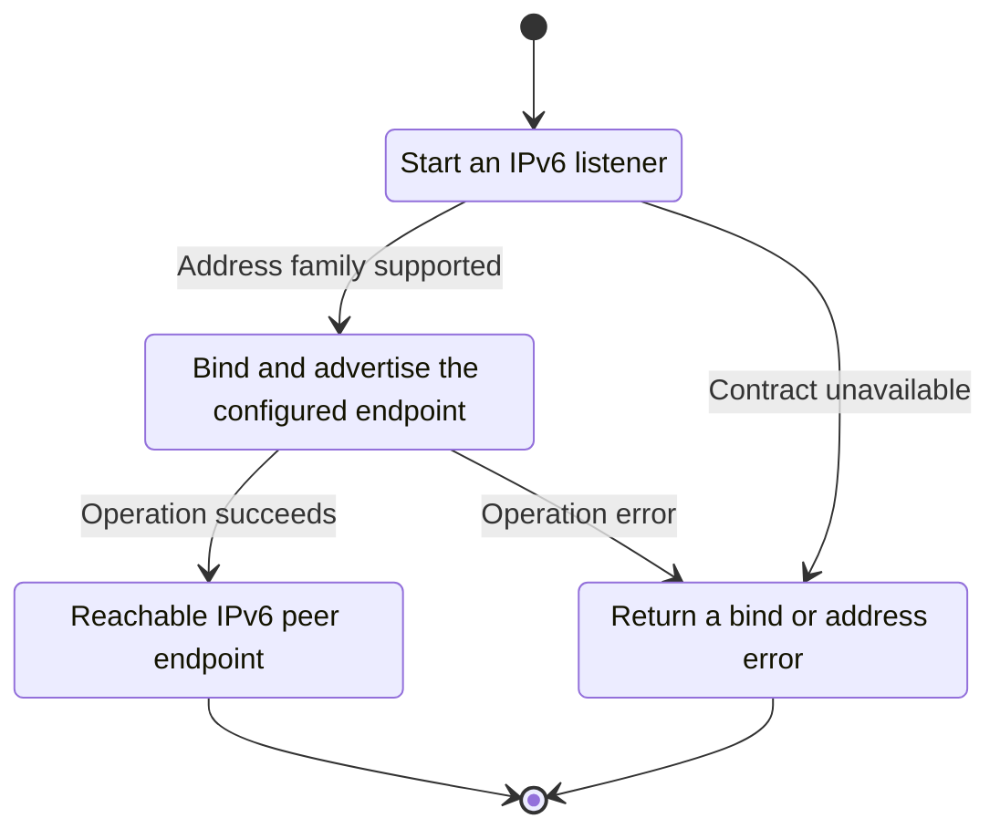
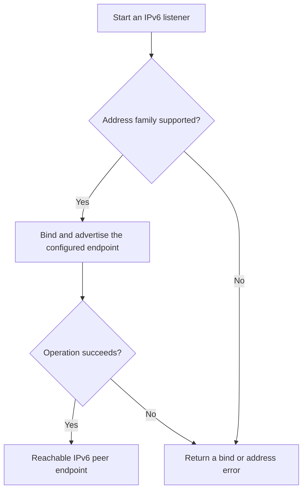

<!-- xone-gap-audit:2026-11-14:pass4:ipv6-p2p -->
> GAP-0085 · P3 · source review at `330b742bfa1ef1401c1b9b9be0cf0bd344255cca`. Static evidence; no deployed-node reproduction or benchmark is claimed.

## What

NetService chooses only IPv4 loopback or IPv4 unspecified as its listening IP. Its advertised enode string interpolates the host directly, although the Enode formatter already knows how to bracket IPv6 hosts.

Current implementation:

- [`crates/xone-node/src/services/net.rs`](https://github.com/XDCIndia/xOneRS/blob/330b742bfa1ef1401c1b9b9be0cf0bd344255cca/crates/xone-node/src/services/net.rs)
- [`crates/xone-node/src/enode.rs`](https://github.com/XDCIndia/xOneRS/blob/330b742bfa1ef1401c1b9b9be0cf0bd344255cca/crates/xone-node/src/enode.rs)
- [`crates/xone-node/src/config.rs`](https://github.com/XDCIndia/xOneRS/blob/330b742bfa1ef1401c1b9b9be0cf0bd344255cca/crates/xone-node/src/config.rs)
- [`bin/xone/src/flags.rs`](https://github.com/XDCIndia/xOneRS/blob/330b742bfa1ef1401c1b9b9be0cf0bd344255cca/bin/xone/src/flags.rs)

## Why

Operators with IPv6-only or dual-stack networks cannot configure a usable inbound P2P endpoint through the current listener.

Verified competitor implementation references:

- [ethereum/go-ethereum: `p2p/server.go`](https://github.com/ethereum/go-ethereum/blob/8059ff8beb3170eb8b977169ac51bb0423c97ee1/p2p/server.go)
- [ethereum/go-ethereum: `p2p/enode/urlv4.go`](https://github.com/ethereum/go-ethereum/blob/8059ff8beb3170eb8b977169ac51bb0423c97ee1/p2p/enode/urlv4.go)

#167 handles NAT and external-address discovery. This unit adds an address-family-capable listener and correct formatting.

## 80% of the way to

1. Add an explicit P2P bind address with validated IPv4/IPv6 behavior for TCP and discovery UDP.
2. Construct advertised URLs through the existing Enode formatter, including discport.
3. Document dual-stack behavior and keep existing IPv4 defaults compatible. Do not expose RPC as a side effect.

Acceptance criteria:

- [ ] Two local nodes connect over IPv6 loopback and exchange discovery packets.
- [ ] Advertised IPv6 enodes round-trip through the parser.
- [ ] IPv4 behavior and separate TCP/UDP ports remain covered.

## ASD-STE100

1. Bind and advertise the configured endpoint.
2. Keep the existing XDC consensus rules unchanged.
3. Check all required input before you start the operation.
4. Keep memory use within the configured limits.
5. Return a bind or address error.
6. Test each acceptance case through the actual entry point.

Technical names follow the repository vocabulary. These short instructions follow the requested sentence limits; certified ASD-STE100 vocabulary compliance has not been assessed.

## Diagrams

```mermaid
sequenceDiagram
    participant Actor as Node operator
    participant Service as Network service
    participant Data as Socket and enode parser
    Actor->>Service: Start an IPv6 listener
    Service->>Data: Check required state and limits
    Data-->>Service: State and validation result
    alt Address family supported
        Service->>Data: Bind and advertise the configured endpoint
        Data-->>Service: Result or operation error
        Service-->>Actor: Reachable IPv6 peer endpoint
    else Contract cannot be met
        Service-->>Actor: Return a bind or address error
    end
```

## Images

N/A. This change affects node behavior. The source links and test fixtures provide the evidence.

## Prompt

```text
Implement GAP-0085 in XDCIndia/xOneRS: Support explicit IPv6 P2P listeners and valid advertised enode URLs.
Observed at 330b742bfa1ef1401c1b9b9be0cf0bd344255cca: NetService chooses only IPv4 loopback or IPv4 unspecified as its listening IP. Its advertised enode string interpolates the host directly, although the Enode formatter already knows how to bracket IPv6 hosts.
Read these target files: crates/xone-node/src/services/net.rs, crates/xone-node/src/enode.rs, crates/xone-node/src/config.rs, bin/xone/src/flags.rs.
Implementation: Add an explicit P2P bind address with validated IPv4/IPv6 behavior for TCP and discovery UDP. Construct advertised URLs through the existing Enode formatter, including discport. Document dual-stack behavior and keep existing IPv4 defaults compatible. Do not expose RPC as a side effect.
Acceptance: Two local nodes connect over IPv6 loopback and exchange discovery packets. Advertised IPv6 enodes round-trip through the parser. IPv4 behavior and separate TCP/UDP ports remain covered.
Related ownership: #167 handles NAT and external-address discovery. This unit adds an address-family-capable listener and correct formatting.
Re-pin current main and the authoritative geth-XDC oracle before editing. Preserve XDC consensus, signatures, encodings, storage publication and configured resource bounds. Use the linked competitor code as design evidence, respecting its license. Write focused failing fixtures, implement the smallest coherent change, and run the applicable repository checks. Report exact commands and results. Open a reviewable PR; do not claim completion from a registered method or a mock-only test.
```

## Workflow

1. **Node operator:** Start an IPv6 listener.
2. **Network service:** Check whether address family supported.
3. **Network service:** Bind and advertise the configured endpoint through socket and enode parser.
4. **Network service:** On success, provide reachable ipv6 peer endpoint.
5. **Network service:** On refusal or failure, return a bind or address error.

The acceptance cases above define the exact errors, ordering and resource boundaries. Verify the real entry point before closing the issue.

## Loop

None. Run the operation only when requested.

## Graph

Lifecycle of this network service operation; this diagram does not change the blockchain consensus state machine.



## Layout

This capability uses a node, command-line, or build interface. It does not require a new graphical screen.

| Interface detail | Placement |
| --- | --- |
| Actor and trigger | Node operator: start an ipv6 listener |
| Input validation | Network service: address family supported |
| Output | Reachable IPv6 peer endpoint |
| Error or refusal | Return a bind or address error |
| Implementation files | `crates/xone-node/src/services/net.rs`, `crates/xone-node/src/enode.rs`, `crates/xone-node/src/config.rs`, `bin/xone/src/flags.rs` |

Keep field names and response shapes compatible with the specification and acceptance cases above.

## Flow



## Summary

Gap: Support explicit IPv6 P2P listeners and valid advertised enode URLs.
Fix: Add an explicit P2P bind address with validated IPv4/IPv6 behavior for TCP and discovery UDP.
Acceptance: Two local nodes connect over IPv6 loopback and exchange discovery packets.
