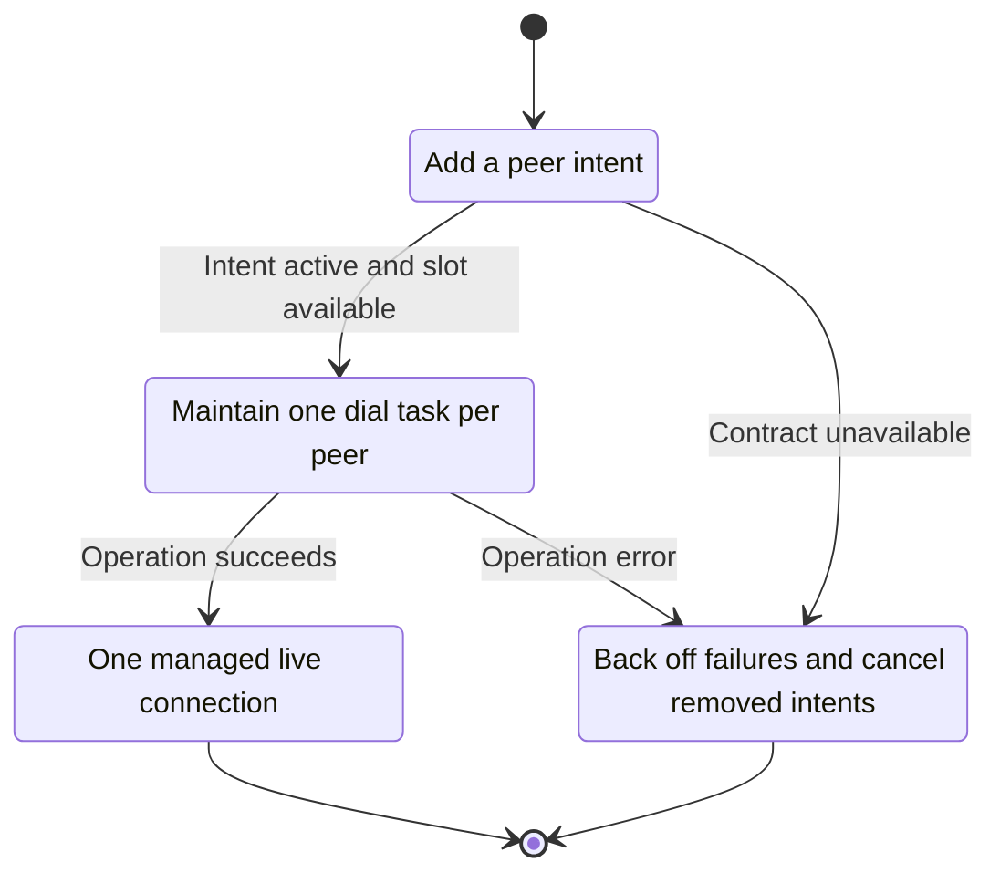
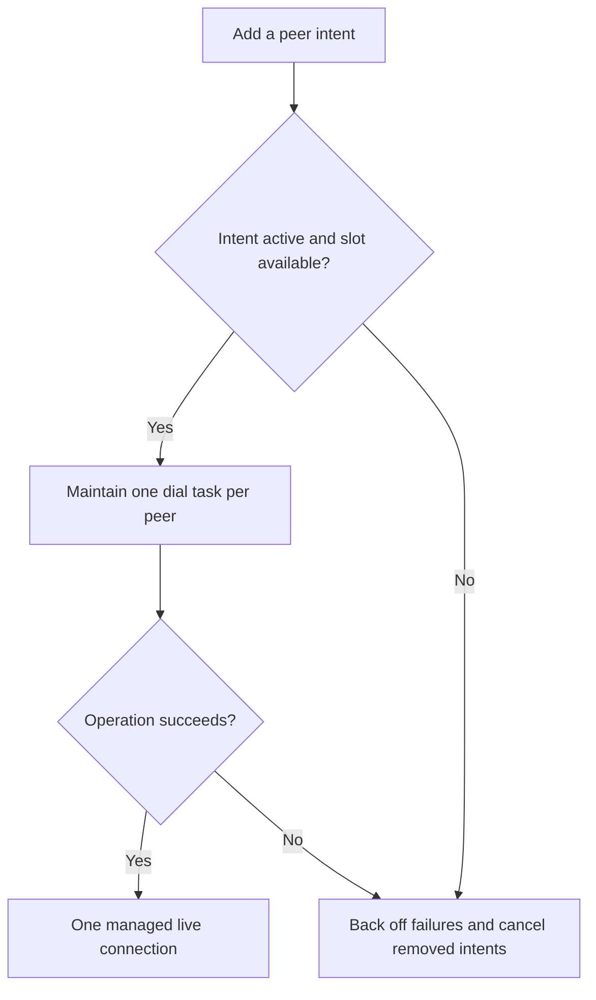

<!-- xone-gap-audit:2026-11-14:pass4:dial-lifecycle -->
> GAP-0086 · P2 · source review at `330b742bfa1ef1401c1b9b9be0cf0bd344255cca`. Static evidence; no deployed-node reproduction or benchmark is claimed.

## What

Every NetHandle::add_peer call spawns another endless five-second redial loop and appends its handle to a vector. Jobs are not keyed by peer identity, so repeated additions create duplicate long-lived work.

Current implementation:

- [`crates/xone-node/src/services/net.rs`](https://github.com/XDCIndia/xOneRS/blob/330b742bfa1ef1401c1b9b9be0cf0bd344255cca/crates/xone-node/src/services/net.rs)
- [`crates/xone-net/src/peers/mod.rs`](https://github.com/XDCIndia/xOneRS/blob/330b742bfa1ef1401c1b9b9be0cf0bd344255cca/crates/xone-net/src/peers/mod.rs)

## Why

Duplicate management requests should not consume an increasing number of background tasks or repeated DNS/dial work.

Verified competitor implementation references:

- [ethereum/go-ethereum: `p2p/dial.go`](https://github.com/ethereum/go-ethereum/blob/8059ff8beb3170eb8b977169ac51bb0423c97ee1/p2p/dial.go)

#163 and #42 own admin peer methods. This fixes scheduler ownership underneath those methods rather than creating another removePeer API.

## 80% of the way to

1. Own one dial intent per peer identity and update it idempotently when addresses or trust settings change.
2. Bound concurrent dials and retained intents; use bounded backoff with jitter after failures.
3. Cancel the corresponding job on removal and all jobs on shutdown. Preserve the repository decision that static peers receive trust treatment.

Acceptance criteria:

- [ ] Adding one peer repeatedly leaves one managed intent and one active dial.
- [ ] A failed endpoint backs off without synchronized retry bursts.
- [ ] Removal and shutdown release jobs and prevent later redials.

## ASD-STE100

1. Maintain one dial task per peer.
2. Keep the existing XDC consensus rules unchanged.
3. Check all required input before you start the operation.
4. Keep memory use within the configured limits.
5. Back off failures and cancel removed intents.
6. Test each acceptance case through the actual entry point.

Technical names follow the repository vocabulary. These short instructions follow the requested sentence limits; certified ASD-STE100 vocabulary compliance has not been assessed.

## Diagrams

```mermaid
sequenceDiagram
    participant Actor as Admin or peer manager
    participant Service as Dial scheduler
    participant Data as Peer connections
    Actor->>Service: Add a peer intent
    Service->>Data: Check required state and limits
    Data-->>Service: State and validation result
    alt Intent active and slot available
        Service->>Data: Maintain one dial task per peer
        Data-->>Service: Result or operation error
        Service-->>Actor: One managed live connection
    else Contract cannot be met
        Service-->>Actor: Back off failures and cancel removed intents
    end
```

## Images

N/A. This change affects node behavior. The source links and test fixtures provide the evidence.

## Prompt

```text
Implement GAP-0086 in XDCIndia/xOneRS: Deduplicate peer redial jobs and bound retry scheduling.
Observed at 330b742bfa1ef1401c1b9b9be0cf0bd344255cca: Every NetHandle::add_peer call spawns another endless five-second redial loop and appends its handle to a vector. Jobs are not keyed by peer identity, so repeated additions create duplicate long-lived work.
Read these target files: crates/xone-node/src/services/net.rs, crates/xone-net/src/peers/mod.rs.
Implementation: Own one dial intent per peer identity and update it idempotently when addresses or trust settings change. Bound concurrent dials and retained intents; use bounded backoff with jitter after failures. Cancel the corresponding job on removal and all jobs on shutdown. Preserve the repository decision that static peers receive trust treatment.
Acceptance: Adding one peer repeatedly leaves one managed intent and one active dial. A failed endpoint backs off without synchronized retry bursts. Removal and shutdown release jobs and prevent later redials.
Related ownership: #163 and #42 own admin peer methods. This fixes scheduler ownership underneath those methods rather than creating another removePeer API.
Re-pin current main and the authoritative geth-XDC oracle before editing. Preserve XDC consensus, signatures, encodings, storage publication and configured resource bounds. Use the linked competitor code as design evidence, respecting its license. Write focused failing fixtures, implement the smallest coherent change, and run the applicable repository checks. Report exact commands and results. Open a reviewable PR; do not claim completion from a registered method or a mock-only test.
```

## Workflow

1. **Admin or peer manager:** Add a peer intent.
2. **Dial scheduler:** Check whether intent active and slot available.
3. **Dial scheduler:** Maintain one dial task per peer through peer connections.
4. **Dial scheduler:** On success, provide one managed live connection.
5. **Dial scheduler:** On refusal or failure, back off failures and cancel removed intents.

The acceptance cases above define the exact errors, ordering and resource boundaries. Verify the real entry point before closing the issue.

## Loop

Retry a managed intent with bounded backoff. Stop on removal, connection success until disconnect, or node shutdown.

## Graph

Lifecycle of this dial scheduler operation; this diagram does not change the blockchain consensus state machine.



## Layout

This capability uses a node, command-line, or build interface. It does not require a new graphical screen.

| Interface detail | Placement |
| --- | --- |
| Actor and trigger | Admin or peer manager: add a peer intent |
| Input validation | Dial scheduler: intent active and slot available |
| Output | One managed live connection |
| Error or refusal | Back off failures and cancel removed intents |
| Implementation files | `crates/xone-node/src/services/net.rs`, `crates/xone-net/src/peers/mod.rs` |

Keep field names and response shapes compatible with the specification and acceptance cases above.

## Flow



## Summary

Gap: Deduplicate peer redial jobs and bound retry scheduling.
Fix: Own one dial intent per peer identity and update it idempotently when addresses or trust settings change.
Acceptance: Adding one peer repeatedly leaves one managed intent and one active dial.
