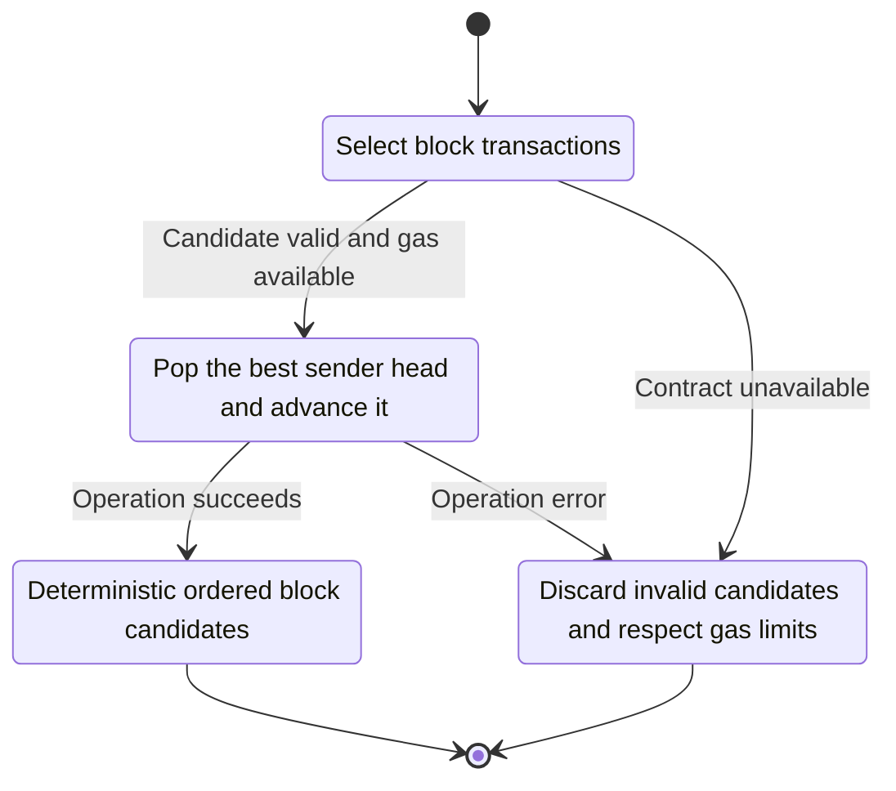
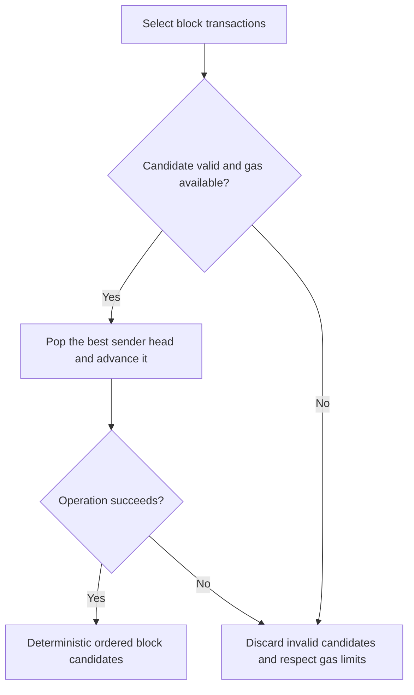

<!-- xone-gap-audit:2026-11-14:pass4:producer-price-heap -->
> GAP-0087 · P2 · source review at `330b742bfa1ef1401c1b9b9be0cf0bd344255cca`. Static evidence; no deployed-node reproduction or benchmark is claimed.

## What

The builder keeps one head per sender in a vector and scans all heads in best() for every transaction selection. The source explicitly leaves a binary heap for large pending sets.

Current implementation:

- [`crates/xone-builder/src/producer/build.rs`](https://github.com/XDCIndia/xOneRS/blob/330b742bfa1ef1401c1b9b9be0cf0bd344255cca/crates/xone-builder/src/producer/build.rs)

## Why

Large pools currently add avoidable CPU work to the time-limited block-building path.

Verified competitor implementation references:

- [XinFinOrg/XDPoSChain: `miner/ordering.go`](https://github.com/XinFinOrg/XDPoSChain/blob/cb1ef79073c05f50b9df75b1e740387b9d72af99/miner/ordering.go)
- [ethereum/go-ethereum: `core/txpool/txorder/ordering.go`](https://github.com/ethereum/go-ethereum/blob/8059ff8beb3170eb8b977169ac51bb0423c97ee1/core/txpool/txorder/ordering.go)

#43 implements block production. #250 parallelizes sender recovery; neither changes this selection data structure.

## 80% of the way to

1. Replace repeated full scans with a heap keyed by the existing effective-tip and tie-break rules.
2. Preserve per-sender nonce order, special-transaction handling, Shift and Pop behavior.
3. Measure large multi-sender pools and keep small-pool overhead visible.

Acceptance criteria:

- [ ] The old and new selectors produce identical selections on randomized pools.
- [ ] Insufficient funds, gas exhaustion, fee changes and special transactions preserve ordering rules.
- [ ] Selection comparisons scale logarithmically per heap update instead of scanning every sender.

## ASD-STE100

1. Pop the best sender head and advance it.
2. Keep the existing XDC consensus rules unchanged.
3. Check all required input before you start the operation.
4. Keep memory use within the configured limits.
5. Discard invalid candidates and respect gas limits.
6. Test each acceptance case through the actual entry point.

Technical names follow the repository vocabulary. These short instructions follow the requested sentence limits; certified ASD-STE100 vocabulary compliance has not been assessed.

## Diagrams

```mermaid
sequenceDiagram
    participant Actor as Block producer
    participant Service as Candidate heap
    participant Data as Sender queues
    Actor->>Service: Select block transactions
    Service->>Data: Check required state and limits
    Data-->>Service: State and validation result
    alt Candidate valid and gas available
        Service->>Data: Pop the best sender head and advance it
        Data-->>Service: Result or operation error
        Service-->>Actor: Deterministic ordered block candidates
    else Contract cannot be met
        Service-->>Actor: Discard invalid candidates and respect gas limits
    end
```

## Images

N/A. This change affects node behavior. The source links and test fixtures provide the evidence.

## Prompt

```text
Implement GAP-0087 in XDCIndia/xOneRS: Use a heap for block-builder transaction selection.
Observed at 330b742bfa1ef1401c1b9b9be0cf0bd344255cca: The builder keeps one head per sender in a vector and scans all heads in best() for every transaction selection. The source explicitly leaves a binary heap for large pending sets.
Read these target files: crates/xone-builder/src/producer/build.rs.
Implementation: Replace repeated full scans with a heap keyed by the existing effective-tip and tie-break rules. Preserve per-sender nonce order, special-transaction handling, Shift and Pop behavior. Measure large multi-sender pools and keep small-pool overhead visible.
Acceptance: The old and new selectors produce identical selections on randomized pools. Insufficient funds, gas exhaustion, fee changes and special transactions preserve ordering rules. Selection comparisons scale logarithmically per heap update instead of scanning every sender.
Related ownership: #43 implements block production. #250 parallelizes sender recovery; neither changes this selection data structure.
Re-pin current main and the authoritative geth-XDC oracle before editing. Preserve XDC consensus, signatures, encodings, storage publication and configured resource bounds. Use the linked competitor code as design evidence, respecting its license. Write focused failing fixtures, implement the smallest coherent change, and run the applicable repository checks. Report exact commands and results. Open a reviewable PR; do not claim completion from a registered method or a mock-only test.
```

## Workflow

1. **Block producer:** Select block transactions.
2. **Candidate heap:** Check whether candidate valid and gas available.
3. **Candidate heap:** Pop the best sender head and advance it through sender queues.
4. **Candidate heap:** On success, provide deterministic ordered block candidates.
5. **Candidate heap:** On refusal or failure, discard invalid candidates and respect gas limits.

The acceptance cases above define the exact errors, ordering and resource boundaries. Verify the real entry point before closing the issue.

## Loop

None. Run the operation only when requested.

## Graph

Lifecycle of this candidate heap operation; this diagram does not change the blockchain consensus state machine.



## Layout

This capability uses a node, command-line, or build interface. It does not require a new graphical screen.

| Interface detail | Placement |
| --- | --- |
| Actor and trigger | Block producer: select block transactions |
| Input validation | Candidate heap: candidate valid and gas available |
| Output | Deterministic ordered block candidates |
| Error or refusal | Discard invalid candidates and respect gas limits |
| Implementation files | `crates/xone-builder/src/producer/build.rs` |

Keep field names and response shapes compatible with the specification and acceptance cases above.

## Flow



## Summary

Gap: Use a heap for block-builder transaction selection.
Fix: Replace repeated full scans with a heap keyed by the existing effective-tip and tie-break rules.
Acceptance: The old and new selectors produce identical selections on randomized pools.
