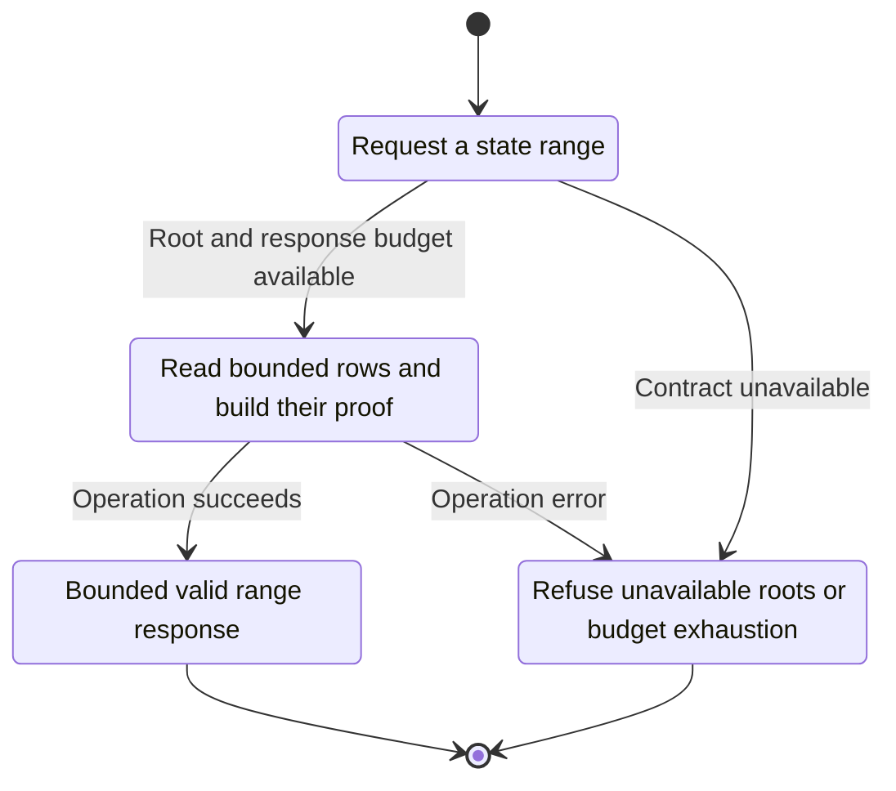
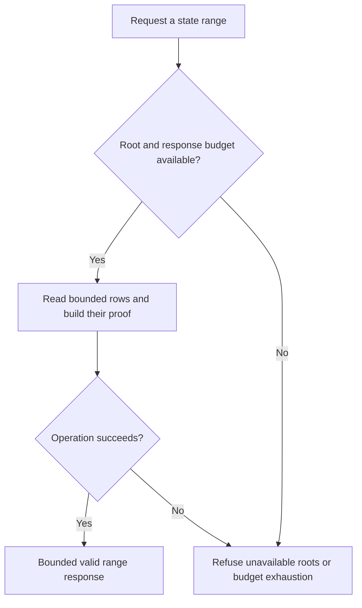

<!-- xone-gap-audit:2026-11-14:pass4:snap-server-streaming -->
> GAP-0088 · P1 · source review at `330b742bfa1ef1401c1b9b9be0cf0bd344255cca`. Static evidence; no deployed-node reproduction or benchmark is claimed.

## What

SnapServer builds Snapshot::from_rows from the entire state and clones the whole code map under store/history reads. It caches two such snapshots. Request cost admission happens after this construction, so the response byte cap does not bound preparation work.

Current implementation:

- [`crates/xone-node/src/services/snap.rs`](https://github.com/XDCIndia/xOneRS/blob/330b742bfa1ef1401c1b9b9be0cf0bd344255cca/crates/xone-node/src/services/snap.rs)
- [`crates/xone-snap/src/server.rs`](https://github.com/XDCIndia/xOneRS/blob/330b742bfa1ef1401c1b9b9be0cf0bd344255cca/crates/xone-snap/src/server.rs)
- [`crates/xone-sync/src/mdbx/mod.rs`](https://github.com/XDCIndia/xOneRS/blob/330b742bfa1ef1401c1b9b9be0cf0bd344255cca/crates/xone-sync/src/mdbx/mod.rs)
- [`crates/xone-db/src/mdbx.rs`](https://github.com/XDCIndia/xOneRS/blob/330b742bfa1ef1401c1b9b9be0cf0bd344255cca/crates/xone-db/src/mdbx.rs)

## Why

A memory-bounded follower can lose that property when another node asks it to serve snap data.

Verified competitor implementation references:

- [ethereum/go-ethereum: `eth/protocols/snap/handlers.go`](https://github.com/ethereum/go-ethereum/blob/8059ff8beb3170eb8b977169ac51bb0423c97ee1/eth/protocols/snap/handlers.go)
- [paradigmxyz/reth: `crates/net/network/src/eth_requests.rs`](https://github.com/paradigmxyz/reth/blob/36600d5ff9628465475dd4c7608e2e9f2fe24273/crates/net/network/src/eth_requests.rs)

#145 makes local state and snap installation disk-backed. This distinct server-side path still materializes full snapshots.

## 80% of the way to

1. Add a retained-root read interface that streams bounded account/storage ranges and proofs from persisted state/trie tables.
2. Apply peer and global admission before expensive reads or proof construction.
3. Bound root metadata, cursor lifetime and proof buffers; avoid whole-state and whole-code-map copies.
4. Preserve XDC wide-account encoding, empty-root refusal and cryptographic proof verification.

Acceptance criteria:

- [ ] Serving a small range does not allocate memory proportional to total chain state.
- [ ] Concurrent import remains within the existing latency budget while a peer requests ranges.
- [ ] Client-side proof validation accepts every served range, including pagination and retained-root boundaries.

## ASD-STE100

1. Read bounded rows and build their proof.
2. Keep the existing XDC consensus rules unchanged.
3. Check all required input before you start the operation.
4. Keep memory use within the configured limits.
5. Refuse unavailable roots or budget exhaustion.
6. Test each acceptance case through the actual entry point.

Technical names follow the repository vocabulary. These short instructions follow the requested sentence limits; certified ASD-STE100 vocabulary compliance has not been assessed.

## Diagrams

```mermaid
sequenceDiagram
    participant Actor as Snap peer
    participant Service as Snap server
    participant Data as Pinned database view
    Actor->>Service: Request a state range
    Service->>Data: Check required state and limits
    Data-->>Service: State and validation result
    alt Root and response budget available
        Service->>Data: Read bounded rows and build their proof
        Data-->>Service: Result or operation error
        Service-->>Actor: Bounded valid range response
    else Contract cannot be met
        Service-->>Actor: Refuse unavailable roots or budget exhaustion
    end
```

## Images

N/A. This change affects node behavior. The source links and test fixtures provide the evidence.

## Prompt

```text
Implement GAP-0088 in XDCIndia/xOneRS: Serve snap ranges from bounded database views without rebuilding whole-state snapshots.
Observed at 330b742bfa1ef1401c1b9b9be0cf0bd344255cca: SnapServer builds Snapshot::from_rows from the entire state and clones the whole code map under store/history reads. It caches two such snapshots. Request cost admission happens after this construction, so the response byte cap does not bound preparation work.
Read these target files: crates/xone-node/src/services/snap.rs, crates/xone-snap/src/server.rs, crates/xone-sync/src/mdbx/mod.rs, crates/xone-db/src/mdbx.rs.
Implementation: Add a retained-root read interface that streams bounded account/storage ranges and proofs from persisted state/trie tables. Apply peer and global admission before expensive reads or proof construction. Bound root metadata, cursor lifetime and proof buffers; avoid whole-state and whole-code-map copies. Preserve XDC wide-account encoding, empty-root refusal and cryptographic proof verification.
Acceptance: Serving a small range does not allocate memory proportional to total chain state. Concurrent import remains within the existing latency budget while a peer requests ranges. Client-side proof validation accepts every served range, including pagination and retained-root boundaries.
Related ownership: #145 makes local state and snap installation disk-backed. This distinct server-side path still materializes full snapshots.
Re-pin current main and the authoritative geth-XDC oracle before editing. Preserve XDC consensus, signatures, encodings, storage publication and configured resource bounds. Use the linked competitor code as design evidence, respecting its license. Write focused failing fixtures, implement the smallest coherent change, and run the applicable repository checks. Report exact commands and results. Open a reviewable PR; do not claim completion from a registered method or a mock-only test.
```

## Workflow

1. **Snap peer:** Request a state range.
2. **Snap server:** Check whether root and response budget available.
3. **Snap server:** Read bounded rows and build their proof through pinned database view.
4. **Snap server:** On success, provide bounded valid range response.
5. **Snap server:** On refusal or failure, refuse unavailable roots or budget exhaustion.

The acceptance cases above define the exact errors, ordering and resource boundaries. Verify the real entry point before closing the issue.

## Loop

None. Run the operation only when requested.

## Graph

Lifecycle of this snap server operation; this diagram does not change the blockchain consensus state machine.



## Layout

This capability uses a node, command-line, or build interface. It does not require a new graphical screen.

| Interface detail | Placement |
| --- | --- |
| Actor and trigger | Snap peer: request a state range |
| Input validation | Snap server: root and response budget available |
| Output | Bounded valid range response |
| Error or refusal | Refuse unavailable roots or budget exhaustion |
| Implementation files | `crates/xone-node/src/services/snap.rs`, `crates/xone-snap/src/server.rs`, `crates/xone-sync/src/mdbx/mod.rs`, `crates/xone-db/src/mdbx.rs` |

Keep field names and response shapes compatible with the specification and acceptance cases above.

## Flow



## Summary

Gap: Serve snap ranges from bounded database views without rebuilding whole-state snapshots.
Fix: Add a retained-root read interface that streams bounded account/storage ranges and proofs from persisted state/trie tables.
Acceptance: Serving a small range does not allocate memory proportional to total chain state.
