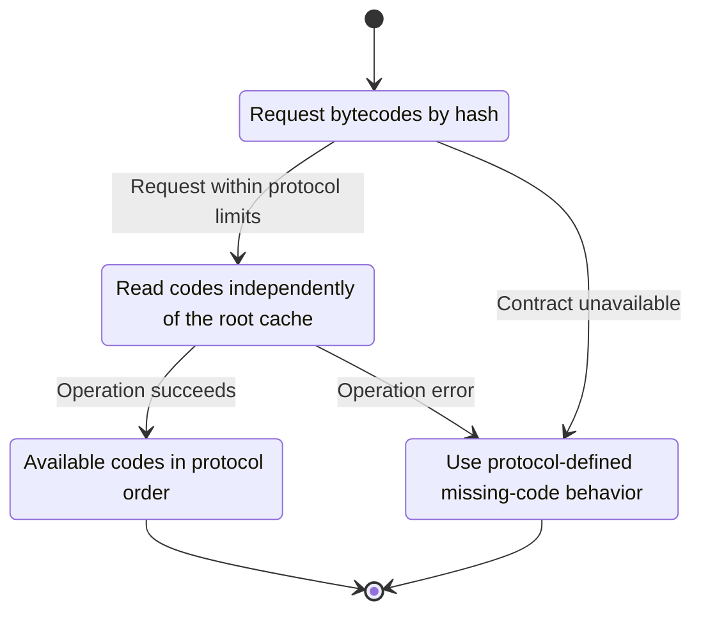
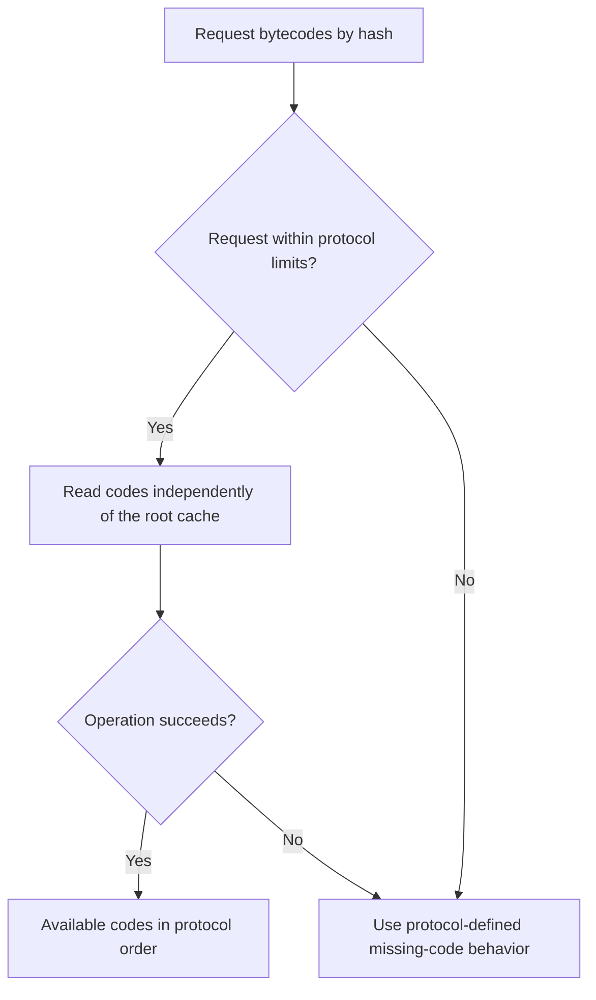

<!-- xone-gap-audit:2026-11-14:pass4:snap-cold-bytecodes -->
> GAP-0089 · P2 · source review at `330b742bfa1ef1401c1b9b9be0cf0bd344255cca`. Static evidence; no deployed-node reproduction or benchmark is claimed.

## What

GetByteCodes contains no root. SnapServer selects a root from cache.last() for rootless requests and answers empty when the cache is empty, even though bytecode is available by hash in storage.

Current implementation:

- [`crates/xone-node/src/services/snap.rs`](https://github.com/XDCIndia/xOneRS/blob/330b742bfa1ef1401c1b9b9be0cf0bd344255cca/crates/xone-node/src/services/snap.rs)
- [`crates/xone-snap/src/server.rs`](https://github.com/XDCIndia/xOneRS/blob/330b742bfa1ef1401c1b9b9be0cf0bd344255cca/crates/xone-snap/src/server.rs)

## Why

A peer can request code in any valid sync order; it should not need an unrelated query to warm server state first.

Verified competitor implementation references:

- [ethereum/go-ethereum: `eth/protocols/snap/handlers.go`](https://github.com/ethereum/go-ethereum/blob/8059ff8beb3170eb8b977169ac51bb0423c97ee1/eth/protocols/snap/handlers.go)

#37 owns snap/1. This is the rootless bytecode query path, separate from range-proof streaming.

## 80% of the way to

1. Route bytecode requests directly to the retained content-addressed code store.
2. Enforce hash-count, byte and time budgets without building an account snapshot.
3. Keep missing-code and empty-code behavior compatible with snap/1 and verify content hashes.

Acceptance criteria:

- [ ] A fresh server answers a known code hash before any account-range request.
- [ ] Evicting root snapshots does not change bytecode availability.
- [ ] Unknown, empty-code and oversized query cases follow the protocol limits.

## ASD-STE100

1. Read codes independently of the root cache.
2. Keep the existing XDC consensus rules unchanged.
3. Check all required input before you start the operation.
4. Keep memory use within the configured limits.
5. Use protocol-defined missing-code behavior.
6. Test each acceptance case through the actual entry point.

Technical names follow the repository vocabulary. These short instructions follow the requested sentence limits; certified ASD-STE100 vocabulary compliance has not been assessed.

## Diagrams

```mermaid
sequenceDiagram
    participant Actor as Snap peer
    participant Service as Snap server
    participant Data as Code store
    Actor->>Service: Request bytecodes by hash
    Service->>Data: Check required state and limits
    Data-->>Service: State and validation result
    alt Request within protocol limits
        Service->>Data: Read codes independently of the root cache
        Data-->>Service: Result or operation error
        Service-->>Actor: Available codes in protocol order
    else Contract cannot be met
        Service-->>Actor: Use protocol-defined missing-code behavior
    end
```

## Images

N/A. This change affects node behavior. The source links and test fixtures provide the evidence.

## Prompt

```text
Implement GAP-0089 in XDCIndia/xOneRS: Serve snap bytecode requests without requiring a warmed root cache.
Observed at 330b742bfa1ef1401c1b9b9be0cf0bd344255cca: GetByteCodes contains no root. SnapServer selects a root from cache.last() for rootless requests and answers empty when the cache is empty, even though bytecode is available by hash in storage.
Read these target files: crates/xone-node/src/services/snap.rs, crates/xone-snap/src/server.rs.
Implementation: Route bytecode requests directly to the retained content-addressed code store. Enforce hash-count, byte and time budgets without building an account snapshot. Keep missing-code and empty-code behavior compatible with snap/1 and verify content hashes.
Acceptance: A fresh server answers a known code hash before any account-range request. Evicting root snapshots does not change bytecode availability. Unknown, empty-code and oversized query cases follow the protocol limits.
Related ownership: #37 owns snap/1. This is the rootless bytecode query path, separate from range-proof streaming.
Re-pin current main and the authoritative geth-XDC oracle before editing. Preserve XDC consensus, signatures, encodings, storage publication and configured resource bounds. Use the linked competitor code as design evidence, respecting its license. Write focused failing fixtures, implement the smallest coherent change, and run the applicable repository checks. Report exact commands and results. Open a reviewable PR; do not claim completion from a registered method or a mock-only test.
```

## Workflow

1. **Snap peer:** Request bytecodes by hash.
2. **Snap server:** Check whether request within protocol limits.
3. **Snap server:** Read codes independently of the root cache through code store.
4. **Snap server:** On success, provide available codes in protocol order.
5. **Snap server:** On refusal or failure, use protocol-defined missing-code behavior.

The acceptance cases above define the exact errors, ordering and resource boundaries. Verify the real entry point before closing the issue.

## Loop

None. Run the operation only when requested.

## Graph

Lifecycle of this snap server operation; this diagram does not change the blockchain consensus state machine.



## Layout

This capability uses a node, command-line, or build interface. It does not require a new graphical screen.

| Interface detail | Placement |
| --- | --- |
| Actor and trigger | Snap peer: request bytecodes by hash |
| Input validation | Snap server: request within protocol limits |
| Output | Available codes in protocol order |
| Error or refusal | Use protocol-defined missing-code behavior |
| Implementation files | `crates/xone-node/src/services/snap.rs`, `crates/xone-snap/src/server.rs` |

Keep field names and response shapes compatible with the specification and acceptance cases above.

## Flow



## Summary

Gap: Serve snap bytecode requests without requiring a warmed root cache.
Fix: Route bytecode requests directly to the retained content-addressed code store.
Acceptance: A fresh server answers a known code hash before any account-range request.
