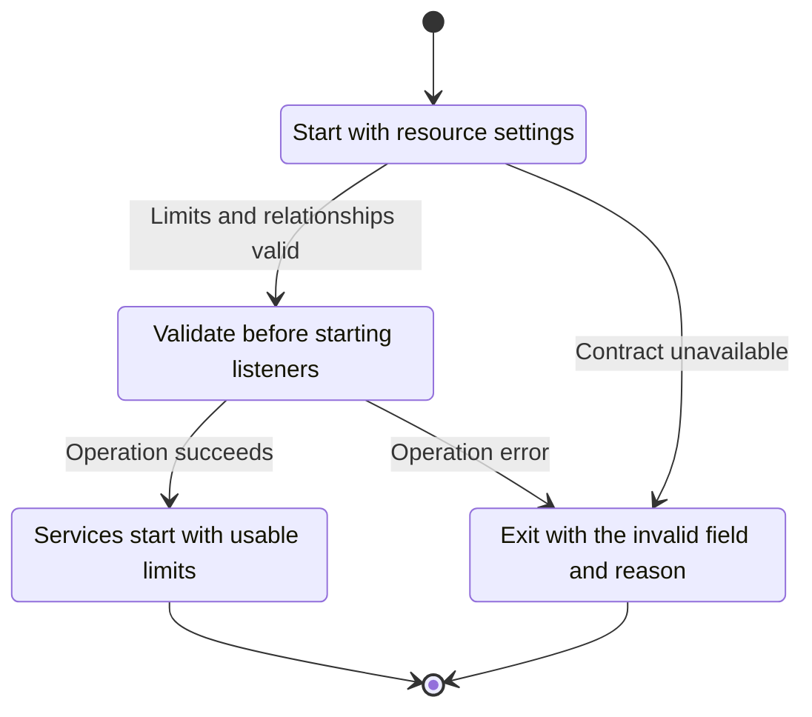
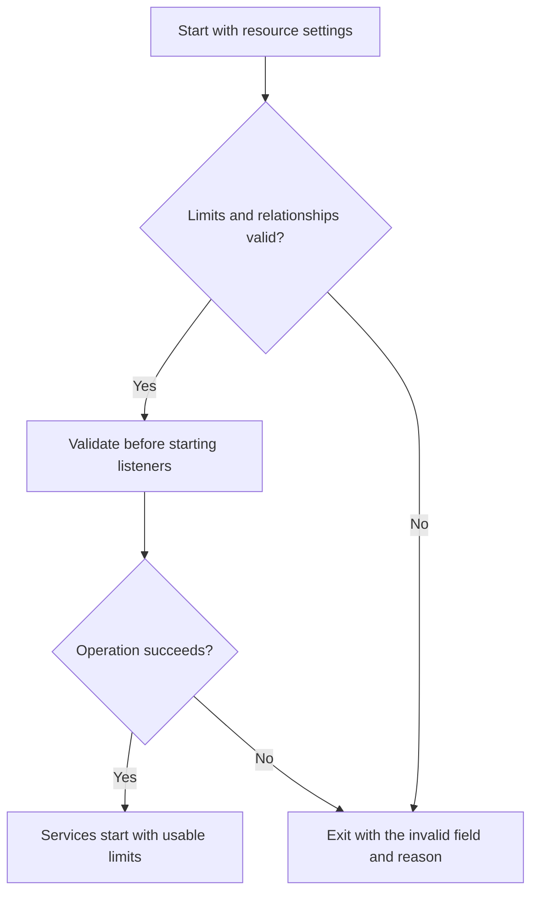

<!-- xone-gap-audit:2026-11-14:pass4:resource-config-validation -->
> GAP-0090 · P2 · source review at `330b742bfa1ef1401c1b9b9be0cf0bd344255cca`. Static evidence; no deployed-node reproduction or benchmark is claimed.

## What

Config deserialization validates sync modes but does not validate the resource-limit relationships. Zero HTTP in-flight capacity can leave every request waiting, and invalid lifecycle budgets reach service startup without a unified validation step.

Current implementation:

- [`crates/xone-node/src/config.rs`](https://github.com/XDCIndia/xOneRS/blob/330b742bfa1ef1401c1b9b9be0cf0bd344255cca/crates/xone-node/src/config.rs)
- [`crates/xone-node/src/services/rpc.rs`](https://github.com/XDCIndia/xOneRS/blob/330b742bfa1ef1401c1b9b9be0cf0bd344255cca/crates/xone-node/src/services/rpc.rs)
- [`crates/xone-node/src/lifecycle.rs`](https://github.com/XDCIndia/xOneRS/blob/330b742bfa1ef1401c1b9b9be0cf0bd344255cca/crates/xone-node/src/lifecycle.rs)

## Why

A syntactically valid configuration should not create a node that starts successfully but cannot serve requests or stop within its advertised budget.

Verified competitor implementation references:

- [paradigmxyz/reth: `crates/node/core/src/args/database.rs`](https://github.com/paradigmxyz/reth/blob/36600d5ff9628465475dd4c7608e2e9f2fe24273/crates/node/core/src/args/database.rs)
- [ethereum/go-ethereum: `node/rpcstack.go`](https://github.com/ethereum/go-ethereum/blob/8059ff8beb3170eb8b977169ac51bb0423c97ee1/node/rpcstack.go)

#39 defines configuration precedence and #16 defines limits. This adds validation for unusable combinations in the current typed config.

## 80% of the way to

1. Validate the effective configuration after all sources are merged and before opening listeners or databases.
2. Define which zero values disable features and reject zero capacities that cause permanent waits. Check byte conversions and lifecycle-budget relationships.
3. Return actionable field-specific errors and include normalized values in dumpconfig without secrets.

Acceptance criteria:

- [ ] Zero HTTP in-flight capacity is rejected or explicitly disables HTTP; it never starts a permanently waiting server.
- [ ] Invalid whole-node/service shutdown budgets fail before resources are acquired.
- [ ] Boundary-value and valid-default configurations round-trip consistently.

## ASD-STE100

1. Validate before starting listeners.
2. Keep the existing XDC consensus rules unchanged.
3. Check all required input before you start the operation.
4. Keep memory use within the configured limits.
5. Exit with the invalid field and reason.
6. Test each acceptance case through the actual entry point.

Technical names follow the repository vocabulary. These short instructions follow the requested sentence limits; certified ASD-STE100 vocabulary compliance has not been assessed.

## Diagrams

```mermaid
sequenceDiagram
    participant Actor as Node operator
    participant Service as Configuration validator
    participant Data as Service limits
    Actor->>Service: Start with resource settings
    Service->>Data: Check required state and limits
    Data-->>Service: State and validation result
    alt Limits and relationships valid
        Service->>Data: Validate before starting listeners
        Data-->>Service: Result or operation error
        Service-->>Actor: Services start with usable limits
    else Contract cannot be met
        Service-->>Actor: Exit with the invalid field and reason
    end
```

## Images

N/A. This change affects node behavior. The source links and test fixtures provide the evidence.

## Prompt

```text
Implement GAP-0090 in XDCIndia/xOneRS: Reject unusable resource and lifecycle limits before starting services.
Observed at 330b742bfa1ef1401c1b9b9be0cf0bd344255cca: Config deserialization validates sync modes but does not validate the resource-limit relationships. Zero HTTP in-flight capacity can leave every request waiting, and invalid lifecycle budgets reach service startup without a unified validation step.
Read these target files: crates/xone-node/src/config.rs, crates/xone-node/src/services/rpc.rs, crates/xone-node/src/lifecycle.rs.
Implementation: Validate the effective configuration after all sources are merged and before opening listeners or databases. Define which zero values disable features and reject zero capacities that cause permanent waits. Check byte conversions and lifecycle-budget relationships. Return actionable field-specific errors and include normalized values in dumpconfig without secrets.
Acceptance: Zero HTTP in-flight capacity is rejected or explicitly disables HTTP; it never starts a permanently waiting server. Invalid whole-node/service shutdown budgets fail before resources are acquired. Boundary-value and valid-default configurations round-trip consistently.
Related ownership: #39 defines configuration precedence and #16 defines limits. This adds validation for unusable combinations in the current typed config.
Re-pin current main and the authoritative geth-XDC oracle before editing. Preserve XDC consensus, signatures, encodings, storage publication and configured resource bounds. Use the linked competitor code as design evidence, respecting its license. Write focused failing fixtures, implement the smallest coherent change, and run the applicable repository checks. Report exact commands and results. Open a reviewable PR; do not claim completion from a registered method or a mock-only test.
```

## Workflow

1. **Node operator:** Start with resource settings.
2. **Configuration validator:** Check whether limits and relationships valid.
3. **Configuration validator:** Validate before starting listeners through service limits.
4. **Configuration validator:** On success, provide services start with usable limits.
5. **Configuration validator:** On refusal or failure, exit with the invalid field and reason.

The acceptance cases above define the exact errors, ordering and resource boundaries. Verify the real entry point before closing the issue.

## Loop

None. Run the operation only when requested.

## Graph

Lifecycle of this configuration validator operation; this diagram does not change the blockchain consensus state machine.



## Layout

This capability uses a node, command-line, or build interface. It does not require a new graphical screen.

| Interface detail | Placement |
| --- | --- |
| Actor and trigger | Node operator: start with resource settings |
| Input validation | Configuration validator: limits and relationships valid |
| Output | Services start with usable limits |
| Error or refusal | Exit with the invalid field and reason |
| Implementation files | `crates/xone-node/src/config.rs`, `crates/xone-node/src/services/rpc.rs`, `crates/xone-node/src/lifecycle.rs` |

Keep field names and response shapes compatible with the specification and acceptance cases above.

## Flow



## Summary

Gap: Reject unusable resource and lifecycle limits before starting services.
Fix: Validate the effective configuration after all sources are merged and before opening listeners or databases.
Acceptance: Zero HTTP in-flight capacity is rejected or explicitly disables HTTP; it never starts a permanently waiting server.
