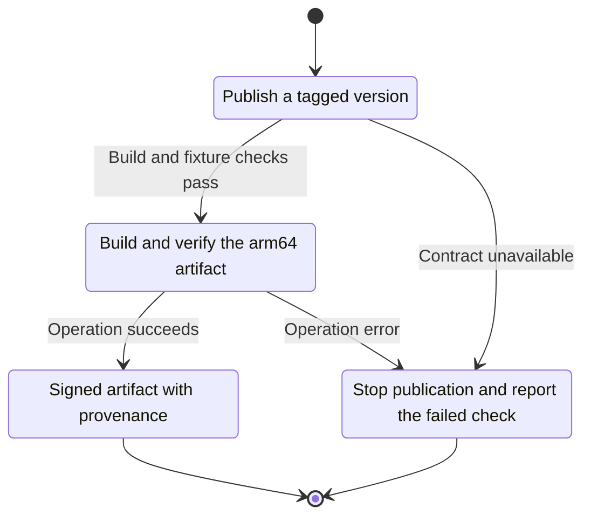
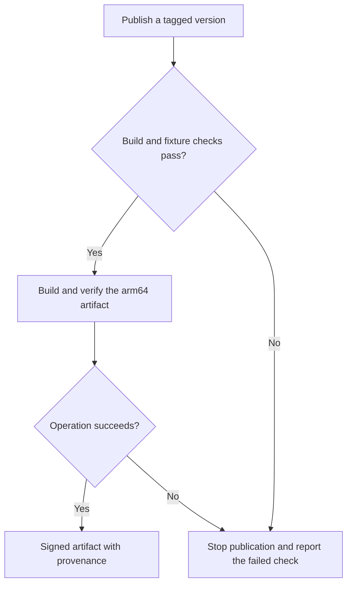

<!-- xone-gap-audit:2026-11-14:pass4:macos-release -->
> GAP-0091 · P3 · source review at `330b742bfa1ef1401c1b9b9be0cf0bd344255cca`. Static evidence; no deployed-node reproduction or benchmark is claimed.

## What

The release path targets Linux binaries. There is no native Apple Silicon release artifact or macOS packaging qualification in the current release scripts.

Current implementation:

- [`ci/release.sh`](https://github.com/XDCIndia/xOneRS/blob/330b742bfa1ef1401c1b9b9be0cf0bd344255cca/ci/release.sh)
- [`ci/test-release.sh`](https://github.com/XDCIndia/xOneRS/blob/330b742bfa1ef1401c1b9b9be0cf0bd344255cca/ci/test-release.sh)
- [`ops/install.md`](https://github.com/XDCIndia/xOneRS/blob/330b742bfa1ef1401c1b9b9be0cf0bd344255cca/ops/install.md)
- [`Cargo.toml`](https://github.com/XDCIndia/xOneRS/blob/330b742bfa1ef1401c1b9b9be0cf0bd344255cca/Cargo.toml)

## Why

Developers using Apple Silicon need a maintained native binary for local integration and follower testing.

Verified competitor implementation references:

- [paradigmxyz/reth: `.github/workflows/release.yml`](https://github.com/paradigmxyz/reth/blob/36600d5ff9628465475dd4c7608e2e9f2fe24273/.github/workflows/release.yml)

#193 and #46 qualify Linux x86_64/aarch64 packaging. This is an additional native platform, not another Linux package.

## 80% of the way to

1. Add a pinned macOS arm64 build and native verification job with an explicit supported OS floor.
2. Exercise storage bindings, IPC paths, signal handling and a local follower/import fixture on macOS.
3. Publish checksums, signatures and provenance through the established release process. Document platform differences and keep Linux gates intact.

Acceptance criteria:

- [ ] The downloaded artifact runs natively on the declared macOS version.
- [ ] A controlled fixture yields the same block and state roots as the Linux build.
- [ ] Release metadata identifies platform, architecture, revision and artifact checksum.

## ASD-STE100

1. Build and verify the arm64 artifact.
2. Keep the existing XDC consensus rules unchanged.
3. Check all required input before you start the operation.
4. Keep memory use within the configured limits.
5. Stop publication and report the failed check.
6. Test each acceptance case through the actual entry point.

Technical names follow the repository vocabulary. These short instructions follow the requested sentence limits; certified ASD-STE100 vocabulary compliance has not been assessed.

## Diagrams

```mermaid
sequenceDiagram
    participant Actor as Release maintainer
    participant Service as Release workflow
    participant Data as Native macOS runner
    Actor->>Service: Publish a tagged version
    Service->>Data: Check required state and limits
    Data-->>Service: State and validation result
    alt Build and fixture checks pass
        Service->>Data: Build and verify the arm64 artifact
        Data-->>Service: Result or operation error
        Service-->>Actor: Signed artifact with provenance
    else Contract cannot be met
        Service-->>Actor: Stop publication and report the failed check
    end
```

## Images

N/A. This change affects node behavior. The source links and test fixtures provide the evidence.

## Prompt

```text
Implement GAP-0091 in XDCIndia/xOneRS: Publish verified native macOS arm64 follower binaries.
Observed at 330b742bfa1ef1401c1b9b9be0cf0bd344255cca: The release path targets Linux binaries. There is no native Apple Silicon release artifact or macOS packaging qualification in the current release scripts.
Read these target files: ci/release.sh, ci/test-release.sh, ops/install.md, Cargo.toml.
Implementation: Add a pinned macOS arm64 build and native verification job with an explicit supported OS floor. Exercise storage bindings, IPC paths, signal handling and a local follower/import fixture on macOS. Publish checksums, signatures and provenance through the established release process. Document platform differences and keep Linux gates intact.
Acceptance: The downloaded artifact runs natively on the declared macOS version. A controlled fixture yields the same block and state roots as the Linux build. Release metadata identifies platform, architecture, revision and artifact checksum.
Related ownership: #193 and #46 qualify Linux x86_64/aarch64 packaging. This is an additional native platform, not another Linux package.
Re-pin current main and the authoritative geth-XDC oracle before editing. Preserve XDC consensus, signatures, encodings, storage publication and configured resource bounds. Use the linked competitor code as design evidence, respecting its license. Write focused failing fixtures, implement the smallest coherent change, and run the applicable repository checks. Report exact commands and results. Open a reviewable PR; do not claim completion from a registered method or a mock-only test.
```

## Workflow

1. **Release maintainer:** Publish a tagged version.
2. **Release workflow:** Check whether build and fixture checks pass.
3. **Release workflow:** Build and verify the arm64 artifact through native macos runner.
4. **Release workflow:** On success, provide signed artifact with provenance.
5. **Release workflow:** On refusal or failure, stop publication and report the failed check.

The acceptance cases above define the exact errors, ordering and resource boundaries. Verify the real entry point before closing the issue.

## Loop

Run the native build and fixture checks for each supported release tag. Retry only failed infrastructure steps. Never publish an artifact whose checks failed.

## Graph

Lifecycle of this release workflow operation; this diagram does not change the blockchain consensus state machine.



## Layout

This capability uses a node, command-line, or build interface. It does not require a new graphical screen.

| Interface detail | Placement |
| --- | --- |
| Actor and trigger | Release maintainer: publish a tagged version |
| Input validation | Release workflow: build and fixture checks pass |
| Output | Signed artifact with provenance |
| Error or refusal | Stop publication and report the failed check |
| Implementation files | `ci/release.sh`, `ci/test-release.sh`, `ops/install.md`, `Cargo.toml` |

Keep field names and response shapes compatible with the specification and acceptance cases above.

## Flow



## Summary

Gap: Publish verified native macOS arm64 follower binaries.
Fix: Add a pinned macOS arm64 build and native verification job with an explicit supported OS floor.
Acceptance: The downloaded artifact runs natively on the declared macOS version.
