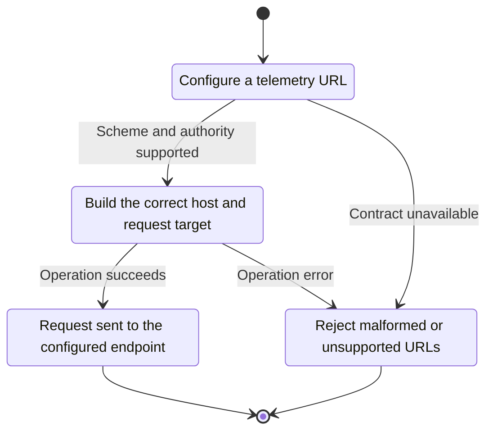
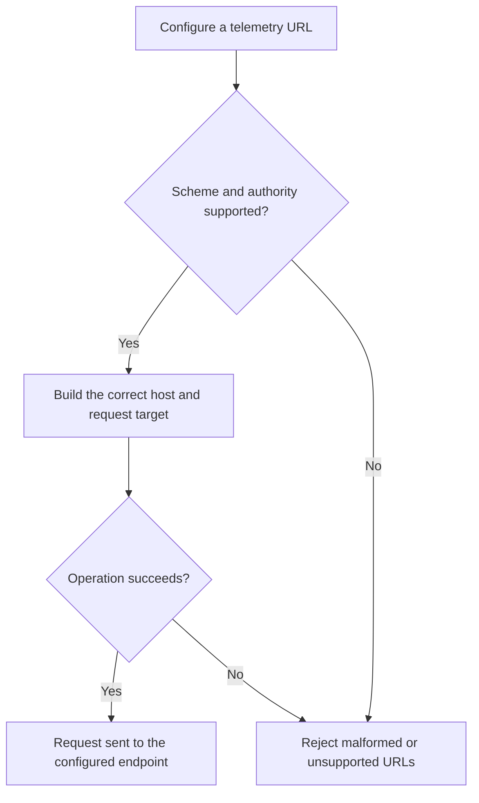

<!-- xone-gap-audit:2026-11-14:pass4:telemetry-url-contract -->
> GAP-0092 · P2 · source review at `330b742bfa1ef1401c1b9b9be0cf0bd344255cca`. Static evidence; no deployed-node reproduction or benchmark is claimed.

## What

parse_target splits host/port with rsplit_once rather than parsing a URL authority. Bracketed IPv6 hosts remain bracketed for DNS/TLS handling. Heartbeat HTTP requests write Host using only the host, omitting an explicit non-default port.

Current implementation:

- [`crates/xone-node/src/observe/wire.rs`](https://github.com/XDCIndia/xOneRS/blob/330b742bfa1ef1401c1b9b9be0cf0bd344255cca/crates/xone-node/src/observe/wire.rs)
- [`crates/xone-node/src/observe/heartbeat.rs`](https://github.com/XDCIndia/xOneRS/blob/330b742bfa1ef1401c1b9b9be0cf0bd344255cca/crates/xone-node/src/observe/heartbeat.rs)
- [`crates/xone-node/src/observe/ethstats.rs`](https://github.com/XDCIndia/xOneRS/blob/330b742bfa1ef1401c1b9b9be0cf0bd344255cca/crates/xone-node/src/observe/ethstats.rs)

## Why

Valid monitoring endpoints can fail because host, port and request target are reconstructed incorrectly.

Verified competitor implementation references:

- [ethereum/go-ethereum: `ethstats/ethstats.go`](https://github.com/ethereum/go-ethereum/blob/8059ff8beb3170eb8b977169ac51bb0423c97ee1/ethstats/ethstats.go)
- [ethereum/go-ethereum: `rpc/http.go`](https://github.com/ethereum/go-ethereum/blob/8059ff8beb3170eb8b977169ac51bb0423c97ee1/rpc/http.go)

#41 implements telemetry. This unit fixes its shared endpoint parsing and HTTP serialization.

## 80% of the way to

1. Use a validated URL/authority representation with separate host, port, path and query components.
2. Serialize Host and request targets correctly for IPv6 and non-default ports. Reject control characters and unsupported userinfo forms without echoing secrets.
3. Preserve TLS verification and the existing explicit plaintext opt-in.

Acceptance criteria:

- [ ] IPv4, DNS, bracketed IPv6, non-default port and path/query fixtures produce valid requests.
- [ ] TLS receives the correct unbracketed server name/address.
- [ ] Invalid authorities and control characters fail before network IO, with redacted errors.

## ASD-STE100

1. Build the correct host and request target.
2. Keep the existing XDC consensus rules unchanged.
3. Check all required input before you start the operation.
4. Keep memory use within the configured limits.
5. Reject malformed or unsupported URLs.
6. Test each acceptance case through the actual entry point.

Technical names follow the repository vocabulary. These short instructions follow the requested sentence limits; certified ASD-STE100 vocabulary compliance has not been assessed.

## Diagrams

```mermaid
sequenceDiagram
    participant Actor as Node operator
    participant Service as Telemetry client
    participant Data as URL parser and transport
    Actor->>Service: Configure a telemetry URL
    Service->>Data: Check required state and limits
    Data-->>Service: State and validation result
    alt Scheme and authority supported
        Service->>Data: Build the correct host and request target
        Data-->>Service: Result or operation error
        Service-->>Actor: Request sent to the configured endpoint
    else Contract cannot be met
        Service-->>Actor: Reject malformed or unsupported URLs
    end
```

## Images

N/A. This change affects node behavior. The source links and test fixtures provide the evidence.

## Prompt

```text
Implement GAP-0092 in XDCIndia/xOneRS: Parse telemetry URLs correctly for IPv6, ports and request targets.
Observed at 330b742bfa1ef1401c1b9b9be0cf0bd344255cca: parse_target splits host/port with rsplit_once rather than parsing a URL authority. Bracketed IPv6 hosts remain bracketed for DNS/TLS handling. Heartbeat HTTP requests write Host using only the host, omitting an explicit non-default port.
Read these target files: crates/xone-node/src/observe/wire.rs, crates/xone-node/src/observe/heartbeat.rs, crates/xone-node/src/observe/ethstats.rs.
Implementation: Use a validated URL/authority representation with separate host, port, path and query components. Serialize Host and request targets correctly for IPv6 and non-default ports. Reject control characters and unsupported userinfo forms without echoing secrets. Preserve TLS verification and the existing explicit plaintext opt-in.
Acceptance: IPv4, DNS, bracketed IPv6, non-default port and path/query fixtures produce valid requests. TLS receives the correct unbracketed server name/address. Invalid authorities and control characters fail before network IO, with redacted errors.
Related ownership: #41 implements telemetry. This unit fixes its shared endpoint parsing and HTTP serialization.
Re-pin current main and the authoritative geth-XDC oracle before editing. Preserve XDC consensus, signatures, encodings, storage publication and configured resource bounds. Use the linked competitor code as design evidence, respecting its license. Write focused failing fixtures, implement the smallest coherent change, and run the applicable repository checks. Report exact commands and results. Open a reviewable PR; do not claim completion from a registered method or a mock-only test.
```

## Workflow

1. **Node operator:** Configure a telemetry URL.
2. **Telemetry client:** Check whether scheme and authority supported.
3. **Telemetry client:** Build the correct host and request target through url parser and transport.
4. **Telemetry client:** On success, provide request sent to the configured endpoint.
5. **Telemetry client:** On refusal or failure, reject malformed or unsupported URLs.

The acceptance cases above define the exact errors, ordering and resource boundaries. Verify the real entry point before closing the issue.

## Loop

None. Run the operation only when requested.

## Graph

Lifecycle of this telemetry client operation; this diagram does not change the blockchain consensus state machine.



## Layout

This capability uses a node, command-line, or build interface. It does not require a new graphical screen.

| Interface detail | Placement |
| --- | --- |
| Actor and trigger | Node operator: configure a telemetry url |
| Input validation | Telemetry client: scheme and authority supported |
| Output | Request sent to the configured endpoint |
| Error or refusal | Reject malformed or unsupported URLs |
| Implementation files | `crates/xone-node/src/observe/wire.rs`, `crates/xone-node/src/observe/heartbeat.rs`, `crates/xone-node/src/observe/ethstats.rs` |

Keep field names and response shapes compatible with the specification and acceptance cases above.

## Flow



## Summary

Gap: Parse telemetry URLs correctly for IPv6, ports and request targets.
Fix: Use a validated URL/authority representation with separate host, port, path and query components.
Acceptance: IPv4, DNS, bracketed IPv6, non-default port and path/query fixtures produce valid requests.
