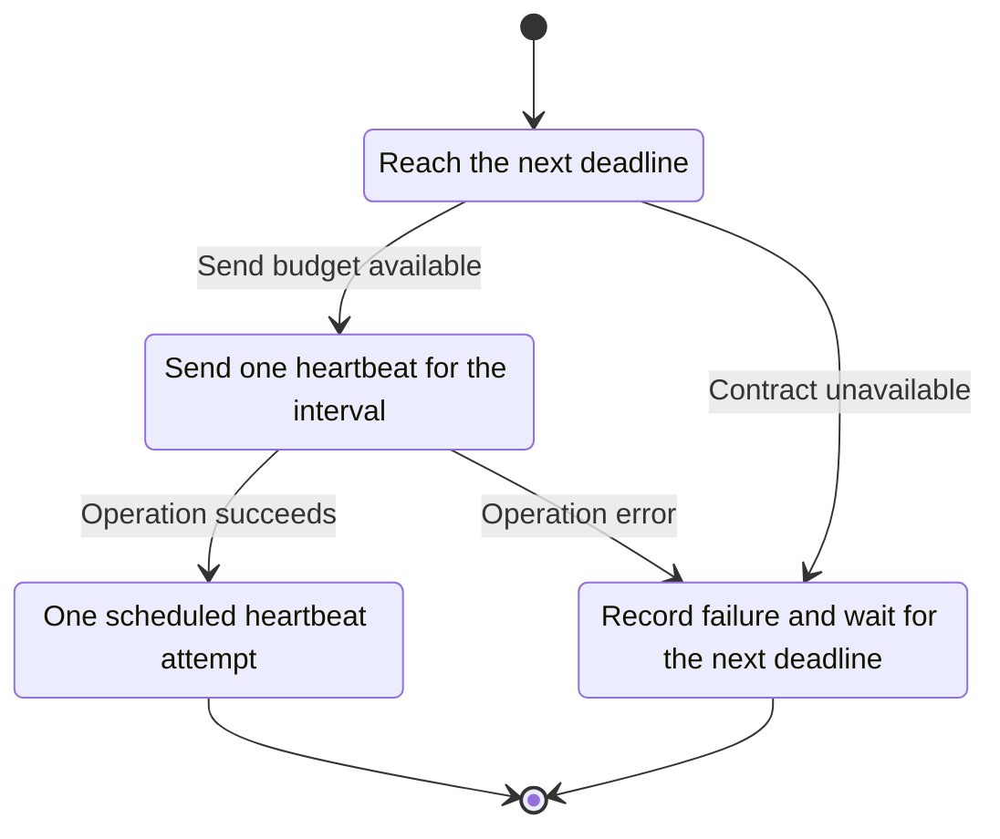
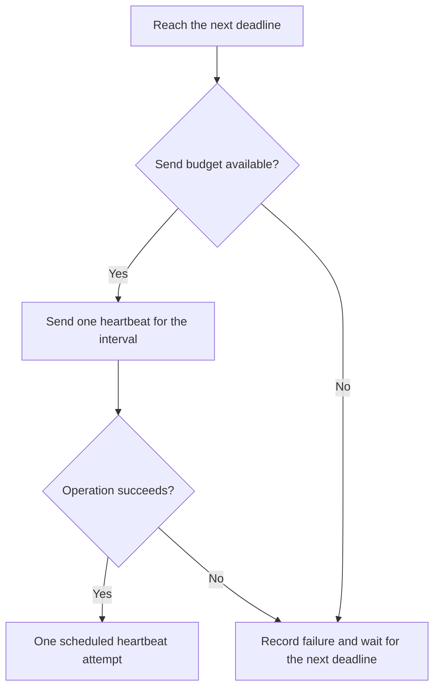

<!-- xone-gap-audit:2026-11-14:pass4:heartbeat-token-units -->
> GAP-0093 · P2 · source review at `330b742bfa1ef1401c1b9b9be0cf0bd344255cca`. Static evidence; no deployed-node reproduction or benchmark is claimed.

## What

Heartbeat::start creates a bucket with burst 3, then calls try_take with cost equal to interval seconds. TokenBucket documents that a cost above its burst never succeeds. A configured interval greater than three seconds therefore prevents sends in this service loop.

Current implementation:

- [`crates/xone-node/src/observe/heartbeat.rs`](https://github.com/XDCIndia/xOneRS/blob/330b742bfa1ef1401c1b9b9be0cf0bd344255cca/crates/xone-node/src/observe/heartbeat.rs)
- [`crates/xone-primitives/src/limits/bucket.rs`](https://github.com/XDCIndia/xOneRS/blob/330b742bfa1ef1401c1b9b9be0cf0bd344255cca/crates/xone-primitives/src/limits/bucket.rs)

## Why

Longer monitoring intervals must reduce traffic rather than silently disable all heartbeats.

Verified competitor implementation references:

- [ethereum/go-ethereum: `ethstats/ethstats.go`](https://github.com/ethereum/go-ethereum/blob/8059ff8beb3170eb8b977169ac51bb0423c97ee1/ethstats/ethstats.go)

#41 owns runtime heartbeat integration. This is a deterministic scheduling defect inside the existing service, even before integration.

## 80% of the way to

1. Use consistent token units for heartbeat sends, independent of the interval value.
2. Schedule the next send from a monotonic deadline without catch-up bursts after long stalls.
3. Test the actual service loop with an injected clock/transport and keep failures bounded by the configured cadence.

Acceptance criteria:

- [ ] Intervals of 1, 15 and 60 seconds all send according to their documented schedule.
- [ ] A long pause causes no unbounded catch-up burst.
- [ ] Transport failures do not create a tight retry loop, and shutdown completes promptly.

## ASD-STE100

1. Send one heartbeat for the interval.
2. Keep the existing XDC consensus rules unchanged.
3. Check all required input before you start the operation.
4. Keep memory use within the configured limits.
5. Record failure and wait for the next deadline.
6. Test each acceptance case through the actual entry point.

Technical names follow the repository vocabulary. These short instructions follow the requested sentence limits; certified ASD-STE100 vocabulary compliance has not been assessed.

## Diagrams

```mermaid
sequenceDiagram
    participant Actor as Heartbeat timer
    participant Service as Heartbeat service
    participant Data as Telemetry endpoint
    Actor->>Service: Reach the next deadline
    Service->>Data: Check required state and limits
    Data-->>Service: State and validation result
    alt Send budget available
        Service->>Data: Send one heartbeat for the interval
        Data-->>Service: Result or operation error
        Service-->>Actor: One scheduled heartbeat attempt
    else Contract cannot be met
        Service-->>Actor: Record failure and wait for the next deadline
    end
```

## Images

N/A. This change affects node behavior. The source links and test fixtures provide the evidence.

## Prompt

```text
Implement GAP-0093 in XDCIndia/xOneRS: Fix heartbeat scheduling when the interval exceeds the token-bucket burst.
Observed at 330b742bfa1ef1401c1b9b9be0cf0bd344255cca: Heartbeat::start creates a bucket with burst 3, then calls try_take with cost equal to interval seconds. TokenBucket documents that a cost above its burst never succeeds. A configured interval greater than three seconds therefore prevents sends in this service loop.
Read these target files: crates/xone-node/src/observe/heartbeat.rs, crates/xone-primitives/src/limits/bucket.rs.
Implementation: Use consistent token units for heartbeat sends, independent of the interval value. Schedule the next send from a monotonic deadline without catch-up bursts after long stalls. Test the actual service loop with an injected clock/transport and keep failures bounded by the configured cadence.
Acceptance: Intervals of 1, 15 and 60 seconds all send according to their documented schedule. A long pause causes no unbounded catch-up burst. Transport failures do not create a tight retry loop, and shutdown completes promptly.
Related ownership: #41 owns runtime heartbeat integration. This is a deterministic scheduling defect inside the existing service, even before integration.
Re-pin current main and the authoritative geth-XDC oracle before editing. Preserve XDC consensus, signatures, encodings, storage publication and configured resource bounds. Use the linked competitor code as design evidence, respecting its license. Write focused failing fixtures, implement the smallest coherent change, and run the applicable repository checks. Report exact commands and results. Open a reviewable PR; do not claim completion from a registered method or a mock-only test.
```

## Workflow

1. **Heartbeat timer:** Reach the next deadline.
2. **Heartbeat service:** Check whether send budget available.
3. **Heartbeat service:** Send one heartbeat for the interval through telemetry endpoint.
4. **Heartbeat service:** On success, provide one scheduled heartbeat attempt.
5. **Heartbeat service:** On refusal or failure, record failure and wait for the next deadline.

The acceptance cases above define the exact errors, ordering and resource boundaries. Verify the real entry point before closing the issue.

## Loop

Send once per configured interval. On failure, wait for the next bounded deadline.

## Graph

Lifecycle of this heartbeat service operation; this diagram does not change the blockchain consensus state machine.



## Layout

This capability uses a node, command-line, or build interface. It does not require a new graphical screen.

| Interface detail | Placement |
| --- | --- |
| Actor and trigger | Heartbeat timer: reach the next deadline |
| Input validation | Heartbeat service: send budget available |
| Output | One scheduled heartbeat attempt |
| Error or refusal | Record failure and wait for the next deadline |
| Implementation files | `crates/xone-node/src/observe/heartbeat.rs`, `crates/xone-primitives/src/limits/bucket.rs` |

Keep field names and response shapes compatible with the specification and acceptance cases above.

## Flow



## Summary

Gap: Fix heartbeat scheduling when the interval exceeds the token-bucket burst.
Fix: Use consistent token units for heartbeat sends, independent of the interval value.
Acceptance: Intervals of 1, 15 and 60 seconds all send according to their documented schedule.
