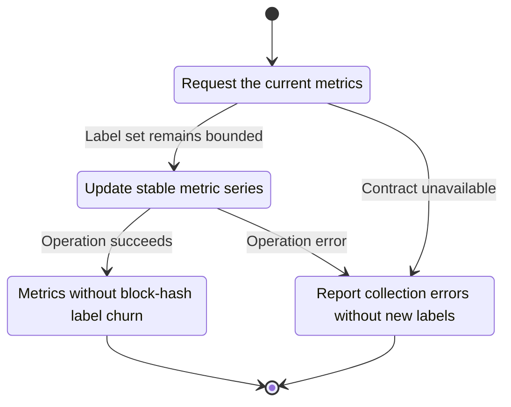
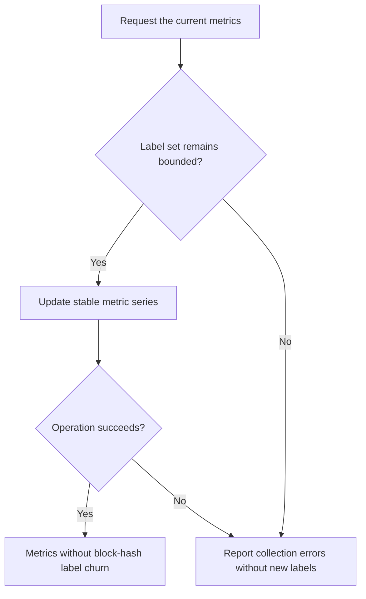

<!-- xone-gap-audit:2026-11-14:pass4:metrics-cardinality -->
> GAP-0094 · P2 · source review at `330b742bfa1ef1401c1b9b9be0cf0bd344255cca`. Static evidence; no deployed-node reproduction or benchmark is claimed.

## What

Every head emits xone_head_block_hash_info with the block hash as a label. Each new block creates a new time-series identity in a Prometheus server that retains prior samples.

Current implementation:

- [`crates/xone-node/src/observe/metrics.rs`](https://github.com/XDCIndia/xOneRS/blob/330b742bfa1ef1401c1b9b9be0cf0bd344255cca/crates/xone-node/src/observe/metrics.rs)

## Why

A healthy fast chain should not create one new monitoring time series per block.

Verified competitor implementation references:

- [ethereum/go-ethereum: `core/blockchain.go`](https://github.com/ethereum/go-ethereum/blob/8059ff8beb3170eb8b977169ac51bb0423c97ee1/core/blockchain.go)
- [ethereum/go-ethereum: `metrics/prometheus/collector.go`](https://github.com/ethereum/go-ethereum/blob/8059ff8beb3170eb8b977169ac51bb0423c97ee1/metrics/prometheus/collector.go)

#184 adds dashboards and alerts. This fixes the producer metric that would create unbounded series churn.

## 80% of the way to

1. Keep stable labels for metrics and report changing block identifiers through an appropriate diagnostic/RPC surface.
2. Retain numeric head height and age gauges for monitoring.
3. Document the removed or replaced metric and update dashboard consumers.

Acceptance criteria:

- [ ] Scraping thousands of simulated heads creates a bounded number of metric label sets.
- [ ] Operators can still obtain the exact current hash through a documented read interface.
- [ ] Existing numeric head/age metrics remain parseable and correct.

## ASD-STE100

1. Update stable metric series.
2. Keep the existing XDC consensus rules unchanged.
3. Check all required input before you start the operation.
4. Keep memory use within the configured limits.
5. Report collection errors without new labels.
6. Test each acceptance case through the actual entry point.

Technical names follow the repository vocabulary. These short instructions follow the requested sentence limits; certified ASD-STE100 vocabulary compliance has not been assessed.

## Diagrams

```mermaid
sequenceDiagram
    participant Actor as Metrics scraper
    participant Service as Metrics exporter
    participant Data as Node statistics
    Actor->>Service: Request the current metrics
    Service->>Data: Check required state and limits
    Data-->>Service: State and validation result
    alt Label set remains bounded
        Service->>Data: Update stable metric series
        Data-->>Service: Result or operation error
        Service-->>Actor: Metrics without block-hash label churn
    else Contract cannot be met
        Service-->>Actor: Report collection errors without new labels
    end
```

## Images

N/A. This change affects node behavior. The source links and test fixtures provide the evidence.

## Prompt

```text
Implement GAP-0094 in XDCIndia/xOneRS: Remove per-block hash churn from Prometheus metric labels.
Observed at 330b742bfa1ef1401c1b9b9be0cf0bd344255cca: Every head emits xone_head_block_hash_info with the block hash as a label. Each new block creates a new time-series identity in a Prometheus server that retains prior samples.
Read these target files: crates/xone-node/src/observe/metrics.rs.
Implementation: Keep stable labels for metrics and report changing block identifiers through an appropriate diagnostic/RPC surface. Retain numeric head height and age gauges for monitoring. Document the removed or replaced metric and update dashboard consumers.
Acceptance: Scraping thousands of simulated heads creates a bounded number of metric label sets. Operators can still obtain the exact current hash through a documented read interface. Existing numeric head/age metrics remain parseable and correct.
Related ownership: #184 adds dashboards and alerts. This fixes the producer metric that would create unbounded series churn.
Re-pin current main and the authoritative geth-XDC oracle before editing. Preserve XDC consensus, signatures, encodings, storage publication and configured resource bounds. Use the linked competitor code as design evidence, respecting its license. Write focused failing fixtures, implement the smallest coherent change, and run the applicable repository checks. Report exact commands and results. Open a reviewable PR; do not claim completion from a registered method or a mock-only test.
```

## Workflow

1. **Metrics scraper:** Request the current metrics.
2. **Metrics exporter:** Check whether label set remains bounded.
3. **Metrics exporter:** Update stable metric series through node statistics.
4. **Metrics exporter:** On success, provide metrics without block-hash label churn.
5. **Metrics exporter:** On refusal or failure, report collection errors without new labels.

The acceptance cases above define the exact errors, ordering and resource boundaries. Verify the real entry point before closing the issue.

## Loop

None. Run the operation only when requested.

## Graph

Lifecycle of this metrics exporter operation; this diagram does not change the blockchain consensus state machine.



## Layout

This capability uses a node, command-line, or build interface. It does not require a new graphical screen.

| Interface detail | Placement |
| --- | --- |
| Actor and trigger | Metrics scraper: request the current metrics |
| Input validation | Metrics exporter: label set remains bounded |
| Output | Metrics without block-hash label churn |
| Error or refusal | Report collection errors without new labels |
| Implementation files | `crates/xone-node/src/observe/metrics.rs` |

Keep field names and response shapes compatible with the specification and acceptance cases above.

## Flow



## Summary

Gap: Remove per-block hash churn from Prometheus metric labels.
Fix: Keep stable labels for metrics and report changing block identifiers through an appropriate diagnostic/RPC surface.
Acceptance: Scraping thousands of simulated heads creates a bounded number of metric label sets.
