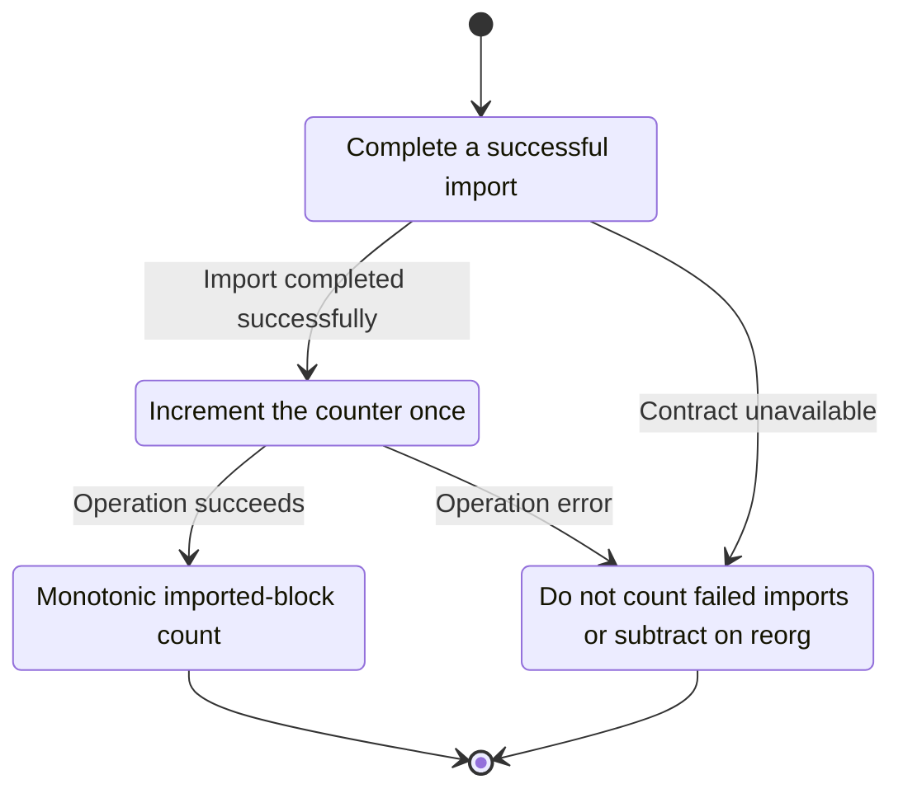
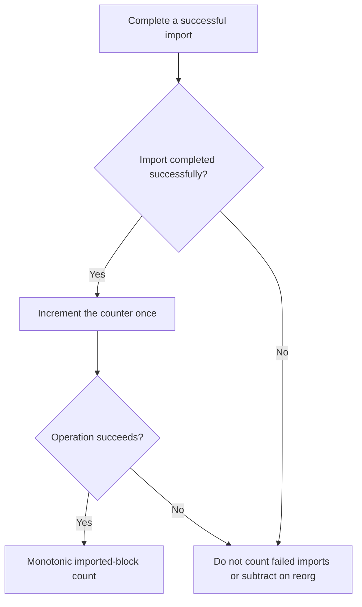

<!-- xone-gap-audit:2026-11-14:pass4:import-counter-semantics -->
> GAP-0095 · P2 · source review at `330b742bfa1ef1401c1b9b9be0cf0bd344255cca`. Static evidence; no deployed-node reproduction or benchmark is claimed.

## What

NodeStats derives blocks_imported_total from current head minus sync start. A set-head or shorter reorg can reduce it, while initialization at a later head can imply imports that this process never performed.

Current implementation:

- [`crates/xone-node/src/services/stats.rs`](https://github.com/XDCIndia/xOneRS/blob/330b742bfa1ef1401c1b9b9be0cf0bd344255cca/crates/xone-node/src/services/stats.rs)
- [`crates/xone-node/src/observe/metrics.rs`](https://github.com/XDCIndia/xOneRS/blob/330b742bfa1ef1401c1b9b9be0cf0bd344255cca/crates/xone-node/src/observe/metrics.rs)
- [`crates/xone-node/src/services/core.rs`](https://github.com/XDCIndia/xOneRS/blob/330b742bfa1ef1401c1b9b9be0cf0bd344255cca/crates/xone-node/src/services/core.rs)

## Why

Prometheus rate calculations treat decreases as resets and can report false throughput when a gauge is exposed as a counter.

Verified competitor implementation references:

- [ethereum/go-ethereum: `metrics/counter.go`](https://github.com/ethereum/go-ethereum/blob/8059ff8beb3170eb8b977169ac51bb0423c97ee1/metrics/counter.go)
- [ethereum/go-ethereum: `core/blockchain.go`](https://github.com/ethereum/go-ethereum/blob/8059ff8beb3170eb8b977169ac51bb0423c97ee1/core/blockchain.go)

#41 defines metrics and #226 adds timing. This repairs the counter semantics of an existing metric.

## 80% of the way to

1. Increment an actual process-local counter only after the defined successful import event.
2. Keep chain height as a separate gauge and define whether side-branch imports count.
3. Document restart reset semantics and avoid counting failed or rolled-back publication as successful import.

Acceptance criteria:

- [ ] The counter never decreases during reorg or set-head within one process.
- [ ] Failed imports do not increment it.
- [ ] A restart starts a new counter series interval while head height still reports the persisted chain.

## ASD-STE100

1. Increment the counter once.
2. Keep the existing XDC consensus rules unchanged.
3. Check all required input before you start the operation.
4. Keep memory use within the configured limits.
5. Do not count failed imports or subtract on reorg.
6. Test each acceptance case through the actual entry point.

Technical names follow the repository vocabulary. These short instructions follow the requested sentence limits; certified ASD-STE100 vocabulary compliance has not been assessed.

## Diagrams

```mermaid
sequenceDiagram
    participant Actor as Chain importer
    participant Service as Import accounting
    participant Data as Process counter
    Actor->>Service: Complete a successful import
    Service->>Data: Check required state and limits
    Data-->>Service: State and validation result
    alt Import completed successfully
        Service->>Data: Increment the counter once
        Data-->>Service: Result or operation error
        Service-->>Actor: Monotonic imported-block count
    else Contract cannot be met
        Service-->>Actor: Do not count failed imports or subtract on reorg
    end
```

## Images

N/A. This change affects node behavior. The source links and test fixtures provide the evidence.

## Prompt

```text
Implement GAP-0095 in XDCIndia/xOneRS: Make blocks_imported_total a monotonic process counter.
Observed at 330b742bfa1ef1401c1b9b9be0cf0bd344255cca: NodeStats derives blocks_imported_total from current head minus sync start. A set-head or shorter reorg can reduce it, while initialization at a later head can imply imports that this process never performed.
Read these target files: crates/xone-node/src/services/stats.rs, crates/xone-node/src/observe/metrics.rs, crates/xone-node/src/services/core.rs.
Implementation: Increment an actual process-local counter only after the defined successful import event. Keep chain height as a separate gauge and define whether side-branch imports count. Document restart reset semantics and avoid counting failed or rolled-back publication as successful import.
Acceptance: The counter never decreases during reorg or set-head within one process. Failed imports do not increment it. A restart starts a new counter series interval while head height still reports the persisted chain.
Related ownership: #41 defines metrics and #226 adds timing. This repairs the counter semantics of an existing metric.
Re-pin current main and the authoritative geth-XDC oracle before editing. Preserve XDC consensus, signatures, encodings, storage publication and configured resource bounds. Use the linked competitor code as design evidence, respecting its license. Write focused failing fixtures, implement the smallest coherent change, and run the applicable repository checks. Report exact commands and results. Open a reviewable PR; do not claim completion from a registered method or a mock-only test.
```

## Workflow

1. **Chain importer:** Complete a successful import.
2. **Import accounting:** Check whether import completed successfully.
3. **Import accounting:** Increment the counter once through process counter.
4. **Import accounting:** On success, provide monotonic imported-block count.
5. **Import accounting:** On refusal or failure, do not count failed imports or subtract on reorg.

The acceptance cases above define the exact errors, ordering and resource boundaries. Verify the real entry point before closing the issue.

## Loop

None. Run the operation only when requested.

## Graph

Lifecycle of this import accounting operation; this diagram does not change the blockchain consensus state machine.



## Layout

This capability uses a node, command-line, or build interface. It does not require a new graphical screen.

| Interface detail | Placement |
| --- | --- |
| Actor and trigger | Chain importer: complete a successful import |
| Input validation | Import accounting: import completed successfully |
| Output | Monotonic imported-block count |
| Error or refusal | Do not count failed imports or subtract on reorg |
| Implementation files | `crates/xone-node/src/services/stats.rs`, `crates/xone-node/src/observe/metrics.rs`, `crates/xone-node/src/services/core.rs` |

Keep field names and response shapes compatible with the specification and acceptance cases above.

## Flow



## Summary

Gap: Make blocks_imported_total a monotonic process counter.
Fix: Increment an actual process-local counter only after the defined successful import event.
Acceptance: The counter never decreases during reorg or set-head within one process.
