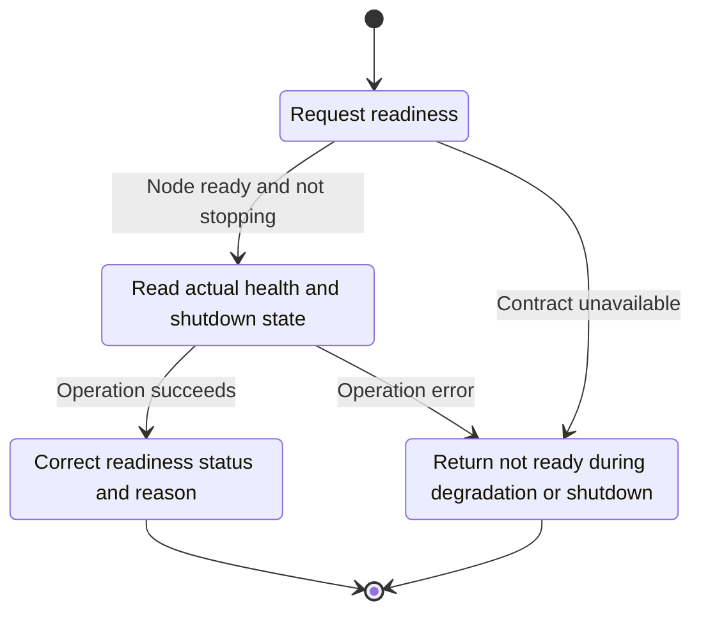
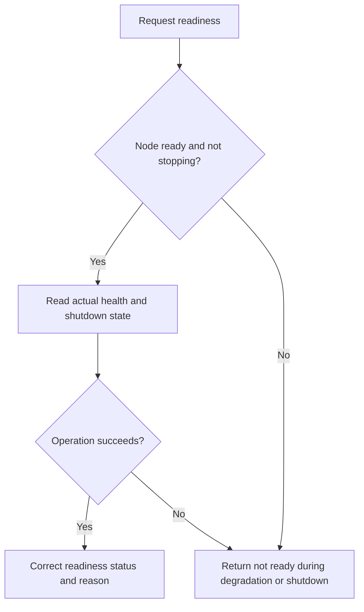

<!-- xone-gap-audit:2026-11-14:pass4:readiness-runtime-state -->
> GAP-0096 · P1 · source review at `330b742bfa1ef1401c1b9b9be0cf0bd344255cca`. Static evidence; no deployed-node reproduction or benchmark is claimed.

## What

Snapshot::ready checks degraded and shutting_down, but the production NodeStats snapshot leaves both fields at Snapshot::default(). Tests set them manually; the live adapter does not carry these lifecycle facts.

Current implementation:

- [`crates/xone-node/src/services/stats.rs`](https://github.com/XDCIndia/xOneRS/blob/330b742bfa1ef1401c1b9b9be0cf0bd344255cca/crates/xone-node/src/services/stats.rs)
- [`crates/xone-node/src/observe/metrics.rs`](https://github.com/XDCIndia/xOneRS/blob/330b742bfa1ef1401c1b9b9be0cf0bd344255cca/crates/xone-node/src/observe/metrics.rs)
- [`crates/xone-node/src/lifecycle.rs`](https://github.com/XDCIndia/xOneRS/blob/330b742bfa1ef1401c1b9b9be0cf0bd344255cca/crates/xone-node/src/lifecycle.rs)
- [`crates/xone-node/src/services/core.rs`](https://github.com/XDCIndia/xOneRS/blob/330b742bfa1ef1401c1b9b9be0cf0bd344255cca/crates/xone-node/src/services/core.rs)

## Why

Load balancers should not receive a healthy response based on default false flags after the node has entered a degraded or stopping state.

Verified competitor implementation references:

- [NethermindEth/nethermind: `src/Nethermind/Nethermind.HealthChecks/NodeHealthService.cs`](https://github.com/NethermindEth/nethermind/blob/a7dd73052e696ad934d228aad3f33e660701fdb7/src/Nethermind/Nethermind.HealthChecks/NodeHealthService.cs)
- [NethermindEth/nethermind: `src/Nethermind/Nethermind.HealthChecks/NodeHealthCheck.cs`](https://github.com/NethermindEth/nethermind/blob/a7dd73052e696ad934d228aad3f33e660701fdb7/src/Nethermind/Nethermind.HealthChecks/NodeHealthCheck.cs)

#41 and #62 are the health/qualification parents. This issue fixes the missing runtime wiring between their existing components.

## 80% of the way to

1. Expose a shared read-only lifecycle/health state from the node to NodeStats.
2. Mark readiness false before shutdown drain and when a durable-storage or signer-safety fault is latched.
3. Keep liveness distinct from readiness and clear faults only through the documented recovery path.

Acceptance criteria:

- [ ] A real metrics listener returns non-ready during injected durable failure and shutdown, even with a fresh head.
- [ ] Normal synchronization and healthy-tip transitions remain correct.
- [ ] Tests use the production adapter rather than only a hand-built Snapshot.

## ASD-STE100

1. Read actual health and shutdown state.
2. Keep the existing XDC consensus rules unchanged.
3. Check all required input before you start the operation.
4. Keep memory use within the configured limits.
5. Return not ready during degradation or shutdown.
6. Test each acceptance case through the actual entry point.

Technical names follow the repository vocabulary. These short instructions follow the requested sentence limits; certified ASD-STE100 vocabulary compliance has not been assessed.

## Diagrams

```mermaid
sequenceDiagram
    participant Actor as Health probe
    participant Service as Health service
    participant Data as Runtime lifecycle state
    Actor->>Service: Request readiness
    Service->>Data: Check required state and limits
    Data-->>Service: State and validation result
    alt Node ready and not stopping
        Service->>Data: Read actual health and shutdown state
        Data-->>Service: Result or operation error
        Service-->>Actor: Correct readiness status and reason
    else Contract cannot be met
        Service-->>Actor: Return not ready during degradation or shutdown
    end
```

## Images

N/A. This change affects node behavior. The source links and test fixtures provide the evidence.

## Prompt

```text
Implement GAP-0096 in XDCIndia/xOneRS: Connect readiness to real degradation and shutdown state.
Observed at 330b742bfa1ef1401c1b9b9be0cf0bd344255cca: Snapshot::ready checks degraded and shutting_down, but the production NodeStats snapshot leaves both fields at Snapshot::default(). Tests set them manually; the live adapter does not carry these lifecycle facts.
Read these target files: crates/xone-node/src/services/stats.rs, crates/xone-node/src/observe/metrics.rs, crates/xone-node/src/lifecycle.rs, crates/xone-node/src/services/core.rs.
Implementation: Expose a shared read-only lifecycle/health state from the node to NodeStats. Mark readiness false before shutdown drain and when a durable-storage or signer-safety fault is latched. Keep liveness distinct from readiness and clear faults only through the documented recovery path.
Acceptance: A real metrics listener returns non-ready during injected durable failure and shutdown, even with a fresh head. Normal synchronization and healthy-tip transitions remain correct. Tests use the production adapter rather than only a hand-built Snapshot.
Related ownership: #41 and #62 are the health/qualification parents. This issue fixes the missing runtime wiring between their existing components.
Re-pin current main and the authoritative geth-XDC oracle before editing. Preserve XDC consensus, signatures, encodings, storage publication and configured resource bounds. Use the linked competitor code as design evidence, respecting its license. Write focused failing fixtures, implement the smallest coherent change, and run the applicable repository checks. Report exact commands and results. Open a reviewable PR; do not claim completion from a registered method or a mock-only test.
```

## Workflow

1. **Health probe:** Request readiness.
2. **Health service:** Check whether node ready and not stopping.
3. **Health service:** Read actual health and shutdown state through runtime lifecycle state.
4. **Health service:** On success, provide correct readiness status and reason.
5. **Health service:** On refusal or failure, return not ready during degradation or shutdown.

The acceptance cases above define the exact errors, ordering and resource boundaries. Verify the real entry point before closing the issue.

## Loop

None. Run the operation only when requested.

## Graph

Lifecycle of this health service operation; this diagram does not change the blockchain consensus state machine.



## Layout

This capability uses a node, command-line, or build interface. It does not require a new graphical screen.

| Interface detail | Placement |
| --- | --- |
| Actor and trigger | Health probe: request readiness |
| Input validation | Health service: node ready and not stopping |
| Output | Correct readiness status and reason |
| Error or refusal | Return not ready during degradation or shutdown |
| Implementation files | `crates/xone-node/src/services/stats.rs`, `crates/xone-node/src/observe/metrics.rs`, `crates/xone-node/src/lifecycle.rs`, `crates/xone-node/src/services/core.rs` |

Keep field names and response shapes compatible with the specification and acceptance cases above.

## Flow



## Summary

Gap: Connect readiness to real degradation and shutdown state.
Fix: Expose a shared read-only lifecycle/health state from the node to NodeStats.
Acceptance: A real metrics listener returns non-ready during injected durable failure and shutdown, even with a fresh head.
