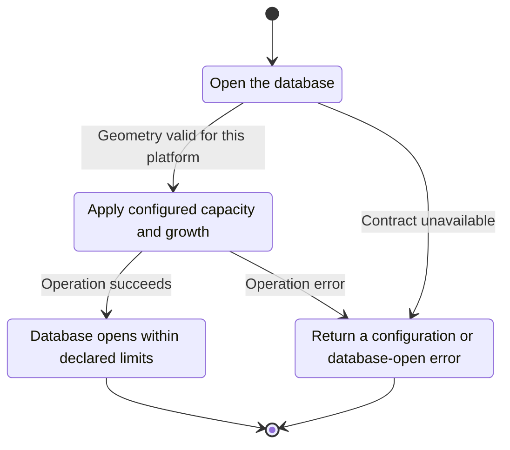
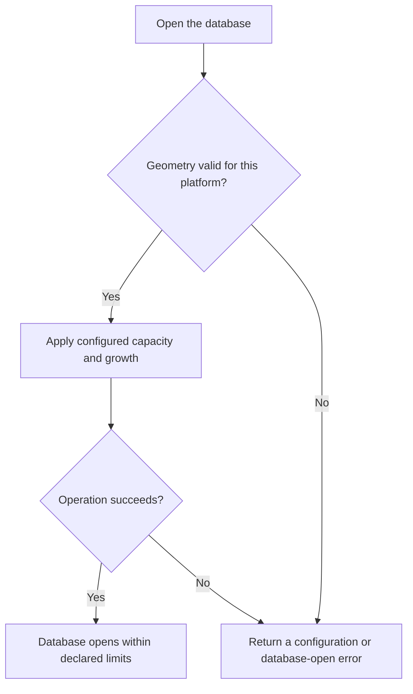

<!-- xone-gap-audit:2026-11-14:pass4:mdbx-geometry -->
> GAP-0097 · P3 · source review at `330b742bfa1ef1401c1b9b9be0cf0bd344255cca`. Static evidence; no deployed-node reproduction or benchmark is claimed.

## What

MDBX options hard-code a one-terabyte maximum map and a 64 MiB growth step. Operators cannot select capacity or growth behavior for different storage profiles.

Current implementation:

- [`crates/xone-db/src/mdbx.rs`](https://github.com/XDCIndia/xOneRS/blob/330b742bfa1ef1401c1b9b9be0cf0bd344255cca/crates/xone-db/src/mdbx.rs)
- [`crates/xone-node/src/config.rs`](https://github.com/XDCIndia/xOneRS/blob/330b742bfa1ef1401c1b9b9be0cf0bd344255cca/crates/xone-node/src/config.rs)
- [`bin/xone/src/flags.rs`](https://github.com/XDCIndia/xOneRS/blob/330b742bfa1ef1401c1b9b9be0cf0bd344255cca/bin/xone/src/flags.rs)

## Why

A fixed capacity can halt a long-lived node even when the operator has enough disk and a planned retention policy.

Verified competitor implementation references:

- [paradigmxyz/reth: `crates/node/core/src/args/database.rs`](https://github.com/paradigmxyz/reth/blob/36600d5ff9628465475dd4c7608e2e9f2fe24273/crates/node/core/src/args/database.rs)

#135 chooses the storage architecture and #176 adds maintenance commands. This unit exposes bounded geometry for the selected MDBX backend.

## 80% of the way to

1. Add explicitly documented max-map-size and growth-step settings with byte-size parsing and safe defaults.
2. Validate limits against MDBX constraints, current database size and page geometry before opening for writes.
3. Keep durability mode and signer publication rules independent; capacity tuning must not weaken fsync behavior.

Acceptance criteria:

- [ ] A small controlled map limit produces an actionable capacity error without corrupting committed data.
- [ ] Reopening with a larger valid limit preserves the head and state.
- [ ] Invalid values fail before migration or import, and dumpconfig shows effective non-secret settings.

## ASD-STE100

1. Apply configured capacity and growth.
2. Keep the existing XDC consensus rules unchanged.
3. Check all required input before you start the operation.
4. Keep memory use within the configured limits.
5. Return a configuration or database-open error.
6. Test each acceptance case through the actual entry point.

Technical names follow the repository vocabulary. These short instructions follow the requested sentence limits; certified ASD-STE100 vocabulary compliance has not been assessed.

## Diagrams

```mermaid
sequenceDiagram
    participant Actor as Node operator
    participant Service as Store initialization
    participant Data as MDBX environment
    Actor->>Service: Open the database
    Service->>Data: Check required state and limits
    Data-->>Service: State and validation result
    alt Geometry valid for this platform
        Service->>Data: Apply configured capacity and growth
        Data-->>Service: Result or operation error
        Service-->>Actor: Database opens within declared limits
    else Contract cannot be met
        Service-->>Actor: Return a configuration or database-open error
    end
```

## Images

N/A. This change affects node behavior. The source links and test fixtures provide the evidence.

## Prompt

```text
Implement GAP-0097 in XDCIndia/xOneRS: Expose validated MDBX capacity and growth settings.
Observed at 330b742bfa1ef1401c1b9b9be0cf0bd344255cca: MDBX options hard-code a one-terabyte maximum map and a 64 MiB growth step. Operators cannot select capacity or growth behavior for different storage profiles.
Read these target files: crates/xone-db/src/mdbx.rs, crates/xone-node/src/config.rs, bin/xone/src/flags.rs.
Implementation: Add explicitly documented max-map-size and growth-step settings with byte-size parsing and safe defaults. Validate limits against MDBX constraints, current database size and page geometry before opening for writes. Keep durability mode and signer publication rules independent; capacity tuning must not weaken fsync behavior.
Acceptance: A small controlled map limit produces an actionable capacity error without corrupting committed data. Reopening with a larger valid limit preserves the head and state. Invalid values fail before migration or import, and dumpconfig shows effective non-secret settings.
Related ownership: #135 chooses the storage architecture and #176 adds maintenance commands. This unit exposes bounded geometry for the selected MDBX backend.
Re-pin current main and the authoritative geth-XDC oracle before editing. Preserve XDC consensus, signatures, encodings, storage publication and configured resource bounds. Use the linked competitor code as design evidence, respecting its license. Write focused failing fixtures, implement the smallest coherent change, and run the applicable repository checks. Report exact commands and results. Open a reviewable PR; do not claim completion from a registered method or a mock-only test.
```

## Workflow

1. **Node operator:** Open the database.
2. **Store initialization:** Check whether geometry valid for this platform.
3. **Store initialization:** Apply configured capacity and growth through mdbx environment.
4. **Store initialization:** On success, provide database opens within declared limits.
5. **Store initialization:** On refusal or failure, return a configuration or database-open error.

The acceptance cases above define the exact errors, ordering and resource boundaries. Verify the real entry point before closing the issue.

## Loop

None. Run the operation only when requested.

## Graph

Lifecycle of this store initialization operation; this diagram does not change the blockchain consensus state machine.



## Layout

This capability uses a node, command-line, or build interface. It does not require a new graphical screen.

| Interface detail | Placement |
| --- | --- |
| Actor and trigger | Node operator: open the database |
| Input validation | Store initialization: geometry valid for this platform |
| Output | Database opens within declared limits |
| Error or refusal | Return a configuration or database-open error |
| Implementation files | `crates/xone-db/src/mdbx.rs`, `crates/xone-node/src/config.rs`, `bin/xone/src/flags.rs` |

Keep field names and response shapes compatible with the specification and acceptance cases above.

## Flow



## Summary

Gap: Expose validated MDBX capacity and growth settings.
Fix: Add explicitly documented max-map-size and growth-step settings with byte-size parsing and safe defaults.
Acceptance: A small controlled map limit produces an actionable capacity error without corrupting committed data.
