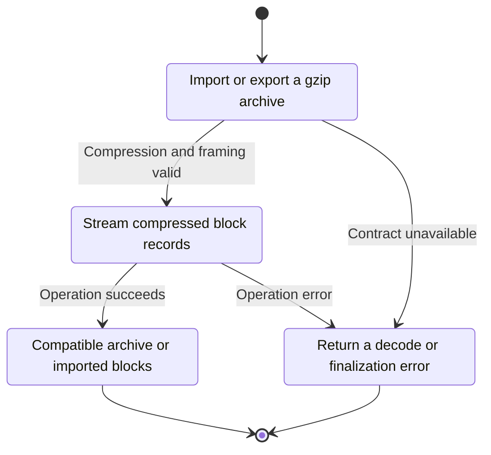
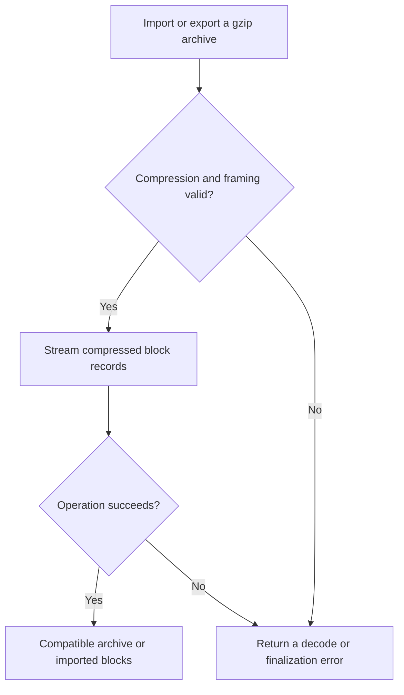

<!-- xone-gap-audit:2026-11-14:pass4:gzip-block-files -->
> GAP-0098 · P3 · source review at `330b742bfa1ef1401c1b9b9be0cf0bd344255cca`. Static evidence; no deployed-node reproduction or benchmark is claimed.

## What

FileSource explicitly documents that .gz files are not read. The import path requires Read+Seek and the export path writes plain RLP regardless of gzip archive conventions.

Current implementation:

- [`crates/xone-sync/src/import.rs`](https://github.com/XDCIndia/xOneRS/blob/330b742bfa1ef1401c1b9b9be0cf0bd344255cca/crates/xone-sync/src/import.rs)
- [`crates/xone-sync/src/export.rs`](https://github.com/XDCIndia/xOneRS/blob/330b742bfa1ef1401c1b9b9be0cf0bd344255cca/crates/xone-sync/src/export.rs)
- [`bin/xone/src/cmd/mod.rs`](https://github.com/XDCIndia/xOneRS/blob/330b742bfa1ef1401c1b9b9be0cf0bd344255cca/bin/xone/src/cmd/mod.rs)
- [`bin/xone/src/cmd/export.rs`](https://github.com/XDCIndia/xOneRS/blob/330b742bfa1ef1401c1b9b9be0cf0bd344255cca/bin/xone/src/cmd/export.rs)

## Why

Compressed block files reduce transfer/storage costs and are already a standard operator interchange format.

Verified competitor implementation references:

- [ethereum/go-ethereum: `cmd/utils/cmd.go`](https://github.com/ethereum/go-ethereum/blob/8059ff8beb3170eb8b977169ac51bb0423c97ee1/cmd/utils/cmd.go)
- [XinFinOrg/XDPoSChain: `cmd/utils/cmd.go`](https://github.com/XinFinOrg/XDPoSChain/blob/cb1ef79073c05f50b9df75b1e740387b9d72af99/cmd/utils/cmd.go)

#34 owns block-file transfer. This is a missing supported encoding, separate from persistent datadir command wiring.

## 80% of the way to

1. Add gzip import/export interoperability with geth block archives.
2. Use a bounded streaming design or a controlled temporary spool compatible with staged body lookups; never decompress the whole archive into RAM.
3. Check gzip completion/CRC, block limits, cancellation and temporary-file cleanup.

Acceptance criteria:

- [ ] A geth-produced .rlp.gz archive imports to the same head and state as its plain equivalent.
- [ ] An xOne gzip export can be read by the reference client.
- [ ] Truncation, corrupt CRC and oversized block fixtures fail without reporting success.

## ASD-STE100

1. Stream compressed block records.
2. Keep the existing XDC consensus rules unchanged.
3. Check all required input before you start the operation.
4. Keep memory use within the configured limits.
5. Return a decode or finalization error.
6. Test each acceptance case through the actual entry point.

Technical names follow the repository vocabulary. These short instructions follow the requested sentence limits; certified ASD-STE100 vocabulary compliance has not been assessed.

## Diagrams

```mermaid
sequenceDiagram
    participant Actor as Node operator
    participant Service as Archive command
    participant Data as Streaming codec and file
    Actor->>Service: Import or export a gzip archive
    Service->>Data: Check required state and limits
    Data-->>Service: State and validation result
    alt Compression and framing valid
        Service->>Data: Stream compressed block records
        Data-->>Service: Result or operation error
        Service-->>Actor: Compatible archive or imported blocks
    else Contract cannot be met
        Service-->>Actor: Return a decode or finalization error
    end
```

## Images

N/A. This change affects node behavior. The source links and test fixtures provide the evidence.

## Prompt

```text
Implement GAP-0098 in XDCIndia/xOneRS: Read and write geth-compatible gzip block archives.
Observed at 330b742bfa1ef1401c1b9b9be0cf0bd344255cca: FileSource explicitly documents that .gz files are not read. The import path requires Read+Seek and the export path writes plain RLP regardless of gzip archive conventions.
Read these target files: crates/xone-sync/src/import.rs, crates/xone-sync/src/export.rs, bin/xone/src/cmd/mod.rs, bin/xone/src/cmd/export.rs.
Implementation: Add gzip import/export interoperability with geth block archives. Use a bounded streaming design or a controlled temporary spool compatible with staged body lookups; never decompress the whole archive into RAM. Check gzip completion/CRC, block limits, cancellation and temporary-file cleanup.
Acceptance: A geth-produced .rlp.gz archive imports to the same head and state as its plain equivalent. An xOne gzip export can be read by the reference client. Truncation, corrupt CRC and oversized block fixtures fail without reporting success.
Related ownership: #34 owns block-file transfer. This is a missing supported encoding, separate from persistent datadir command wiring.
Re-pin current main and the authoritative geth-XDC oracle before editing. Preserve XDC consensus, signatures, encodings, storage publication and configured resource bounds. Use the linked competitor code as design evidence, respecting its license. Write focused failing fixtures, implement the smallest coherent change, and run the applicable repository checks. Report exact commands and results. Open a reviewable PR; do not claim completion from a registered method or a mock-only test.
```

## Workflow

1. **Node operator:** Import or export a gzip archive.
2. **Archive command:** Check whether compression and framing valid.
3. **Archive command:** Stream compressed block records through streaming codec and file.
4. **Archive command:** On success, provide compatible archive or imported blocks.
5. **Archive command:** On refusal or failure, return a decode or finalization error.

The acceptance cases above define the exact errors, ordering and resource boundaries. Verify the real entry point before closing the issue.

## Loop

None. Run the operation only when requested.

## Graph

Lifecycle of this archive command operation; this diagram does not change the blockchain consensus state machine.



## Layout

This capability uses a node, command-line, or build interface. It does not require a new graphical screen.

| Interface detail | Placement |
| --- | --- |
| Actor and trigger | Node operator: import or export a gzip archive |
| Input validation | Archive command: compression and framing valid |
| Output | Compatible archive or imported blocks |
| Error or refusal | Return a decode or finalization error |
| Implementation files | `crates/xone-sync/src/import.rs`, `crates/xone-sync/src/export.rs`, `bin/xone/src/cmd/mod.rs`, `bin/xone/src/cmd/export.rs` |

Keep field names and response shapes compatible with the specification and acceptance cases above.

## Flow



## Summary

Gap: Read and write geth-compatible gzip block archives.
Fix: Add gzip import/export interoperability with geth block archives.
Acceptance: A geth-produced .rlp.gz archive imports to the same head and state as its plain equivalent.
