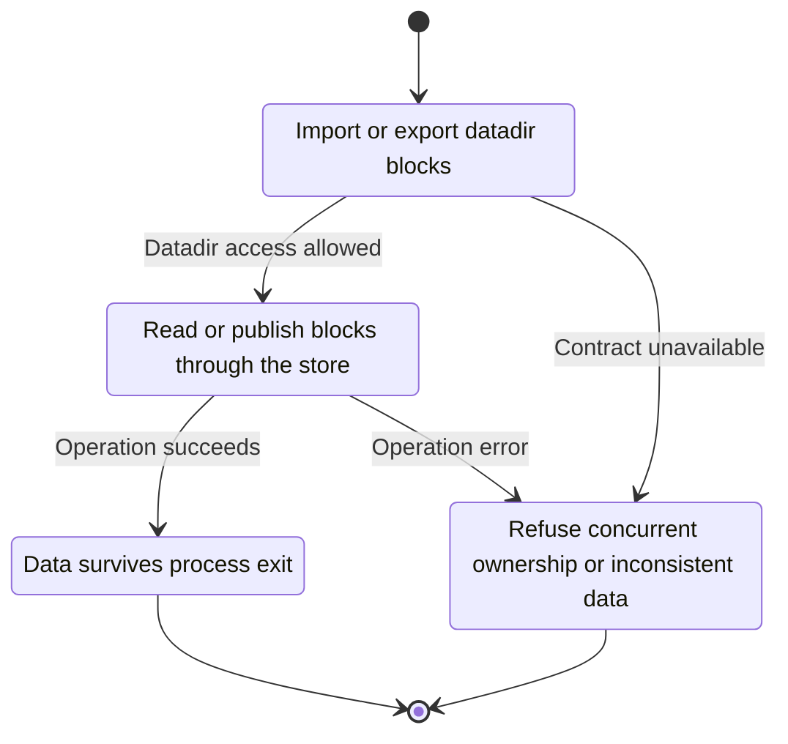
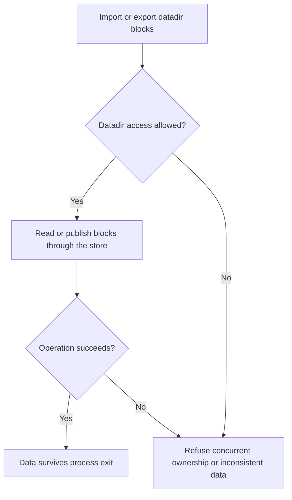

<!-- xone-gap-audit:2026-11-14:pass4:persistent-import-export -->
> GAP-0099 · P1 · source review at `330b742bfa1ef1401c1b9b9be0cf0bd344255cca`. Static evidence; no deployed-node reproduction or benchmark is claimed.

## What

The command helper open() constructs Chain<MemStore,...> from genesis. import reports imported blocks but discards the chain when the process exits. export requires --input to rebuild an in-memory chain instead of reading the node datadir.

Current implementation:

- [`bin/xone/src/cmd/mod.rs`](https://github.com/XDCIndia/xOneRS/blob/330b742bfa1ef1401c1b9b9be0cf0bd344255cca/bin/xone/src/cmd/mod.rs)
- [`bin/xone/src/cmd/import.rs`](https://github.com/XDCIndia/xOneRS/blob/330b742bfa1ef1401c1b9b9be0cf0bd344255cca/bin/xone/src/cmd/import.rs)
- [`bin/xone/src/cmd/export.rs`](https://github.com/XDCIndia/xOneRS/blob/330b742bfa1ef1401c1b9b9be0cf0bd344255cca/bin/xone/src/cmd/export.rs)
- [`crates/xone-node/src/datadir.rs`](https://github.com/XDCIndia/xOneRS/blob/330b742bfa1ef1401c1b9b9be0cf0bd344255cca/crates/xone-node/src/datadir.rs)
- [`crates/xone-sync/src/mdbx/mod.rs`](https://github.com/XDCIndia/xOneRS/blob/330b742bfa1ef1401c1b9b9be0cf0bd344255cca/crates/xone-sync/src/mdbx/mod.rs)

## Why

Operators expect an import command to populate their node. Success output currently describes an ephemeral verification run.

Verified competitor implementation references:

- [ethereum/go-ethereum: `cmd/geth/chaincmd.go`](https://github.com/ethereum/go-ethereum/blob/8059ff8beb3170eb8b977169ac51bb0423c97ee1/cmd/geth/chaincmd.go)
- [ethereum/go-ethereum: `cmd/utils/cmd.go`](https://github.com/ethereum/go-ethereum/blob/8059ff8beb3170eb8b977169ac51bb0423c97ee1/cmd/utils/cmd.go)

#34 provides import/export primitives. This issue replaces the explicitly temporary command backend that is still wired in the shipped binary.

## 80% of the way to

1. Open the existing persistent backend with the same genesis/schema gates and exclusive ownership as node startup.
2. Import through the real validation and durable publication path, resuming from the persisted head.
3. Export retained blocks directly from the datadir without re-execution. Keep an explicitly named verification-only mode if the memory workflow remains useful.

Acceptance criteria:

- [ ] After CLI import exits, a new process opens the datadir at the imported head with matching state.
- [ ] Export works without --input and rejects requests for unavailable history.
- [ ] A running node lock, wrong genesis or storage failure prevents the command from reporting success.

## ASD-STE100

1. Read or publish blocks through the store.
2. Keep the existing XDC consensus rules unchanged.
3. Check all required input before you start the operation.
4. Keep memory use within the configured limits.
5. Refuse concurrent ownership or inconsistent data.
6. Test each acceptance case through the actual entry point.

Technical names follow the repository vocabulary. These short instructions follow the requested sentence limits; certified ASD-STE100 vocabulary compliance has not been assessed.

## Diagrams

```mermaid
sequenceDiagram
    participant Actor as Node operator
    participant Service as Offline command
    participant Data as Locked persistent store
    Actor->>Service: Import or export datadir blocks
    Service->>Data: Check required state and limits
    Data-->>Service: State and validation result
    alt Datadir access allowed
        Service->>Data: Read or publish blocks through the store
        Data-->>Service: Result or operation error
        Service-->>Actor: Data survives process exit
    else Contract cannot be met
        Service-->>Actor: Refuse concurrent ownership or inconsistent data
    end
```

## Images

N/A. This change affects node behavior. The source links and test fixtures provide the evidence.

## Prompt

```text
Implement GAP-0099 in XDCIndia/xOneRS: Connect import and export commands to the persistent datadir.
Observed at 330b742bfa1ef1401c1b9b9be0cf0bd344255cca: The command helper open() constructs Chain<MemStore,...> from genesis. import reports imported blocks but discards the chain when the process exits. export requires --input to rebuild an in-memory chain instead of reading the node datadir.
Read these target files: bin/xone/src/cmd/mod.rs, bin/xone/src/cmd/import.rs, bin/xone/src/cmd/export.rs, crates/xone-node/src/datadir.rs, crates/xone-sync/src/mdbx/mod.rs.
Implementation: Open the existing persistent backend with the same genesis/schema gates and exclusive ownership as node startup. Import through the real validation and durable publication path, resuming from the persisted head. Export retained blocks directly from the datadir without re-execution. Keep an explicitly named verification-only mode if the memory workflow remains useful.
Acceptance: After CLI import exits, a new process opens the datadir at the imported head with matching state. Export works without --input and rejects requests for unavailable history. A running node lock, wrong genesis or storage failure prevents the command from reporting success.
Related ownership: #34 provides import/export primitives. This issue replaces the explicitly temporary command backend that is still wired in the shipped binary.
Re-pin current main and the authoritative geth-XDC oracle before editing. Preserve XDC consensus, signatures, encodings, storage publication and configured resource bounds. Use the linked competitor code as design evidence, respecting its license. Write focused failing fixtures, implement the smallest coherent change, and run the applicable repository checks. Report exact commands and results. Open a reviewable PR; do not claim completion from a registered method or a mock-only test.
```

## Workflow

1. **Node operator:** Import or export datadir blocks.
2. **Offline command:** Check whether datadir access allowed.
3. **Offline command:** Read or publish blocks through the store through locked persistent store.
4. **Offline command:** On success, provide data survives process exit.
5. **Offline command:** On refusal or failure, refuse concurrent ownership or inconsistent data.

The acceptance cases above define the exact errors, ordering and resource boundaries. Verify the real entry point before closing the issue.

## Loop

None. Run the operation only when requested.

## Graph

Lifecycle of this offline command operation; this diagram does not change the blockchain consensus state machine.



## Layout

This capability uses a node, command-line, or build interface. It does not require a new graphical screen.

| Interface detail | Placement |
| --- | --- |
| Actor and trigger | Node operator: import or export datadir blocks |
| Input validation | Offline command: datadir access allowed |
| Output | Data survives process exit |
| Error or refusal | Refuse concurrent ownership or inconsistent data |
| Implementation files | `bin/xone/src/cmd/mod.rs`, `bin/xone/src/cmd/import.rs`, `bin/xone/src/cmd/export.rs`, `crates/xone-node/src/datadir.rs`, `crates/xone-sync/src/mdbx/mod.rs` |

Keep field names and response shapes compatible with the specification and acceptance cases above.

## Flow



## Summary

Gap: Connect import and export commands to the persistent datadir.
Fix: Open the existing persistent backend with the same genesis/schema gates and exclusive ownership as node startup.
Acceptance: After CLI import exits, a new process opens the datadir at the imported head with matching state.
