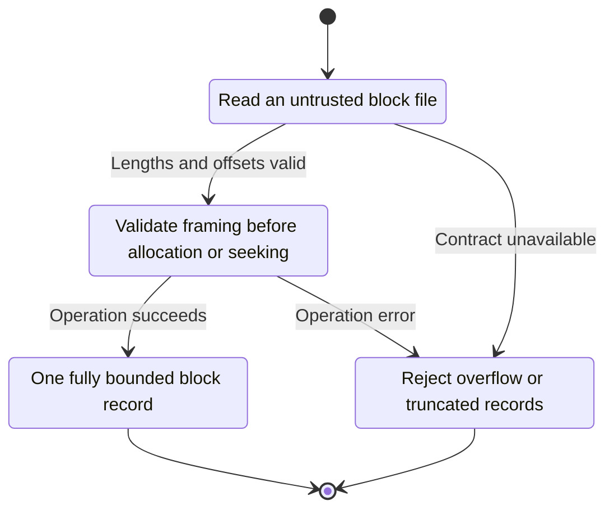
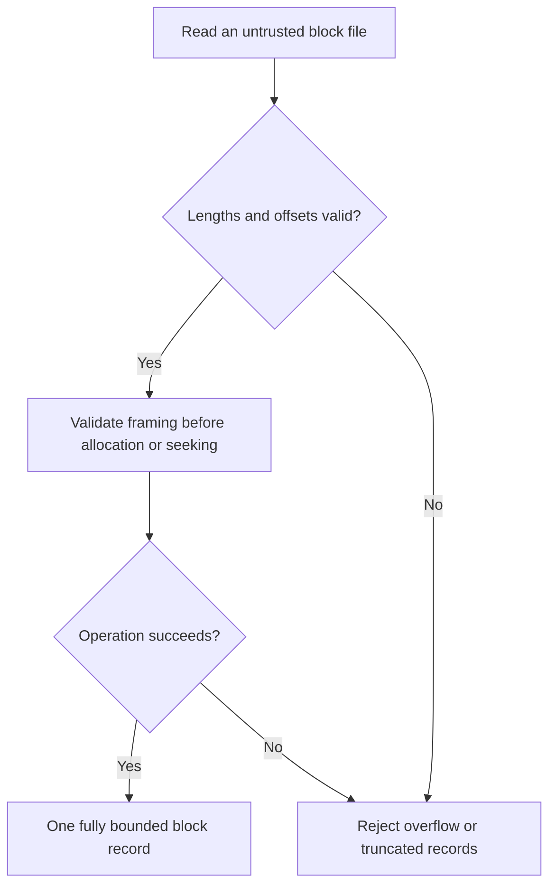

<!-- xone-gap-audit:2026-11-14:pass4:blockfile-length-validation -->
> GAP-0100 · P1 · source review at `330b742bfa1ef1401c1b9b9be0cf0bd344255cca`. Static evidence; no deployed-node reproduction or benchmark is claimed.

## What

FileSource adds header and payload lengths with ordinary u64 addition in read_at and offset_of. An eight-byte RLP length can approach u64::MAX. decode_block also relies on decoded container shapes without explicitly checking every required list marker.

Current implementation:

- [`crates/xone-sync/src/import.rs`](https://github.com/XDCIndia/xOneRS/blob/330b742bfa1ef1401c1b9b9be0cf0bd344255cca/crates/xone-sync/src/import.rs)

## Why

An invalid downloaded archive should produce a bounded error instead of a panic, wrapped offset or misleading parse.

Verified competitor implementation references:

- [ethereum/go-ethereum: `rlp/decode.go`](https://github.com/ethereum/go-ethereum/blob/8059ff8beb3170eb8b977169ac51bb0423c97ee1/rlp/decode.go)
- [ethereum/go-ethereum: `core/types/block.go`](https://github.com/ethereum/go-ethereum/blob/8059ff8beb3170eb8b977169ac51bb0423c97ee1/core/types/block.go)

#34 owns file import. This is a concrete hostile-length and container-validation gap in its decoder.

## 80% of the way to

1. Use checked length/offset arithmetic and reject oversized or noncanonical containers before allocating or seeking.
2. Validate outer block, transaction-list and uncle-list shapes and reject trailing bytes according to the interchange contract.
3. Return typed errors for truncated and impossible lengths; do not panic or wrap offsets in release mode.

Acceptance criteria:

- [ ] Maximum-u64 length prefixes fail identically in debug and release builds.
- [ ] Non-list containers, truncated payloads and noncanonical length encodings are rejected.
- [ ] Valid legacy and typed-transaction block files remain interoperable.

## ASD-STE100

1. Validate framing before allocation or seeking.
2. Keep the existing XDC consensus rules unchanged.
3. Check all required input before you start the operation.
4. Keep memory use within the configured limits.
5. Reject overflow or truncated records.
6. Test each acceptance case through the actual entry point.

Technical names follow the repository vocabulary. These short instructions follow the requested sentence limits; certified ASD-STE100 vocabulary compliance has not been assessed.

## Diagrams

```mermaid
sequenceDiagram
    participant Actor as Node operator
    participant Service as RLP file reader
    participant Data as Bounded input reader
    Actor->>Service: Read an untrusted block file
    Service->>Data: Check required state and limits
    Data-->>Service: State and validation result
    alt Lengths and offsets valid
        Service->>Data: Validate framing before allocation or seeking
        Data-->>Service: Result or operation error
        Service-->>Actor: One fully bounded block record
    else Contract cannot be met
        Service-->>Actor: Reject overflow or truncated records
    end
```

## Images

N/A. This change affects node behavior. The source links and test fixtures provide the evidence.

## Prompt

```text
Implement GAP-0100 in XDCIndia/xOneRS: Validate block-file RLP lengths before arithmetic, allocation and seeking.
Observed at 330b742bfa1ef1401c1b9b9be0cf0bd344255cca: FileSource adds header and payload lengths with ordinary u64 addition in read_at and offset_of. An eight-byte RLP length can approach u64::MAX. decode_block also relies on decoded container shapes without explicitly checking every required list marker.
Read these target files: crates/xone-sync/src/import.rs.
Implementation: Use checked length/offset arithmetic and reject oversized or noncanonical containers before allocating or seeking. Validate outer block, transaction-list and uncle-list shapes and reject trailing bytes according to the interchange contract. Return typed errors for truncated and impossible lengths; do not panic or wrap offsets in release mode.
Acceptance: Maximum-u64 length prefixes fail identically in debug and release builds. Non-list containers, truncated payloads and noncanonical length encodings are rejected. Valid legacy and typed-transaction block files remain interoperable.
Related ownership: #34 owns file import. This is a concrete hostile-length and container-validation gap in its decoder.
Re-pin current main and the authoritative geth-XDC oracle before editing. Preserve XDC consensus, signatures, encodings, storage publication and configured resource bounds. Use the linked competitor code as design evidence, respecting its license. Write focused failing fixtures, implement the smallest coherent change, and run the applicable repository checks. Report exact commands and results. Open a reviewable PR; do not claim completion from a registered method or a mock-only test.
```

## Workflow

1. **Node operator:** Read an untrusted block file.
2. **RLP file reader:** Check whether lengths and offsets valid.
3. **RLP file reader:** Validate framing before allocation or seeking through bounded input reader.
4. **RLP file reader:** On success, provide one fully bounded block record.
5. **RLP file reader:** On refusal or failure, reject overflow or truncated records.

The acceptance cases above define the exact errors, ordering and resource boundaries. Verify the real entry point before closing the issue.

## Loop

None. Run the operation only when requested.

## Graph

Lifecycle of this rlp file reader operation; this diagram does not change the blockchain consensus state machine.



## Layout

This capability uses a node, command-line, or build interface. It does not require a new graphical screen.

| Interface detail | Placement |
| --- | --- |
| Actor and trigger | Node operator: read an untrusted block file |
| Input validation | RLP file reader: lengths and offsets valid |
| Output | One fully bounded block record |
| Error or refusal | Reject overflow or truncated records |
| Implementation files | `crates/xone-sync/src/import.rs` |

Keep field names and response shapes compatible with the specification and acceptance cases above.

## Flow



## Summary

Gap: Validate block-file RLP lengths before arithmetic, allocation and seeking.
Fix: Use checked length/offset arithmetic and reject oversized or noncanonical containers before allocating or seeking.
Acceptance: Maximum-u64 length prefixes fail identically in debug and release builds.
