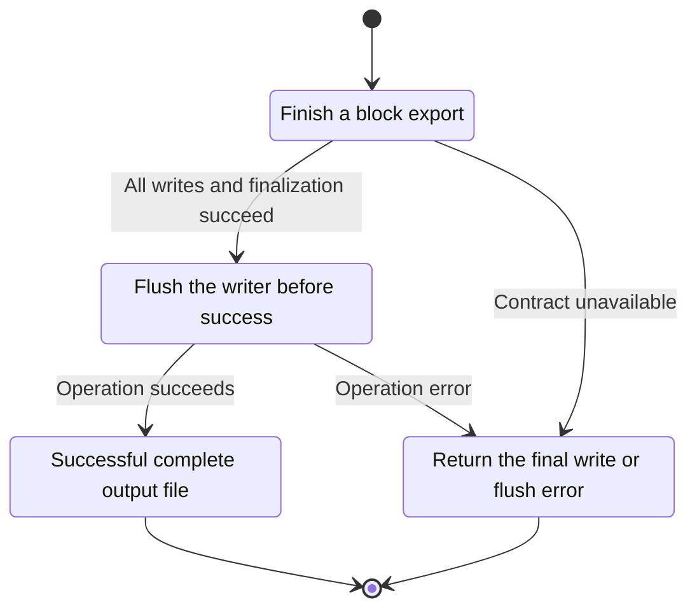
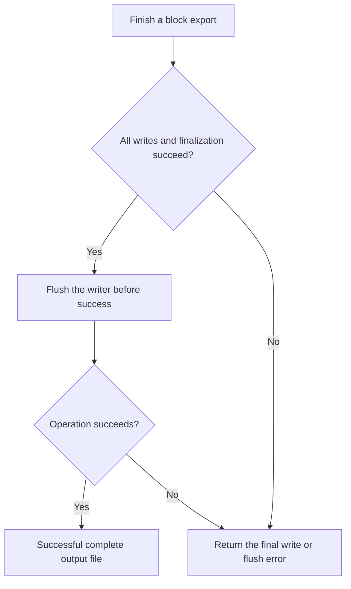

<!-- xone-gap-audit:2026-11-14:pass4:export-write-completion -->
> GAP-0101 · P1 · source review at `330b742bfa1ef1401c1b9b9be0cf0bd344255cca`. Static evidence; no deployed-node reproduction or benchmark is claimed.

## What

The export command wraps File in BufWriter and returns its success message without an explicit flush. A final buffered write can fail during Drop, where the IO error is discarded.

Current implementation:

- [`bin/xone/src/cmd/export.rs`](https://github.com/XDCIndia/xOneRS/blob/330b742bfa1ef1401c1b9b9be0cf0bd344255cca/bin/xone/src/cmd/export.rs)
- [`crates/xone-sync/src/export.rs`](https://github.com/XDCIndia/xOneRS/blob/330b742bfa1ef1401c1b9b9be0cf0bd344255cca/crates/xone-sync/src/export.rs)

## Why

An operator must not receive a success message for an archive whose final buffered bytes never reached the file.

Verified competitor implementation references:

- [ethereum/go-ethereum: `core/blockchain.go`](https://github.com/ethereum/go-ethereum/blob/8059ff8beb3170eb8b977169ac51bb0423c97ee1/core/blockchain.go)
- [ethereum/go-ethereum: `cmd/utils/cmd.go`](https://github.com/ethereum/go-ethereum/blob/8059ff8beb3170eb8b977169ac51bb0423c97ee1/cmd/utils/cmd.go)

#34 owns export. This is its command-level completion/error propagation contract, independent of gzip support.

## 80% of the way to

1. Explicitly finish and flush every output layer before returning success.
2. Define the durability contract and use sync/atomic publication if the command promises a completed durable artifact.
3. Write through a temporary destination or preserve an existing destination until a completed export can replace it.

Acceptance criteria:

- [ ] A writer that fails only on final flush makes the command exit nonzero.
- [ ] No success message is printed for a truncated export.
- [ ] A completed export round-trips and replacement behavior is documented and tested.

## ASD-STE100

1. Flush the writer before success.
2. Keep the existing XDC consensus rules unchanged.
3. Check all required input before you start the operation.
4. Keep memory use within the configured limits.
5. Return the final write or flush error.
6. Test each acceptance case through the actual entry point.

Technical names follow the repository vocabulary. These short instructions follow the requested sentence limits; certified ASD-STE100 vocabulary compliance has not been assessed.

## Diagrams

```mermaid
sequenceDiagram
    participant Actor as Node operator
    participant Service as Export command
    participant Data as Buffered output writer
    Actor->>Service: Finish a block export
    Service->>Data: Check required state and limits
    Data-->>Service: State and validation result
    alt All writes and finalization succeed
        Service->>Data: Flush the writer before success
        Data-->>Service: Result or operation error
        Service-->>Actor: Successful complete output file
    else Contract cannot be met
        Service-->>Actor: Return the final write or flush error
    end
```

## Images

N/A. This change affects node behavior. The source links and test fixtures provide the evidence.

## Prompt

```text
Implement GAP-0101 in XDCIndia/xOneRS: Propagate buffered export write failures before reporting success.
Observed at 330b742bfa1ef1401c1b9b9be0cf0bd344255cca: The export command wraps File in BufWriter and returns its success message without an explicit flush. A final buffered write can fail during Drop, where the IO error is discarded.
Read these target files: bin/xone/src/cmd/export.rs, crates/xone-sync/src/export.rs.
Implementation: Explicitly finish and flush every output layer before returning success. Define the durability contract and use sync/atomic publication if the command promises a completed durable artifact. Write through a temporary destination or preserve an existing destination until a completed export can replace it.
Acceptance: A writer that fails only on final flush makes the command exit nonzero. No success message is printed for a truncated export. A completed export round-trips and replacement behavior is documented and tested.
Related ownership: #34 owns export. This is its command-level completion/error propagation contract, independent of gzip support.
Re-pin current main and the authoritative geth-XDC oracle before editing. Preserve XDC consensus, signatures, encodings, storage publication and configured resource bounds. Use the linked competitor code as design evidence, respecting its license. Write focused failing fixtures, implement the smallest coherent change, and run the applicable repository checks. Report exact commands and results. Open a reviewable PR; do not claim completion from a registered method or a mock-only test.
```

## Workflow

1. **Node operator:** Finish a block export.
2. **Export command:** Check whether all writes and finalization succeed.
3. **Export command:** Flush the writer before success through buffered output writer.
4. **Export command:** On success, provide successful complete output file.
5. **Export command:** On refusal or failure, return the final write or flush error.

The acceptance cases above define the exact errors, ordering and resource boundaries. Verify the real entry point before closing the issue.

## Loop

None. Run the operation only when requested.

## Graph

Lifecycle of this export command operation; this diagram does not change the blockchain consensus state machine.



## Layout

This capability uses a node, command-line, or build interface. It does not require a new graphical screen.

| Interface detail | Placement |
| --- | --- |
| Actor and trigger | Node operator: finish a block export |
| Input validation | Export command: all writes and finalization succeed |
| Output | Successful complete output file |
| Error or refusal | Return the final write or flush error |
| Implementation files | `bin/xone/src/cmd/export.rs`, `crates/xone-sync/src/export.rs` |

Keep field names and response shapes compatible with the specification and acceptance cases above.

## Flow



## Summary

Gap: Propagate buffered export write failures before reporting success.
Fix: Explicitly finish and flush every output layer before returning success.
Acceptance: A writer that fails only on final flush makes the command exit nonzero.
