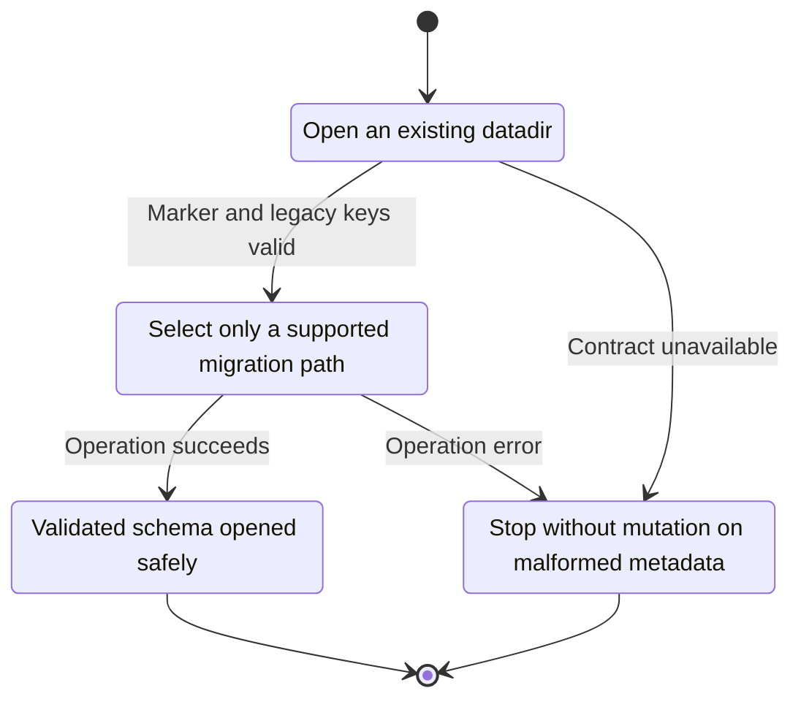
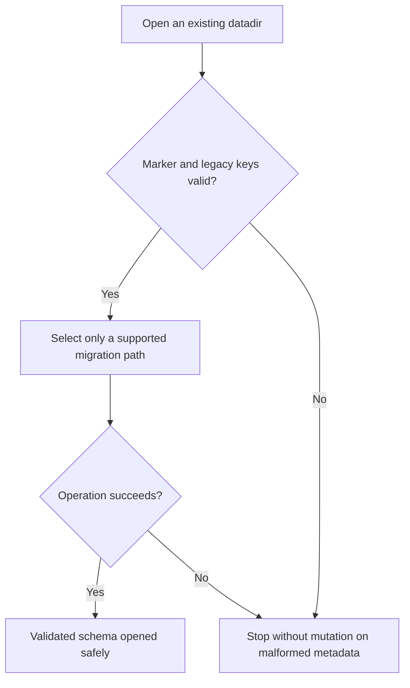

<!-- xone-gap-audit:2026-11-14:pass4:schema-marker-validation -->
> GAP-0102 · P1 · source review at `330b742bfa1ef1401c1b9b9be0cf0bd344255cca`. Static evidence; no deployed-node reproduction or benchmark is claimed.

## What

Schema loading uses rd.get(...).and_then(le_u64). A present marker with invalid length becomes None, which is also the signal to run the legacy migration. Unknown future numeric versions are rejected, but malformed markers are not distinguished from absence.

Current implementation:

- [`crates/xone-sync/src/mdbx/mod.rs`](https://github.com/XDCIndia/xOneRS/blob/330b742bfa1ef1401c1b9b9be0cf0bd344255cca/crates/xone-sync/src/mdbx/mod.rs)
- [`crates/xone-db/src/mdbx.rs`](https://github.com/XDCIndia/xOneRS/blob/330b742bfa1ef1401c1b9b9be0cf0bd344255cca/crates/xone-db/src/mdbx.rs)

## Why

Corruption must not be interpreted as permission to transform an already migrated database.

Verified competitor implementation references:

- [paradigmxyz/reth: `crates/storage/db/src/version.rs`](https://github.com/paradigmxyz/reth/blob/36600d5ff9628465475dd4c7608e2e9f2fe24273/crates/storage/db/src/version.rs)

#11 covers crash-safe publication and #135 architecture. This issue repairs the schema discriminator used before those data paths.

## 80% of the way to

1. Distinguish an absent legacy marker, a valid supported version and malformed bytes.
2. Reject malformed or unsupported values before starting a migration or changing state tables.
3. Validate legacy key shapes before migration indexing/splitting and return a corruption error rather than panicking.

Acceptance criteria:

- [ ] A malformed schema marker returns a typed error and leaves tables unchanged.
- [ ] Supported legacy and current databases still open through their intended paths.
- [ ] Truncated legacy changeset keys cannot panic the migration.

## ASD-STE100

1. Select only a supported migration path.
2. Keep the existing XDC consensus rules unchanged.
3. Check all required input before you start the operation.
4. Keep memory use within the configured limits.
5. Stop without mutation on malformed metadata.
6. Test each acceptance case through the actual entry point.

Technical names follow the repository vocabulary. These short instructions follow the requested sentence limits; certified ASD-STE100 vocabulary compliance has not been assessed.

## Diagrams

```mermaid
sequenceDiagram
    participant Actor as Node operator
    participant Service as Schema loader
    participant Data as Metadata table
    Actor->>Service: Open an existing datadir
    Service->>Data: Check required state and limits
    Data-->>Service: State and validation result
    alt Marker and legacy keys valid
        Service->>Data: Select only a supported migration path
        Data-->>Service: Result or operation error
        Service-->>Actor: Validated schema opened safely
    else Contract cannot be met
        Service-->>Actor: Stop without mutation on malformed metadata
    end
```

## Images

N/A. This change affects node behavior. The source links and test fixtures provide the evidence.

## Prompt

```text
Implement GAP-0102 in XDCIndia/xOneRS: Fail closed on malformed database schema markers before migration.
Observed at 330b742bfa1ef1401c1b9b9be0cf0bd344255cca: Schema loading uses rd.get(...).and_then(le_u64). A present marker with invalid length becomes None, which is also the signal to run the legacy migration. Unknown future numeric versions are rejected, but malformed markers are not distinguished from absence.
Read these target files: crates/xone-sync/src/mdbx/mod.rs, crates/xone-db/src/mdbx.rs.
Implementation: Distinguish an absent legacy marker, a valid supported version and malformed bytes. Reject malformed or unsupported values before starting a migration or changing state tables. Validate legacy key shapes before migration indexing/splitting and return a corruption error rather than panicking.
Acceptance: A malformed schema marker returns a typed error and leaves tables unchanged. Supported legacy and current databases still open through their intended paths. Truncated legacy changeset keys cannot panic the migration.
Related ownership: #11 covers crash-safe publication and #135 architecture. This issue repairs the schema discriminator used before those data paths.
Re-pin current main and the authoritative geth-XDC oracle before editing. Preserve XDC consensus, signatures, encodings, storage publication and configured resource bounds. Use the linked competitor code as design evidence, respecting its license. Write focused failing fixtures, implement the smallest coherent change, and run the applicable repository checks. Report exact commands and results. Open a reviewable PR; do not claim completion from a registered method or a mock-only test.
```

## Workflow

1. **Node operator:** Open an existing datadir.
2. **Schema loader:** Check whether marker and legacy keys valid.
3. **Schema loader:** Select only a supported migration path through metadata table.
4. **Schema loader:** On success, provide validated schema opened safely.
5. **Schema loader:** On refusal or failure, stop without mutation on malformed metadata.

The acceptance cases above define the exact errors, ordering and resource boundaries. Verify the real entry point before closing the issue.

## Loop

None. Run the operation only when requested.

## Graph

Lifecycle of this schema loader operation; this diagram does not change the blockchain consensus state machine.



## Layout

This capability uses a node, command-line, or build interface. It does not require a new graphical screen.

| Interface detail | Placement |
| --- | --- |
| Actor and trigger | Node operator: open an existing datadir |
| Input validation | Schema loader: marker and legacy keys valid |
| Output | Validated schema opened safely |
| Error or refusal | Stop without mutation on malformed metadata |
| Implementation files | `crates/xone-sync/src/mdbx/mod.rs`, `crates/xone-db/src/mdbx.rs` |

Keep field names and response shapes compatible with the specification and acceptance cases above.

## Flow



## Summary

Gap: Fail closed on malformed database schema markers before migration.
Fix: Distinguish an absent legacy marker, a valid supported version and malformed bytes.
Acceptance: A malformed schema marker returns a typed error and leaves tables unchanged.
