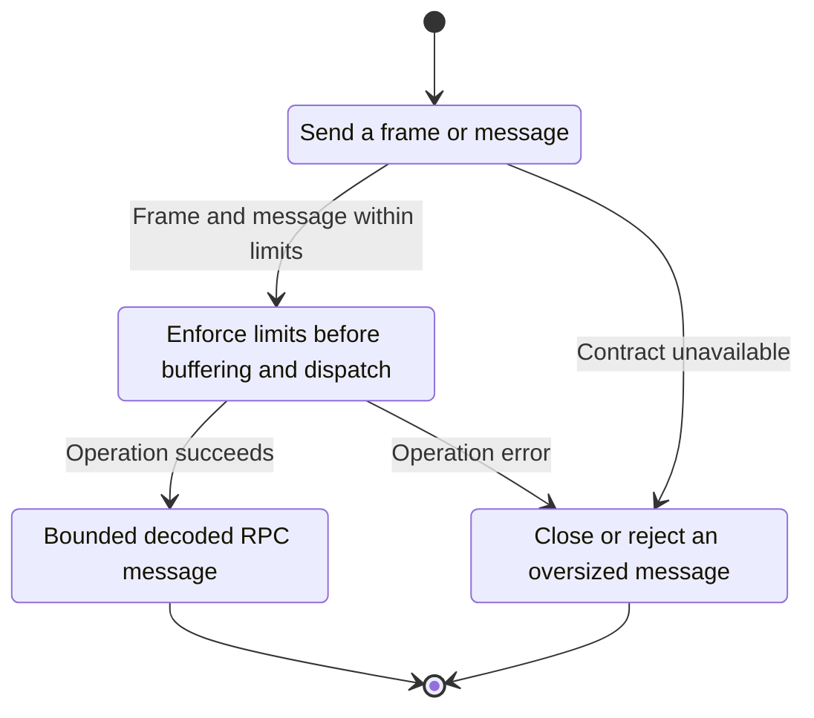
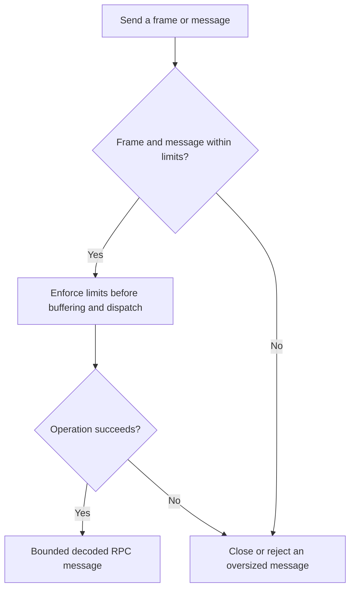

<!-- xone-gap-audit:2026-11-14:pass4:websocket-frame-limit -->
> GAP-0103 · P1 · source review at `330b742bfa1ef1401c1b9b9be0cf0bd344255cca`. Static evidence; no deployed-node reproduction or benchmark is claimed.

## What

serve_ws calls accept_hdr_async without a WebSocketConfig, then allocates/converts received text before Rpc::serve checks body_bytes. Subscription messages take an earlier shortcut and do not reach that body check.

Current implementation:

- [`crates/xone-rpc/src/transport.rs`](https://github.com/XDCIndia/xOneRS/blob/330b742bfa1ef1401c1b9b9be0cf0bd344255cca/crates/xone-rpc/src/transport.rs)
- [`crates/xone-rpc/src/server.rs`](https://github.com/XDCIndia/xOneRS/blob/330b742bfa1ef1401c1b9b9be0cf0bd344255cca/crates/xone-rpc/src/server.rs)

## Why

A post-parse RPC limit cannot bound memory used while the transport assembles a larger message.

Verified competitor implementation references:

- [ethereum/go-ethereum: `rpc/websocket.go`](https://github.com/ethereum/go-ethereum/blob/8059ff8beb3170eb8b977169ac51bb0423c97ee1/rpc/websocket.go)

#267 fixes subscription policy/admission. This unit moves byte enforcement ahead of WebSocket message assembly and parsing.

## 80% of the way to

1. Set explicit frame and reassembled-message limits from the transport configuration at handshake construction.
2. Apply the same ingress bound to ordinary requests, batches and subscription requests.
3. Bound fragmented-message handling and close oversized connections with the documented protocol code before JSON dispatch.

Acceptance criteria:

- [ ] Oversized ordinary and subscription messages are rejected at the WebSocket layer.
- [ ] Fragmentation cannot bypass the complete-message limit.
- [ ] Valid messages at the boundary succeed and cleanup releases connection permits.

## ASD-STE100

1. Enforce limits before buffering and dispatch.
2. Keep the existing XDC consensus rules unchanged.
3. Check all required input before you start the operation.
4. Keep memory use within the configured limits.
5. Close or reject an oversized message.
6. Test each acceptance case through the actual entry point.

Technical names follow the repository vocabulary. These short instructions follow the requested sentence limits; certified ASD-STE100 vocabulary compliance has not been assessed.

## Diagrams

```mermaid
sequenceDiagram
    participant Actor as WebSocket peer
    participant Service as WebSocket transport
    participant Data as Frame decoder
    Actor->>Service: Send a frame or message
    Service->>Data: Check required state and limits
    Data-->>Service: State and validation result
    alt Frame and message within limits
        Service->>Data: Enforce limits before buffering and dispatch
        Data-->>Service: Result or operation error
        Service-->>Actor: Bounded decoded RPC message
    else Contract cannot be met
        Service-->>Actor: Close or reject an oversized message
    end
```

## Images

N/A. This change affects node behavior. The source links and test fixtures provide the evidence.

## Prompt

```text
Implement GAP-0103 in XDCIndia/xOneRS: Apply configured WebSocket message limits before decoding or allocation.
Observed at 330b742bfa1ef1401c1b9b9be0cf0bd344255cca: serve_ws calls accept_hdr_async without a WebSocketConfig, then allocates/converts received text before Rpc::serve checks body_bytes. Subscription messages take an earlier shortcut and do not reach that body check.
Read these target files: crates/xone-rpc/src/transport.rs, crates/xone-rpc/src/server.rs.
Implementation: Set explicit frame and reassembled-message limits from the transport configuration at handshake construction. Apply the same ingress bound to ordinary requests, batches and subscription requests. Bound fragmented-message handling and close oversized connections with the documented protocol code before JSON dispatch.
Acceptance: Oversized ordinary and subscription messages are rejected at the WebSocket layer. Fragmentation cannot bypass the complete-message limit. Valid messages at the boundary succeed and cleanup releases connection permits.
Related ownership: #267 fixes subscription policy/admission. This unit moves byte enforcement ahead of WebSocket message assembly and parsing.
Re-pin current main and the authoritative geth-XDC oracle before editing. Preserve XDC consensus, signatures, encodings, storage publication and configured resource bounds. Use the linked competitor code as design evidence, respecting its license. Write focused failing fixtures, implement the smallest coherent change, and run the applicable repository checks. Report exact commands and results. Open a reviewable PR; do not claim completion from a registered method or a mock-only test.
```

## Workflow

1. **WebSocket peer:** Send a frame or message.
2. **WebSocket transport:** Check whether frame and message within limits.
3. **WebSocket transport:** Enforce limits before buffering and dispatch through frame decoder.
4. **WebSocket transport:** On success, provide bounded decoded rpc message.
5. **WebSocket transport:** On refusal or failure, close or reject an oversized message.

The acceptance cases above define the exact errors, ordering and resource boundaries. Verify the real entry point before closing the issue.

## Loop

None. Run the operation only when requested.

## Graph

Lifecycle of this websocket transport operation; this diagram does not change the blockchain consensus state machine.



## Layout

This capability uses a node, command-line, or build interface. It does not require a new graphical screen.

| Interface detail | Placement |
| --- | --- |
| Actor and trigger | WebSocket peer: send a frame or message |
| Input validation | WebSocket transport: frame and message within limits |
| Output | Bounded decoded RPC message |
| Error or refusal | Close or reject an oversized message |
| Implementation files | `crates/xone-rpc/src/transport.rs`, `crates/xone-rpc/src/server.rs` |

Keep field names and response shapes compatible with the specification and acceptance cases above.

## Flow



## Summary

Gap: Apply configured WebSocket message limits before decoding or allocation.
Fix: Set explicit frame and reassembled-message limits from the transport configuration at handshake construction.
Acceptance: Oversized ordinary and subscription messages are rejected at the WebSocket layer.
