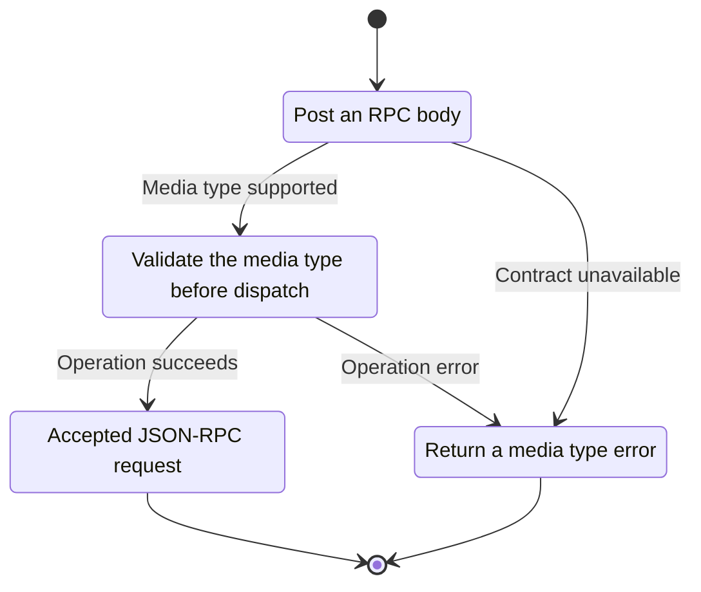
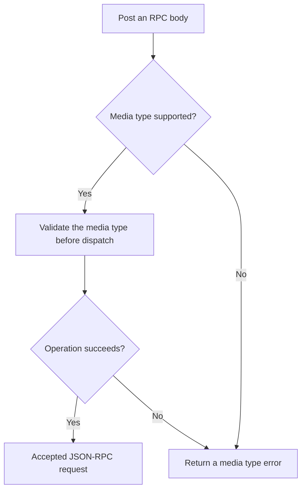

<!-- xone-gap-audit:2026-11-14:pass4:http-content-type -->
> GAP-0104 · P2 · source review at `330b742bfa1ef1401c1b9b9be0cf0bd344255cca`. Static evidence; no deployed-node reproduction or benchmark is claimed.

## What

http_handle checks Host and POST but never validates Content-Type. Any POST body that parses as JSON reaches the RPC dispatcher, including simple browser form media types.

Current implementation:

- [`crates/xone-rpc/src/transport.rs`](https://github.com/XDCIndia/xOneRS/blob/330b742bfa1ef1401c1b9b9be0cf0bd344255cca/crates/xone-rpc/src/transport.rs)

## Why

The HTTP boundary should accept the documented RPC representation and reject other browser-compatible request formats.

Verified competitor implementation references:

- [ethereum/go-ethereum: `rpc/http.go`](https://github.com/ethereum/go-ethereum/blob/8059ff8beb3170eb8b977169ac51bb0423c97ee1/rpc/http.go)
- [ethereum/go-ethereum: `rpc/http_test.go`](https://github.com/ethereum/go-ethereum/blob/8059ff8beb3170eb8b977169ac51bb0423c97ee1/rpc/http_test.go)

#257 handles CORS headers/preflight and #60 owns authorization. This is validation of the actual POST representation.

## 80% of the way to

1. Validate the media type and permitted parameters using the pinned oracle HTTP contract.
2. Reject unsupported simple-form or text media types before invoking a method.
3. Keep OPTIONS handling in the CORS layer and continue enforcing authentication and namespace policy independently.

Acceptance criteria:

- [ ] application/json with supported parameters works.
- [ ] Unsupported content types fail before a test handler is called.
- [ ] Preflight remains functional and the test does not rely on CORS as authentication.

## ASD-STE100

1. Validate the media type before dispatch.
2. Keep the existing XDC consensus rules unchanged.
3. Check all required input before you start the operation.
4. Keep memory use within the configured limits.
5. Return a media type error.
6. Test each acceptance case through the actual entry point.

Technical names follow the repository vocabulary. These short instructions follow the requested sentence limits; certified ASD-STE100 vocabulary compliance has not been assessed.

## Diagrams

```mermaid
sequenceDiagram
    participant Actor as HTTP client
    participant Service as HTTP listener
    participant Data as Media type parser
    Actor->>Service: Post an RPC body
    Service->>Data: Check required state and limits
    Data-->>Service: State and validation result
    alt Media type supported
        Service->>Data: Validate the media type before dispatch
        Data-->>Service: Result or operation error
        Service-->>Actor: Accepted JSON-RPC request
    else Contract cannot be met
        Service-->>Actor: Return a media type error
    end
```

## Images

N/A. This change affects node behavior. The source links and test fixtures provide the evidence.

## Prompt

```text
Implement GAP-0104 in XDCIndia/xOneRS: Validate HTTP JSON-RPC media types before dispatch.
Observed at 330b742bfa1ef1401c1b9b9be0cf0bd344255cca: http_handle checks Host and POST but never validates Content-Type. Any POST body that parses as JSON reaches the RPC dispatcher, including simple browser form media types.
Read these target files: crates/xone-rpc/src/transport.rs.
Implementation: Validate the media type and permitted parameters using the pinned oracle HTTP contract. Reject unsupported simple-form or text media types before invoking a method. Keep OPTIONS handling in the CORS layer and continue enforcing authentication and namespace policy independently.
Acceptance: application/json with supported parameters works. Unsupported content types fail before a test handler is called. Preflight remains functional and the test does not rely on CORS as authentication.
Related ownership: #257 handles CORS headers/preflight and #60 owns authorization. This is validation of the actual POST representation.
Re-pin current main and the authoritative geth-XDC oracle before editing. Preserve XDC consensus, signatures, encodings, storage publication and configured resource bounds. Use the linked competitor code as design evidence, respecting its license. Write focused failing fixtures, implement the smallest coherent change, and run the applicable repository checks. Report exact commands and results. Open a reviewable PR; do not claim completion from a registered method or a mock-only test.
```

## Workflow

1. **HTTP client:** Post an RPC body.
2. **HTTP listener:** Check whether media type supported.
3. **HTTP listener:** Validate the media type before dispatch through media type parser.
4. **HTTP listener:** On success, provide accepted json-rpc request.
5. **HTTP listener:** On refusal or failure, return a media type error.

The acceptance cases above define the exact errors, ordering and resource boundaries. Verify the real entry point before closing the issue.

## Loop

None. Run the operation only when requested.

## Graph

Lifecycle of this http listener operation; this diagram does not change the blockchain consensus state machine.



## Layout

This capability uses a node, command-line, or build interface. It does not require a new graphical screen.

| Interface detail | Placement |
| --- | --- |
| Actor and trigger | HTTP client: post an rpc body |
| Input validation | HTTP listener: media type supported |
| Output | Accepted JSON-RPC request |
| Error or refusal | Return a media type error |
| Implementation files | `crates/xone-rpc/src/transport.rs` |

Keep field names and response shapes compatible with the specification and acceptance cases above.

## Flow



## Summary

Gap: Validate HTTP JSON-RPC media types before dispatch.
Fix: Validate the media type and permitted parameters using the pinned oracle HTTP contract.
Acceptance: application/json with supported parameters works.
