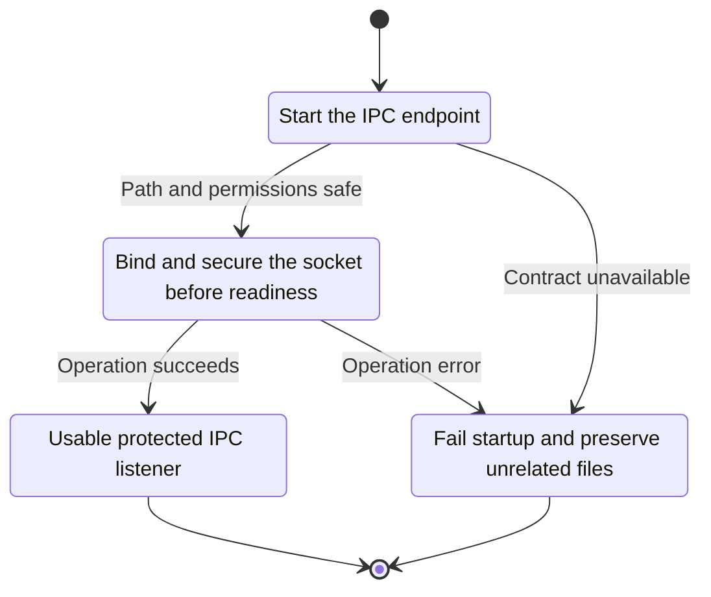
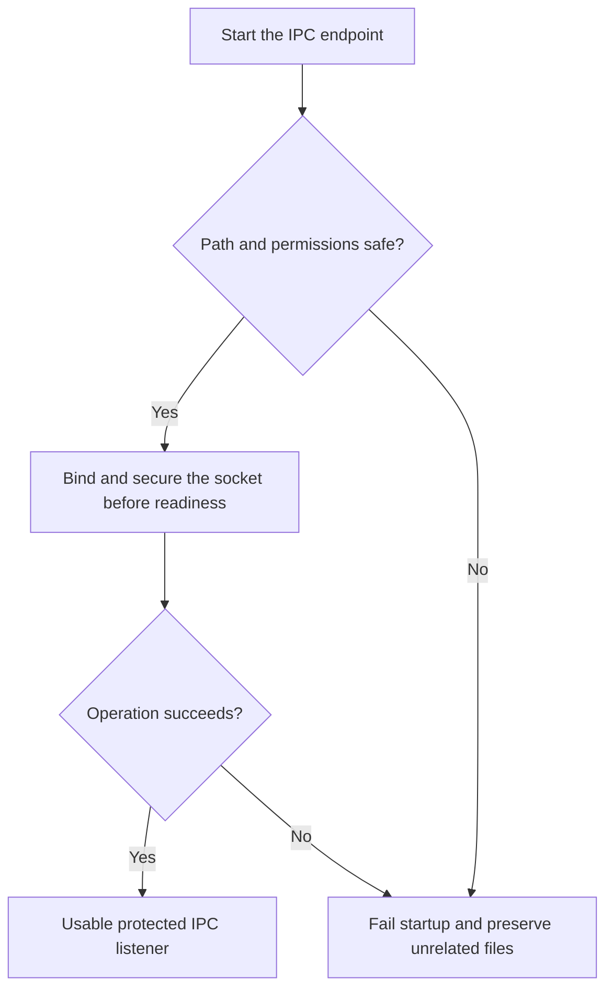

<!-- xone-gap-audit:2026-11-14:pass4:ipc-startup-contract -->
> GAP-0105 · P1 · source review at `330b742bfa1ef1401c1b9b9be0cf0bd344255cca`. Static evidence; no deployed-node reproduction or benchmark is claimed.

## What

RpcService::start spawns an async IPC bind and returns Ok immediately. Bind failures are only printed later. serve_ipc does not set explicit socket permissions, even though IPC serves all namespaces.

Current implementation:

- [`crates/xone-node/src/services/rpc.rs`](https://github.com/XDCIndia/xOneRS/blob/330b742bfa1ef1401c1b9b9be0cf0bd344255cca/crates/xone-node/src/services/rpc.rs)
- [`crates/xone-rpc/src/transport.rs`](https://github.com/XDCIndia/xOneRS/blob/330b742bfa1ef1401c1b9b9be0cf0bd344255cca/crates/xone-rpc/src/transport.rs)

## Why

Operators can otherwise start a node with no working local control socket or with permissions broader than the privileged interface requires.

Verified competitor implementation references:

- [ethereum/go-ethereum: `node/rpcstack.go`](https://github.com/ethereum/go-ethereum/blob/8059ff8beb3170eb8b977169ac51bb0423c97ee1/node/rpcstack.go)
- [ethereum/go-ethereum: `rpc/ipc_unix.go`](https://github.com/ethereum/go-ethereum/blob/8059ff8beb3170eb8b977169ac51bb0423c97ee1/rpc/ipc_unix.go)

#39 defines startup failure handling and #60 IPC exposure. This is the current asynchronous-bind path that bypasses those gates.

## 80% of the way to

1. Bind the IPC listener and set restrictive permissions before the service reports startup success.
2. Propagate directory, path-length, permission and bind errors through lifecycle rollback.
3. Remove only an appropriate stale socket owned by this datadir lifecycle; do not silently delete an unrelated regular file or active foreign endpoint.

Acceptance criteria:

- [ ] An unusable IPC path makes startup fail before readiness or signing.
- [ ] The socket has the documented restrictive mode regardless of process umask.
- [ ] Partial startup rolls back listeners and preserves unrelated files.

## ASD-STE100

1. Bind and secure the socket before readiness.
2. Keep the existing XDC consensus rules unchanged.
3. Check all required input before you start the operation.
4. Keep memory use within the configured limits.
5. Fail startup and preserve unrelated files.
6. Test each acceptance case through the actual entry point.

Technical names follow the repository vocabulary. These short instructions follow the requested sentence limits; certified ASD-STE100 vocabulary compliance has not been assessed.

## Diagrams

```mermaid
sequenceDiagram
    participant Actor as Node operator
    participant Service as RPC lifecycle
    participant Data as Filesystem and Unix socket
    Actor->>Service: Start the IPC endpoint
    Service->>Data: Check required state and limits
    Data-->>Service: State and validation result
    alt Path and permissions safe
        Service->>Data: Bind and secure the socket before readiness
        Data-->>Service: Result or operation error
        Service-->>Actor: Usable protected IPC listener
    else Contract cannot be met
        Service-->>Actor: Fail startup and preserve unrelated files
    end
```

## Images

N/A. This change affects node behavior. The source links and test fixtures provide the evidence.

## Prompt

```text
Implement GAP-0105 in XDCIndia/xOneRS: Bind and secure IPC before reporting RPC service startup success.
Observed at 330b742bfa1ef1401c1b9b9be0cf0bd344255cca: RpcService::start spawns an async IPC bind and returns Ok immediately. Bind failures are only printed later. serve_ipc does not set explicit socket permissions, even though IPC serves all namespaces.
Read these target files: crates/xone-node/src/services/rpc.rs, crates/xone-rpc/src/transport.rs.
Implementation: Bind the IPC listener and set restrictive permissions before the service reports startup success. Propagate directory, path-length, permission and bind errors through lifecycle rollback. Remove only an appropriate stale socket owned by this datadir lifecycle; do not silently delete an unrelated regular file or active foreign endpoint.
Acceptance: An unusable IPC path makes startup fail before readiness or signing. The socket has the documented restrictive mode regardless of process umask. Partial startup rolls back listeners and preserves unrelated files.
Related ownership: #39 defines startup failure handling and #60 IPC exposure. This is the current asynchronous-bind path that bypasses those gates.
Re-pin current main and the authoritative geth-XDC oracle before editing. Preserve XDC consensus, signatures, encodings, storage publication and configured resource bounds. Use the linked competitor code as design evidence, respecting its license. Write focused failing fixtures, implement the smallest coherent change, and run the applicable repository checks. Report exact commands and results. Open a reviewable PR; do not claim completion from a registered method or a mock-only test.
```

## Workflow

1. **Node operator:** Start the IPC endpoint.
2. **RPC lifecycle:** Check whether path and permissions safe.
3. **RPC lifecycle:** Bind and secure the socket before readiness through filesystem and unix socket.
4. **RPC lifecycle:** On success, provide usable protected ipc listener.
5. **RPC lifecycle:** On refusal or failure, fail startup and preserve unrelated files.

The acceptance cases above define the exact errors, ordering and resource boundaries. Verify the real entry point before closing the issue.

## Loop

None. Run the operation only when requested.

## Graph

Lifecycle of this rpc lifecycle operation; this diagram does not change the blockchain consensus state machine.



## Layout

This capability uses a node, command-line, or build interface. It does not require a new graphical screen.

| Interface detail | Placement |
| --- | --- |
| Actor and trigger | Node operator: start the ipc endpoint |
| Input validation | RPC lifecycle: path and permissions safe |
| Output | Usable protected IPC listener |
| Error or refusal | Fail startup and preserve unrelated files |
| Implementation files | `crates/xone-node/src/services/rpc.rs`, `crates/xone-rpc/src/transport.rs` |

Keep field names and response shapes compatible with the specification and acceptance cases above.

## Flow



## Summary

Gap: Bind and secure IPC before reporting RPC service startup success.
Fix: Bind the IPC listener and set restrictive permissions before the service reports startup success.
Acceptance: An unusable IPC path makes startup fail before readiness or signing.
