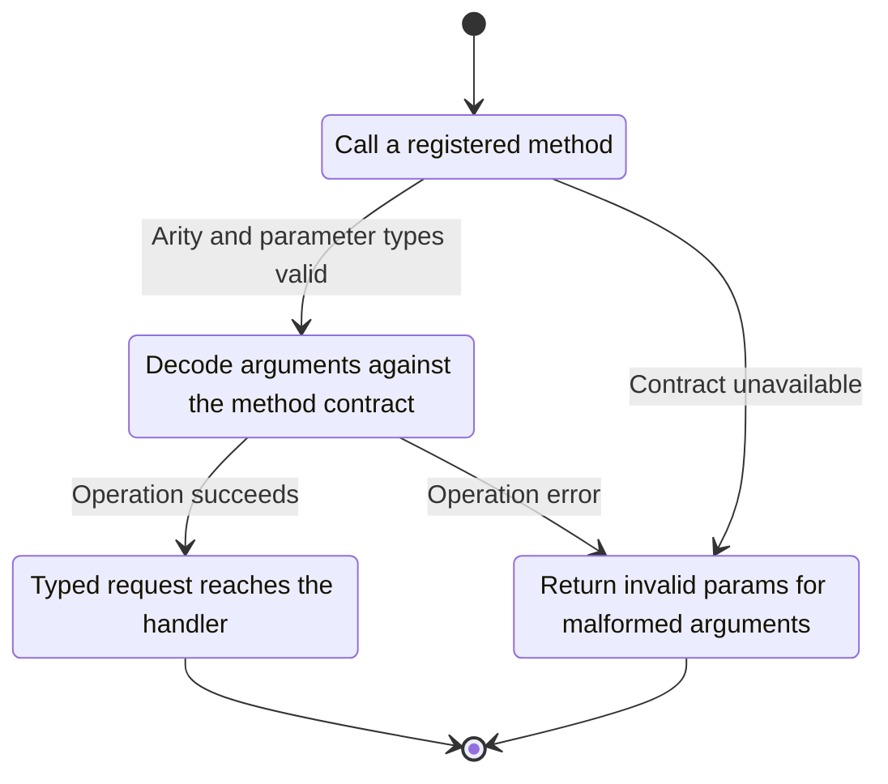
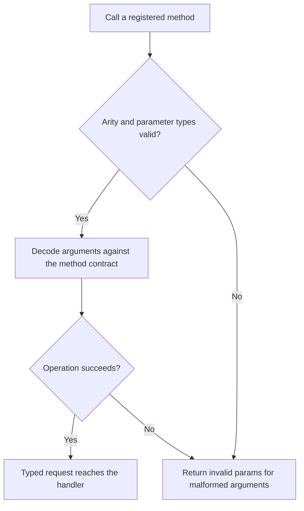

<!-- xone-gap-audit:2026-11-14:pass4:rpc-argument-arity -->
> GAP-0106 · P2 · source review at `330b742bfa1ef1401c1b9b9be0cf0bd344255cca`. Static evidence; no deployed-node reproduction or benchmark is claimed.

## What

Registry entries contain no argument schema. Handlers ignore extra positional parameters and number_or_latest defaults required selectors. The transaction-index parser calls parse_tag, so block tags such as latest can be interpreted as transaction index zero.

Current implementation:

- [`crates/xone-rpc/src/server.rs`](https://github.com/XDCIndia/xOneRS/blob/330b742bfa1ef1401c1b9b9be0cf0bd344255cca/crates/xone-rpc/src/server.rs)
- [`crates/xone-rpc/src/types.rs`](https://github.com/XDCIndia/xOneRS/blob/330b742bfa1ef1401c1b9b9be0cf0bd344255cca/crates/xone-rpc/src/types.rs)
- [`crates/xone-rpc/src/eth.rs`](https://github.com/XDCIndia/xOneRS/blob/330b742bfa1ef1401c1b9b9be0cf0bd344255cca/crates/xone-rpc/src/eth.rs)

## Why

A malformed call should not silently query the latest block or the first transaction instead of the value the client intended.

Verified competitor implementation references:

- [ethereum/go-ethereum: `rpc/json.go`](https://github.com/ethereum/go-ethereum/blob/8059ff8beb3170eb8b977169ac51bb0423c97ee1/rpc/json.go)
- [ethereum/go-ethereum: `internal/ethapi/api.go`](https://github.com/ethereum/go-ethereum/blob/8059ff8beb3170eb8b977169ac51bb0423c97ee1/internal/ethapi/api.go)

#266 fixes the JSON-RPC envelope and #265 call-object fields. This unit validates positional method signatures and scalar domains.

## 80% of the way to

1. Record required/optional argument counts and validate them before dispatch.
2. Use distinct parsers for block selectors, quantities, indexes and counts.
3. Pin each existing method signature to the XDC oracle; retain defaults only where the reference parameter is optional.

Acceptance criteria:

- [ ] Extra parameters and missing required selectors fail with the expected error.
- [ ] Transaction indexes reject latest, pending and other block tags.
- [ ] Valid optional arguments and legacy supported numeric forms retain compatibility.

## ASD-STE100

1. Decode arguments against the method contract.
2. Keep the existing XDC consensus rules unchanged.
3. Check all required input before you start the operation.
4. Keep memory use within the configured limits.
5. Return invalid params for malformed arguments.
6. Test each acceptance case through the actual entry point.

Technical names follow the repository vocabulary. These short instructions follow the requested sentence limits; certified ASD-STE100 vocabulary compliance has not been assessed.

## Diagrams

```mermaid
sequenceDiagram
    participant Actor as RPC caller
    participant Service as Method registry
    participant Data as Parameter schema
    Actor->>Service: Call a registered method
    Service->>Data: Check required state and limits
    Data-->>Service: State and validation result
    alt Arity and parameter types valid
        Service->>Data: Decode arguments against the method contract
        Data-->>Service: Result or operation error
        Service-->>Actor: Typed request reaches the handler
    else Contract cannot be met
        Service-->>Actor: Return invalid params for malformed arguments
    end
```

## Images

N/A. This change affects node behavior. The source links and test fixtures provide the evidence.

## Prompt

```text
Implement GAP-0106 in XDCIndia/xOneRS: Enforce RPC method arity and distinguish quantities from block tags.
Observed at 330b742bfa1ef1401c1b9b9be0cf0bd344255cca: Registry entries contain no argument schema. Handlers ignore extra positional parameters and number_or_latest defaults required selectors. The transaction-index parser calls parse_tag, so block tags such as latest can be interpreted as transaction index zero.
Read these target files: crates/xone-rpc/src/server.rs, crates/xone-rpc/src/types.rs, crates/xone-rpc/src/eth.rs.
Implementation: Record required/optional argument counts and validate them before dispatch. Use distinct parsers for block selectors, quantities, indexes and counts. Pin each existing method signature to the XDC oracle; retain defaults only where the reference parameter is optional.
Acceptance: Extra parameters and missing required selectors fail with the expected error. Transaction indexes reject latest, pending and other block tags. Valid optional arguments and legacy supported numeric forms retain compatibility.
Related ownership: #266 fixes the JSON-RPC envelope and #265 call-object fields. This unit validates positional method signatures and scalar domains.
Re-pin current main and the authoritative geth-XDC oracle before editing. Preserve XDC consensus, signatures, encodings, storage publication and configured resource bounds. Use the linked competitor code as design evidence, respecting its license. Write focused failing fixtures, implement the smallest coherent change, and run the applicable repository checks. Report exact commands and results. Open a reviewable PR; do not claim completion from a registered method or a mock-only test.
```

## Workflow

1. **RPC caller:** Call a registered method.
2. **Method registry:** Check whether arity and parameter types valid.
3. **Method registry:** Decode arguments against the method contract through parameter schema.
4. **Method registry:** On success, provide typed request reaches the handler.
5. **Method registry:** On refusal or failure, return invalid params for malformed arguments.

The acceptance cases above define the exact errors, ordering and resource boundaries. Verify the real entry point before closing the issue.

## Loop

None. Run the operation only when requested.

## Graph

Lifecycle of this method registry operation; this diagram does not change the blockchain consensus state machine.



## Layout

This capability uses a node, command-line, or build interface. It does not require a new graphical screen.

| Interface detail | Placement |
| --- | --- |
| Actor and trigger | RPC caller: call a registered method |
| Input validation | Method registry: arity and parameter types valid |
| Output | Typed request reaches the handler |
| Error or refusal | Return invalid params for malformed arguments |
| Implementation files | `crates/xone-rpc/src/server.rs`, `crates/xone-rpc/src/types.rs`, `crates/xone-rpc/src/eth.rs` |

Keep field names and response shapes compatible with the specification and acceptance cases above.

## Flow



## Summary

Gap: Enforce RPC method arity and distinguish quantities from block tags.
Fix: Record required/optional argument counts and validate them before dispatch.
Acceptance: Extra parameters and missing required selectors fail with the expected error.
