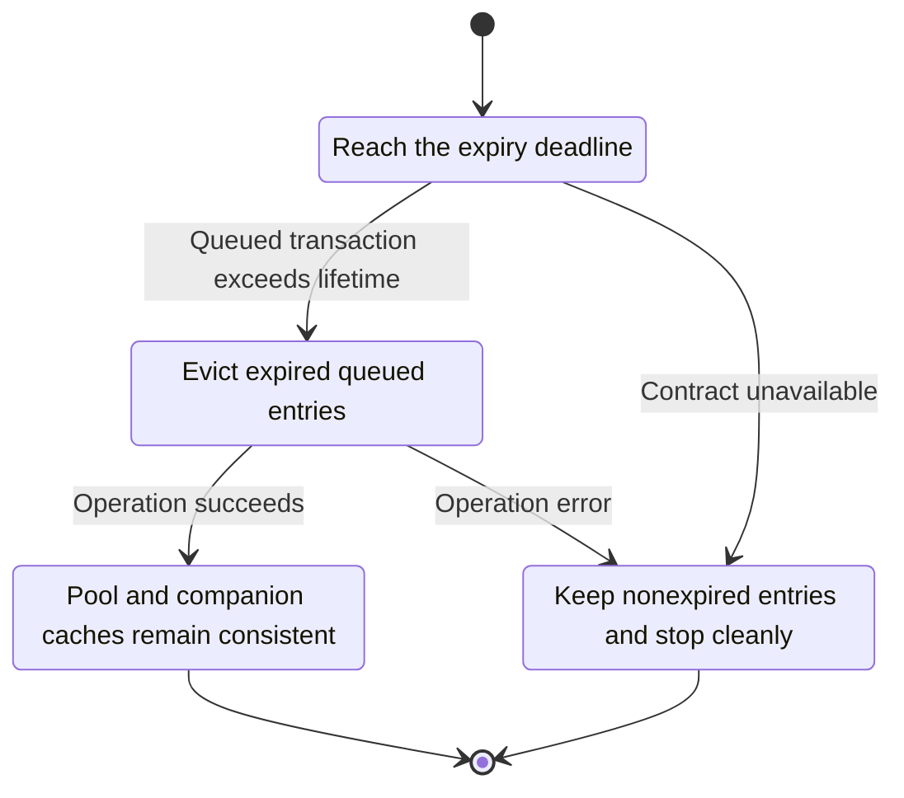
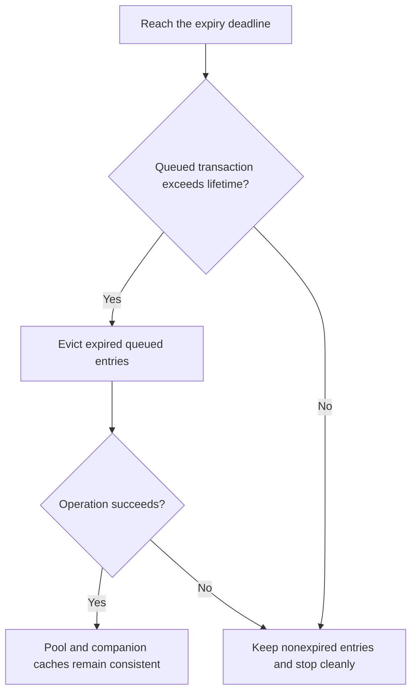

<!-- xone-gap-audit:2026-11-14:pass4:txpool-expiry-tick -->
> GAP-0107 · P2 · source review at `330b742bfa1ef1401c1b9b9be0cf0bd344255cca`. Static evidence; no deployed-node reproduction or benchmark is claimed.

## What

The pool library implements evict_expired, but PoolService only waits for head changes and calls reset. No production caller invokes the expiry routine, so queue lifetime does not trigger removal while the service runs.

Current implementation:

- [`crates/xone-node/src/services/pool.rs`](https://github.com/XDCIndia/xOneRS/blob/330b742bfa1ef1401c1b9b9be0cf0bd344255cca/crates/xone-node/src/services/pool.rs)
- [`crates/xone-builder/src/txpool/evict.rs`](https://github.com/XDCIndia/xOneRS/blob/330b742bfa1ef1401c1b9b9be0cf0bd344255cca/crates/xone-builder/src/txpool/evict.rs)
- [`crates/xone-builder/src/txpool/queued.rs`](https://github.com/XDCIndia/xOneRS/blob/330b742bfa1ef1401c1b9b9be0cf0bd344255cca/crates/xone-builder/src/txpool/queued.rs)

## Why

Configured queue lifetime is ineffective unless the runtime actually schedules eviction.

Verified competitor implementation references:

- [ethereum/go-ethereum: `core/txpool/legacypool/legacypool.go`](https://github.com/ethereum/go-ethereum/blob/8059ff8beb3170eb8b977169ac51bb0423c97ee1/core/txpool/legacypool/legacypool.go)

#165 exposes pool controls and journaling. This issue wires the already implemented lifetime behavior into the live service.

## 80% of the way to

1. Add a bounded monotonic expiry tick to the pool service and run it against a pinned current state.
2. Preserve the rule that only stale queued accounts expire; executable pending transactions follow normal pool rules.
3. Remove corresponding raw bytes and pending-event bookkeeping, and cancel the ticker on shutdown.

Acceptance criteria:

- [ ] A queued transaction expires after its configured lifetime even when the head does not advance.
- [ ] Pending and recently refreshed queued accounts are retained.
- [ ] A fake-clock test covers long pauses and shutdown without waiting in real time.

## ASD-STE100

1. Evict expired queued entries.
2. Keep the existing XDC consensus rules unchanged.
3. Check all required input before you start the operation.
4. Keep memory use within the configured limits.
5. Keep nonexpired entries and stop cleanly.
6. Test each acceptance case through the actual entry point.

Technical names follow the repository vocabulary. These short instructions follow the requested sentence limits; certified ASD-STE100 vocabulary compliance has not been assessed.

## Diagrams

```mermaid
sequenceDiagram
    participant Actor as Pool timer
    participant Service as Pool service
    participant Data as Queued transactions
    Actor->>Service: Reach the expiry deadline
    Service->>Data: Check required state and limits
    Data-->>Service: State and validation result
    alt Queued transaction exceeds lifetime
        Service->>Data: Evict expired queued entries
        Data-->>Service: Result or operation error
        Service-->>Actor: Pool and companion caches remain consistent
    else Contract cannot be met
        Service-->>Actor: Keep nonexpired entries and stop cleanly
    end
```

## Images

N/A. This change affects node behavior. The source links and test fixtures provide the evidence.

## Prompt

```text
Implement GAP-0107 in XDCIndia/xOneRS: Run queued transaction expiry from the live pool service.
Observed at 330b742bfa1ef1401c1b9b9be0cf0bd344255cca: The pool library implements evict_expired, but PoolService only waits for head changes and calls reset. No production caller invokes the expiry routine, so queue lifetime does not trigger removal while the service runs.
Read these target files: crates/xone-node/src/services/pool.rs, crates/xone-builder/src/txpool/evict.rs, crates/xone-builder/src/txpool/queued.rs.
Implementation: Add a bounded monotonic expiry tick to the pool service and run it against a pinned current state. Preserve the rule that only stale queued accounts expire; executable pending transactions follow normal pool rules. Remove corresponding raw bytes and pending-event bookkeeping, and cancel the ticker on shutdown.
Acceptance: A queued transaction expires after its configured lifetime even when the head does not advance. Pending and recently refreshed queued accounts are retained. A fake-clock test covers long pauses and shutdown without waiting in real time.
Related ownership: #165 exposes pool controls and journaling. This issue wires the already implemented lifetime behavior into the live service.
Re-pin current main and the authoritative geth-XDC oracle before editing. Preserve XDC consensus, signatures, encodings, storage publication and configured resource bounds. Use the linked competitor code as design evidence, respecting its license. Write focused failing fixtures, implement the smallest coherent change, and run the applicable repository checks. Report exact commands and results. Open a reviewable PR; do not claim completion from a registered method or a mock-only test.
```

## Workflow

1. **Pool timer:** Reach the expiry deadline.
2. **Pool service:** Check whether queued transaction exceeds lifetime.
3. **Pool service:** Evict expired queued entries through queued transactions.
4. **Pool service:** On success, provide pool and companion caches remain consistent.
5. **Pool service:** On refusal or failure, keep nonexpired entries and stop cleanly.

The acceptance cases above define the exact errors, ordering and resource boundaries. Verify the real entry point before closing the issue.

## Loop

Check expiry at a bounded interval. Skip catch-up bursts and stop the timer during shutdown.

## Graph

Lifecycle of this pool service operation; this diagram does not change the blockchain consensus state machine.



## Layout

This capability uses a node, command-line, or build interface. It does not require a new graphical screen.

| Interface detail | Placement |
| --- | --- |
| Actor and trigger | Pool timer: reach the expiry deadline |
| Input validation | Pool service: queued transaction exceeds lifetime |
| Output | Pool and companion caches remain consistent |
| Error or refusal | Keep nonexpired entries and stop cleanly |
| Implementation files | `crates/xone-node/src/services/pool.rs`, `crates/xone-builder/src/txpool/evict.rs`, `crates/xone-builder/src/txpool/queued.rs` |

Keep field names and response shapes compatible with the specification and acceptance cases above.

## Flow



## Summary

Gap: Run queued transaction expiry from the live pool service.
Fix: Add a bounded monotonic expiry tick to the pool service and run it against a pinned current state.
Acceptance: A queued transaction expires after its configured lifetime even when the head does not advance.
