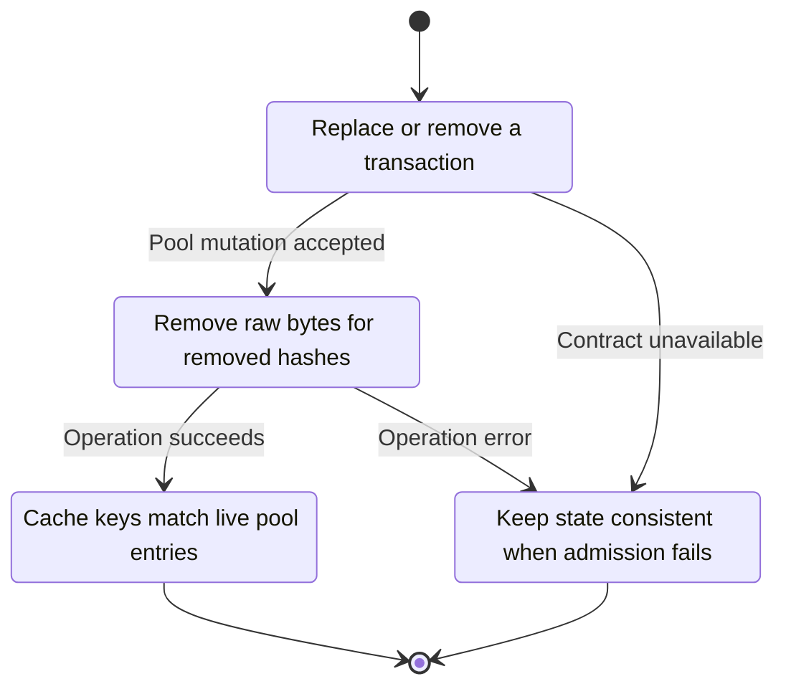
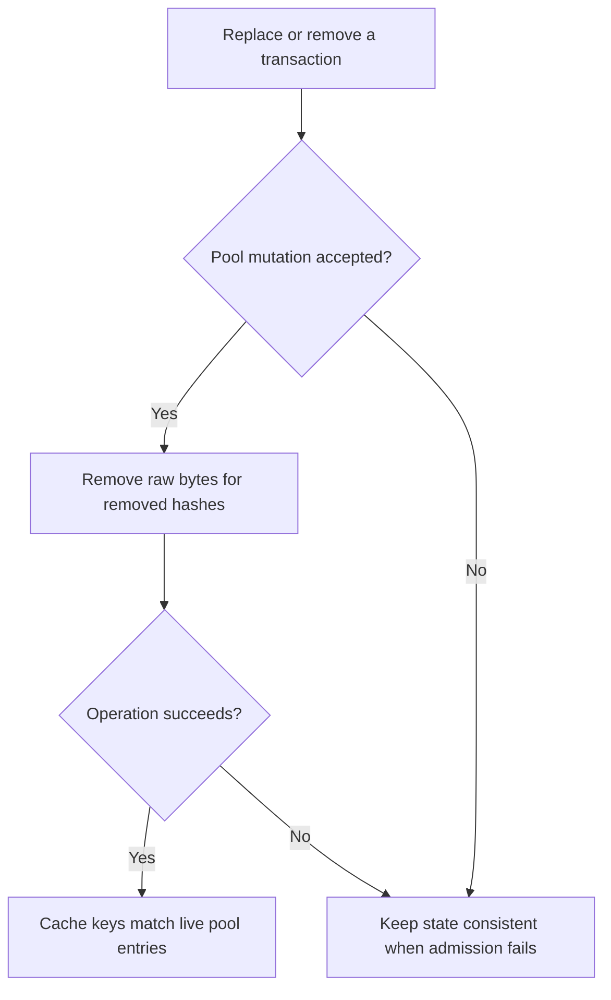

<!-- xone-gap-audit:2026-11-14:pass4:txpool-raw-cache -->
> GAP-0108 · P1 · source review at `330b742bfa1ef1401c1b9b9be0cf0bd344255cca`. Static evidence; no deployed-node reproduction or benchmark is claimed.

## What

add_raws inserts every accepted transaction into Inner.raws, but removes stale raw entries only during reset on a head change. Replacement and price-based eviction can remove transactions from the bounded Pool while their raw encodings remain in the side map.

Current implementation:

- [`crates/xone-node/src/services/pool.rs`](https://github.com/XDCIndia/xOneRS/blob/330b742bfa1ef1401c1b9b9be0cf0bd344255cca/crates/xone-node/src/services/pool.rs)
- [`crates/xone-builder/src/txpool/mod.rs`](https://github.com/XDCIndia/xOneRS/blob/330b742bfa1ef1401c1b9b9be0cf0bd344255cca/crates/xone-builder/src/txpool/mod.rs)
- [`crates/xone-builder/src/txpool/evict.rs`](https://github.com/XDCIndia/xOneRS/blob/330b742bfa1ef1401c1b9b9be0cf0bd344255cca/crates/xone-builder/src/txpool/evict.rs)

## Why

Pool count and slot limits do not bound memory if removed transactions remain in a separate raw-byte map.

Verified competitor implementation references:

- [ethereum/go-ethereum: `core/txpool/legacypool/legacypool.go`](https://github.com/ethereum/go-ethereum/blob/8059ff8beb3170eb8b977169ac51bb0423c97ee1/core/txpool/legacypool/legacypool.go)
- [ethereum/go-ethereum: `core/txpool/legacypool/list.go`](https://github.com/ethereum/go-ethereum/blob/8059ff8beb3170eb8b977169ac51bb0423c97ee1/core/txpool/legacypool/list.go)

#165 configures pool bounds. This repairs a side cache that currently outlives the bounded entries.

## 80% of the way to

1. Make pool mutation return removal events or use one authoritative representation so raw bytes leave with their transaction.
2. Apply cleanup on replacement, rejection after admission, eviction, expiry and reset without requiring a new head.
3. Avoid an unbounded duplicate map and avoid a full pool scan on every single admission if a bounded delta is available.

Acceptance criteria:

- [ ] Repeated accepted replacements with a fixed head do not grow retained raw-byte count beyond live pool contents.
- [ ] Price eviction and expiry release the removed bytes.
- [ ] RPC content and block building still access every live transaction encoding.

## ASD-STE100

1. Remove raw bytes for removed hashes.
2. Keep the existing XDC consensus rules unchanged.
3. Check all required input before you start the operation.
4. Keep memory use within the configured limits.
5. Keep state consistent when admission fails.
6. Test each acceptance case through the actual entry point.

Technical names follow the repository vocabulary. These short instructions follow the requested sentence limits; certified ASD-STE100 vocabulary compliance has not been assessed.

## Diagrams

```mermaid
sequenceDiagram
    participant Actor as Transaction sender
    participant Service as Pool mutation path
    participant Data as Raw transaction cache
    Actor->>Service: Replace or remove a transaction
    Service->>Data: Check required state and limits
    Data-->>Service: State and validation result
    alt Pool mutation accepted
        Service->>Data: Remove raw bytes for removed hashes
        Data-->>Service: Result or operation error
        Service-->>Actor: Cache keys match live pool entries
    else Contract cannot be met
        Service-->>Actor: Keep state consistent when admission fails
    end
```

## Images

N/A. This change affects node behavior. The source links and test fixtures provide the evidence.

## Prompt

```text
Implement GAP-0108 in XDCIndia/xOneRS: Keep raw transaction storage bounded during replacement and eviction.
Observed at 330b742bfa1ef1401c1b9b9be0cf0bd344255cca: add_raws inserts every accepted transaction into Inner.raws, but removes stale raw entries only during reset on a head change. Replacement and price-based eviction can remove transactions from the bounded Pool while their raw encodings remain in the side map.
Read these target files: crates/xone-node/src/services/pool.rs, crates/xone-builder/src/txpool/mod.rs, crates/xone-builder/src/txpool/evict.rs.
Implementation: Make pool mutation return removal events or use one authoritative representation so raw bytes leave with their transaction. Apply cleanup on replacement, rejection after admission, eviction, expiry and reset without requiring a new head. Avoid an unbounded duplicate map and avoid a full pool scan on every single admission if a bounded delta is available.
Acceptance: Repeated accepted replacements with a fixed head do not grow retained raw-byte count beyond live pool contents. Price eviction and expiry release the removed bytes. RPC content and block building still access every live transaction encoding.
Related ownership: #165 configures pool bounds. This repairs a side cache that currently outlives the bounded entries.
Re-pin current main and the authoritative geth-XDC oracle before editing. Preserve XDC consensus, signatures, encodings, storage publication and configured resource bounds. Use the linked competitor code as design evidence, respecting its license. Write focused failing fixtures, implement the smallest coherent change, and run the applicable repository checks. Report exact commands and results. Open a reviewable PR; do not claim completion from a registered method or a mock-only test.
```

## Workflow

1. **Transaction sender:** Replace or remove a transaction.
2. **Pool mutation path:** Check whether pool mutation accepted.
3. **Pool mutation path:** Remove raw bytes for removed hashes through raw transaction cache.
4. **Pool mutation path:** On success, provide cache keys match live pool entries.
5. **Pool mutation path:** On refusal or failure, keep state consistent when admission fails.

The acceptance cases above define the exact errors, ordering and resource boundaries. Verify the real entry point before closing the issue.

## Loop

None. Run the operation only when requested.

## Graph

Lifecycle of this pool mutation path operation; this diagram does not change the blockchain consensus state machine.



## Layout

This capability uses a node, command-line, or build interface. It does not require a new graphical screen.

| Interface detail | Placement |
| --- | --- |
| Actor and trigger | Transaction sender: replace or remove a transaction |
| Input validation | Pool mutation path: pool mutation accepted |
| Output | Cache keys match live pool entries |
| Error or refusal | Keep state consistent when admission fails |
| Implementation files | `crates/xone-node/src/services/pool.rs`, `crates/xone-builder/src/txpool/mod.rs`, `crates/xone-builder/src/txpool/evict.rs` |

Keep field names and response shapes compatible with the specification and acceptance cases above.

## Flow



## Summary

Gap: Keep raw transaction storage bounded during replacement and eviction.
Fix: Make pool mutation return removal events or use one authoritative representation so raw bytes leave with their transaction.
Acceptance: Repeated accepted replacements with a fixed head do not grow retained raw-byte count beyond live pool contents.
