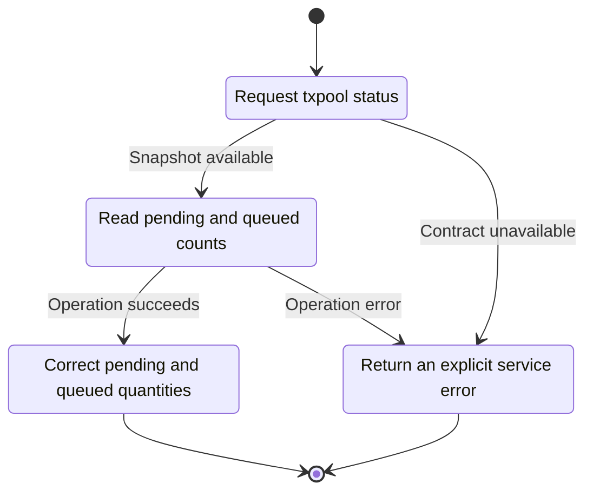
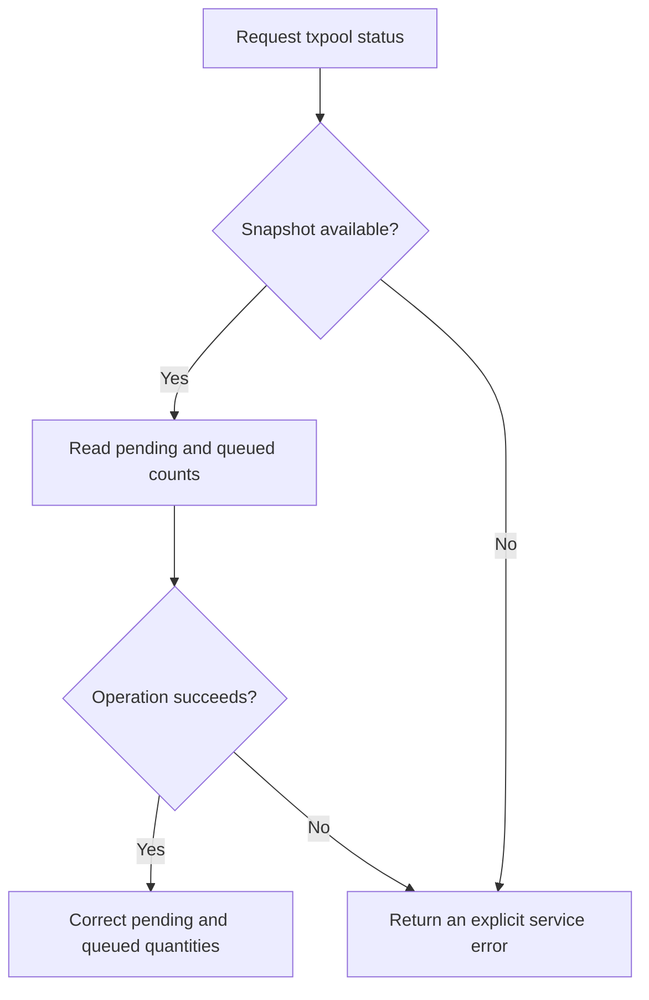

<!-- xone-gap-audit:2026-11-14:pass4:txpool-status-counts -->
> GAP-0109 · P2 · source review at `330b742bfa1ef1401c1b9b9be0cf0bd344255cca`. Static evidence; no deployed-node reproduction or benchmark is claimed.

## What

PoolApi::status returns Pool::len(), whose tuple is total transaction count and occupied slots. The RPC handler interprets that tuple as pending and queued. Pool::stats() already provides the correct counts.

Current implementation:

- [`crates/xone-node/src/services/pool.rs`](https://github.com/XDCIndia/xOneRS/blob/330b742bfa1ef1401c1b9b9be0cf0bd344255cca/crates/xone-node/src/services/pool.rs)
- [`crates/xone-builder/src/txpool/mod.rs`](https://github.com/XDCIndia/xOneRS/blob/330b742bfa1ef1401c1b9b9be0cf0bd344255cca/crates/xone-builder/src/txpool/mod.rs)
- [`crates/xone-rpc/src/txpool.rs`](https://github.com/XDCIndia/xOneRS/blob/330b742bfa1ef1401c1b9b9be0cf0bd344255cca/crates/xone-rpc/src/txpool.rs)

## Why

Operators and monitoring tools currently receive mislabeled capacity values instead of pool state counts.

Verified competitor implementation references:

- [ethereum/go-ethereum: `internal/ethapi/api.go`](https://github.com/ethereum/go-ethereum/blob/8059ff8beb3170eb8b977169ac51bb0423c97ee1/internal/ethapi/api.go)
- [ethereum/go-ethereum: `core/txpool/legacypool/legacypool.go`](https://github.com/ethereum/go-ethereum/blob/8059ff8beb3170eb8b977169ac51bb0423c97ee1/core/txpool/legacypool/legacypool.go)

#42 owns txpool RPC parity. This is a concrete tuple-contract mismatch in the current adapter.

## 80% of the way to

1. Use the pending/queued statistics API in the production PoolApi adapter.
2. Keep slot accounting for capacity diagnostics under an explicitly named field or metric.
3. Verify status through the real RPC adapter as transactions are queued, promoted, replaced and mined.

Acceptance criteria:

- [ ] One pending and two queued transactions report pending=1 and queued=2 regardless of slot sizes.
- [ ] Promotion changes both counts correctly.
- [ ] A large transaction using multiple slots does not inflate the queued count.

## ASD-STE100

1. Read pending and queued counts.
2. Keep the existing XDC consensus rules unchanged.
3. Check all required input before you start the operation.
4. Keep memory use within the configured limits.
5. Return an explicit service error.
6. Test each acceptance case through the actual entry point.

Technical names follow the repository vocabulary. These short instructions follow the requested sentence limits; certified ASD-STE100 vocabulary compliance has not been assessed.

## Diagrams

```mermaid
sequenceDiagram
    participant Actor as RPC caller
    participant Service as Pool RPC adapter
    participant Data as Pool statistics
    Actor->>Service: Request txpool status
    Service->>Data: Check required state and limits
    Data-->>Service: State and validation result
    alt Snapshot available
        Service->>Data: Read pending and queued counts
        Data-->>Service: Result or operation error
        Service-->>Actor: Correct pending and queued quantities
    else Contract cannot be met
        Service-->>Actor: Return an explicit service error
    end
```

## Images

N/A. This change affects node behavior. The source links and test fixtures provide the evidence.

## Prompt

```text
Implement GAP-0109 in XDCIndia/xOneRS: Report pending and queued counts correctly in txpool_status.
Observed at 330b742bfa1ef1401c1b9b9be0cf0bd344255cca: PoolApi::status returns Pool::len(), whose tuple is total transaction count and occupied slots. The RPC handler interprets that tuple as pending and queued. Pool::stats() already provides the correct counts.
Read these target files: crates/xone-node/src/services/pool.rs, crates/xone-builder/src/txpool/mod.rs, crates/xone-rpc/src/txpool.rs.
Implementation: Use the pending/queued statistics API in the production PoolApi adapter. Keep slot accounting for capacity diagnostics under an explicitly named field or metric. Verify status through the real RPC adapter as transactions are queued, promoted, replaced and mined.
Acceptance: One pending and two queued transactions report pending=1 and queued=2 regardless of slot sizes. Promotion changes both counts correctly. A large transaction using multiple slots does not inflate the queued count.
Related ownership: #42 owns txpool RPC parity. This is a concrete tuple-contract mismatch in the current adapter.
Re-pin current main and the authoritative geth-XDC oracle before editing. Preserve XDC consensus, signatures, encodings, storage publication and configured resource bounds. Use the linked competitor code as design evidence, respecting its license. Write focused failing fixtures, implement the smallest coherent change, and run the applicable repository checks. Report exact commands and results. Open a reviewable PR; do not claim completion from a registered method or a mock-only test.
```

## Workflow

1. **RPC caller:** Request txpool status.
2. **Pool RPC adapter:** Check whether snapshot available.
3. **Pool RPC adapter:** Read pending and queued counts through pool statistics.
4. **Pool RPC adapter:** On success, provide correct pending and queued quantities.
5. **Pool RPC adapter:** On refusal or failure, return an explicit service error.

The acceptance cases above define the exact errors, ordering and resource boundaries. Verify the real entry point before closing the issue.

## Loop

None. Run the operation only when requested.

## Graph

Lifecycle of this pool rpc adapter operation; this diagram does not change the blockchain consensus state machine.



## Layout

This capability uses a node, command-line, or build interface. It does not require a new graphical screen.

| Interface detail | Placement |
| --- | --- |
| Actor and trigger | RPC caller: request txpool status |
| Input validation | Pool RPC adapter: snapshot available |
| Output | Correct pending and queued quantities |
| Error or refusal | Return an explicit service error |
| Implementation files | `crates/xone-node/src/services/pool.rs`, `crates/xone-builder/src/txpool/mod.rs`, `crates/xone-rpc/src/txpool.rs` |

Keep field names and response shapes compatible with the specification and acceptance cases above.

## Flow



## Summary

Gap: Report pending and queued counts correctly in txpool_status.
Fix: Use the pending/queued statistics API in the production PoolApi adapter.
Acceptance: One pending and two queued transactions report pending=1 and queued=2 regardless of slot sizes.
